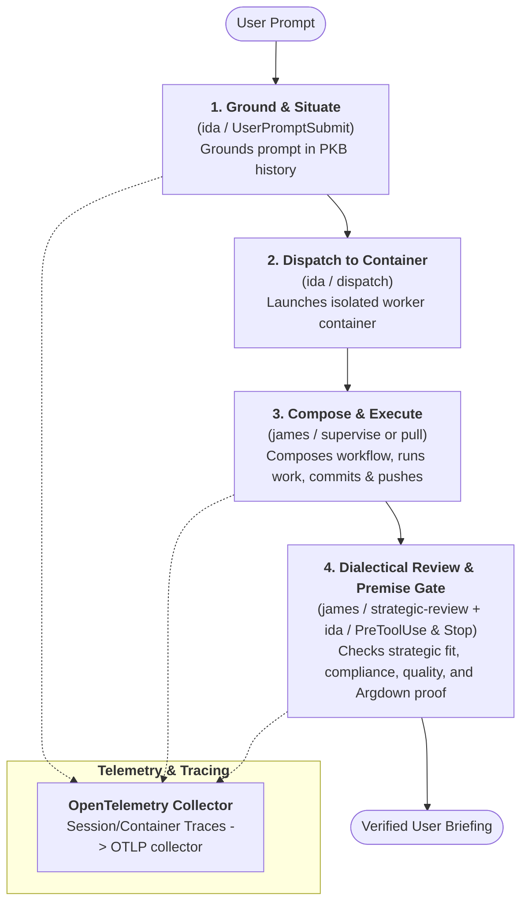

# academicOps

You can delegate execution to AI without delegating judgment.

## What academicOps is

> In some ways it's middleware, but what it really is, is a principled, integrated approach to unpacking a highly opinionated view of what academic integrity requires, and operationalising that in a distributed workflow.

Academics are going to use AI to improve their productivity. The longer-term bet behind academicOps is that judgement remains the stumbling block: academic integrity requires accountability and trust in your processes, and that trust is not there yet, least of all where several tools from different vendors are used together in novel configurations with little way to verify or validate across them. academicOps is the layer above those tools. It can incorporate commercial offerings, and it facilitates, and sometimes replicates, the expert strategic judgement that anyone using them needs. It is not a production line for more outputs: it builds the modular blocks that let a changing research strategy run across many projects.

academicOps is a modular suite of five plugins for Claude Code, Antigravity (`agy`), and OpenClaw built around **prompt situation**, **containerized execution**, **dialectical review**, and **session telemetry**:

1. **Strategic Face & Premise-Check Gate (`ida`):** Grounds top-level user prompts in PKB history (`UserPromptSubmit`), arms and enforces the `hearsay_gate` on incoming peer/worker reports (`premise-check`), and dispatches work to isolated containers (`dispatch`).
2. **Execution, Custody & Dialectical Review (`james`):** Provides the hookless operational agent suite (`james`, `pauli`, `rbg`, `marsha`, `sara`), universal `axioms`, and custodian, planning, supervision (`/james:supervise`), leaf execution (`/james:pull`), and three-lens review skills.
3. **Domain Research Tools (`tools`):** Provides research analysis, SQL transformation, visualization, document typesetting, diagramming, and peer-review skills.
4. **Telegram Channel (`ida-telegram`) & Debug (`aops-debug`):** Optional channel integration (Claude Code / OpenClaw) and raw hook payload diagnostics.

## How It Works

## Master Hook Lifecycle Matrix

Only `ida` (plus `aops-debug` and `ida-telegram`) registers runtime hooks; `james` and `tools` are hookless:

| Plugin | Canonical Event | Target Client | Required Context / Env | Injected Payload / Action | WHY (Purpose & Rationale) |
| :- | :- | :- | :- | :- | :- |
| `ida` | `SessionStart` | Claude Code, OpenClaw, AGY | `PKB_MCP_URL`, `AOPS_SESSION_ID` | Injects `CORE.md`, session metadata, and `premise-check` pointer. | Establishes universal baseline instructions and session attribution at startup. |
| `ida` | `UserPromptSubmit` (`PreInvocation` on AGY) | Claude Code, OpenClaw, AGY | `PKB_MCP_URL`, `CF_ACCESS_CLIENT_ID` + `CF_ACCESS_CLIENT_SECRET` | Grounds top-level `ida` user prompts in PKB search; arms `hearsay_gate` on incoming reports. | Grounds interactive turns in PKB history and arms verification on incoming reports. |
| `ida` | `SubagentStart` | Claude Code | none | Injects `honesty.md` report-formatting reminder with recipient context. | Ensures spawned subagents return verifiable `premise-check` Argdown reports. |
| `ida` | `PostToolUse` / `PostToolBatch` | Claude Code, OpenClaw, AGY | none | Arms `hearsay_gate` on foreground subagent returns (`hearsay.md`) and emits OTel spans. | Binds the receiver the instant a subagent report lands. |
| `ida` | `PreToolUse` | Claude Code, OpenClaw, AGY | none | Refuses dispatches/messages while `hearsay_gate` is armed; emits OTel spans. | Prevents acting on or relaying unchecked reports. |
| `ida` | `Stop` / `SubagentStop` | Claude Code, OpenClaw, AGY | none | Enforces `hearsay_gate` on `Stop`; emits OTel spans on `SubagentStop`. | Prevents session handover with unverified claims. |

## Telemetry & OTEL Tracing Architecture

academicOps uses Claude Code's native OpenTelemetry export, sent to an OTLP collector the installer supplies:

- **Collector:** Session and Polecat container traces send OTLP spans to the collector endpoint named by `OTEL_EXPORTER_OTLP_ENDPOINT`. Where the collector relays them is the installer's choice.
- **Contract Variables:**
  - `CLAUDE_CODE_ENABLE_TELEMETRY=true`
  - `OTEL_EXPORTER_OTLP_ENDPOINT=http://<collector-host>:4318`
  - `OTEL_EXPORTER_OTLP_PROTOCOL=http/protobuf`
  - `OTEL_RESOURCE_ATTRIBUTES=service.name=academicOps,service.version=<your installed version>`

## The Plugins

Install what you need -- plugins are separately installable and loosely coupled:

| Plugin | Owns |
| - | - |
| `ida` | The strategic face and the only agent that speaks to the user, with prompt situation and premise check. |
| `james` | Lead executor, review supervisor, and custodian agent suite (james, pauli, marsha, rbg, sara) with planning, execution, axioms, and dialectical review skills. |
| `tools` | Domain research skills (analyst, peer-review, pdf, extract, diagram, etc.). |
| `ida-telegram` | Ida's custom Telegram channel and Mini App plugin for Claude Code. |
| `aops-debug` | Debug plugin that dumps raw hook payloads. |

## Install

See [`INSTALL.md`](INSTALL.md) for installation and configuration instructions.

## Where work runs

When dispatching a unit of work, academicOps picks one of three surfaces by the size and cost of the work:

| Surface | When it is picked | What it does |
| :- | :- | :- |
| **In-session subagent** | Small units | Runs in this session, cheapest model per effort type; commits and pushes. |
| **Isolated async agent** | Substantial, or has subtasks | Own branch or worktree; pushes before reclaim. No return path by design. |
| **Polecat container** | Substantial, implementation, or cost-sensitive | Docker container running `agy`, seeded with the task id, running `/supervise` on a calibrated coordinator model (or `/pull` for fast-path leaf tasks), headless. |

Asynchronous work writes its result to the task record and pushes its branch; nothing waits on it.

## Developing academicOps itself

Setup, checks, and the pull-request process are in [`CONTRIBUTING.md`](CONTRIBUTING.md).
[`specs/ARCHITECTURE.md`](specs/ARCHITECTURE.md) is authoritative for the repository layout, plugin boundaries, build stages, and the constraints on all of them.
