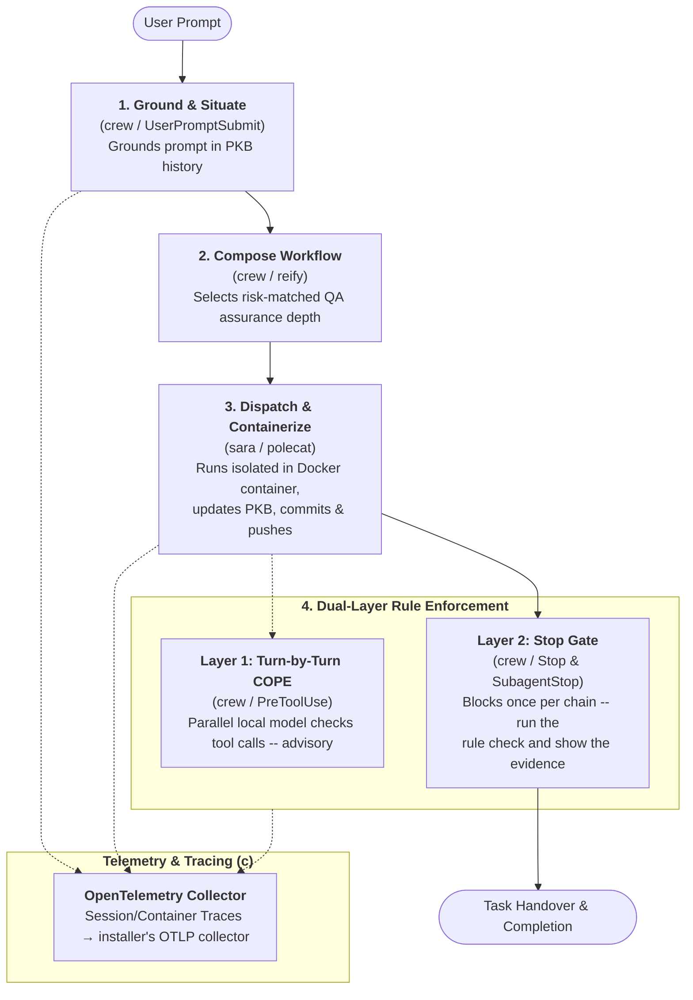

# academicOps

You can delegate execution to AI without delegating judgment.

## What academicOps is

> In some ways it's middleware, but what it really is, is a principled, integrated approach to unpacking a highly opinionated view of what academic integrity requires, and operationalising that in a distributed workflow.

Academics are going to use AI to improve their productivity. The longer-term bet behind academicOps is that judgement remains the stumbling block: academic integrity requires accountability and trust in your processes, and that trust is not there yet, least of all where several tools from different vendors are used together in novel configurations with little way to verify or validate across them. academicOps is the layer above those tools. It can incorporate commercial offerings, and it facilitates, and sometimes replicates, the expert strategic judgement that anyone using them needs. It is not a production line for more outputs: it builds the modular blocks that let a changing research strategy run across many projects.

academicOps is a streamlined suite of six plugins for Claude Code and Antigravity built around **4 core pillars** and **session telemetry**:

1. **Prompt Situation (`crew`):** Intercepts incoming prompts and grounds them in strategic history from the PKB.
2. **Workflow Composition (`crew`):** Selects appropriate risk-matched review and QA assurance levels for the task.
3. **Containerized Execution & Dispatch (`sara`):** Dispatches tasks to safe, isolated Docker containers (`polecat`), writing results back to the PKB task record, committing changes, and pushing.
4. **Dual-Layer Rule Enforcement (`crew`):** Runs a turn-by-turn local model evaluator on tool calls, advisory only; plus a stop gate that withholds the stop once per chain, directing the agent to verify rule compliance (`axioms/` + project + local rules) and present checkable evidence before handing back. Both hooks are currently disabled; their sources sit unwired in `plugins/crew/cope_hooks_disabled/`.

## How It Works



## Master Hook Lifecycle Matrix

Every hook across the plugins is deterministic, lightweight, and single-purpose. The table below details when each hook fires, which plugin owns it, what context it requires, what payload it injects, and **WHY** it exists:

| Plugin | Event | Client | What it does | Why |
| :- | :- | :- | :- | :- |
| `crew` | `SessionStart` | Both | Injects session metadata, crew's `CORE.md`, and the workspace `.agents/CORE.md`; moves credentials into `CLAUDE_ENV_FILE`. | Every agent starts knowing where it is and what the shared rules are. |
| `crew` | `UserPromptSubmit` (agy: `PreInvocation`) | Both | Searches the PKB with the user's prompt and injects the relevant history, on top-level `ida` sessions only. Needs `PKB_MCP_URL` and the `CF_ACCESS_CLIENT_ID` + `CF_ACCESS_CLIENT_SECRET` pair ([INSTALL.md](INSTALL.md#prompt-hydration-credentials)). | **Pillar 1 (Situation):** grounds each user prompt in what is already known. |
| `crew` | Every other lifecycle event it registers | Both | Emits OpenTelemetry spans. | The only plugin that traces a session live. |
| `ida` | `SessionStart` | Both | Injects ida's `CORE.md` and the pointer to `premise-check`. | Every report between agents is written and checked the same way. |
| `ida` | `UserPromptSubmit`, `PostToolUse`, `PostToolBatch`, `SubagentStop` | Both (agy: a subset) | Arms the recipient's gate when a report from another agent arrives. | A report is second-hand until it is checked. |
| `ida` | `PreToolUse`, `Stop` | Both | Holds the recipient's next dispatch, message, or stop until it records a verdict on the report. | Unchecked claims cannot be relayed onward. |
| `ida` | `SubagentStart` | Claude Code | Reminds the starting subagent to report honestly. | Binds the worker before it writes its report. |
| `sara`, `tools`, `ida-telegram` | `SessionStart` | Both (`ida-telegram`: Claude Code) | Injects the plugin's `CORE.md`. | Tells agents what the plugin offers. |
| `aops-debug` | Every event | Both | Writes the raw hook payload to a temp file. | Debugging only; changes nothing. |

The full event list per plugin is in [`specs/ARCHITECTURE.md`](specs/ARCHITECTURE.md).

## Telemetry & OTEL Tracing Architecture

academicOps uses Claude Code's native OpenTelemetry export, sent to an OTLP collector the installer supplies:

- **Collector:** Session and Polecat container traces send OTLP spans to the collector endpoint named by `OTEL_EXPORTER_OTLP_ENDPOINT`. Where the collector relays them is the installer's choice.
- **Contract Variables:**
  - `CLAUDE_CODE_ENABLE_TELEMETRY=true`
  - `OTEL_EXPORTER_OTLP_ENDPOINT=http://<collector-host>:4318`
  - `OTEL_EXPORTER_OTLP_PROTOCOL=http/protobuf`
  - `OTEL_RESOURCE_ATTRIBUTES=service.name=academicOps,service.version=<your installed version>`

## The Plugins

Install what you need -- plugins are separately installable and loosely coupled:

| Plugin | Owns |
| - | - |
| `ida` | ida, the interactive face and the only agent that talks to you; the `premise-check` and `argdown-toulmin` skills; the hooks that hold an agent until it has checked a report it received. |
| `crew` | james, pauli, and marsha; the axioms; the working skills (intake, planning, reify, pull, review, memory); session setup, PKB prompt grounding, and tracing. |
| `sara` | Polecat dispatch and nothing else: sara launches isolated containers on tasks that are ready to run. |
| `tools` | Domain research skills (analyst, peer-review, pdf, diagram, and the rest). |
| `ida-telegram` | Ida's Telegram channel and Mini App. |
| `aops-debug` | Debug plugin that dumps raw hook payloads. |

## Install

```bash
claude mcp add --transport http --scope user services <your PKB MCP endpoint>
claude plugin marketplace add nicsuzor/academicOps
claude plugin install ida@academicOps
claude plugin install crew@academicOps
claude plugin install sara@academicOps
claude plugin install tools@academicOps
```

`ida-telegram` and `aops-debug` install the same way as `ida`, with no
`--config`.

Requirements: Claude Code (or Antigravity), and Docker if you want polecat's containerised workers.

## Where work runs

Work is done in the session or sent to a polecat. There is no third route.

| Surface | When it is picked | What it does |
| :- | :- | :- |
| **In-session** | Anything the conversation needs back inline | Runs in this session. Bounded subtasks go to cheap subagents; reading and editing run on the fast model tier. |
| **Polecat container** | Work that runs, measures, tests, or builds on its own time | Docker container, headless, with no plugins and no PKB access, seeded with the full reified task as its prompt. Needs the `sara` plugin. |

A polecat's result is written to the task record and its branch is pushed; nothing waits on it.

## Developing academicOps itself

Setup, checks, and the pull-request process are in [`CONTRIBUTING.md`](CONTRIBUTING.md).
[`specs/ARCHITECTURE.md`](specs/ARCHITECTURE.md) is authoritative for the repository layout, plugin boundaries, build stages, and the constraints on all of them.
