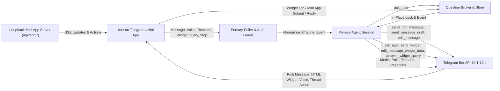

# ida-telegram

Connects Telegram chats, forum topics, voice notes, Bot API 10.1-10.4 Rich Messages and HTML Widgets, and the Mini App dashboard to the primary conversational agent.

## Architecture

- **Role gating:** Only the primary instance (`IDA_TELEGRAM_ROLE=primary`) registers tools, acquires the host polling lock, and exposes the loopback Mini App API; non-primary instances remain inert.
- **Channel transport:** Inbound Telegram updates from allowlisted user IDs mark arrival with `👀`, transcribe voice notes or fetch attachments, and deliver events into the agent turn queue. Outbound answers and reports use Rich Messages (`send_rich_message`) or private-chat streaming drafts (`send_message_draft`), while interactive questions and decisions default to Profile-1 HTML Widgets (`ask_user`) synchronized with the Mini App API.
- **Tool deadlines:** Every MCP tool enforces a 30-second execution deadline and 25-second Bot API request timeout except file-upload tools (`send_photo`, `send_document`, `send_video`, `send_animation`, `send_media_group`, `send_audio`, `send_video_note`, and `send_rich_message` when uploading existing local files via multipart form data).

## What it provides

| Kind | Name | Purpose |
| :- | :- | :- |
| Skill | `telegram` | Guides message-kind selection across Rich Messages, streaming Rich drafts, HTML Widgets, interactive buttons, reactions, threads, voice, and bot commands. |
| Skill | `menu-proposal` | Reviews telemetry and available skills to propose and configure the native Telegram bot command menu. |
| Skill | `refresh-questions` | Sweeps pending Mini App questions against external state, closes settled items with cited reasons, and checks recommendation context. |
| Hook | `SessionStart` | Runs startup readiness notice for the Telegram channel environment. |
| MCP Server | `ida-telegram` | Exposes outbound messaging, Rich Message, HTML Widget, media, poll, thread, reaction, and question tools alongside `notifications/claude/channel` inbound events and permission relays. |
| HTTP API | Mini App backend (`/api/app/*`) | Loopback server backing Details pages, tool permission approvals, PR diff review actions, interactive Question settlements, Anchor status, and session stop signals via SSE. |

## Configuration

Variables load from the environment and `$STATE_DIR/.env` (environment variables override `$STATE_DIR/.env`):

| Variable | Purpose | Default / Requirement |
| :- | :- | :- |
| `MINI_APP_URL` (`IDA_WEB_URL`) | Public HTTPS URL reaching the plugin Mini App server. | Required; fails to start if unset (no default). |
| `TELEGRAM_BOT_TOKEN` | Telegram Bot API token for polling and outbound calls. | Required for live Telegram connectivity; empty disables polling. |
| `IDA_TELEGRAM_ROLE` | Enables primary poller, MCP tools, and HTTP server when set to `primary`. | Unset (inert non-primary mode). |
| `ALLOWED_USER_IDS` (`TELEGRAM_ALLOW_FROM`) | Space- or comma-separated authorized Telegram numeric user IDs. | Empty list (drops all updates). |
| `TELEGRAM_API_BASE_URL` | Custom Bot API endpoint base URL. | `https://api.telegram.org` |
| `STATE_DIR` | Persistent directory for chat state, questions, details, inbox audio, and `.env`. | `~/.claude/channels/telegram` |
| `PORT` | Loopback HTTP port (`127.0.0.1`) for the Mini App API server. | `8093` |
| `VOICE_REPLIES` | Outbound voice synthesis policy (`off`, `mirror`, or `always`). | `mirror` |
| `VOICE_TRANSCRIBE_CMD` | Executable used to transcribe inbound voice notes. | Resolves `transcribe.sh` from `$STATE_DIR` or standard bin paths. |
| `VOICE_SPEAK_CMD` | Executable used to synthesize outbound OGG/Opus voice replies. | Resolves bundled `scripts/speak.sh` or `$STATE_DIR/speak.sh`. |
| `ASSEMBLY_AI_API_KEY` | API key passed to the default AssemblyAI voice transcription script. | No default. |
| `GEMINI_API_KEY` | API key passed to the default Gemini speech synthesis script. | No default. |
| `GEMINI_TTS_VOICE` | Prebuilt Gemini TTS voice name used by `scripts/speak.sh`. | `Aoede` |
| `TELEGRAM_BOT_COMMANDS` | Explicit JSON array overriding the auto-discovered skill command menu. | Auto-discovered from installed skills. |
| `TELEGRAM_AUTO_INTERRUPT` | Cancels active turns on new free-text messages unless set to `"false"`. | Enabled (`!== "false"`). |
| `IDA_NAME` (`INSTANCE_NAME`, `INSTANCE_ID`) | Instance identifier appended to Mini App URLs. | Unset. |
| `GITHUB_TOKEN` | GitHub token used to fetch PR diffs in the Mini App Review tab. | Unset. |
| `IDA_BRIDGE_TOKEN` (`BRIDGE_TOKEN`) | Shared bearer/header secret for authenticated Mini App bridge requests. | Unset. |
| `CF_ACCESS_TEAM_DOMAIN` (`CF_ACCESS_TEAM_NAME`), `CF_ACCESS_AUD`, `CF_ACCESS_ALLOWED_EMAILS`, `CF_ACCESS_CERTS_URL`, `CF_ACCESS_KEYS` (`CF_ACCESS_PUBKEY`) | Cloudflare Access JWT verification settings for perimeter authentication on `/api/app/*`. | Unset. |

## Dependencies

- **Bun runtime:** Executes the stdio MCP server, Telegram bot poller, and HTTP server.
- **Telegram Bot API 10.1-10.4:** Required for Rich Messages, private-chat Rich drafts, and Profile-1 HTML Widgets.
- **Public HTTPS reverse proxy or tunnel:** Routes external Telegram Mini App traffic to `127.0.0.1:$PORT` at `MINI_APP_URL`.
- **Voice tooling (`ffmpeg` with `libopus`, `python3 >= 3.10`, `uv` / `assemblyai`):** Required when voice transcription or spoken replies are enabled.
