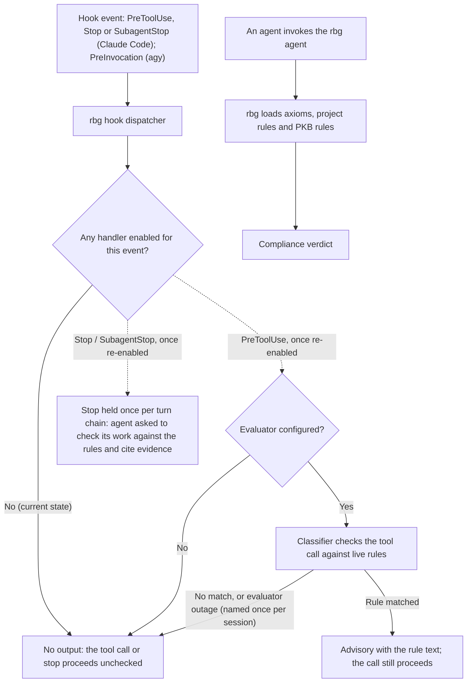

# rbg

Rule checking for agent sessions: the rbg compliance-review agent, the `axioms` skill, and two in-session hooks.

> **The hooks are currently disabled** (temporarily, since 2026-08-08, `v0.7.1`). The plugin still registers them, so each hook event runs the dispatcher, but no handler is enabled: the dispatcher returns nothing, and every tool call and stop goes through unchecked. The rbg agent and the `axioms` skill are unaffected. The two checks below describe what the hooks do once re-enabled.

- **Turn-by-turn check** (disabled): Evaluates tool calls against live rules via a fast classifier model and injects advisory context on match. Fails open and never blocks.
- **Turn-boundary stop gate** (disabled): At a `Stop` event, holds completion once so the agent explicitly checks its work against governing rules and cites verifiable evidence.

## How it works



## Components

| Component | File | Purpose |
| - | - | - |
| `PreToolUse` / `PreInvocation` | `hooks/dispatch.py` | Registered; runs turn/tool checks (Claude Code) or injects rule roster (agy) once re-enabled. Currently does nothing. |
| `Stop` / `SubagentStop` | `hooks/dispatch.py` | Registered; prompts rule verification before final handback once re-enabled. Currently does nothing. |
| Evaluation Handler | `hooks/handlers.py` | Disabled. Evaluates tool calls against rules and injects advisories. |
| Stop Handler | `hooks/handlers.py` | Disabled. Dispatches `rule-check.md` once per turn chain. |
| Evaluator Client | `hooks/evaluator.py` | HTTP client for `cope` and `openai` wire protocols. |
| Rule Loader | `hooks/rules.py` | Merges three rule scopes (`trigger: always_on`). |
| Messages | `hooks/messages/*.md` | Templates for advisories, prompts, and stop checks. |

## Rule Scopes

Rules are loaded and merged across three scopes (`axioms` cannot be overridden):

1. **Axioms:** The `axioms` skill's files, `skills/axioms/` (inviolable baseline).
2. **Project rules:** `$CWD/.agents/rules/*.md` (project-local).
3. **User rules:**
   - **In-session evaluator (COPE):** `$COPE_USER_RULES_DIR/*.md` (user-scoped, `trigger: always_on`).
   - **Compliance reviewer (RBG):** Active PKB documents with `type: rule`.

Only markdown files declaring `trigger: always_on` are sent to the evaluator or roster.

## Configuration

Set via environment variables:

| Variable | Protocol / Hook | Default | Purpose |
| - | - | - | - |
| `COPE_EVALUATOR_URL` | All | none | Evaluator endpoint URL (omitted = clean no-op). |
| `COPE_EVALUATOR_PROTOCOL` | `cope` or `openai` | none | Protocol format spoken by endpoint. |
| `COPE_EVALUATOR_MODEL` | All | none | Model identifier sent in requests. |
| `COPE_EVALUATOR_API_KEY` | Optional | none | Bearer token for authenticated endpoints. |
| `COPE_EVALUATOR_TIMEOUT` | All | `5.0` | Max seconds allowed for per-tool check sweep. |
| `COPE_EVALUATOR_TRACE_PATH` | Tracing | none | Path to append JSONL rule evaluation logs. |
| `COPE_EVALUATOR_OTEL_TRACE_PATH` | Tracing | none | Path to append OTLP JSON file spans. |
| `COPE_USER_RULES_DIR` | Roster / Loader | none | Directory containing user-scoped rules (`*.md`). |

## Local Evaluator Stack

Run a local open-weights classifier (`zentropi-ai/cope-b-a4b` via llama.cpp + shim):

```bash
uv run python scripts/cope_eval_stack.py start \
  --server-bin <llama.cpp>/build/bin/llama-server \
  --model <path>/cope-b-a4b.Q4_K_M.gguf \
  --log-dir <state-dir> \
  --warmup .agents/rules
```

Point the agent environment at `COPE_EVALUATOR_URL=http://127.0.0.1:8099/v1/label` and `COPE_EVALUATOR_PROTOCOL=cope`.

## Dependencies

- `hooks/dispatch.py`: Hook dispatcher runtime.
- `agents/rbg.md`: the rbg agent (the Judge).
- `skills/axioms/`: the `axioms` skill; its files are the baseline axioms.
- External or local Reflexes/CoPE or OpenAI-compatible classifier endpoint.
