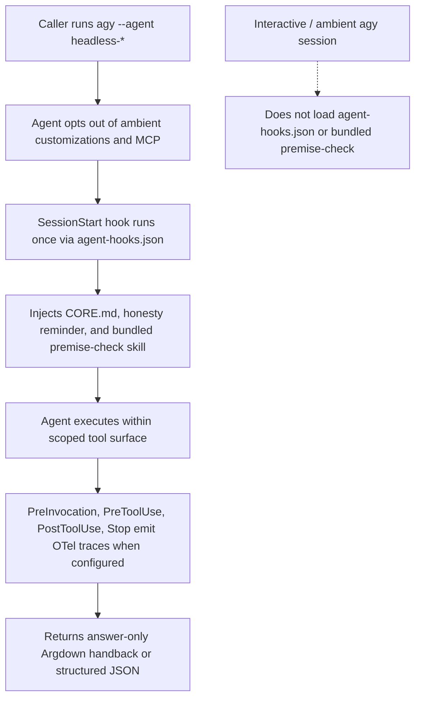

# agy-headless

Run isolated, low-context headless Antigravity (`agy`) agents that return answer-only `premise-check` Argdown handbacks (or structured JSON) without loading ambient workspace rules, MCP servers, or PKB hooks.

## How it works

Ambient `agy` sessions ignore this plugin's opt-in hooks and bundled skill completely; only sessions started explicitly with `--agent headless-*` load them.

## What it provides

| Type | Name | Purpose |
| :- | :- | :- |
| Agent | `headless-bare` | Zero file or web tools (`finish` only; excludes default prompt components) for prompt-in text transforms and structured JSON output. |
| Agent | `headless-web` | Grounded web search (`search_web`, `read_url_content`, `finish`; excludes default prompt components) with inline source URLs. |
| Agent | `headless-ro` | Read-only local file inspection (`view_file`, `grep_search`, `find_by_name`, `list_dir`, `finish`) citing `file:line` inline. |
| Agent | `headless-explore` | Read-only multi-step exploration and reasoning (read-only `run_command`, file reads, web search, `finish`; zero write tools). |
| Bundled skill | `premise-check` | Reporting and formal compliance review doctrine injected once on `SessionStart` for headless profiles without registering an ambient skill. |
| Hook (opt-in) | `SessionStart` | Injects `CORE.md`, the `honesty.md` handback reminder, and `premise-check` once per conversation without requiring `PKB_MCP_URL`. |
| Hook (opt-in) | `PreInvocation`, `PreToolUse`, `PostToolUse`, `Stop` | Emits OpenInference OTel traces for headless runs when tracing is configured. |

## Configuration

This plugin reads no required configuration and carries no hardcoded defaults; `PKB_MCP_URL` is not required. OpenTelemetry tracing is optional and activates only when standard tracing environment variables are set in the caller's environment:

- `OTEL_EXPORTER_OTLP_ENDPOINT` (or `OTEL_EXPORTER_OTLP_TRACES_ENDPOINT`, `BETA_TRACING_ENDPOINT`, `GENAI_ENGINE_TRACE_ENDPOINT`): OTLP trace collector endpoint (no default; unset disables trace export).
- `OTEL_EXPORTER_OTLP_HEADERS` / `OTEL_EXPORTER_OTLP_PROTOCOL` / `OTEL_SERVICE_NAME`: Optional OTLP transport settings (no defaults).
- `AOPS_TRACER_STATE_DIR`: Optional override for local turn-state files during active trace export.

## Dependencies

- Antigravity CLI (`agy`) -- this plugin ships for the `agy` client only.
- `uv` (invoked by the agent-scoped hook commands to run Python handlers).
- Typically invoked from Claude Code via the `ida:agy` skill (optional; profiles also run directly via `agy --sandbox --agent headless-<profile>`).
