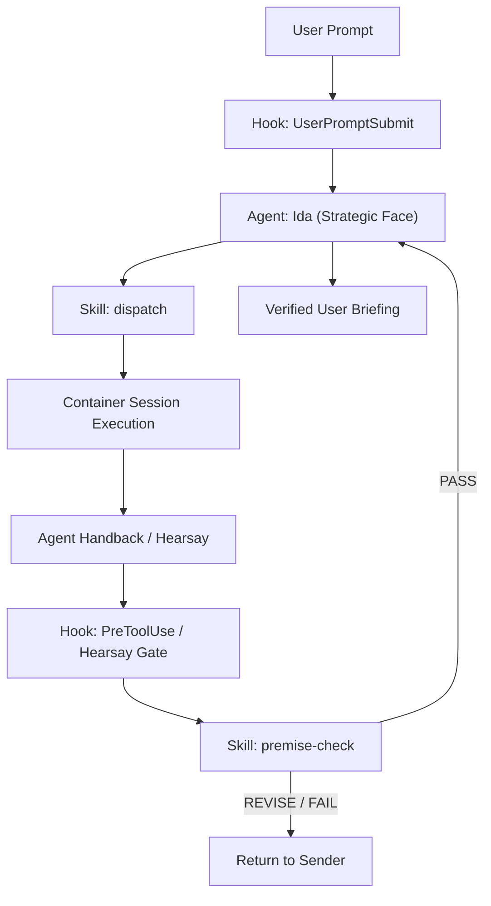

# ida

Ida is the strategic user-facing coordination and reporting integrity plugin for academicOps, providing the only agent that speaks directly with the human principal and enforcing premise-check verification on all evidence-backed claims.

## How It Works

## What It Provides

| Type | Name | Description |
| - | - | - |
| Agents | `ida` | Strategic face and sole conversational agent trusted to talk to the user |
| Skills | `premise-check` | Verifies evidence-backed claims and arguments against 7-keyed-line standards |
| Skills | `argdown-toulmin` | Chained Toulmin Argdown grammar and presentation standard |
| Skills | `dispatch` | Starts polecat container sessions on queued tasks |
| Hooks | `SessionStart` | Injects core session instructions and initializes session telemetry |
| Hooks | `UserPromptSubmit` | Grounds top-level Ida user prompts in PKB search and guards cognitive load |
| Hooks | `PreToolUse` | Injects MCP caller session metadata and gates unchecked hearsay claims |
| Hooks | `PostToolUse` | Arms hearsay checks on foreground subagent returns and emits OpenTelemetry spans |
| Hooks | `Stop` | Enforces premise-check completion before session handover |

## How It Is Configured

Endpoints and credentials have no default values and must be supplied in the launch environment:

| Variable | Description |
| - | - |
| `PKB_MCP_URL` | HTTP endpoint URL for the Personal Knowledge Base MCP service |
| `DISPATCHER_MCP_TOKEN_ID` | Cloudflare Access service token ID for hook PKB search and OTLP export |
| `DISPATCHER_MCP_TOKEN_SECRET` | Cloudflare Access service token secret for hook PKB search and OTLP export |
| `OTEL_EXPORTER_OTLP_ENDPOINT` | OTLP collector endpoint URL for OpenTelemetry span emission |
| `AOPS_SESSION_ID` | Active session or conversation identifier for trace correlation and PKB operations |
| `AOPS_SESSIONS` | Directory path for local session transcript and state correlation |
| `PREMISE_CHECK_GATE_MODE` | Enforcement mode for the hearsay gate (`block` by default, or `warn`) |

## What It Depends On

- Python 3.11 or later (`uv` runtime with `opentelemetry-sdk` and `opentelemetry-exporter-otlp-proto-http`)
- Node.js and `@argdown/cli` (`argdown` on `PATH` for deterministic Argdown syntax checks)
- Personal Knowledge Base (`pkb` / `services`) MCP server
