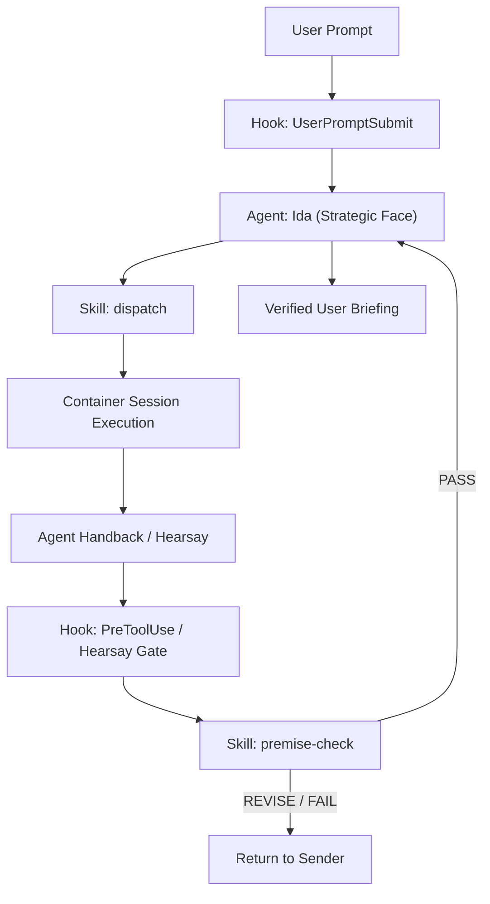

# ida

Ida is the strategic user-facing coordination and reporting integrity plugin for academicOps, providing the only agent that speaks directly with the human principal and enforcing premise-check verification on all evidence-backed claims.

## How It Works

## What It Provides

| Type | Name | Description |
| - | - | - |
| Agents | `ida` | Strategic face and sole conversational agent trusted to talk to the user |
| Skills | `premise-check` | Verifies evidence-backed claims and arguments against 7-keyed-line standards |
| Skills | `argdown-toulmin` | Chained Toulmin Argdown grammar and presentation standard (staged from lib/skills) |
| Skills | `dispatch` | Starts polecat container sessions on queued tasks (staged from lib/skills) |
| Hooks | `SessionStart` | Injects core session instructions and initializes session telemetry |
| Hooks | `UserPromptSubmit` | Intercepts user prompts to guard cognitive load and maintain topic tracking |
| Hooks | `PreToolUse` | Intercepts tool calls and gates hearsay claims before action |
| Hooks | `PostToolUse` | Records tool execution traces and emits OpenTelemetry spans |
| Hooks | `Stop` | Enforces premise-check completion before session handover |

## How It Is Configured

The plugin reads the following environment variables (there are no default values):

| Variable | Description |
| - | - |
| `PKB_MCP_URL` | HTTP endpoint URL for the Personal Knowledge Base MCP service |
| `OTEL_EXPORTER_OTLP_ENDPOINT` | OTLP collector endpoint URL for OpenTelemetry span emission |
| `AOPS_SESSION_ID` | Active session or conversation identifier for trace correlation and PKB operations |
| `PREMISE_CHECK_GATE_MODE` | Enforcement mode for the hearsay gate (`block` or `warn`) |

## What It Depends On

- Python 3.11 or later
- OpenTelemetry SDK (`opentelemetry-sdk`, `opentelemetry-exporter-otlp-proto-http`)
- Personal Knowledge Base (`pkb`) MCP server
- Shared build-staged skills from `lib/skills/` (`argdown-toulmin`, `dispatch`)
