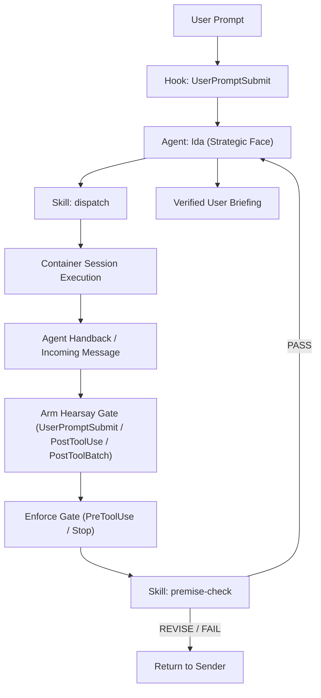

# ida

Ida is the strategic user-facing coordination and reporting integrity plugin for academicOps, providing the only agent that speaks directly with the human principal and enforcing premise-check verification on all evidence-backed claims.

## How It Works

## What It Provides

| Type | Name | Description |
| - | - | - |
| Agents | `ida` | Strategic face and sole conversational agent trusted to talk to the user |
| Skills | `premise-check` | Verifies evidence-backed claims and arguments against 7-keyed-line standards |
| Skills | `argdown-toulmin` | Chained Toulmin Argdown grammar and presentation standard |
| Skills | `dispatch` | Starts polecat container sessions on queued tasks |
| Hooks | `SessionStart` | Injects `CORE.md`, session metadata, and `premise-check` pointer |
| Hooks | `UserPromptSubmit` | Grounds top-level Ida prompts in PKB search and arms `hearsay_gate` on incoming reports |
| Hooks | `SubagentStart` | Injects `honesty.md` report-formatting reminders with recipient context |
| Hooks | `PostToolUse` / `PostToolBatch` | Arms `hearsay_gate` on foreground subagent returns and emits OpenTelemetry spans |
| Hooks | `PreToolUse` | Runs telemetry tracing and gates dispatches/messages while `hearsay_gate` is armed |
| Hooks | `Stop` / `SubagentStop` | Enforces `hearsay_gate` on `Stop` and emits OpenTelemetry spans on `SubagentStop` |
| Hooks | Lifecycle & Telemetry (`SessionEnd`, `PreCompact`, `PostCompact`, `PermissionRequest`, `PermissionDenied`, `Notification`, `PostToolUseFailure`, `StopFailure`) | Emits OpenTelemetry spans and session lifecycle telemetry |

## How It Is Configured

Endpoints and credentials have no default values and must be supplied in the launch environment:

| Variable | Description |
| - | - |
| `PKB_MCP_URL` | HTTP endpoint URL for the Personal Knowledge Base MCP service |
| `CF_ACCESS_CLIENT_ID` | Cloudflare Access service token client ID for hook PKB search and OTLP export |
| `CF_ACCESS_CLIENT_SECRET` | Cloudflare Access service token client secret for hook PKB search and OTLP export |
| `OTEL_EXPORTER_OTLP_ENDPOINT` | OTLP collector endpoint URL for OpenTelemetry span emission |
| `AOPS_SESSION_ID` | Active session or conversation identifier for trace correlation and PKB operations |
| `AOPS_SESSIONS` | Directory path for local session transcript and state correlation |
| `PREMISE_CHECK_GATE_MODE` | Enforcement mode for the hearsay gate (`block` by default, or `warn`) |

## What It Depends On

- Python 3.11 or later (`uv` runtime with `opentelemetry-sdk` and `opentelemetry-exporter-otlp-proto-http`)
- Node.js and `@argdown/cli` (`argdown` on `PATH` for deterministic Argdown syntax checks)
- Personal Knowledge Base (`pkb` / `services`) MCP server
