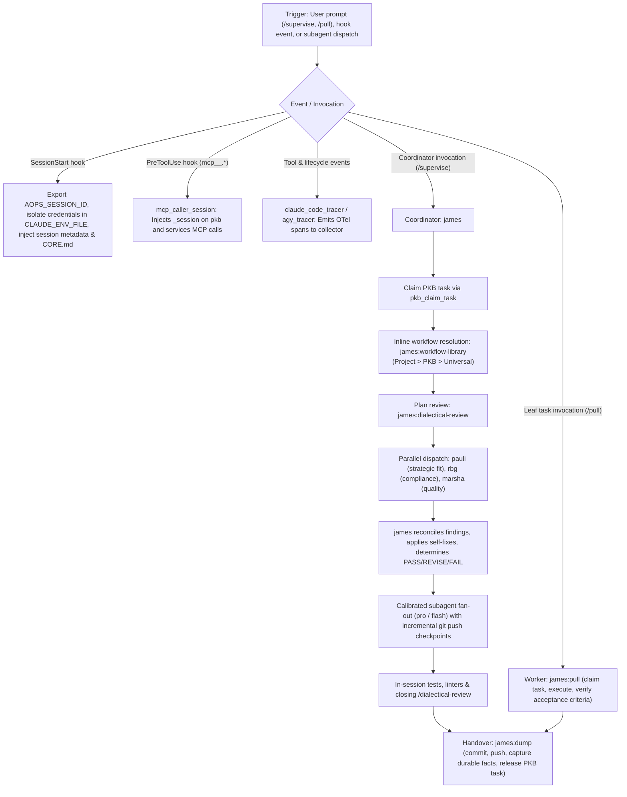

# james

Standalone in-session coordinator and subagent supervision plugin for Claude Code and Antigravity (`agy`) across any repository with PKB MCP access.

## How it works

## What it provides

| Component | Type | Description |
| - | - | - |
| `james` | Subagent | Lead executor, review supervisor, and in-session coordinator. |
| `marsha` | Subagent | Qualitative quality and excellence reviewer across live rendered outputs. |
| `pauli` | Subagent | PKB custodian, strategic fit reviewer, and targeted read-only GitHub query specialist. |
| `rbg` | Subagent | Compliance reviewer across universal axioms, project rules, data boundaries, and enforcement. |
| `supervise` | Skill | Coordinates multi-stage or repository-scoped tasks with inline workflow composition, subagent fan-out, and checkpoints. |
| `pull` | Skill | Claims, executes, and verifies already-scoped atomic leaf tasks to completion. |
| `dump` | Skill | Commits work, mints retroactive tasks, captures durable facts, releases claimed tasks, and emits the final report. |
| `dialectical-review` | Skill | Coordinates parallel multi-lens review across strategic fit, compliance, and qualitative quality. |
| `premise-check` | Skill | Formats evidence-backed reports in Chained Toulmin Argdown and records checker verdicts via `verdict.py`. |
| `workflow-library` | Skill | Manages and resolves composable workflow templates across Project, PKB, and Universal tiers. |
| `SessionStart` | Hook | Sets session metadata, credentials, session ID, and injects `CORE.md`. |
| `mcp_caller_session` | Hook | Injects `_session` on `pkb` and `services` MCP tool calls. |
| Tracing & Observability | Hooks | Emits OpenTelemetry session, lifecycle, and tool spans (`claude_code_tracer`, `agy_tracer`, `emit_debug_span`). |

## How it is configured

Set via environment variables (there are no defaults):

| Variable | Purpose |
| - | - |
| `AOPS_SESSION_ID` | Session identifier propagated across PKB operations and OpenTelemetry spans (generated if unset). |
| `CLAUDE_ENV_FILE` | Path to environment file for isolated session credential export. |
| `AOPS_IMAGE_PLUGINS_VERSION` | Version identifier injected into session startup telemetry. |
| `OTEL_EXPORTER_OTLP_ENDPOINT` | HTTP/gRPC endpoint for OpenTelemetry span collector export. |
| `AOPS_TRACER_STATE_DIR` | Directory for local tracer state files and session status records. |
| `PKB_MCP_URL` | URL endpoint for the Personal Knowledge Base MCP server. |
| `PKB_MCP_TOOL_PREFIX` | Tool name prefix for PKB MCP operations when mapped through harness bridges. |
| `AOPS_BOT_GH_TOKEN` | GitHub token for targeted read-only queries (`pauli`) and PR operations. |

## What it depends on

- Python `>= 3.11` with `uv`
- Access to PKB MCP server (`pkb` / `services`)
- Git repository checkout with configured upstream remote
- OpenTelemetry collector or Arize Phoenix (optional, for span ingestion)
