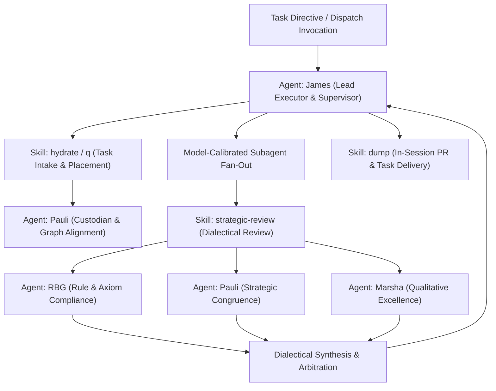

# james

James is the lead execution, dialectical review supervision, and knowledge custodian plugin for academicOps, coordinating specialist review lenses and multi-stage container task delivery.

## How It Works

## What It Provides

| Type | Name | Description |
| - | - | - |
| Agents | `james` | Lead executor and dialectical review supervisor |
| Agents | `rbg` | Compliance reviewer evaluating work against axioms, project rules, and authority limits |
| Agents | `pauli` | PKB custodian, graph truth maintainer, and strategic congruence reviewer |
| Agents | `marsha` | Qualitative excellence reviewer and audience taste discriminator |
| Agents | `sara` | Headless dispatcher and epistemic gatekeeper for automated worker runs |
| Skills | `axioms` | Inviolable universal behavioral rules governing all agents |
| Skills | `argdown-toulmin` | Chained Toulmin Argdown grammar and presentation standard |
| Skills | `dispatch` | Starts polecat container sessions on queued tasks |
| Skills | `supervise` | Supervise repo-scoped epic execution and multi-stage delivery in containers |
| Skills | `pull` | Fast-path leaf task claiming and execution |
| Skills | `dump` | Session exit, handover, and task completion reporting |
| Skills | `q` | Capture natural-language asks and situate them on the task graph |
| Skills | `reify` | Bind task nodes to executors and composed workflows |
| Skills | `reconcile` | Truth maintenance and dependency progression over the task graph |
| Skills | `strategic-review` | Multi-agent dialectical review supervised by James |
| Skills | `verify` | Qualitative verification against genre standards and audience resonance |
| Skills | `strategize` | Reason at strategic altitude across the whole task graph |
| Skills | `decompose` | Expand situated objectives into dependency sub-graphs |
| Skills | `hydrate` | Disambiguation index and semantic search across the knowledge base |
| Skills | `remember` | Persist and consolidate durable knowledge into canonical notes |
| Skills | `phoenix` | Query Arize Phoenix OpenTelemetry traces, spans, and transcripts |
| Skills | `learn` | Diagnose systemic framework faults and propose minimal workflow remedies |
| Skills | `craft` | Authoring standard and quality gate for agent instructions and workflows |
| Skills | `daily` | Generate and update daily notes and prompt sweep summaries |
| Skills | `decide` | Interactive triage of pending decisions |
| Skills | `dispatch-queue` | Interactive inspection and launch of ready queued tasks |
| Skills | `argument-audit` | Stress-test structured arguments for gaps and rival explanations |
| Skills | `argument-extraction` | Reconstruct and extract arguments into parser-valid Argdown |
| Skills | `argument-map` | Build reviewable multi-layer argument maps and overview pages |
| Skills | `up` | Analyze framework failures at the general class level |
| Skills | `workflow-library` | Library management for composable three-tier workflow templates |

## How It Is Configured

Packaged diagnostic scripts (`phoenix`) read the following environment variables (endpoints and credentials have no default values):

| Variable | Description |
| - | - |
| `PHOENIX_MCP_URL` | HTTP endpoint URL for the Arize Phoenix OpenTelemetry span store |
| `PHOENIX_MCP_PROJECT` | Project namespace name within Arize Phoenix |
| `CF_ACCESS_CLIENT_ID` | Cloudflare Access service token client ID for authenticated Phoenix queries |
| `CF_ACCESS_CLIENT_SECRET` | Cloudflare Access service token client secret for authenticated Phoenix queries |

## What It Depends On

- Python 3.11 or later
- Personal Knowledge Base (`pkb` / `services`) MCP server configured in the client harness
- Arize Phoenix OpenTelemetry tracing backend (for `phoenix` and `learn`)
- GitHub CLI (`gh`) for repository pull request and issue workflows
- Node.js and `@argdown/cli` (for standalone Argdown map validation in `argument-extraction`, `argument-audit`, and `argument-map`)
