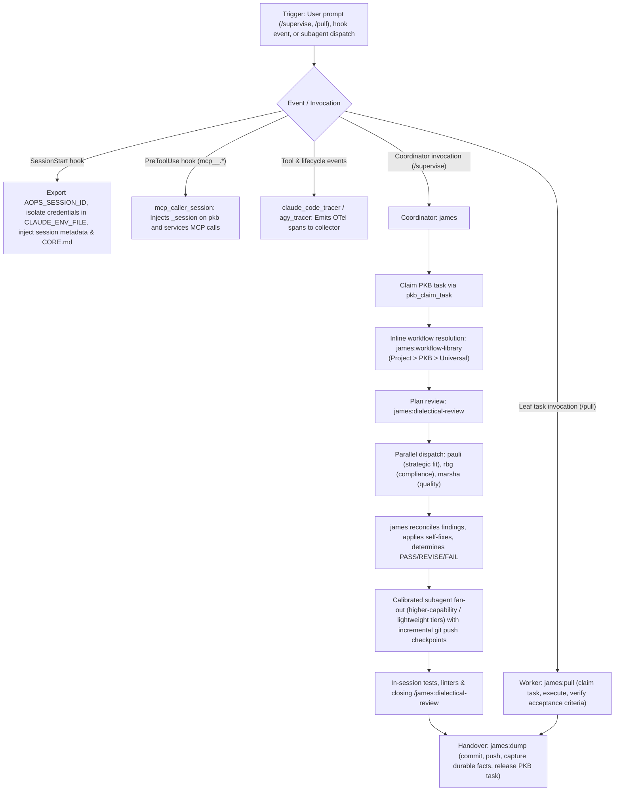

# james

Standalone in-session coordinator and subagent supervision plugin for Claude Code and Antigravity (`agy`) across any repository with PKB MCP access.

## How it works

## What it provides

| Component | Type | Description |
| - | - | - |
| `james` | Subagent | Lead executor, review supervisor, and in-session coordinator. |
| `marsha` | Subagent | Qualitative quality and excellence reviewer across live rendered outputs. |
| `pauli` | Subagent | PKB custodian, strategic fit reviewer, and targeted read-only GitHub query specialist. |
| `rbg` | Subagent | Compliance reviewer across universal axioms, project rules, data boundaries, and enforcement. |
| `supervise` | Skill | Coordinates multi-stage or repository-scoped tasks with inline workflow composition, subagent fan-out, and checkpoints. |
| `pull` | Skill | Claims, executes, and verifies already-scoped atomic leaf tasks to completion. |
| `dump` | Skill | Commits work, mints retroactive tasks, captures durable facts, releases claimed tasks, and emits the final report. |
| `dialectical-review` | Skill | Coordinates parallel multi-lens review across strategic fit, compliance, and qualitative quality. |
| `premise-check` | Skill | Formats evidence-backed reports in Chained Toulmin Argdown and records checker verdicts via `verdict.py`. |
| `workflow-library` | Skill | Manages and resolves composable workflow templates across Project, PKB, and Universal tiers. |
| `SessionStart` | Hook | Sets session metadata, credentials, session ID, and injects `CORE.md`. |
| `mcp_caller_session` | Hook | Injects `_session` on `pkb` and `services` MCP tool calls. |
| Tracing & Observability | Hooks | Emits OpenTelemetry session, lifecycle, and tool spans (`claude_code_tracer`, `agy_tracer`, `emit_debug_span`). |

## How it is configured

Configured solely via environment variables (`manifest/plugin.json` declares no `userConfig` fields, and there are no defaults):

### Session, PKB & Git Isolation

| Variable | Purpose |
| - | - |
| `AOPS_SESSION_ID` | Session identifier propagated across PKB operations, `CLAUDE_ENV_FILE`, and OpenTelemetry spans. |
| `CLAUDE_ENV_FILE` | Target environment file path for isolated session variable export at `SessionStart`. |
| `PKB_MCP_URL` | Personal Knowledge Base MCP server endpoint URL (required by `SessionStart`). |
| `PKB_MCP_TOOL_PREFIX` | Variable preserved into `CLAUDE_ENV_FILE` for isolated session MCP configuration. |
| `AOPS_SESSIONS` | Session state directory preserved into `CLAUDE_ENV_FILE` and read by `claude_code_tracer`. |
| `AOPS_BOT_GH_TOKEN` | GitHub token preserved into `CLAUDE_ENV_FILE` and scrubbed from traced span attributes. |
| `AOPS_GIT_CONFIG_GLOBAL` | Source global gitconfig path mapped to `GIT_CONFIG_GLOBAL` (with `GIT_CONFIG_NOSYSTEM=1`) in `CLAUDE_ENV_FILE`. |
| `GIT_CONFIG_GLOBAL` / `GIT_CONFIG_NOSYSTEM` | Git configuration variables preserved into `CLAUDE_ENV_FILE` when already set. |
| `AOPS_IMAGE_PLUGINS_VERSION` | Container image plugin version tag emitted in startup telemetry and metadata. |
| `AOPS_IMAGE_STALE` / `AOPS_IMAGE_STALENESS_WARNING` | Image staleness flag (`1`) and custom warning message surfaced at `SessionStart`. |

### OpenTelemetry Tracing & Diagnostics

| Variable | Purpose |
| - | - |
| `OTEL_EXPORTER_OTLP_ENDPOINT` / `OTEL_EXPORTER_OTLP_TRACES_ENDPOINT` | Primary OTLP collector endpoint URLs for span export. |
| `GENAI_ENGINE_TRACE_ENDPOINT` / `BETA_TRACING_ENDPOINT` | Alternate trace endpoint URLs checked for collector configuration and startup diagnostics. |
| `OTEL_EXPORTER_OTLP_HEADERS` / `OTEL_EXPORTER_OTLP_TRACES_HEADERS` / `GENAI_ENGINE_API_KEY` | Authentication headers or API key for OTLP span export. |
| `OTEL_EXPORTER_OTLP_PROTOCOL` / `OTEL_EXPORTER_OTLP_TRACES_PROTOCOL` / `GENAI_ENGINE_TRACE_PROTOCOL` | OTLP transport protocol selector (`http/protobuf` or `grpc`). |
| `OTEL_SERVICE_NAME` / `PHOENIX_PROJECT_NAME` | Service name and Arize Phoenix project identifier attached to exported spans. |
| `OTEL_SPAN_ATTRIBUTE_VALUE_LENGTH_LIMIT` | Byte limit for truncated OpenTelemetry span string attributes. |
| `OTEL_EXPORTER_OTLP_CERTIFICATE` / `OTEL_EXPORTER_OTLP_TRACES_CERTIFICATE` / `REQUESTS_CA_BUNDLE` / `CURL_CA_BUNDLE` / `SSL_CERT_FILE` | TLS certificate bundles inspected when routing OTLP HTTP export through a proxy. |
| `HTTPS_PROXY` / `https_proxy` / `ALL_PROXY` / `all_proxy` | Proxy settings checked before selecting environment CA certificates for OTLP HTTP export. |
| `AOPS_TRACER_STATE_DIR` / `TRACER_STATE_DIR` / `AOPS_TRACER_DIR` | Directory holding local tracer spool and active session state files. |
| `AOPS_TELEMETRY_FAILURE_MODE` | Telemetry error handling policy (`block` or `warn`). |
| `AOPS_SESSION_POINTER_DIR` | Override directory for one-time `SessionStart` pointer marker files. |
| `AOPS_HOOK_LOG_PATH` | Optional JSONL log destination for raw hook invocation records in `dispatch.py`. |
| `COPE_EVALUATOR_OTEL_TRACE_PATH` | Checked in `dispatch.py` to warn on stderr if set when `evaluator_otel_trace` is not bundled. |

### Execution Context, Harness & Credentials

| Variable | Purpose |
| - | - |
| `AOPS_AGENT_NAME` / `CLAUDE_AGENT_NAME` / `AGY_AGENT_NAME` | Logical agent or subagent identifier attached to hook contexts and spans. |
| `CLAUDE_CODE_IS_COWORK` / `CLAUDE_CODE_ENTRYPOINT` | Claude Cowork environment signals causing plugin hooks to skip cleanly. |
| `CLAUDE_PROJECT_DIR` / `ANTIGRAVITY_APP_DATA_DIR` | Client project workspace path and Antigravity app data directory for transcript/token lookup. |
| `ANTIGRAVITY_CLI` / `GEMINI_CLI` | Client runtime indicators recorded on `verdict.py` telemetry spans. |
| `POLECAT_TASK` / `POLECAT_TARGET_TASK` / `AOPS_CONTAINER` / `AOPS_TASK_ID` / `GENAI_ENGINE_TASK_ID` | Container execution flags and task identifiers attached to spans and failure-mode detection. |
| `GITHUB_ACTIONS` / `GITHUB_SERVER_URL` / `GITHUB_REPOSITORY` / `GITHUB_RUN_ID` / `GITHUB_RUN_ATTEMPT` / `GITHUB_WORKFLOW` / `GITHUB_JOB` / `GITHUB_EVENT_NAME` / `GITHUB_REF` / `GITHUB_SHA` | GitHub Actions run attributes attached to spans when `GITHUB_ACTIONS=true`. |
| `GH_TOKEN` / `GITHUB_TOKEN` | GitHub credentials scrubbed from traced span attributes. |
| `DISPATCHER_MCP_TOKEN_ID` / `DISPATCHER_MCP_TOKEN_SECRET` | Cloudflare Access credentials used for OTLP authentication and scrubbed from span attributes. |
| `USER` / `USERNAME` | Operating system username attached to session span metadata. |

## What it depends on

- Python `>= 3.11` with `uv`
- Access to PKB MCP server (`pkb` / `services`)
- Git repository checkout with configured upstream remote
- OpenTelemetry collector or Arize Phoenix (optional, for span ingestion)
