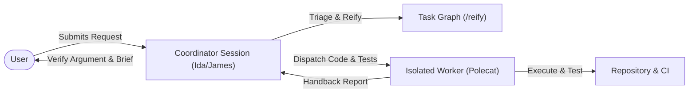

# Coordinator Delegation and In-Session Execution Boundaries

This specification defines the operational and behavioral boundaries governing interactive and coordinator agent sessions within the academicOps framework. It eliminates multi-million token context inflation and financial waste caused by coordinators executing test suites, running deep repository code searches, and reading full codebases directly in interactive sessions.

## User experience flow

## Capabilities and user stories

### US-1 Delegation of Code Inspection and Test Suites

As the user, I want coordinator and interactive agent sessions to delegate codebase reading and test executions to isolated worker containers, so that my interactive sessions remain responsive, fast, and protected from multi-million token context bloat.

- **AC-1.1** Given an interactive or coordinator session (`ida`, `james`, or main session), when a task requires executing repository test suites (`uv run pytest`, `make test`, or integration tests) or build commands, then the coordinator refuses in-session execution and dispatches the task to an isolated worker container (`polecat`).
- **AC-1.2** Given an interactive or coordinator session, when a task requires deep repository code searches, multi-file code greps, or sequential whole-file inspections, then the coordinator queues or dispatches the investigation as an isolated probe or worker task to a polecat rather than reading repository files into coordinator context.

### US-2 Custodian Scope Bounded to Graph and Targeted Queries

As the user, I want the PKB custodian (`pauli`) strictly bounded to PKB graph operations and targeted read-only GitHub queries, so that knowledge queries never trigger repository-wide code exploration or test execution in-session.

- **AC-2.1** Given a knowledge task received by the custodian (`pauli`), when the task requires inspecting repository source files, searching local directories, or running tests/builds, then the custodian halts and returns the work for polecat dispatch within 1 second.
- **AC-2.2** Given a planning or graph curation request, when the custodian (`pauli`) executes planning skills (`/strategize`, `/decompose`, `/reify`), then the custodian operates strictly on the PKB graph and targeted read-only GitHub CLI queries (`gh pr view`, `gh issue view`, `gh release view`) without searching repository source code.

### US-3 Semantic Review Without In-Session Test Execution

As the user, I want review workflows in coordinator sessions to execute as static semantic evaluations without running test suites or unbounded code greps in-session, so that reviews provide fast, high-altitude feedback without context corruption.

- **AC-3.1** Given a dialectical review (`/strategic-review`) running in an interactive coordinator session, when reviewer lenses (`pauli`, `rbg`, `marsha`) evaluate candidate changes, then reviewers evaluate diffs and specs statically without running test suites (`uv run pytest`) or executing live code probes in-session.
- **AC-3.2** Given a deliverable requiring runtime test execution or empirical reproduction, when review identifies that test verification is needed, then test execution is verified against CI receipts or delegated to an independent verification task dispatched to an isolated polecat.

## Shared interface contract

Coordinator sessions and isolated worker containers interact strictly through the PKB task graph and dispatch interface:

- **Dispatch Contract**: The coordinator formats tasks with `Ask`, `Goal`, `Context`, `Acceptance`, `Instructions`, `Output`, and `Report` per `/reify`. The worker runs with `/ida:pull <task-id>`.
- **Handback Contract**: The worker commits changes to git, posts completion evidence and PR links to the task record, and releases via `/dump` with a parser-valid Chained Toulmin Argdown block answering each acceptance criterion.
- **Review Contract**: The coordinator evaluates the returned argument per `premise-check` without re-running test suites or re-reading touched source files.

## Invariants and security boundaries

- **Zero In-Session Test Execution**: Interactive and coordinator sessions never execute `uv run pytest`, `pytest`, `npm test`, or `make test`.
- **Zero In-Session Codebase Greps**: Interactive and coordinator sessions never execute recursive codebase greps (`grep -r`, `rg`, `grep_search`) across repository source trees.
- **Isolation of Execution State**: All mutating file edits, test runner outputs, compiler stderr, and container builds are isolated in ephemeral polecat containers.
- **Positive Security Boundary**: Only authorized interactive users or automated dispatchers initiate polecat worker tasks; worker containers execute with sandboxed credentials and communicate solely via git branches and the PKB MCP interface.
