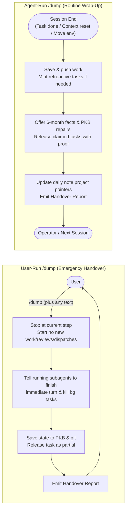

# Dump Skill Session Wrap-Up and Emergency Handover

This specification defines the invocation modes, lifecycle contracts, and reporting requirements for the session exit and handover skill (`dump`). It distinguishes between a user-run `/dump` (an immediate emergency handover where the agent stops at its current position, tells running subagents to finish their immediate turn, saves state to the PKB, and hands over without starting any further work) and an agent-run `/dump` (the calm, routine wrap-up at task completion, context reset, or environment transition). It also defines consolidated daily note updates per touched project, retroactive task creation for unparented file modifications with explicit exemptions, durable fact retention and knowledge graph conflict repair, disciplined next-step pointers, and producing session identification in handover reports.

## User experience flow



## Capabilities and user stories

### US-1 User-run emergency handover vs. agent-run routine wrap-up

As the user directing or supervising an agent session, I want a `/dump` command I invoke myself to trigger an immediate emergency handover while keeping an agent-initiated `/dump` at session end as a calm routine wrap-up, so that my explicit stop command halts further work immediately without turning ordinary session completions into alarms.

- **AC-1.1 (User-run emergency handover)**: Given an active session, when the user invokes `/dump` (or `/ida:dump`) as a command in their prompt turn (regardless of any accompanying wording, context, or trailing instructions), then the agent stops where it is currently, starts zero new reviews, dispatches, re-dispatches, or task steps, messages all running subagents (e.g. `send_message`) to finish their immediate turn and return current state while terminating active background command tasks (e.g. `manage_task: kill`), saves current state to the PKB and git working tree, releases incomplete claimed tasks as `partial`, and emits the handover report.
- **AC-1.2 (Agent-run routine wrap-up)**: Given a session ending on the agent's own initiative (upon task completion, context window reset, or environment transition), when the agent invokes `dump`, then the procedure completes file persistence, task status updates, and handover reporting methodically without emitting panic, abort, or emergency failure language.
- **AC-1.3 (Trigger source discrimination)**: Given any invocation of `dump`, when the agent determines which mode applies, then it distinguishes user-run emergency handover from agent-run routine wrap-up by whether `/dump` was invoked as a command in the user's prompt turn ( as opposed to an informational question about `/dump` or an autonomous session-end wrap-up initiated by the agent).

### US-2 Consolidated daily note project pointers

As the user reviewing daily progress, I want `dump` to record one consolidated status pointer per touched project in the daily note with its immediate next step, so that project status is scannable at a glance without cluttering the note with fragmented task logs.

- **AC-2.1 (One consolidated pointer per touched project)**: Given a session that modified files, updated tasks, or achieved a major operational find across one or more projects, when `dump` compiles its final updates, then in interactive or coordinator sessions it writes exactly one consolidated bullet per touched project into the daily note under `## Today's work` stating the project's current state and verified next step (or omitting the next step if none exists); in headless worker sessions, it emits the consolidated project pointer in the handover block on the record to avoid multi-writer contention.
- **AC-2.2 (Preserved block isolation and clean absorption)**: Given the daily note formatting contract where named sections are preserved across automated note composition runs, when `dump` appends project pointers, then it writes them exclusively into `## Today's work`, allowing the subsequent daily note sweep to absorb completed milestones into structured summary views while retaining active threads.

### US-3 Retroactive task creation for unparented project changes

As a maintainer tracking project evolution on the knowledge graph, I want any ad-hoc session that modified project files without an existing task to create a retroactive task documenting the work, so that repository changes are never orphaned from the graph.

- **AC-3.1 (Retroactive task for unparented file changes)**: Given an ad-hoc session that executed modifications resulting in uncommitted or committed changes to repository project files without an assigned task, when `dump` executes, then the skill requires creating a retroactive task on the knowledge graph that documents the semantic goal, touched files, commit SHA, and verified deliverable, releasing the task as `done` with evidence.
- **AC-3.2 (Exemptions for routing work and ephemeral minor edits)**: Given an ad-hoc session performing operational routing, dispatching, or task triage without modifying repository project files, or executing minor user-directed adjustments that hold no institutional value thirty days later, when `dump` executes, then the session is exempt from retroactive task creation.

### US-4 Durable fact capture and PKB conflict repair

As a researcher maintaining durable institutional truth in the knowledge base, I want `dump` to capture findings that will remain valuable over six months and offer them to the knowledge base custodian while reporting conflicting or stale notes for repair, so that institutional knowledge stays accurate.

- **AC-4.1 (Six-month durable fact offering and conflict reporting)**: Given verified architectural decisions, operational constraints, or environment invariants discovered during the session that will remain relevant in six months, or conflicting/outdated knowledge base notes encountered during execution, when `dump` runs, then it offers the durable facts and reports the contradictions to the knowledge base custodian (`pauli`) (or records durable facts under `## Durable Facts` in the task record and handover summary when running in an isolated worker session).

### US-5 Disciplined next-step pointers and resumption prompts

As the user picking up after a completed or interrupted session, I want un-invented pointers to existing follow-up tasks or a copy-pasteable resumption prompt for interrupted tasks, so that the next session resumes cleanly without speculative busywork.

- **AC-5.1 (Strict tri-state next step)**: Given any session executing `dump`, when the `Next step` field is populated, then it states an exact pointer (`[[id]]` or URL) if a pre-existing dependent task exists on the graph, a self-contained 2–4 sentence resumption prompt if the task is released as `partial` or `in_progress`, or `None` if the task is `done` with no pre-existing dependent task, never inventing speculative follow-up tasks.

### US-6 Handover block session traceability

As a framework auditor investigating execution history, I want the session identifier printed in the handover block and task release call, so that every handover report links directly to its generating session logs and OpenTelemetry traces.

- **AC-6.1 (Explicit session ID in handover header and release call)**: Given any execution of `dump`, when the skill releases claimed tasks via `pkb_release_task` and emits its structured handover block, then it passes the active `session_id` in the release payload and prints the session identifier directly in the handover heading (`## Handover: <agent> <session-id / conversation-id>`).

## Shared interface contract

### 1. Invocation Mode Discrimination and Execution Contract

| Mode | Trigger Condition | Subagent & Background Task Action | Work Progression | Task Release Default |
| :- | :- | :- | :- | :- |
| **Mode 1: User-Run `/dump` (Emergency Handover)** | User invokes `/dump` (or `/ida:dump`) as a command in the prompt turn, regardless of accompanying wording or trailing instructions. | Message all running subagents (e.g. `send_message`) to finish their immediate turn and return current state; kill active background tasks/timers (e.g. `manage_task: kill`). | Stop where currently at; start zero new reviews, dispatches, re-dispatches, test suites, or remaining task steps. | `partial` (or `done` only if all acceptance criteria were already verified prior to `/dump`). |
| **Mode 2: Agent-Run `/dump` (Routine Wrap-Up)** | Agent invokes `/dump` on its own initiative at task completion, context window reset, or environment transition. | All in-session subagents have completed their assigned turns normally. | Complete standard wrap-up across file persistence, retroactive task check, durable fact capture, and task release. | `done` when all acceptance criteria are verified with proof; `partial` on context reset or environment transition. |

### 2. Consolidated Daily Note Project Updates (`## Today's work`)

- **Interactive / Coordinator Sessions**: Write one consolidated bullet per touched project into `## Today's work` in the daily note:
  ```markdown
  - **<project-name>**: <latest status or major find in 10-20 words> -- Next: <pointer or resumption prompt>
  ```
  Omit `-- Next: ...` when no pre-existing follow-up task or resumption prompt applies.
- **Headless / Isolated Worker Sessions**: Emit the consolidated project status in the structured handover block on the task record so automated daily sweeps absorb it without concurrent write contention.

### 3. Handover Block Schema

```markdown
## Handover: <agent> <session-id / conversation-id>

1. **Task**: <task-id and title, or "Ad-hoc / Retroactive: <id>">
2. **Summary**: Concise synthesis of findings, modifications, and outcomes.
3. **Status & Safeguards**:
   - STATUS: <done | partial | failed | cancelled | in_progress>
   - GATE: <the acceptance criterion id tested, and observed result against it>
   - CONFIDENCE: <high | med | low> + <what single check would falsify this>
   - CONFOUND CHECK: <did a clean-room/differential control run? result? -- or "NOT RUN">
4. **Output**: <branch + commit SHA> | <PR or artifact link>
5. **Next step**: <[[task-id]] pointer | Resumption prompt | None>
6. **Durable Facts**: [None | List of durable facts offered to Pauli or recorded for collection]
7. **Argument**: The `argdown` block recorded under the task's `## Report`.
8. **Limitations**: Unresolved items, out-of-scope elements, and verbatim error outputs.
9. **Rule Violations**: [None | Disclosed violations with rule citations and reasons]
```

## Invariants and security boundaries

- **No post-`/dump` work initiation**: When the user invokes `/dump`, the receiving agent is strictly prohibited from initiating new reviews, spawning new subagents, dispatching or re-dispatching workers, or advancing to subsequent task steps before handing over, even if the user's message includes conversational explanations or additional wording alongside `/dump`.
- **Bounded subagent wind-down**: Running subagents cannot be preempted mid-token, so the parent agent instructs each active subagent (e.g. via `send_message`) to complete its immediate turn and return its current state without starting another step, while terminating any background shell or timer tasks (e.g. via `manage_task: kill`).
- **Headless worker containment**: Dispatched workers executing an assigned task via `/pull` are bound to their claimed task scope; unparented edits outside their task boundary are a containment breach under `fail-fast` rather than grounds for automated retroactive task creation.
- **Never release as `review`**: Both emergency handovers and routine wrap-ups release tasks exclusively as `done`, `partial`, `failed`, `cancelled`, or `in_progress`, never `review`.
- **Data boundaries on public repositories**: Commits, branch names, and pull requests created during `dump` against public repositories must never emit private PKB task, note, or session identifiers.
