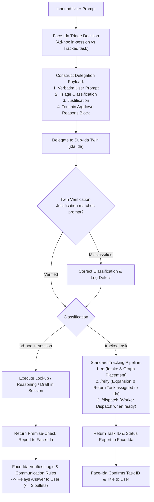

# Face-Ida Triage and Tracked-Request Workflow

This specification defines the consolidated workflow and triage contract for the user-facing agent persona ("Face Ida"). It replaces scattered, contradictory instructions regarding in-session handling, delegation, and ask tracking. Under this architecture, the user-facing agent never executes substantive work directly, delegates every request to an internal subagent twin ("Sub-Ida"), and performs an explicit upfront triage decision with a formal reasons block evaluating whether an ask can be resolved ad-hoc in-session or requires an asynchronously tracked task. Tracked requests flow exclusively through the standard intake, reification, and dispatch pipeline, ensuring verified results are returned to the user through dedicated delivery tasks assigned to the user-facing agent, while retiring ad-hoc task tracking via the legacy tracking command.

## User stories

### US-1 Upfront Triage and Delegation Contract

As the user-facing agent, I want to evaluate every inbound user request at intake to classify it as either ad-hoc in-session or requiring a tracked task, so that the non-execution boundary is preserved and work is routed to the appropriate execution surface with explicit, auditable reasons.

- **AC-1.1** Given an incoming user request, when the user-facing agent receives it, then the agent executes no substantive work (no repository searches, file edits, diagnostics, code runs, or multi-step lookups) directly in its main context.
- **AC-1.2** Given an incoming request, when the user-facing agent prepares to delegate, then it makes an explicit triage classification:
  - `ad-hoc in-session`: The request is an immediate clarification, conversational reasoning, or lookup answerable within the active session turn without background workers.
  - `tracked task`: The request requires work beyond the immediate turn or session (code modifications, multi-step investigations, background executions, external pull requests, or evaluations).
- **AC-1.3** Given a triage classification, when the user-facing agent delegates to Sub-Ida, then the delegation payload includes:
  1. The verbatim, unmodified text of the user's prompt as an immutable referent;
  2. The triage classification (`ad-hoc in-session` or `tracked task`);
  3. A written justification stating why the request fits the chosen category;
  4. A structured Toulmin Argdown `reasons` block validating the triage choice.

### US-2 Subagent Twin Verification and Execution Routing

As the subagent twin, I want to independently check the user-facing agent's triage justification against the user's actual prompt before executing, so that misclassified requests are caught and routed correctly.

- **AC-2.1** Given a delegation message from the user-facing agent, when Sub-Ida receives it, then Sub-Ida verifies the triage justification against the verbatim user prompt before starting work:
  - If the request was classified as `ad-hoc in-session` but requires background execution, code changes, or multi-step analysis, Sub-Ida flags the misclassification and escalates it to the tracked task pipeline.
  - If the request was classified as `tracked task` but is a simple query answerable immediately in-session without side effects, Sub-Ida resolves it directly in-session and notes the over-tracking defect.
- **AC-2.2** Given a validated `ad-hoc in-session` request, when Sub-Ida executes, then Sub-Ida conducts the lookup or analysis in-session and returns a verified report with a standard premise-check argument to the user-facing agent.
- **AC-2.3** Given a validated `tracked task` request, when Sub-Ida executes, then Sub-Ida routes the request through the intake (`/q`), reification (`/reify`), and dispatch (`/dispatch`) pipeline. To maintain single-assignee boundaries and ensure headless workers never hold user delivery obligations:
  - When the request decomposes into multiple child tasks, the reification pipeline creates a coordinating parent task with worker subtasks, plus a dedicated terminal delivery task assigned to the user-facing agent (`assignee: ida`, dependent on worker subtasks) to deliver the result to the user.
  - When the request is an atomic task executed by a headless worker, the reification pipeline creates a paired follow-up delivery task assigned to the user-facing agent (`assignee: ida`, dependent on the worker task) to deliver the completed artifact to the user.
- **AC-2.4** Given a completed subagent report, when the user-facing agent receives it, then the agent verifies the report argument and relay line derivations, applies attention-protection brevity rules (bottom-line first, at most 3 bullets unless detail was requested), and communicates the result or task confirmation to the user.

### US-3 Retirement of Legacy `/mine` Ask Tracking

As a framework maintainer and operator, I want all tracked user requests to flow through the unified intake and reification pipeline instead of the legacy `/mine` ask-tracking command, so that all persistent tasks share uniform graph placement, valuation, and delivery semantics.

- **AC-3.1** Given any user request requiring asynchronous tracking, when captured, then it is routed through the standard intake (`/q`) and reification (`/reify`) workflow rather than being filed as an ad-hoc tracked task via `/mine <ask>`.
- **AC-3.2** Given the `/mine` command, when evaluated across skills, agent definitions, and command registries:
  - The parameterised form (`/mine <ask>`) is deprecated and retired from user-facing workflows;
  - The bare sweep form (`/mine` without arguments) is superseded by standard truth maintenance (`/reconcile`) and scheduled daily review (`/decide` / `/daily`), which surface delivery tasks assigned to the user-facing agent.

## Design

### 1. Architectural Motivation and Context

Prior to this specification, instructions governing the user-facing agent and related skills contained scattered and contradictory directives:

1. Agent instructions stated that the main context only reviews reports, reads the knowledge base, and talks to the user, but lacked clear criteria for distinguishing in-session execution from asynchronous task dispatch.
2. Intake and dispatch skill instructions stated that task dispatch was reserved solely for real code changes, conflicting with complex research, multi-repo comparisons, or workflow sweeps that require asynchronous tracking without modifying code.
3. Legacy ask tracking created a parallel, bespoke tracking mechanism (`ida-tracked` tag, `ida_held` status) that bypassed standard graph placement, valuation, and reification.
4. User-facing agents frequently drifted into performing work directly or failed to communicate why a task was being dispatched rather than answered immediately.

This specification consolidates these practices into a single, cohesive workflow governed by upfront triage, inter-agent reasons verification, standard intake reification, and closed-loop delivery.

### 2. Consolidated Triage Contract

When an inbound user message arrives, the user-facing agent executes the following two-phase sequence:



#### 2.1 Triage Classification Standard

The triage choice is strictly bounded:

1. **`ad-hoc in-session`**:
   - **Definition**: Any request that can be completely resolved within the immediate turn and session context without launching background workers, modifying code repositories, or running multi-stage analytical sweeps.
   - **Examples**: Direct conversational questions; clarification of requirements; lookups in accessible documentation; summarizing a single note or file; drafting an immediate response.
   - **Execution Surface**: Executed entirely by Sub-Ida in-session.

2. **`tracked task`**:
   - **Definition**: Any request that cannot be answered immediately in-session, requires persistent tracking across turns or sessions, modifies repository code or configurations, executes long-running background tasks, or spans multiple sub-tasks.
   - **Examples**: PR reviews and sweeps across multiple repositories; building or refactoring tools; comparing CI test suites; generating complex analytical datasets; any multi-file code change.
   - **Execution Surface**: Handled by Sub-Ida via `/q` -> `/reify` -> `/dispatch`.

#### 2.2 Delegation Payload and Reasons Block Format

The delegation message from Face Ida to Sub-Ida adheres to the standard inter-agent premise contract. It includes:

1. **Referent Ask**: The verbatim, unmodified prompt and source message ID.
2. **Triage Classification**: Stated as `ad-hoc in-session` or `tracked task` with concise justification.
3. **Reasons Block**: Chained Toulmin Argdown argument adhering to standard premise-check syntax and closed basis vocabulary:

```argdown
===
asks:
  user_ask: Evaluate request for triage
answers:
  user_ask: (3)
===

(1) The user request asks for <summary of request> [source: <message-id>]. -- I read it
(2) Requests that require <in-session lookup | persistent background execution> are classified as <ad-hoc in-session | tracked task>. -- rule
-- A request requiring <operational criteria> belongs to <classification>. Unless: contrary operational requirements; none observed. --
(3) The request is classified as <ad-hoc in-session | tracked task> (1, 2).
```

#### 2.3 Sub-Ida Twin Verification

Upon receiving the delegation message, Sub-Ida (`ida:ida`):

1. Reads the referent prompt and evaluates whether Face Ida's classification holds under the triage criteria.
2. If verified, executes the designated pathway (ad-hoc execution or `/q` -> `/reify` -> `/dispatch`).
3. If defective (e.g. Face Ida attempted to run a complex PR sweep ad-hoc in-session, or created a tracked task for a trivial conversational question):
   - Corrects the routing to the appropriate pathway;
   - Records the defect in the return report's reason block under `premise-check`.

### 3. Tracked Request Lifecycle and Closed-Loop Delivery

Tracked requests flow through the standard framework pipeline:

1. **Intake (`/q`)**:
   Sub-Ida captures the request onto the strategic task graph under the relevant parent epic or domain container, wiring `serves` and dependency edges.
2. **Reification (`/reify`)**:
   Sub-Ida expands the task into concrete execution steps, acceptance criteria, and quality gates. To enforce the **Dropped Means Not Delivered** invariant within the single-assignee task model:
   - Headless workers cannot hold user delivery obligations.
   - Reification must always ensure an explicit delivery task node assigned to the user-facing agent (`assignee: ida`, `depends_on: [<worker-tasks>]`) exists.
   - For composite work, the terminal child task of the epic is assigned to `ida`. For single-worker tasks, a paired delivery task assigned to `ida` is created with a dependency edge on the worker task.
3. **Dispatch (`/dispatch`)**:
   If the task is ready and immediate execution is authorized, polecat workers are dispatched in parallel. If capture-only was requested, the task remains `queued`.
4. **Delivery to User**:
   When the working task completes, the terminal return task assigned to `ida` becomes unblocked. The user-facing agent (or scheduled daily triage) processes the result, checks the premise, and communicates the deliverable to the user on the originating channel.

### 4. Fate of the Legacy `/mine` Command

1. **Retirement of `/mine <ask>` Tracking**:
   The practice of Face Ida tracking user requests via `/mine <ask>` is retired. User requests requiring persistent tracking are processed exclusively through the unified `/q` -> `/reify` -> `/dispatch` pipeline.
2. **Supersession of Bare `/mine`**:
   The bare form (`/mine` without arguments), which previously scanned for `ida-tracked` tags and unparented tasks, is superseded by standard truth maintenance (`/reconcile`) and scheduled daily note triage (`/decide` and `/daily`). Because all tracked asks now carry explicit return-to-user tasks assigned to `ida`, they are naturally surfaced during regular reconciliation passes without requiring a dedicated tracking tag or separate CLI command.
3. **Deprecation Path**:
   In Stage 2, the `/mine` skill is updated to mark `/mine <ask>` as deprecated, routing users and agents to `/q`, and aligning bare `/mine` with standard reconciliation.

## Open questions

None. The design resolves the trade-offs identified in the originating directive, establishing unambiguous boundaries between in-session reasoning and durable asynchronous tracking.
