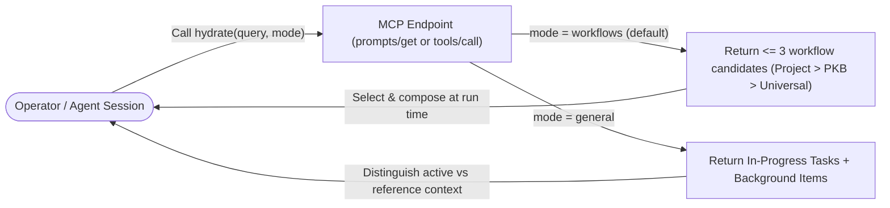

# Hydrate as an MCP Workflow Finder

The `hydrate` MCP endpoint provides on-demand workflow discovery (`workflows` mode, default) and active-versus-background context search (`general` mode) for operators and their agent sessions. Given a free-text query, the server returns up to three candidate workflow descriptions ordered most-specific first so the calling agent can select and compose an execution plan at run time, or partitions general search results into active in-progress tasks and background knowledge.

## User experience flow

## Capabilities and user stories

### US-1 Fast workflow discovery from an instruction

As an operator, I want my agent session to query the MCP server with a task instruction and receive up to three matching workflow descriptions ordered most-specific first, so that the agent selects and composes the right steps without scanning the entire workflow library.

- **AC-1.1** Given a free-text `query` and `mode: "workflows"` (or `mode` omitted, since `"workflows"` is the default), when the endpoint is called, then it searches only workflow and workflow-template documents across configured tiers, applying `Project > PKB > Universal` tier shadowing (higher tiers shadow matching slugs in lower tiers) and scoping project templates to the active `project`.
- **AC-1.2** Given matching workflows, when the response is returned in `workflows` mode, then it contains at most 3 candidate items (id, title, tier/scope, one-line description/pointer) ordered most-specific first for the calling agent to compose.
- **AC-1.3** Given a warm server, when `workflows` mode runs, then it completes within 100 ms.

### US-2 General hydration with active-vs-background separation

As an operator, I want a `general` hydration mode that separates active in-progress work from background knowledge, so that my agent session distinguishes ongoing tasks from reference notes and completed or queued items.

- **AC-2.1** Given a free-text `query` and `mode: "general"`, when the endpoint is called, then results are partitioned into `in_progress` tasks (`type: task`, `status: in_progress`) and background items (notes, knowledge documents, and other tasks) related to the query.

### US-3 Spec-aligned MCP exposure across direct and portal clients

As an operator, I want the workflow finder exposed via native parameterized MCP prompts and mirrored as an MCP tool, so that both direct MCP clients and tool-only Code Mode portals can invoke it.

- **AC-3.1** Given a direct MCP client, when it calls `prompts/list`, then a `hydrate` prompt appears describing `workflows` mode as its primary purpose with arguments `query` (required string) and `mode` (`"workflows"` | `"general"`, default `"workflows"`).
- **AC-3.2** Given a direct MCP client calling `prompts/get` for `hydrate`, when `query` and optional `mode` are supplied, then the server executes the lookup and returns the formatted workflow or general results in `PromptMessage` content.
- **AC-3.3** Given a Code Mode portal client that only invokes `tools/list` and `tools/call`, when the tool surface is enabled, then `hydrate` is callable via `tools/call` with the same `query` and `mode` schema.

## Shared interface contract

The endpoint exposes one shared schema across `prompts/list` + `prompts/get` (for direct MCP clients) and `tools/list` + `tools/call` (for tool-only portals):

| Parameter | Type | Required | Default | Description |
| - | - | - | - | - |
| `query` | `string` | Yes | - | Free-text instruction or search query. |
| `mode` | `enum` (`"workflows"`, `"general"`) | No | `"workflows"` | `"workflows"` searches workflow/template documents only (`<= 3` results, most-specific first); `"general"` returns `in_progress` tasks separated from background items. |

In `workflows` mode, the server performs semantic candidate discovery over workflow/template documents, applies `Project > PKB > Universal` tier shadowing (scoped to the active `project` when provided), and returns at most 3 candidate descriptions ordered most-specific first. In `general` mode, the server runs standard search and partitions results into **In-progress tasks** and **Background**.

## Invariants and security boundaries

- **Authorized access**: Only authenticated callers on the configured MCP transport (direct client or authorized portal) may invoke `hydrate`; returned items are scoped to the caller's authorized knowledge base and active project boundary.
- **Read-only query**: `hydrate` is strictly read-only and idempotent; repeated calls with the same `query` and `mode` mutate no task or knowledge state.
- **Agent-side composition**: The server discovers and returns candidate workflow descriptions; selecting and composing workflows into an execution plan remains the calling agent's responsibility at run time.

## Open questions

- How should universal workflow-library files outside the PKB vault be made available to the PKB server index for single-pass `workflows` discovery (configured workflow directory path vs. vault sync)?
