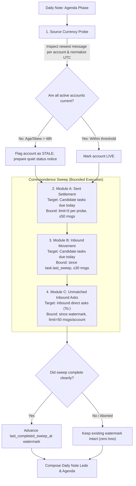

# Bounded-Read Daily Correspondence Sweep and Source Currency Enforcement

This specification establishes the architectural standard, bounded-read invariants, source currency checks, and enforcement design ensuring that every scheduled daily note run executes the correspondence sweep and surfaces all mail requiring action, while strictly bounding per-run read volume to what changed since the last completed sweep.

- **Stated Purpose:** Eliminate correspondence backlog blind spots and unbounded mail reads in daily runs by binding the correspondence sweep into the daily template, establishing per-module query bounds with persistent watermark tracking, and enforcing source freshness validation.
- **Primary Audience:** Framework architects, daily workflow designers, automation engineers, and compliance reviewers.
- **Governing Principles:** Execute precisely the requested task; maintain strict proportion and bounded resource consumption; fail loud on infrastructure faults without silent empty successes; state claims strictly tailored to verified evidence.

## 1. User Stories

### US-1: Bounded-Read Correspondence Sweep Execution

As the framework principal, I want every hourly daily note run to execute the correspondence sweep across all relevant email accounts, so that I am alerted to all correspondence requiring my action without the run reading excessive amounts of data or incurring unbounded token costs.

- **AC-1.1**: Given an executing daily note run, when reaching the agenda phase, then the run executes the correspondence sweep across Modules A, B, and C in sequence without substituting a shallow recent-message listing.
- **AC-1.2**: Given an execution of Module A (Sent-mail settlement), when probing Sent Items, then queries are strictly restricted to open candidate tasks due today or surfaced on the daily note, with targeted recipient and thread subject filters and a hard limit of at most 5 messages per query (ceiling: ≤ 20 queries, ≤ 50 messages read).
- **AC-1.3**: Given an execution of Module B (Inbound movement), when probing Inbox and Archive for candidate tasks, then queries are bounded to candidate tasks due today or surfaced on the note since each task's recorded sweep check, with a hard limit of at most 5 messages per query (ceiling: ≤ 15 queries, ≤ 30 messages read).
- **AC-1.4**: Given an execution of Module C (Unmatched inbound asks), when scanning the inbox for direct asks addressed to the user (`To:`), then the scan reads only messages received since the persistent sweep watermark, capped at a hard limit of 50 messages per account.
- **AC-1.5**: Given a daily run that follows one or more skipped, failed, or aborted runs, when Module C executes, then it scans from the un-advanced sweep watermark up to a safe 48-hour lookback ceiling, ensuring zero message loss between successful sweeps.

### US-2: Mail Source Freshness and Currency Verification

As the framework principal, I want daily note runs to actively verify whether each mail source is current, so that a stale or frozen local store does not falsely masquerade as an absence of new mail.

- **AC-2.1**: Given an executing correspondence sweep, when initializing account checks, then the run inspects the timestamp of the newest available message in each configured mail account.
- **AC-2.2**: Given a mail account whose newest message is older than the freshness threshold (> 48 hours during business days, or showing > 48-hour skew relative to peer active accounts), when evaluated for currency, then the run flags that account as stale/unsynced rather than treating an empty query return as an absence of mail.
- **AC-2.3**: Given a mail account detected as stale or unreachable, when the daily note is composed, then the note records a quiet inline degradation notice and strictly refrains from asserting in the lede that no new mail requires action.
- **AC-2.4**: Given external mail systems hosted on segregated enterprise infrastructure not connected to the local mail interface, when evaluating mail coverage, then the system documents that those accounts are outside the mail connector's reach and must be tracked via task graph items or calendar entries.

## 2. Context and Problem Statement

### 2.1 The Observed Failure Pattern

Scheduled daily note runs exhibit a failure mode where correspondence sweeps are skipped in favor of narrow recent-message queries, resulting in unverified negative claims in the daily lede (such as asserting no mail needs attention) while a substantial backlog of actionable correspondence remains unaddressed.

Investigation of recent runs revealed four compound structural causes:

1. **Vague Descriptive Reference Without Structural Binding:** Daily instructions named the sweep only as a descriptive activity rather than citing a canonical workflow identifier, leading agents to treat superficial message listing calls as fulfilling the requirement.
2. **Narrow Window Blindness:** Querying recent messages across a short window (e.g., the past few hours) inherently blinds the system to the standing backlog of open correspondence tasks received earlier that remain unanswered.
3. **Silent Success on Stale Local Caches:** When an underlying mail connector's local cache store stops syncing, subsequent queries return empty results with success status codes. Systems checking only whether the service is reachable interpret this empty result as an absence of incoming mail.
4. **Omission of Settlement and Inbound Tracking:** Without executing dedicated settlement and movement modules, the system never checks Sent Items to settle completed reply tasks and never inspects open correspondence tasks for incoming movement or nudges.

### 2.2 Account Reachability and Architecture Partitioning

Mail sources fall into three architectural categories:

1. **Primary Institutional Accounts (Live & Connected):** Fully reachable by local mail tools. Holds the active operational backlog (supervisory confirmations, peer review invitations, collaboration approaches). Missed when sweep execution is omitted.
2. **Secondary Accounts (Subject to Local Sync Failure):** Connected to local tools but dependent on upstream sync background jobs. When sync stalls, queries succeed but return stale data. Requires explicit skew and age detection to prevent false negative reporting.
3. **External Enterprise Tenants (Disconnected by Design):** Enterprise accounts segregated by tenant policies and absent from local connector configurations. Completely unreachable by local mail tools. Actions arriving here must be tracked exclusively via external calendar sync or manually captured task nodes.

## 3. Operative Rules and Invariants

### Rule 1: Mandatory Correspondence Sweep Execution Invariant

Every daily note run must execute the canonical correspondence sweep workflow across Modules A, B, and C during the agenda phase. An agent is strictly prohibited from substituting a raw message list call or narrow date filter for the full sweep workflow.

### Rule 2: Bounded Read Invariant

Each correspondence sweep module must operate within strict per-run query bounds to prevent unbounded context consumption:

- **Module A (Sent Settlement):** Probe Sent Items only for active candidate tasks due today or candidate for daily note surfacing, with a limit of at most 5 messages per query (ceiling: ≤ 20 queries, ≤ 50 messages read).
- **Module B (Inbound Movement):** Probe Inbox and Archive only for active candidate tasks since each task's last recorded sweep check, with a limit of at most 5 messages per query (ceiling: ≤ 15 queries, ≤ 30 messages read).
- **Module C (Unmatched Asks):** Scan Inbox for direct personal requests (`To:`) since the persistent sweep watermark, capped at a limit of at most 50 messages per account.
- **Overall Ceiling:** Total messages read across all modules during a single scheduled run must not exceed 100 messages.

### Rule 3: Watermark Persistence & Skipped Run Recovery

The correspondence sweep must maintain a persistent timestamp watermark (`last_completed_sweep_at`) in daily state metadata:

- **Advancement on Success:** The watermark advances to the current run timestamp only upon successful completion of the sweep.
- **Hold on Failure:** If a run skips, fails, or aborts, the watermark remains unchanged. The subsequent run queries from the un-advanced watermark up to a safe 48-hour lookback ceiling, ensuring complete continuity with zero lost mail.
- **Day Boundary Resolution:** The first run of a new day initializes its watermark from the prior day's final daily note watermark, preventing redundant multi-day re-scans.
- **Stale Store Resumption:** When an account recovers from an extended stale state, the sweep executes an outage-recovery query bounded by the 48-hour ceiling.

### Rule 4: Source Currency & Stale Store Detection Invariant

A mail source is not current merely because it returns a successful response or an empty message list:

- **Freshness Probe:** Prior to querying, each run must inspect the timestamp of the newest message in each active account.
- **Timezone Normalization:** Message timestamps returned by external connectors must be normalized to UTC prior to evaluating elapsed time, avoiding false staleness triggers caused by local clock offsets.
- **Skew Detection:** If an account's newest message exhibits greater than 48 hours of age during normal business periods, or shows greater than 48 hours of skew relative to active peer accounts, the source must be flagged as stale.
- **Reporting Contract:** Stale sources must be recorded as quiet inline degradation notices (e.g., `*<account> store stale (newest message YYYY-MM-DD); inbound mail unverified.*`). The daily note lede is strictly prohibited from making unverified negative claims regarding incoming correspondence while any source is stale or unverified.

## 4. Technical Design

### 4.1 Module-by-Module Query Bounds

#### Module A: Sent-Mail Settlement

- **Selection:** Query active tasks tagged or classified as correspondence that are either due today or candidates for daily note surfacing. Historical closed backlog is excluded.
- **Probe Strategy:** For each candidate task (typically 3–8 tasks), execute targeted queries against Sent Items:
  1. Recipient query: match correspondent email address in `To`/`Cc` with date after task creation.
  2. Subject query: match specific thread subject with date after task creation.
- **Bound:** Every query specifies `limit: 5`. Maximum 2 queries per candidate task. Total messages inspected across all candidate tasks is capped at 50 messages.

#### Module B: Inbound Movement on Open Tasks

- **Selection:** Use the same active candidate set as Module A.
- **Probe Strategy:** Query the Inbox and Archive for messages from the correspondent or on the thread subject received since the task's last recorded sweep check.
- **Bound:** Every query specifies `limit: 5`. Maximum 1 query per candidate task. Total messages inspected is capped at 30 messages.

#### Module C: Unmatched Inbound Asks

- **Selection:** Read messages received since the last successful sweep where the user is a primary recipient (`To:`).
- **Watermark Resolution:**
  1. Read `last_completed_sweep_at` from the daily note metadata.
  2. If missing, initialize from the prior daily note's final watermark or 24 hours ago, whichever is more recent.
  3. If elapsed time exceeds 48 hours, cap the query window to 48 hours and log a warning in execution traces.
- **Filtering:** Evaluate semantically for direct personal requests. Exclude automated notices, newsletters, and messages where the user is merely copied.
- **Bound:** Hard ceiling of 50 messages per account. Across active accounts, maximum 100 messages read.

### 4.2 Source Freshness Determination Algorithm

1. For each active account, invoke the recent message tool with `limit: 1`.
2. Extract the timestamp of the newest message and normalize to UTC.
3. Compute age relative to current UTC time.
4. Evaluate skew across accounts:
   - If an account shows greater than 48 hours of inactivity during business periods while peer accounts show recent traffic, flag the account as `STALE`.
5. Degradation Handling:
   - Output quiet inline notice in the agenda section noting that the store is stale and inbound mail for that account is unverified.
   - Constrain the daily lede: forbid stating that no mail needs attention; state clearly which accounts were verified and which remain unverified.

## 5. Proportional Intervention & Enforcement Pyramid Analysis

Following the framework enforcement pyramid:

1. `doctrine only`
2. `instructions` (`suggestion` → `advisory` → `imperative` → `absolute`)
3. `JIT injection`
4. `structural`
5. `process`
6. `post-hoc`

### 5.1 Analysis of Options

- **Option A (Structural / Deterministic Code Wrapper):** Build an executable script to query mail APIs and parse responses deterministically.
  - _Evaluation:_ **REJECTED.** Violates non-mechanical baseline and non-delegable judgment. Evaluating whether an email constitutes an actionable ask, whether an invitation is optional, or whether a sent draft satisfies an obligation requires qualitative semantic comprehension.
- **Option B (Process Gate / Independent Reviewer Subagent):** Dispatch an independent QA reviewer subagent to audit every hourly sweep.
  - _Evaluation:_ **REJECTED.** Disproportionate overhead. Adding a multi-agent review round on every hourly run introduces unsustainable token costs and latency for routine operational runs.
- **Option C (Instructions: Imperative + Post-Hoc: Observability):**
  - _Evaluation:_ **SELECTED (Least-Invasive Winning Increment).**
  - Upgrades instructions from unmapped advisory mentions to an explicit imperative contract binding the sweep workflow, setting strict query ceilings, mandating watermark tracking, and requiring source currency checks.
  - Paired with post-hoc execution traces to ensure observability of per-run read counts and freshness status.

## 6. Implementation Deliverables

To implement this specification, downstream tasks will update the following canonical surfaces:

1. **Daily Template (`tpl_daily`):**
   - Bind the correspondence sweep workflow explicitly by identifier in Step 3.
   - Add the Source Currency Verification requirement to Precondition 0.4.
   - Mandate persistent watermark recording in frontmatter metadata.
2. **Correspondence Sweep Workflow (`wf-email-sweep`):**
   - Formalize the per-module query bounds (`limit: 5` for A/B, `limit: 50` for C).
   - Incorporate the source freshness probe and UTC normalization into initialization.
   - Define watermark tracking and recovery rules for skipped runs.
3. **Daily Reconcile Specification (`spec_daily_reconcile_steps`):**
   - Update Step 3 to reflect bounded sweep execution and source freshness validation.
   - Add the Bounded Read Invariant and Source Currency Invariant to the ownership table.
4. **Repository Enforcement Register (`specs/ENFORCEMENT-MAP.md`):**
   - Register the rule cross-reference row in the active enforcement map.

## 7. Outcome-Level Build Criteria and Replay Verification

For the downstream build task, deliverables must satisfy four concrete criteria:

1. **Build Criterion 1 (Template & Specification Alignment):** Daily template and reconcile specifications bind the sweep workflow by identifier, establish watermark maintenance, and require source freshness verification.
2. **Build Criterion 2 (Workflow Bounds & Freshness):** The sweep workflow defines explicit query limits, 48-hour recovery lookback, and account skew detection.
3. **Build Criterion 3 (Enforcement Map Synchronization):** The rule is registered in the empirical enforcement map.
4. **Build Criterion 4 (Deterministic Replay Verification):**
   - **Scenario Conditions:** A simulated state comprising one live institutional account, one stale secondary account (skew > 48 hours), one documented external enterprise account, and active candidate correspondence tasks.
   - **Verification Checks:**
     - The runner detects the secondary account skew and flags it as stale.
     - Module A executes targeted sent probes for candidate tasks with `limit: 5`.
     - Module B checks inbound movement with `limit: 5`.
     - Module C scans the live inbox from the watermark with `limit: 50`.
     - Total messages read across all modules is strictly ≤ 100 messages.
     - The daily note surfaces pending correspondence, emits a quiet degradation notice for the stale account, and does not assert that no mail needs attention.
     - The watermark advances upon clean completion.

## 8. Regulatory Experiment Record

- **Hypothesis:** Upgrading the correspondence sweep from an unmapped, advisory description to an imperative workflow binding with per-module read bounds, watermark tracking, and source currency verification will eliminate backlog blind spots while bounding per-run mail reads to ≤ 100 messages.
- **What moved:** From unmapped advisory description to `instructions` (`imperative`) and `post-hoc` (`observability`).
- **On what evidence:** Documented run failure where standing correspondence was omitted behind an unverified negative lede claim due to an un-executed sweep and a silent stale store.
- **Observation / Promotion Criteria:** Subsequent daily note runs consistently execute the sweep, correctly detect stale accounts, surface pending correspondence, and complete within the ≤ 100 messages read bound.
- **Kill / Escalation Criteria:** If runs continue to skip the sweep or exceed read bounds, escalate to Level 4 structural partitioning (dispatching the sweep as an isolated background task prior to daily note generation).
