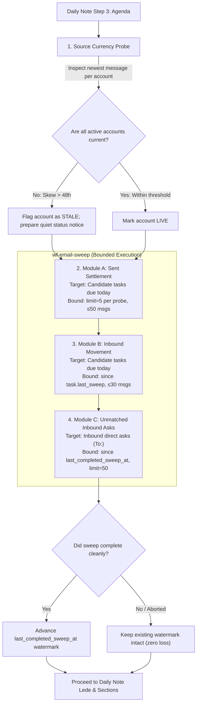

# Bounded-Read Daily Correspondence Sweep and Source Currency Enforcement

This specification establishes the architectural standard, bounded-read invariants, source currency checks, and enforcement design ensuring that every daily note run executes the correspondence sweep and surfaces all mail the user owes action on, while strictly bounding per-run read volume to what changed since the last completed sweep.

- **Stated Purpose:** Eliminate email backlog blind spots and unbounded mail reads in daily runs by binding `wf-email-sweep` into the daily template, establishing per-module query bounds with watermark tracking, and enforcing source freshness validation.
- **Primary Audience:** Framework architects, daily workflow designers, automation engineers, and compliance reviewers.
- **Governing Axioms and Rules:** [`plugins/rbg/skills/axioms/do-one-thing.md`](../../plugins/rbg/skills/axioms/do-one-thing.md) (execute precisely the requested task), [`plugins/rbg/skills/axioms/proportionate.md`](../../plugins/rbg/skills/axioms/proportionate.md) (least mechanism; strict resource bounds), [`plugins/rbg/skills/axioms/fail-fast.md`](../../plugins/rbg/skills/axioms/fail-fast.md) (fail loud on infrastructure faults; no silent empty successes), [`plugins/rbg/skills/axioms/honest-epistemics.md`](../../plugins/rbg/skills/axioms/honest-epistemics.md) (no unverified negative claims), and [`specs/enforcement/enforcement.md`](enforcement.md) (proportional intervention).

## 1. User Stories

### US-1: Bounded-Read Correspondence Sweep Execution

As the framework principal (the user), I want every hourly daily note run to execute the correspondence sweep across all relevant email accounts, so that I am alerted to all correspondence requiring my action without the run reading excessive amounts of data or incurring unbounded token costs.

- **AC-1.1**: Given an executing daily note run, when reaching Step 3 (Agenda), then the run executes `wf-email-sweep` across Modules A, B, and C in sequence without substituting a shallow recent-message listing.
- **AC-1.2**: Given an execution of Module A (Sent-mail settlement), when probing Sent Items, then queries are strictly restricted to open candidate tasks due today or surfaced on the daily note, with targeted recipient and thread subject filters and a hard limit of at most 5 messages per query (ceiling: ≤ 20 queries, ≤ 50 messages read).
- **AC-1.3**: Given an execution of Module B (Inbound movement), when probing Inbox and Archive for candidate tasks, then queries are bounded to candidate tasks due today or surfaced on the note `since` each task's recorded sweep check, with a hard limit of at most 5 messages per query (ceiling: ≤ 15 queries, ≤ 30 messages read).
- **AC-1.4**: Given an execution of Module C (Unmatched inbound asks), when scanning the inbox for direct asks addressed to the user (`To:`), then the scan reads only messages received `since` the persistent `last_completed_sweep_at` watermark, capped at a hard limit of 50 messages per account.
- **AC-1.5**: Given a daily run that follows one or more skipped, failed, or aborted runs, when Module C executes, then it scans from the un-advanced `last_completed_sweep_at` watermark up to a safe 48-hour lookback ceiling, ensuring zero message loss between successful sweeps.

### US-2: Mail Source Freshness and Currency Verification

As the framework principal, I want daily note runs to actively verify whether each mail source is current, so that a stale or frozen local store does not falsely masquerade as "no new mail".

- **AC-2.1**: Given an executing correspondence sweep, when initializing account checks, then the run inspects the timestamp of the newest available message in each configured mail account.
- **AC-2.2**: Given a mail account whose newest message is older than the freshness threshold (> 48 hours during business days, or showing > 48-hour skew relative to other active accounts), when evaluated for currency, then the run flags that account as stale/unsynced rather than treating an empty query result as an absence of mail.
- **AC-2.3**: Given a mail account detected as stale or unreachable, when the daily note is composed, then the note records a quiet inline degradation notice (e.g. `*<account> store stale (newest message YYYY-MM-DD); inbound mail unverified.*`) and strictly forbids asserting in the lede that "no new mail needs you".
- **AC-2.4**: Given external mail systems that are not configured in the local mail connector (such as external board or governance accounts), when evaluating mail coverage, then the system explicitly records that those accounts are outside the email connector's reach and must be tracked via task graph items or calendar entries.

## 2. Context and Failure Analysis: The 2026-11-01 Incident

### 2.1 The Observed Failure

On the morning of 2026-11-01 (Brisbane local time), the daily note run produced a lede asserting:

> "Nothing is on your calendar today and no new mail needs you."

In reality, approximately 27 emails requiring the user's attention or action were pending in the inbox or sitting as overdue correspondence tasks on the graph. These included an external board draft review due on Monday 2026-11-02, multiple manuscript peer-review invitations, formal supervisory audit confirmations, and student inquiries.

Execution telemetry revealed that the run never executed the correspondence sweep:

1. Tool traces recorded only two narrow calls:
   - `email_messages_list_recent({limit: 40, since: "2026-10-31T21:00:00Z"})` on the default institutional account, returning only 2 recent messages.
   - `email_messages_list_recent({limit: 30, since: "2026-10-31T12:00:00Z", account: "personal"})`, returning `[]`.
2. No tool span during the entire session fetched or executed `wf-email-sweep` or any `wf-email-*` workflow.
3. The run blindly converted the 2-message return into the definitive negative claim: "no new mail needs you."

### 2.2 Five Root Causes

1. **Vague Descriptive Reference Without Workflow ID:** Step 3 of `tpl_daily` instructed: _"Run the standalone correspondence-sweep workflow ... over the window since the previous daily note's compose."_ It failed to cite the canonical workflow ID (`wf-email-sweep`) and provided no explicit instruction to load or invoke it. The companion skill summarized this step as _"Step 3: Read today's agenda (correspondence sweep, email, and calendar)"_, which models interpreted as satisfied by an ordinary recent-message listing.
2. **Narrow Date Filters Ignore Standing Backlog:** Calling `email_messages_list_recent` with a narrow `since` filter covering only the last few hours inherently misses all standing correspondence tasks that were received earlier and remain unanswered.
3. **Total Omission of Sweep Modules A, B, and C:**
   - _Module A (Sent-mail settlement)_ was skipped: Sent Items was never queried to determine whether open correspondence tasks had already been answered.
   - _Module B (Inbound movement)_ was skipped: existing open correspondence tasks due today were not checked for incoming replies, follow-ups, or nudges.
   - _Module C (Unmatched inbound asks)_ was skipped: inbound mail was not evaluated for direct asks (`To:`) requiring task creation.
4. **Silent Success on Stale Local Store:** The personal mail store had ceased syncing 7 days prior (newest message was from 2026-10-25). When queried with `since: 2026-10-31`, the mail server returned an empty list (`[]`) with HTTP 200 success. Because `tpl_daily` precondition 0.4 checked only whether a service was _unreachable_ (throwing an error), the stale store passed as completely healthy.
5. **False Negative Assertion in Lede:** Despite checking only a narrow slice and reading a stale store, the agent made the unverified claim that "no new mail needs you", violating `honest-epistemics`.

### 2.3 Per-Account and Per-Email Reachability Findings

The 27 missed items fall into three distinct architectural categories across accounts:

| Account / Source | Status on 2026-11-01 | Reachable by Email Sweep? | Findings & Missed Item Analysis |
| :- | :- | :- | :- |
| **Institutional Account (QUT)** | **Live & Current** (newest message < 15m old) | **YES** | **Reachable.** The vast majority of the 27 items resided here or in PKB tasks derived from it. Missed entirely because `wf-email-sweep` was not run:  • _Overdue reply tasks:_ Lucinda Nelson industry engagement confirmation (due 20 Oct; draft unsent in Drafts); Robyn Mayes visiting scholar inquiry; Jenny Domino thesis prospectus feedback. • _Pending peer-review invitations:_ Human Behavior & Emerging Technologies (received 31 Oct); Information, Communication & Society (RICS-2026-0633.R1); Federal Law Review referee request. • _Inbound actions & invitations:_ 2027 Head of School workload conversation scheduling; Dagstuhl seminar on online hate speech; DMRC visiting scholar seminars. |
| **Personal Account** | **Stale / Unsynced** (frozen at 2026-10-25) | **NO (until upstream sync fixed)** | **Temporarily Unreachable.** The local cache store contained no messages newer than 2026-10-25 due to an upstream connector sync failure. The sweep cannot read what is not in the store. The daily run must detect this skew, report the account as stale, and refrain from claiming the personal inbox is clear. |
| **External Board Tenant** | **External Infrastructure** (not configured in connector) | **NO (by design)** | **Unreachable via Email MCP.** The Oversight Board draft review (due Mon 2 Nov 20:00) resides on a segregated enterprise tenant not connected to the local email MCP. `tpl_daily` explicitly notes: _"The email MCP never reaches Oversight Board email."_ This item was known to the graph and calendar, but can never be verified via mail queries. |

## 3. The Operative Rules

> **Rule 1: Mandatory Correspondence Sweep Execution Invariant**
> Every daily note run must execute `wf-email-sweep` in full sequence (Modules A, B, and C) during Step 3. An agent is strictly prohibited from substituting a raw `email_messages_list_recent` call or narrow date filter for the sweep workflow.
>
> **Rule 2: Bounded Read Invariant**
> Each correspondence sweep module must operate within strict per-run query bounds to prevent unbounded context consumption:
>
> - **Module A (Sent Settlement):** Probe Sent Items only for active candidate tasks due today or surfaced on the daily note (`due <= today` or surfaced in `## Today` / `## Invitations`), with `limit: 5` per query (ceiling: ≤ 20 queries, ≤ 50 messages read).
> - **Module B (Inbound Movement):** Probe Inbox/Archive only for active candidate tasks `since` the task's last sweep check, with `limit: 5` per query (ceiling: ≤ 15 queries, ≤ 30 messages read).
> - **Module C (Unmatched Asks):** Scan Inbox for direct asks (`To:`) `since: last_completed_sweep_at` watermark, capped at `limit: 50` messages per account.
> - **Overall Ceiling:** Total messages read across all modules during a single hourly run must not exceed 100 messages.
>
> **Rule 3: Watermark Persistence & Skipped Run Recovery**
> The correspondence sweep must maintain a persistent timestamp watermark (`last_completed_sweep_at`) in the daily note frontmatter. The watermark advances to the current run timestamp _only upon successful completion_ of the sweep. If a run skips, fails, or aborts, the watermark remains unchanged; the subsequent run queries from the un-advanced watermark up to a safe 48-hour lookback ceiling, ensuring complete continuity with zero lost mail.
>
> **Rule 4: Source Currency & Stale Store Detection Invariant**
> A mail source is not current merely because it returns HTTP 200 or an empty list. Before querying, each run must inspect the timestamp of the newest message in each active account. If an account's newest message exhibits > 48-hour skew during weekdays or relative to peer accounts, the run must flag the source as stale, log the status in the pre-write turn ledger, record a quiet inline degradation notice in the note, and refrain from making any negative assertion in the lede.

## 4. Technical Design

### 4.1 Module-by-Module Query Bounds

#### Module A: Sent-Mail Settlement

- **Selection:** Query the PKB for open tasks tagged or classified as correspondence (`email-reply`, `invitation`, `correspondence`) that are either due today (`due <= today`) or candidate for surfacing in `## Today` or `## Invitations`. Do not iterate through all historical backlog tasks.
- **Probe Strategy:** For each candidate task (typically 3–8 tasks), execute targeted queries against Sent Items:
  1. Recipient query: match correspondent email address in `To`/`Cc` with date after task `created`.
  2. Subject query: match specific thread subject with date after task `created`.
- **Bound:** Every query specifies `limit: 5`. Maximum 2 queries per candidate task. Total messages inspected across all candidate tasks is capped at 50 messages.

#### Module B: Inbound Movement on Open Tasks

- **Selection:** Use the same active candidate set as Module A.
- **Probe Strategy:** Query the Inbox and Archive for messages from the correspondent or on the thread subject received `since: task.last_sweep_check` (or `task.modified`).
- **Bound:** Every query specifies `limit: 5`. Maximum 1 query per candidate task. Total messages inspected is capped at 30 messages.

#### Module C: Unmatched Inbound Asks

- **Selection:** Read all messages received since the last successful sweep where the user is a primary recipient (`To:`).
- **Watermark Resolution:**
  1. Read `last_completed_sweep_at` from the existing daily note frontmatter.
  2. If missing (e.g. first run of the day), set watermark to the compose timestamp of yesterday's daily note or 24 hours ago, whichever is more recent.
  3. If `now - watermark > 48 hours`, cap the query window to 48 hours to prevent token exhaustion, and log a warning in the turn ledger.
- **Query Strategy:** Query active accounts using `email_messages_list_recent({account: acc, since: watermark, limit: 50})`.
- **Filtering:** Filter semantically for direct personal requests (`To:` user). Exclude newsletters, bulk announcements, automated alerts, and messages where the user is merely CC'd.
- **Bound:** Hard ceiling of 50 messages per account. For two active accounts, maximum 100 messages read.

### 4.2 Source Freshness Determination Algorithm

Before executing the sweep queries, the runner evaluates account health:

1. For each account, invoke `email_messages_list_recent({account: acc, limit: 1})`.
2. Extract the timestamp $T_{\text{newest}}$ of the returned message.
3. Calculate age: $\Delta T = T_{\text{now}} - T_{\text{newest}}$.
4. Evaluate against freshness rules:
   - **Normal Business Hours:** If $\Delta T > 48\text{ hours}$, or if $\Delta T_{\text{acc1}} - \Delta T_{\text{acc2}} > 48\text{ hours}$, mark account as `STALE`.
   - **Weekends / Holidays:** Account may be quiet; evaluate relative skew. If institutional account has mail from today but personal account has nothing for 7 days, mark personal account as `STALE`.
5. Impact on Daily Note:
   - If an account is `STALE`, inject quiet inline status in `## Today`: `*<account> store stale (newest message YYYY-MM-DD); inbound personal mail unverified.*`
   - Lede restriction: If any active account is `STALE` or unreachable, the lede MUST NOT state "no new mail needs you". It must qualify the statement: e.g. _"QUT mail is clear; personal mail unverified (store stale)."_

## 5. Proportional Intervention & Enforcement Pyramid Analysis

Following the framework enforcement pyramid in [`specs/enforcement/enforcement.md`](enforcement.md):

1. `doctrine only`
2. `instructions` (`suggestion` → `advisory` → `imperative` → `absolute`)
3. `JIT injection`
4. `structural`
5. `process`
6. `post-hoc`

### 5.1 Options Analysis

- **Option A (Structural / Deterministic Pipeline Script):** Build a standalone Python CLI or shell script that executes mail queries, parses headers with regex, and writes markdown tables.
  - _Evaluation:_ **REJECTED.** Violates `no-over-engineering` and `judgment-non-delegable`. Discerning whether an inbound email requires the user's action, whether an invitation is optional vs. mandatory, and whether a sent message substantively settles an ask requires qualitative semantic reasoning that deterministic scripts cannot perform.
- **Option B (Process Gate / Independent Reviewer Subagent):** Require an independent QA subagent to verify every email sweep before the daily note can be committed.
  - _Evaluation:_ **DISPROPORTIONATE.** Hourly daily runs are high-frequency operational tasks. Adding a multi-agent review round on every hourly run introduces severe token overhead and latency.
- **Option C (Instructions: Imperative + Post-Hoc: Observability):**
  - _Evaluation:_ **SELECTED (Least-Invasive Winning Increment).**
  - Current baseline: `tpl_daily` contains an unmapped, advisory descriptive mention of the sweep without a workflow ID, and lacks bounded-read constraints and source currency checks.
  - Target increment: Escalate within `instructions` from `advisory` to `imperative`, combined with `post-hoc` (`observability`):
    1. Bind `wf-email-sweep` explicitly by ID in `tpl_daily` Step 3 and `spec_daily_reconcile_steps`.
    2. Add imperative preconditions in `tpl_daily` enforcing bounded queries and source currency checks.
    3. Mandate recording sweep receipts and account freshness in the pre-write turn execution ledger.
    4. Register the rule in `specs/ENFORCEMENT-MAP.md`.

## 6. How the Change Reaches Executing Environments

The implementation propagates across all execution surfaces:

1. **PKB Template `tpl_daily` (Immediate Runtime Propagation):**
   - Step 3 updated to mandate loading and executing `wf-email-sweep` across Modules A, B, and C.
   - Precondition 4 expanded to cover Source Currency Verification alongside service unreachability.
   - Bounded read parameters and watermark maintenance defined in template hygiene.
   - Any runner fetching `tpl_daily` immediately receives the updated imperative contract.
2. **PKB Workflow Template `wf-email-sweep` (Canonical Procedure):**
   - Updated with explicit query limits (`limit: 5` for A/B, `limit: 50` for C).
   - Watermark tracking and lookback ceiling (48 hours) incorporated into Module C.
   - Source currency pre-check formalized in workflow initialization.
3. **PKB Specification `spec_daily_reconcile_steps` (Architectural SSoT):**
   - Step 3 row updated to specify `wf-email-sweep` with bounded reads and currency validation.
   - Bounded Read Invariant and Source Currency Invariant documented under Invariants.
4. **Repository Enforcement Map `specs/ENFORCEMENT-MAP.md`:**
   - Registers the new rule cross-reference row in the empirical enforcement register.

## 7. Outcome-Level Build Criteria and Replay Test Case

For the downstream Stage 2 Build task (`aops_6ec68a56`), the deliverables must satisfy four concrete criteria:

1. **Build Criterion 1 (`tpl_daily` & `spec_daily_reconcile_steps`):** Step 3 explicitly names `wf-email-sweep`, establishes the watermark in frontmatter, and mandates source currency checks.
2. **Build Criterion 2 (`wf-email-sweep`):** Carries per-module parameter bounds (`limit: 5` for A/B, `limit: 50` for C), max 48-hour recovery lookback, and source skew detection.
3. **Build Criterion 3 (Enforcement Map Sync):** Row registered in `specs/ENFORCEMENT-MAP.md`.
4. **Build Criterion 4 (Deterministic Replay Test Case of 2026-11-01 Backlog):**
   - **Scenario Input:** Simulate the 2026-11-01 morning mailbox state:
     - Institutional account: Live (newest message 2026-10-31 20:57 UTC).
     - Personal account: Stale (newest message 2026-10-25 01:08 UTC, skew: 7 days).
     - External board account: Documented as external tenant outside connector.
     - Standing backlog: 3 overdue candidate correspondence tasks on graph.
   - **Expected Execution Behavior:**
     - Step 3 detects personal account skew (>48h) and marks it `STALE`.
     - Module A executes targeted Sent queries for the 3 candidate tasks (`limit: 5`), reading ≤ 15 messages.
     - Module B checks inbound movement for the 3 candidate tasks, reading ≤ 15 messages.
     - Module C reads institutional inbox `since: 2026-10-30T22:00:00Z` (`limit: 50`), capturing pending peer reviews.
     - Total messages read across all modules is strictly ≤ 80 messages.
   - **Expected Daily Note Output:**
     - Lede correctly reflects pending correspondence and notes personal account staleness; does NOT assert "no new mail needs you".
     - `## Today` / `## Invitations` surface pending reviews and overdue replies with concrete response mechanisms.
     - Quiet inline notice emitted: `*Personal account store stale (newest message 2026-10-25); inbound personal mail unverified.*`
     - Frontmatter records updated watermark `last_completed_sweep_at`.

## 8. Regulatory Experiment Record

- **Hypothesis:** Upgrading the correspondence sweep from an unmapped, advisory description to an imperative workflow binding with per-module read bounds, watermark tracking, and source currency verification will eliminate backlog blind spots while bounding per-run mail reads to ≤ 100 messages.
- **What moved:** From unmapped advisory description to `instructions` (`imperative`) and `post-hoc` (`observability`) across `tpl_daily`, `spec_daily_reconcile_steps`, `wf-email-sweep`, and `specs/ENFORCEMENT-MAP.md`.
- **On what evidence:** Empirical failure of 2026-11-01 morning run where 27 emails and overdue correspondence tasks were hidden behind an unverified lede claim ("no new mail needs you") due to an un-executed sweep and a week-stale personal mail store.
- **Observation / Promotion Criteria:** Subsequent daily note runs consistently execute `wf-email-sweep`, correctly flag stale accounts, surface pending correspondence in `## Today` / `## Invitations`, and complete within the ≤ 100 messages per run read bound.
- **Kill / Escalation Criteria:** If runs continue to skip the sweep or exceed read bounds, escalate to Level 4 structural partitioning (dispatching the sweep as an isolated background task prior to daily note generation).
