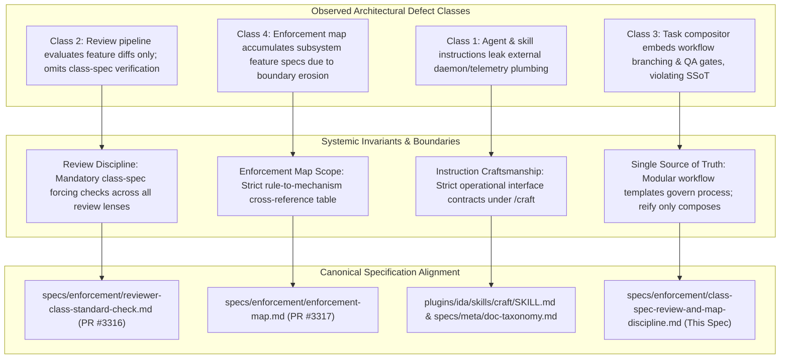

# Class-Spec Review Enforcement, Runtime Workflow Composition, and Enforcement Map Discipline

Systemic design specification establishing the structural, authoring, and review invariants across four architectural defect classes: non-actionable external infrastructure leakage in agent definitions and skills, reviewer verification against governing class specifications, pure runtime workflow composition in task generation skills, and strict rule cross-reference boundaries for the enforcement register.

- **Stated Purpose:** Establishes class-specification review enforcement across QA reviews, eliminates hardcoded workflow branching in task composition skills to uphold Single Source of Truth (SSoT), restores strict rule cross-reference boundaries to `specs/ENFORCEMENT-MAP.md`, and confines agent personas and skills strictly to operational interface contracts.
- **Primary Audience:** Framework architects, reviewer personas (`marsha`, `rbg`, `pauli`), task compositors, and compliance auditors.
- **Governing Architecture:** Extends [`enforcement.md`](enforcement.md), [`reviewer-class-standard-check.md`](reviewer-class-standard-check.md), [`enforcement-map.md`](enforcement-map.md), [`../meta/doc-taxonomy.md`](../meta/doc-taxonomy.md), and [`../../plugins/ida/skills/craft/SKILL.md`](../../plugins/ida/skills/craft/SKILL.md).

## User Stories

### US-1: QA Enforcement of Class Specifications

As a framework auditor and user, I want review processes to validate every modified file against its governing class specification (not merely against PR-specific feature criteria), so that agent personas and skills do not accumulate non-actionable implementation details, inconsistent instructions, or architectural leakage.

- **AC-1.1:** Given a candidate diff modifying an instruction file (`plugins/*/agents/*.md`, `plugins/*/skills/*/SKILL.md`, `plugins/*/workflows/*.md`), when Marsha (`wf-qa`) evaluates the artifact, then Marsha tests the modified file against `plugins/ida/skills/craft/SKILL.md` and renders `FAIL` if the file includes non-actionable external implementation details, couples to neighbour internals, or exceeds line budgets.
- **AC-1.2:** Given a candidate diff modifying a specification or documentation file, when Marsha evaluates the artifact, then Marsha tests the modified file against `specs/meta/doc-taxonomy.md` and `specs/meta/writing-specs.md` and renders `FAIL` if documentation is misplaced, includes historical provenance, or duplicates authoritative state.
- **AC-1.3:** Given a candidate diff modifying an enforcement mechanism or map entry, when Marsha and RBG evaluate the artifact, then they test the modified file against `specs/enforcement/enforcement.md` and render `FAIL` if the mechanism bypasses the options pass or introduces ungrounded non-rule entries.

### US-2: Operational Interface Contracts in Skills and Personas

As an autonomous agent executing tasks, I want agent definitions and skill instructions to specify strictly my operational triggers, preconditions, behavioral boundaries, and input/output contracts, so that prompt context is not bloated with external daemon topologies, container listeners, or telemetry plumbing that I cannot influence or act upon.

- **AC-2.1:** Given an agent definition, when inspected for system interfaces, then it describes status transitions and completion event triggers without detailing backend daemon bridges, container exit listeners, or internal queue topologies.
- **AC-2.2:** Given a dispatch skill, when inspected for completion handling, then it instructs the session on how completion notifications are delivered and acted upon without detailing background telemetry spans, socket listeners, or queue consumption internals.

### US-3: Pure Task Composition from Modular Workflows

As a task reification engine (`pauli`, `/reify`), I want task composition to derive all task structures, steps, and follow-ups exclusively from modular workflow templates, so that workflow rules have a Single Source of Truth (SSoT) and task assembly does not embed hardcoded category branching or bespoke QA gates.

- **AC-3.1:** Given an objective or node being reified, when `/reify` runs, then it hydrates context, composes relevant modular workflow templates, and generates standard task fields (`## Ask`, `## Goal`, `## Acceptance`, `## Instructions`, `## Output`, `## Report`) without evaluating hardcoded task-category branching or ad-hoc review exceptions in the skill body.
- **AC-3.2:** Given a workflow requiring independent QA review, when `/reify` assembles the task graph, then the QA follow-up structure and merge authority are determined strictly by the composed workflow template (`wf-finish.md`, `wf-code-task-base.md`, `wf-qa.md`) and the PR risk taxonomy in `specs/enforcement/enforcement.md`.
- **AC-3.3:** Given a candidate diff modifying `reify/SKILL.md` or any task-creating skill, when RBG (`wf-rbg`) evaluates the diff, then RBG checks compliance with `single-source-of-truth` and `runtime-workflow-composition.md`, rendering `FAIL` if the skill embeds workflow branching or QA gating rules.

### US-4: Concise Rule Cross-Reference Table Boundary

As a compliance reviewer (`rbg`), I want `specs/ENFORCEMENT-MAP.md` to be maintained strictly as a concise cross-reference table mapping governing agent RULES to their enforcement mechanisms, so that the map does not degrade into an arbitrary changelog or inventory of subsystem feature specs.

- **AC-4.1:** Given `specs/ENFORCEMENT-MAP.md` and `specs/enforcement/enforcement.md`, when an agent reads their introductory definitions, then the text explicitly defines the map as a concise cross-reference table documenting what kind of enforcement mechanism is applied to each governing RULE (axioms in `plugins/rbg/skills/axioms/` and project rules in `.agents/rules/`), and explicitly prohibits subsystem feature specs, daemon summaries, and workflow descriptions.
- **AC-4.2:** Given any entry in `specs/ENFORCEMENT-MAP.md`, when audited, then the entry links directly to an authoritative rule definition (an axiom slug or project rule) and specifies its mechanism category (`doctrine only`, `instructions`, `JIT injection`, `structural`, `process`, `post-hoc`), severity gradation, and verification detail.
- **AC-4.3:** Given a candidate diff modifying `specs/ENFORCEMENT-MAP.md`, when RBG evaluates the change, then RBG verifies entry validity (that every added or modified row corresponds to a governing rule) in addition to verifying pinpoint line references, rendering `FAIL` if a subsystem feature spec or workflow summary is introduced.

## Architectural Mapping & Root-Cause Analyses

### Class 1: Non-Actionable External System Implementation Leakage in Personas and Skills

- **Symptom & Defect:** Agent persona definitions (`plugins/*/agents/*.md`) and operational skills (`plugins/*/skills/*/SKILL.md`) frequently accumulate external daemon topologies, container listeners, telemetry span names, and internal queue names.
- **Systemic Cause:** When updating instructions to reflect backend architectural shifts, authors explain the backend mechanics rather than defining the operational trigger, preconditions, and I/O contracts from the executing agent's perspective.
- **Carrying Mechanisms Today:**
  - `specs/ENFORCEMENT-MAP.md:27` (`[Axiom: Excellence]`, `plugins/ida/skills/craft/SKILL.md`).
  - `specs/ENFORCEMENT-MAP.md:55` (`[Instruction Modularity]`, `specs/meta/doc-taxonomy.md:25`).
- **Architectural Invariant:** Under `plugins/ida/skills/craft/SKILL.md` ("One component, one job", "Specify process, not keystrokes", "The Body Is a Budget"), agent and skill instructions specify strictly what the agent must know to act: triggers, preconditions, operational interfaces, and expected outcomes. They name external boundaries (e.g. learning of completion from events delivered to the session) but never the internal mechanisms by which external subsystems generate or route those events.
- **Enforcement Move & Evidence:** Fix at source (`instructions: imperative`). Existing `/craft` rules already prohibit non-actionable external mechanics; the failure was authorial leakage unchecked by review.

### Class 2: Review Pipeline Omission of Class-Specification Verification

- **Symptom & Defect:** Review processes approve candidate changes that pass feature-specific acceptance criteria but violate governing craftsmanship and taxonomy standards.
- **Systemic Cause:** Reviewers evaluate only the PR's explicit task criteria (e.g. confirming removal of legacy strings or green test runs) without testing modified files against their governing class specifications (`/craft` for instructions, `doc-taxonomy.md` for documentation, `enforcement.md` for enforcement mechanisms).
- **Carrying Mechanisms Today:**
  - `specs/ENFORCEMENT-MAP.md:53` (`[Persona: Marsha]`).
  - `plugins/ida/agents/marsha.md:13-21`, `plugins/ida/skills/verify/SKILL.md:15-24`, `plugins/ida/skills/workflow-library/workflows/wf-qa.md:28-35`.
- **Architectural Invariant:** Formally established in companion specification [`reviewer-class-standard-check.md`](reviewer-class-standard-check.md) (PR #3316): QA review instructions mandate evaluating all changed files against their governing class specification, treating non-actionable external implementation details and inconsistent instructions as critical failures (`FAIL`).
- **Enforcement Move & Evidence:** One-step enforcement move within `instructions`: escalate QA review duties from implicit awareness to an explicit mandatory forcing check (`instructions: imperative`). Evidence shows reviewers verify only literal checklist items unless a dedicated forcing check mandates class-spec validation.

### Class 3: Task Composition Skill Embedding Workflow Branching and QA Restrictions

- **Symptom & Defect:** Task composition skills (`plugins/ida/skills/reify/SKILL.md`) embed bespoke workflow branching rules, risk categorizations, and ad-hoc QA review gating logic directly into the skill body.
- **Systemic Cause:** Authors treat the task compositor as a policy engine rather than a pure assembly mechanism, violating:
  1. _Single Source of Truth (SSoT)_ (`plugins/rbg/skills/axioms/single-source-of-truth.md`): Workflows specify full task processes, stages, and QA gates in modular workflow templates (`plugins/ida/skills/workflow-library/workflows/`). Duplicating workflow rules in `reify` creates competing definitions that drift.
  2. _Runtime Workflow Composition_ (`.agents/rules/RULES.md`, `.agents/rules/runtime-workflow-composition.md`): No skill hardcodes workflow branching paths; the composing agent decides at runtime which templates to assemble.
  3. _Autonomous Execution Bounds:_ Task authors must not invent checks and balances outside what composed workflow templates mandate.
- **Carrying Mechanisms Today:**
  - `specs/ENFORCEMENT-MAP.md:36` (`[Axiom: Single Source of Truth]`).
  - `.agents/rules/RULES.md` & `.agents/rules/runtime-workflow-composition.md`.
  - `plugins/ida/skills/reify/SKILL.md`, `wf-task-base.md`, `wf-code-task-base.md`, `wf-finish.md`, `wf-qa.md`.
- **Architectural Invariant:** `reify/SKILL.md` is strictly a pure compositor: it hydrates context, composes modular workflow templates selected dynamically for the objective, formats standard task records, and reports. All execution steps, review gates, and follow-up minting obligations reside exclusively in workflow templates and the PR risk taxonomy.
- **Enforcement Move & Evidence:**
  - For `reify/SKILL.md`: Fix at source (`instructions: imperative`) to purge hardcoded workflow rules.
  - For RBG Review: One-step move within `instructions: imperative` in `plugins/rbg/agents/rbg.md` and `wf-rbg.md` to evaluate task-composition skills explicitly against SSoT and `runtime-workflow-composition.md`.

### Class 4: Subsystem Spec Accumulation and Boundary Erosion in the Enforcement Map

- **Symptom & Defect:** `specs/ENFORCEMENT-MAP.md` accumulates subsystem feature specifications, background daemons, and general workflow summaries rather than governing agent behavioral rules.
- **Systemic Cause:**
  - Ambiguous introductory framing led agents to treat `ENFORCEMENT-MAP.md` as an inventory table for all touched components.
  - Reviewers verified pinpoint reference integrity (whether files and line numbers exist) without verifying entry validity (whether the entry is an agent rule).
- **Carrying Mechanisms Today:**
  - `specs/enforcement/enforcement.md:14,46-54`.
  - `specs/ENFORCEMENT-MAP.md:5-14`.
  - `.agents/rules/RULES.md` (`Enforcement changes run through options pass`).
- **Architectural Invariant:** Formally established in companion specification [`enforcement-map.md`](enforcement-map.md) (PR #3317): `specs/ENFORCEMENT-MAP.md` is strictly a concise cross-reference table documenting what kind of enforcement mechanism is applied to each governing RULE (axioms and project rules). Subsystem feature specs belong in `specs/<subsystem>/<name>.md`, not in the enforcement map. RBG verifies entry validity for any map modification.
- **Enforcement Move & Evidence:** Fix at source in documentation framing, paired with an imperative review instruction for RBG to verify entry validity on enforcement map diffs.

## One-Step Enforcement Moves & Proportionality Analysis

In accordance with the enforcement pyramid options pass ([`specs/enforcement/enforcement.md`](enforcement.md#proportional-intervention-options-pass)), every proposed change is evaluated against the controlled vocabulary:

| Item | Current Mechanism & Severity | Proposed One-Step Move | Justification & Empirical Evidence |
| :- | :- | :- | :- |
| **Marsha Class-Spec Review Duty** | `instructions`, `advisory` (general criteria review) | Escalate to `instructions`, `imperative` (mandatory forcing check in `marsha.md`, `verify/SKILL.md`, and `wf-qa.md`) | Field evidence demonstrated that without an explicit class-spec forcing check, QA reviewers pass severe instruction craft violations because they evaluate only feature acceptance criteria. |
| **Agent Definition Operational Boundaries** | `instructions`, `imperative` | Fix at source (`instructions`, `imperative`) | Existing `/craft` rules already prohibit non-actionable external details; the defect was an editing lapse. |
| **Skill Interface Boundaries** | `instructions`, `imperative` | Fix at source (`instructions`, `imperative`) | Existing `/craft` rules already mandate operational contract separation; verified by Marsha's class-spec forcing check. |
| **Task Composition Modularity (`reify/SKILL.md`)** | `instructions`, `imperative` (with embedded workflow logic) | Fix at source (`instructions`, `imperative`): purge hardcoded workflow rules; pure template composition | SSoT and runtime-workflow-composition rules already exist; embedding workflow logic into `reify` was a direct SSoT violation requiring cleanup at the source. |
| **RBG Task Composition Review Duty** | `instructions`, `advisory` (general axiom check) | Escalate to `instructions`, `imperative` (explicit SSoT & runtime-composition check on task skills in `rbg.md`, `wf-rbg.md`) | Field evidence proved reviewers pass hardcoded workflow logic unless explicitly instructed to verify task skills against SSoT and `runtime-workflow-composition.md`. |
| **Enforcement Map Purpose Definition** | `doctrine only` (ambiguous intro statements) | Fix at source (`instructions`, `imperative` in `specs/ENFORCEMENT-MAP.md` and `specs/enforcement/enforcement.md`) | Ambiguity in the document's introductory framing led agents to treat it as a subsystem changelog; clarifying the definition resolves the root cause. |
| **RBG Enforcement Map Entry-Validity Review** | `process`, `required gate` (pinpoint ref check only) | Escalate within `instructions`, `imperative` in `rbg.md` & `wf-rbg.md` to verify Entry Validity | Review evidence showed reviewers approved subsystem entries because line pinpoints existed; RBG must evaluate whether the entry represents an agent rule. |

## Architectural Foundation & Sibling Spec Alignment

To maintain Single Source of Truth (SSoT) and prevent branch divergence across release branches, this specification aligns directly with its established companion specifications:

1. **Reviewer Class-Standard Verification**: Detailed review forcing checks, prompt templates, and evaluation criteria for Marsha's review duty are canonical in [`specs/enforcement/reviewer-class-standard-check.md`](reviewer-class-standard-check.md) (PR #3316).
2. **Enforcement Map Schema & Concision**: Detailed table schema rules, entry-validity criteria, and the conformed register are canonical in [`specs/enforcement/enforcement-map.md`](enforcement-map.md) (PR #3317).
3. **Pure Reification & Instruction Craftsmanship**: The architectural boundaries governing pure runtime template composition in `reify/SKILL.md` and operational contract containment in `craft/SKILL.md` are defined herein.

## Implementation Contracts for the Build Stage

The downstream implementation stage will apply these architectural contracts across target files:

### 1. `specs/enforcement/enforcement.md`

- Clarify § "The table schema (4 columns)" to establish that `specs/ENFORCEMENT-MAP.md` is strictly a concise cross-reference table showing what kind of enforcement mechanism is applied to each governing rule.
- Prohibit using the map as a subsystem feature inventory or workflow summary.
- Update review role definitions to include Marsha's mandatory Class-Spec Verification duty and RBG's Entry-Validity duty.

### 2. `specs/ENFORCEMENT-MAP.md`

- Reframe the introductory header to state unambiguously the concise cross-reference rule table purpose and boundary.
- Audit all rows, removing entries that summarize subsystem feature specifications or workflow lifecycle summaries rather than governing agent rules.

### 3. `plugins/ida/agents/marsha.md`, `plugins/ida/skills/verify/SKILL.md`, & `wf-qa.md`

- Add the mandatory Class Specification Verification duty: evaluate all changed files against their governing class spec (`/craft` for instructions, `doc-taxonomy.md` for docs, `enforcement.md` for enforcement), rejecting non-actionable external implementation details and inconsistent instructions.

### 4. `plugins/rbg/agents/rbg.md` & `plugins/ida/skills/workflow-library/workflows/wf-rbg.md`

- Add explicit review instructions to:
  - Verify that skills creating tasks do not embed hardcoded workflow branching or QA restrictions (enforcing SSoT and `runtime-workflow-composition.md`).
  - Verify that any added or modified row in `specs/ENFORCEMENT-MAP.md` represents an active governing rule.

### 5. `plugins/ida/skills/reify/SKILL.md`

- Purge hardcoded QA minting sections and task-category branching.
- Retain only pure composition: hydrate, compose modular workflows in context, write standard task records, and report. All follow-ups derive from composed workflow templates.

### 6. `plugins/ida/skills/dispatch/SKILL.md` & `plugins/ida/agents/sara.md`

- Strip references to backend daemon bridges, Docker exit listeners, queue topologies, and internal telemetry spans, defining strictly the operational interface contracts for completion event delivery.

## Verification & Observability Metrics

The effectiveness of these systemic fixes will be observed and measured across future pull requests and framework sessions:

1. **Instruction Cleanliness:** Zero references to internal daemon queues, Docker exit listeners, or backend telemetry plumbing in `plugins/*/agents/*.md` and `plugins/*/skills/*/SKILL.md`.
2. **Review Catch Rate:** Marsha's QA reviews explicitly evaluate changed files against class specs (`/craft`, `doc-taxonomy.md`, `enforcement.md`), catching and rejecting non-actionable implementation details before merge.
3. **Task Composition Modularity:** `plugins/ida/skills/reify/SKILL.md` remains strictly under 80 lines and contains zero task-category branching logic. Reified tasks derive their full structure from workflow templates.
4. **Enforcement Map Hygiene:** `specs/ENFORCEMENT-MAP.md` contains 100% rule cross-reference rows, with zero subsystem feature specifications or workflow lifecycle summaries.
