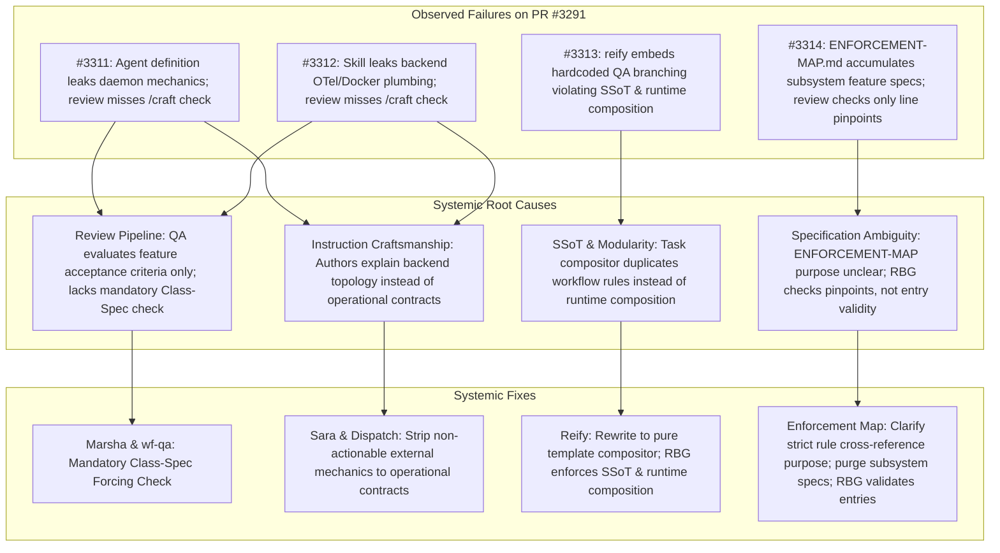

# Class-Spec Review Enforcement, Runtime Workflow Composition, and Enforcement Map Discipline

Systemic design specification detailing the structural and review fixes resolving the four root-cause classes diagnosed in issues #3311, #3312, #3313, and #3314.

- **Stated Purpose:** Establishes class-specification review enforcement across QA reviews, eliminates hardcoded workflow branching in task composition skills to uphold Single Source of Truth (SSoT), restores strict rule cross-reference boundaries to `specs/ENFORCEMENT-MAP.md`, and strips non-actionable external infrastructure mechanics from agent and skill instructions.
- **Primary Audience:** Framework architects, reviewer personas (`marsha`, `rbg`, `pauli`), task compositors, and compliance auditors.
- **Governing Architecture:** Extends [`enforcement.md`](enforcement.md), [`../meta/doc-taxonomy.md`](../meta/doc-taxonomy.md), and [`../../plugins/ida/skills/craft/SKILL.md`](../../plugins/ida/skills/craft/SKILL.md).

## User Stories

### US-1: QA Enforcement of Class Specifications

As a framework auditor and user, I want review processes to validate every modified file against its governing class specification (not merely against PR-specific feature criteria), so that agent personas and skills do not accumulate non-actionable implementation details, inconsistent instructions, or architectural leakage.

- **AC-1.1:** Given a candidate diff modifying an instruction file (`plugins/*/agents/*.md`, `plugins/*/skills/*/SKILL.md`, `plugins/*/workflows/*.md`), when Marsha (`wf-qa`) evaluates the artifact, then Marsha tests the modified file against `plugins/ida/skills/craft/SKILL.md` and renders `FAIL` if the file includes non-actionable external implementation details, couples to neighbour internals, or exceeds line budgets.
- **AC-1.2:** Given a candidate diff modifying a specification or documentation file, when Marsha evaluates the artifact, then Marsha tests the modified file against `specs/meta/doc-taxonomy.md` and `specs/meta/writing-specs.md` and renders `FAIL` if documentation is misplaced, includes historical provenance, or duplicates authoritative state.
- **AC-1.3:** Given a candidate diff modifying an enforcement mechanism or map entry, when Marsha and RBG evaluate the artifact, then they test the modified file against `specs/enforcement/enforcement.md` and render `FAIL` if the mechanism bypasses the options pass or introduces ungrounded non-rule entries.

### US-2: Operational Interface Contracts in Skills and Personas

As an autonomous agent executing tasks, I want agent definitions and skill instructions to specify strictly my operational triggers, preconditions, behavioral boundaries, and input/output contracts, so that prompt context is not bloated with external daemon topologies, container listeners, or telemetry plumbing that I cannot influence or act upon.

- **AC-2.1:** Given an agent definition (`plugins/ida/agents/sara.md`), when inspected for system interfaces, then it describes status transitions and completion event triggers without detailing backend daemon bridges, Docker exit listeners, or internal queue names.
- **AC-2.2:** Given a dispatch skill (`plugins/ida/skills/dispatch/SKILL.md`), when inspected for completion handling, then it instructs the session on how completion notifications are delivered and acted upon without detailing background OTel spans, Docker socket listeners, or queue consumption internals.

### US-3: Pure Task Composition from Modular Workflows

As a task reification engine (`pauli`, `/reify`), I want task composition to derive all task structures, steps, and follow-ups exclusively from modular workflow templates, so that workflow rules have a Single Source of Truth (SSoT) and task assembly does not embed hardcoded category branching or bespoke QA gates.

- **AC-3.1:** Given an objective or node being reified, when `/reify` runs, then it hydrates context, composes relevant modular workflow templates, and generates standard task fields (`## Ask`, `## Goal`, `## Acceptance`, `## Instructions`, `## Output`, `## Report`) without evaluating hardcoded task-category branching or ad-hoc review exceptions in the skill body.
- **AC-3.2:** Given a workflow requiring independent QA review, when `/reify` assembles the task graph, then the QA follow-up structure and merge authority are determined strictly by the composed workflow template (`wf-finish.md`, `wf-code-task-base.md`, `wf-qa.md`) and the PR risk taxonomy in `specs/enforcement/enforcement.md`.
- **AC-3.3:** Given a candidate diff modifying `reify/SKILL.md` or any task-creating skill, when RBG (`wf-rbg`) evaluates the diff, then RBG checks compliance with `single-source-of-truth` and `runtime-workflow-composition.md`, rendering `REJECT` if the skill embeds workflow branching or QA gating rules.

### US-4: Concise Rule Cross-Reference Table Boundary

As a compliance reviewer (`rbg`), I want `specs/ENFORCEMENT-MAP.md` to be maintained strictly as a concise cross-reference table mapping governing agent RULES to their enforcement mechanisms, so that the map does not degrade into an arbitrary changelog or inventory of subsystem feature specs.

- **AC-4.1:** Given `specs/ENFORCEMENT-MAP.md` and `specs/enforcement/enforcement.md`, when an agent reads their introductory definitions, then the text explicitly defines the map as a concise cross-reference table documenting what kind of enforcement mechanism is applied to each governing RULE (axioms in `plugins/rbg/skills/axioms/` and project rules in `.agents/rules/`), and explicitly prohibits subsystem feature specs, daemon summaries, and workflow descriptions.
- **AC-4.2:** Given any entry in `specs/ENFORCEMENT-MAP.md`, when audited, then the entry links directly to an authoritative rule definition (an axiom slug or project rule) and specifies its mechanism category (`doctrine only`, `instructions`, `JIT injection`, `structural`, `process`, `post-hoc`), severity gradation, and verification detail.
- **AC-4.3:** Given a candidate diff modifying `specs/ENFORCEMENT-MAP.md`, when RBG evaluates the change, then RBG verifies entry validity (that every added or modified row corresponds to a governing rule) in addition to verifying pinpoint line references, rendering `REJECT` if a subsystem feature spec or workflow summary is introduced.

## Architectural Mapping & Root-Cause Analyses

This design directly resolves the four /learn issues filed from PR #3291 review comments:

### Issue 1 (#3311): Agent Definitions Accumulating Non-Actionable External System Details

- **Target File:** `plugins/ida/agents/sara.md:49`.
- **Systemic Cause:**
  - _Authoring defect:_ Agent definitions (`plugins/*/agents/*.md`) accumulated external system architecture details (daemon bridge internals, Docker exit listener, OTel span names, queue names) rather than remaining confined to the agent's role, behavioral rules, and interface contracts per `plugins/ida/skills/craft/SKILL.md`.
  - _Verification defect:_ Marsha (`wf-qa`) evaluated only the PR feature criteria (confirming removal of `[polecat-exit]`) and did not check modified files against their class spec (`plugins/ida/skills/craft/SKILL.md`).
- **Mechanisms Carrying the Affected Rule Today:**
  - `specs/ENFORCEMENT-MAP.md:27` (`[Axiom: Excellence]`, `plugins/ida/agents/marsha.md`, `plugins/ida/skills/craft/SKILL.md`).
  - `specs/ENFORCEMENT-MAP.md:53` (`[Persona: Marsha]`, `plugins/ida/agents/marsha.md:15`).
  - Full target files: `plugins/ida/agents/sara.md:49`, `plugins/ida/agents/marsha.md:13-21`, `plugins/ida/skills/verify/SKILL.md:15-24`, `plugins/ida/skills/workflow-library/workflows/wf-qa.md:28-35`.
- **Proposed Fix:**
  - _Fix at source (`sara.md`):_ Update line 49 to state only the operational contract: "Workers set `in_progress` on claim and `done`, `partial`, or `failed` on release; learn of completions from completion events delivered to the session rather than polling or timers, and never write worker statuses directly."
  - _Fix in review lens (`marsha.md`, `verify/SKILL.md`, `wf-qa.md`):_ Add an explicit, mandatory review duty: **Class Specification Verification**. Require Marsha to identify the class spec for every modified file (e.g. `plugins/ida/skills/craft/SKILL.md` for instruction, persona, and skill files; `specs/meta/doc-taxonomy.md` for documentation; `specs/enforcement/enforcement.md` for enforcement mechanisms) and evaluate compliance, rejecting unnecessary implementation detail that the agent cannot act upon and inconsistent instructions.
- **Enforcement Move & Evidence:**
  - For `sara.md`: Fix at source (`instructions: imperative`). Existing `/craft` principles already forbid non-actionable detail.
  - For QA Review: One-step enforcement move on the pyramid within `instructions`: escalate QA review duties from implicit awareness to an explicit mandatory forcing check (`instructions: imperative` in `marsha.md:15`, `verify/SKILL.md:18`, and `wf-qa.md:29`).
  - _Evidence:_ Review comment on PR #3291 demonstrated that without an explicit class-spec forcing check in QA instructions, reviewer agents evaluate only literal task acceptance criteria and allow severe craftsmanship violations into production files.
- **Observation Proving It Worked:**
  - `plugins/ida/agents/sara.md` contains 0 references to daemon bridges, queues, Docker listeners, or OTel spans.
  - Review reports produced by `marsha` on instruction changes explicitly cite compliance with `/craft`, rejecting PRs that introduce non-actionable external mechanics.

### Issue 2 (#3312): Skill Instructions Leaking External Infrastructure Mechanics

- **Target File:** `plugins/ida/skills/dispatch/SKILL.md:31`.
- **Systemic Cause:**
  - _Authoring defect:_ Skill instructions (`plugins/*/skills/*/SKILL.md`) explained backend infrastructure mechanics, daemon topologies, and telemetry pipelines rather than defining the operational trigger, preconditions, and I/O contracts for the executing agent per `plugins/ida/skills/craft/SKILL.md`.
  - _Verification defect:_ Reviewers passed the skill change because it aligned with backend telemetry designs, failing to evaluate the skill against its class spec (`/craft`).
- **Mechanisms Carrying the Affected Rule Today:**
  - `specs/ENFORCEMENT-MAP.md:27` (`[Axiom: Excellence]`).
  - `specs/ENFORCEMENT-MAP.md:55` (`[Instruction Modularity]`, `specs/meta/doc-taxonomy.md:25`).
  - Full target files: `plugins/ida/skills/dispatch/SKILL.md:28-42`, `plugins/ida/skills/craft/SKILL.md`.
- **Proposed Fix:**
  - _Fix at source (`dispatch/SKILL.md`):_ Update Section 3 ("Receive completion events") to state strictly the operational interface: "Do not poll workers or wait on a timer (no status checking loops, no sleep loops, no cron timers). The dispatching session learns of worker completion from completion notifications delivered to the session rather than polling or timers."
  - _Review enforcement:_ Evaluated under the mandatory class-spec forcing check in Marsha (`#3311`), testing skill instructions for conciseness, body token budgets, and operational contract separation.
- **Enforcement Move & Evidence:**
  - For `dispatch/SKILL.md`: Fix at source (`instructions: imperative`).
  - For QA Review: Handled under the one-step escalation of the class-spec forcing check in `marsha.md` and `wf-qa.md`.
  - _Evidence:_ Review comment on PR #3291 showed that authors instinctively explain backend daemon mechanics in skills unless guided by clear operational contract boundaries and verified by class-spec review.
- **Observation Proving It Worked:**
  - `plugins/ida/skills/dispatch/SKILL.md` lines 28-36 contain 0 references to Docker exit listeners, OpenTelemetry spans, or `polecat_events` queues.
  - Dispatching sessions execute cleanly without coupling to daemon architecture.

### Issue 3 (#3313): Task Composition Skill Embedding Workflow Branching and QA Restrictions

- **Target File:** `plugins/ida/skills/reify/SKILL.md:94`.
- **Systemic Cause:**
  - _Authoring defect:_ `plugins/ida/skills/reify/SKILL.md` embedded bespoke workflow branching rules, risk categorization ("low-risk internal changes chiefly bugfixes"), and QA follow-up minting logic under `### Mint QA follow-up when required` (lines 85-98), rather than functioning as a pure compositor that derives task stages and follow-ups from modular workflow templates (`plugins/ida/skills/workflow-library/workflows/`).
  - _Rule violations:_
    1. Single Source of Truth (SSoT) (`plugins/rbg/skills/axioms/single-source-of-truth.md`): Workflow processes are authored and maintained in workflow templates; hardcoding them in `reify` creates competing definitions.
    2. Workflows are composed at run time (`.agents/rules/RULES.md:46`, `.agents/rules/runtime-workflow-composition.md`): No skill hardcodes workflow branching paths; the composing agent decides at runtime which templates to assemble.
    3. Sara & task author discipline: Agents have explicit instructions not to add unrequested checks, balances, and restrictions outside composed workflow templates.
  - _Verification defect:_ RBG verified diff size and general authority without testing against SSoT and `runtime-workflow-composition.md`. Marsha evaluated only specimen test cases (Case A and Case B) rather than architectural rule compliance.
- **Mechanisms Carrying the Affected Rule Today:**
  - `specs/ENFORCEMENT-MAP.md:36` (`[Axiom: Single Source of Truth]`).
  - `.agents/rules/RULES.md:46` (`Workflows are composed at run time`).
  - `.agents/rules/runtime-workflow-composition.md`.
  - Full target files: `plugins/ida/skills/reify/SKILL.md:1-119`, `plugins/ida/skills/workflow-library/workflows/wf-task-base.md`, `wf-code-task-base.md`, `wf-finish.md`, `wf-qa.md`, `plugins/rbg/agents/rbg.md`, `wf-rbg.md`.
- **Proposed Fix:**
  - _Fix at source (`reify/SKILL.md`):_ Completely rewrite `plugins/ida/skills/reify/SKILL.md` so that it is solely about how to compose a task from modular workflow templates. Delete lines 85-98 (`### Mint QA follow-up when required`) and all hardcoded task category branching. Follow-ups (including independent QA review tasks) are minted strictly when and how the composed workflow templates mandate.
  - _Workflow template alignment:_ Ensure modular workflow templates (`wf-task-base.md`, `wf-code-task-base.md`, `wf-finish.md`, `wf-qa.md`) explicitly state their follow-up contracts and merge criteria per the PR risk taxonomy in `specs/enforcement/enforcement.md`.
  - _Fix in review lens (`rbg.md`, `wf-rbg.md`):_ Add an explicit compliance check for task-creating skills and workflows against SSoT and `runtime-workflow-composition.md`, rejecting any hardcoded workflow branching in skills.
- **Enforcement Move & Evidence:**
  - For `reify/SKILL.md`: Fix at source (`instructions: imperative`). Purges duplicate workflow rules.
  - For RBG Review: One-step enforcement move within `instructions`: add an explicit SSoT and runtime-workflow-composition check for task-composition skills (`instructions: imperative` in `rbg.md` and `wf-rbg.md`).
  - _Evidence:_ Review comment on PR #3291 confirmed that hardcoded workflow restrictions repeatedly recur in `reify/SKILL.md` unless RBG actively polices SSoT and runtime composition boundaries.
- **Observation Proving It Worked:**
  - `plugins/ida/skills/reify/SKILL.md` contains 0 category branching logic, 0 hardcoded QA minting rules, and stays strictly under 80 lines.
  - All reified tasks derive their acceptance criteria, instructions, and follow-ups 100% from composed workflow templates.

### Issue 4 (#3314): ENFORCEMENT-MAP.md Accumulating Subsystem Specs Due to Unclear Purpose

- **Target File:** `specs/ENFORCEMENT-MAP.md:70`.
- **Systemic Cause:**
  - _Document purpose ambiguity:_ The introductory framing of `specs/ENFORCEMENT-MAP.md` and `specs/enforcement/enforcement.md` did not state with sufficient force that the map is strictly a concise cross-reference table documenting what KIND of enforcement mechanism is applied to each governing RULE (axioms in `plugins/rbg/skills/axioms/` and project rules in `.agents/rules/`). Agents perceived it as a changelog or inventory of all architectural features and subsystem guarantees (e.g. adding rows for "Polecat Completion Reporting & Session Waking").
  - _Verification defect:_ RBG and automated tests checked pinpoint reference integrity (`test_check_refs.py`), verifying that file paths and line ranges existed, but did not test ENTRY VALIDITY (whether the entry is an agent behavioral rule governed by the enforcement pyramid).
- **Mechanisms Carrying the Affected Rule Today:**
  - `specs/enforcement/enforcement.md:14,46-54` (`The table schema (4 columns)`).
  - `specs/ENFORCEMENT-MAP.md:5-14`.
  - `.agents/rules/RULES.md:15` (`Enforcement changes run through options pass`).
  - Full target files: `specs/ENFORCEMENT-MAP.md`, `specs/enforcement/enforcement.md`, `plugins/rbg/agents/rbg.md`, `wf-rbg.md`.
- **Proposed Fix:**
  - _Fix at source (`specs/ENFORCEMENT-MAP.md` & `specs/enforcement/enforcement.md`):_
    1. Update the title and intro statements of `specs/ENFORCEMENT-MAP.md` to state clearly: "A concise cross-reference table showing what KIND of enforcement mechanism is applied to each governing RULE. It is NOT a changelog, architectural inventory, or summary of subsystem specs and workflows."
    2. Update `specs/enforcement/enforcement.md` (§ "The table schema (4 columns)") to explicitly define entry validity: an entry belongs in `ENFORCEMENT-MAP.md` ONLY if it corresponds to an active governing rule (an axiom in `plugins/rbg/skills/axioms/` or a project rule in `.agents/rules/`).
    3. Perform a comprehensive sweep of `specs/ENFORCEMENT-MAP.md`, pruning entries that summarize subsystem feature specifications, background daemons, or workflow lifecycle summaries rather than governing agent rules.
  - _Fix in review lens (`rbg.md`, `wf-rbg.md`):_ Update RBG review instructions to require checking ENTRY VALIDITY on any diff touching `specs/ENFORCEMENT-MAP.md`: verify that every added or modified row references a recognized rule slug in axioms or project rules, rejecting entries that summarize general subsystem features.
- **Enforcement Move & Evidence:**
  - For `specs/ENFORCEMENT-MAP.md` & `specs/enforcement/enforcement.md`: Fix at source (`instructions: imperative` in spec/doc definition).
  - For RBG Review: One-step enforcement move within `instructions`: escalate RBG review duties on enforcement map diffs from pinpoint reference checking to entry-validity checking (`instructions: imperative` in `rbg.md` and `wf-rbg.md`).
  - _Evidence:_ Review comment on PR #3291 and Telegram message 789 demonstrated that without clear boundary statements and entry-validity review checks, agents repeatedly treat `ENFORCEMENT-MAP.md` as an inventory table for subsystem features.
- **Observation Proving It Worked:**
  - The intro statement of `specs/ENFORCEMENT-MAP.md` unambiguously defines its role as a concise rule cross-reference table.
  - 100% of rows in `specs/ENFORCEMENT-MAP.md` map to an active axiom or project rule.
  - RBG review reports reject candidate PRs adding non-rule subsystem features to `specs/ENFORCEMENT-MAP.md`.

## One-Step Enforcement Moves & Proportionality Analysis

In accordance with the enforcement pyramid options pass ([`specs/enforcement/enforcement.md`](enforcement.md#proportional-intervention-options-pass)), every proposed change is evaluated against the controlled vocabulary:

| Item | Current Mechanism & Severity | Proposed One-Step Move | Justification & Empirical Evidence |
| :- | :- | :- | :- |
| **Marsha Class-Spec Review Duty** | `instructions`, `advisory` (general criteria review) | Escalate to `instructions`, `imperative` (mandatory forcing check in `marsha.md`, `verify/SKILL.md`, and `wf-qa.md`) | PR #3291 review comment 1 demonstrated that without an explicit class-spec forcing check, QA reviewers pass severe instruction craft violations because they evaluate only feature acceptance criteria. |
| **Agent Definition Boundaries (`sara.md`)** | `instructions`, `imperative` | Fix at source (`instructions`, `imperative`) | Existing `/craft` rules already prohibit non-actionable external details; the defect was an editing lapse. |
| **Skill Interface Boundaries (`dispatch/SKILL.md`)** | `instructions`, `imperative` | Fix at source (`instructions`, `imperative`) | Existing `/craft` rules already mandate operational contract separation; caught going forward by Marsha's class-spec forcing check. |
| **Task Composition Modularity (`reify/SKILL.md`)** | `instructions`, `imperative` (with embedded workflow logic) | Fix at source (`instructions`, `imperative`): purge hardcoded workflow rules; pure template composition | SSoT and runtime-workflow-composition rules already exist; embedding workflow logic into `reify` was a direct SSoT violation requiring cleanup at the source. |
| **RBG Task Composition Review Duty** | `instructions`, `advisory` (general axiom check) | Escalate to `instructions`, `imperative` (explicit SSoT & runtime-composition check on task skills in `rbg.md`, `wf-rbg.md`) | PR #3291 review comment 3 proved reviewers pass hardcoded workflow logic unless explicitly instructed to verify task skills against SSoT and `runtime-workflow-composition.md`. |
| **Enforcement Map Purpose Definition** | `doctrine only` (ambiguous intro statements) | Fix at source (`instructions`, `imperative` in `specs/ENFORCEMENT-MAP.md` and `specs/enforcement/enforcement.md`) | Ambiguity in the document's introductory framing led agents to treat it as a subsystem changelog; clarifying the definition resolves the root cause. |
| **RBG Enforcement Map Entry-Validity Review** | `process`, `required gate` (pinpoint ref check only) | Escalate within `instructions`, `imperative` in `rbg.md` & `wf-rbg.md` to verify Entry Validity | PR #3291 review comment 4 showed reviewers approved subsystem entries because line pinpoints existed; RBG must evaluate whether the entry is an agent rule. |

## Detailed Implementation Plan for Stage 2 (Build)

Stage 2 (`aops_6af91c53`) will implement the design across target files as follows:

### 1. `specs/enforcement/enforcement.md`

- Update § "The table schema (4 columns)" to establish that `specs/ENFORCEMENT-MAP.md` is strictly a concise cross-reference table showing what KIND of enforcement mechanism is applied to each governing RULE (axioms and project rules).
- Add explicit prohibition against using the map as a subsystem feature inventory or workflow summary.
- Update § "Three non-overlapping review roles" to include Marsha's mandatory Class-Spec Verification duty and RBG's Entry-Validity duty for map changes.

### 2. `specs/ENFORCEMENT-MAP.md`

- Rewrite the introductory header to state unambiguously the concise cross-reference rule table purpose and boundary.
- Perform a sentence-by-sentence audit across all rows, purging subsystem feature specs and workflow summaries.
- Ensure every remaining row links to a genuine axiom or project rule.

### 3. `plugins/ida/agents/marsha.md`

- In § "Review Duties (Running Things)", add duty: **Class specification verification**. Check all modified files against their governing class spec (`/craft` for instructions, `doc-taxonomy.md` for docs, `enforcement.md` for enforcement), rejecting non-actionable external implementation details and inconsistent instructions.

### 4. `plugins/ida/skills/verify/SKILL.md`

- In § 2 ("Mandatory Forcing Checks"), add a mandatory forcing check for **Class specification verification** answering explicitly whether changed files comply with their governing class spec.

### 5. `plugins/ida/skills/workflow-library/workflows/wf-qa.md`

- In § "Procedure", integrate the class specification check alongside Gate 0 and criteria verification.

### 6. `plugins/rbg/agents/rbg.md` & `plugins/ida/skills/workflow-library/workflows/wf-rbg.md`

- In § "Review Duties", add:
  - Task composition skill check: verify that skills creating tasks do not embed hardcoded workflow branching or QA restrictions (enforcing SSoT and `runtime-workflow-composition.md`).
  - Enforcement map entry-validity check: verify that any added or modified row in `specs/ENFORCEMENT-MAP.md` represents an active governing rule.

### 7. `plugins/ida/skills/reify/SKILL.md`

- Delete section `### Mint QA follow-up when required` (lines 85-98) and all category-based branching.
- Retain only the 4-step pure composition process: (1) Hydrate, (2) Compose workflows, (3) Write each task, (4) Report.
- Follow-ups and QA tasks are minted strictly per the composed workflow templates.

### 8. `plugins/ida/skills/dispatch/SKILL.md`

- Update Section 3 ("Receive completion events") lines 28-36 to specify only the operational interface contract: receiving completion notifications delivered to the session rather than polling or timers.

### 9. `plugins/ida/agents/sara.md`

- Update line 49 to remove daemon bridges, Docker exit listeners, queue names, and OTel spans, retaining only the operational contract for learning of worker completion from completion events.

## Verification & Observability Metrics

The effectiveness of these systemic fixes will be observed and measured across future PRs and framework sessions:

1. **Instruction Cleanliness:** Zero references to internal daemon queues, Docker exit listeners, or backend telemetry plumbing in `plugins/*/agents/*.md` and `plugins/*/skills/*/SKILL.md`.
2. **Review Catch Rate:** Marsha's QA reviews explicitly evaluate changed files against class specs (`/craft`, `doc-taxonomy.md`, `enforcement.md`), catching and rejecting non-actionable implementation details before merge.
3. **Task Composition Modularity:** `plugins/ida/skills/reify/SKILL.md` remains strictly under 80 lines and contains zero task-category branching logic. Reified tasks derive their full structure from workflow templates.
4. **Enforcement Map Hygiene:** `specs/ENFORCEMENT-MAP.md` contains 100% rule cross-reference rows, with zero subsystem feature specifications or workflow lifecycle summaries.
