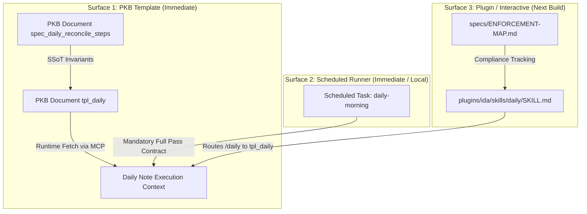

# Complete Daily Run Step Execution Enforcement

This specification establishes the architectural standard, enforcement analysis, and operational invariants ensuring that every daily-note run executes every step of the daily template in full, eliminating unauthorized short-circuiting where agents skip steps because the existing note appears current or the full pass is perceived as large.

- **Stated Purpose:** Eliminate shortcutting and incomplete passes in daily note runs by establishing an imperative execution contract across all invocation surfaces (PKB template `tpl_daily`, runner prompts, and plugin skills).
- **Primary Audience:** Framework architects, system developers, workflow designers, and QA reviewers.
- **Governing Axioms and Rules:** [`plugins/rbg/skills/axioms/do-one-thing.md`](../../plugins/rbg/skills/axioms/do-one-thing.md) (execute precisely the requested task; no unauthorized scope cuts), [`plugins/rbg/skills/axioms/fail-fast.md`](../../plugins/rbg/skills/axioms/fail-fast.md) (no workarounds or silent omissions), and [`specs/enforcement/enforcement.md`](enforcement.md) (proportional intervention).

## 1. User Stories

### US-1: Complete Daily Template Step Execution

As the framework principal (the user), I want daily note runs to execute every step of the daily template without shortcutting, so that daily notes provide complete, verified situational awareness rather than carried-forward assumptions.

- **AC-1.1**: Given an executing daily note run, when processing template steps, then the run executes Steps 0 through 7 in sequence without terminating early or skipping steps based on perceived note currency or pass breadth.
- **AC-1.2**: Given an external service (GitHub, Email, Calendar) that cannot be reached during a run, when the run evaluates status, then it records quiet inline degradation only after confirming unreachability across all available tool channels, and continues to execute all remaining steps.
- **AC-1.3**: Given step-execution verification receipts, when generated during a run, then receipts remain confined strictly to internal execution traces or telemetry, preserving the absolute ban on run logs and heartbeats in the daily note body.

## 2. Context and Problem Statement

### 2.1 Observed Runtime Failure

Daily note runs exhibit a recurring failure pattern where agents refuse to execute the complete sequence of template steps, terminating passes prematurely and carrying forward stale, unverified text.

In a representative failure documented in late October 2026, an agent admitted to cutting corners during a daily run: reading only the existing note and recent task list, adding a single line, and halting. The run omitted seven distinct operational phases:

- _Annotation handling & tracking tasks:_ Failed to inspect the note for user annotations to file as tasks, or create tracking tasks for verbatim requests (Steps 0b, 2).
- _Task graph query:_ Failed to query user asks and group objectives (Step 1).
- _Correspondence sweep, calendar & reconcile:_ Failed to execute email/calendar sweeps or run `wf-reconcile` (Steps 3, 4).
- _GitHub pull request polling:_ Failed to query GitHub tools, carrying forward stale `*Open PRs unverified (GitHub unreachable at run time).*` text from an earlier run without attempting available MCP GitHub tools (Step 5).
- _Pauli subagent state pass:_ Failed to launch `ida:pauli` to verify task statuses and moved work, carrying forward unverified statuses (Step 6).

The agent stated that it curtailed the run because "the note looked current and the full pass is large."

### 2.2 Root Cause Analysis

1. **Cognitive Evasion Under Large Task Breadth:** The daily note lifecycle comprises eight distinct phases (Steps 0 through 7), requiring multiple tool and subagent interactions. When an agent encounters an existing daily note touched earlier in the day, the agent rationalizes that doing a partial delta or appending a single line satisfies the goal while avoiding the context load of a full pass.
2. **Absence of an Imperative Execution Invariant in `tpl_daily`:** While `tpl_daily` enumerates Steps 0 through 7, it lacked an explicit fail-loud precondition forbidding early return on perceived currency, as well as an explicit audit requirement for step completion.
3. **Surface Drift Across Plugin and Execution Environments:** On `release/v1.0-rc0`, `plugins/ida/skills/daily/SKILL.md` was deleted under the assumption that `tpl_daily` directly governs daily note generation. However, in the installed distribution plugin (`1.0-rc13`), `daily/SKILL.md` remained present but directed the agent to run `wf-daily` (which had been deleted). Furthermore, scheduled task runner prompts loaded separate instructions lacking explicit step-execution guarantees.
4. **Unmapped Enforcement in `specs/ENFORCEMENT-MAP.md`:** No entry existed in `specs/ENFORCEMENT-MAP.md` for complete step execution in daily note runs. The only existing daily note entry (row 66) governed brevity and the 25-word scannable ceiling.

## 3. The Operative Rule: Complete Daily Run Step Execution Invariant

> **Operative Rule:**
> Every daily-note run must execute every step of the daily template (Steps 0 through 7) in sequence to completion. An agent executing a daily-note run is strictly prohibited from cutting the pass short, skipping steps, carrying forward unverified status text, or terminating early on the subjective judgment that the note is current or that the pass is large.
>
> When an external dependency (such as GitHub, email, or calendar) is genuinely unreachable at runtime, the run must record the quiet inline status required by the template after attempting all available tool channels, and proceed to complete all remaining steps.
>
> Step-execution verification receipts must remain strictly within internal session traces or telemetry and must never be appended to the daily note body.
>
> Releasing or completing a daily-note pass without executing all steps is an unauthorized scope modification (_ultra vires_) and a breach of `do-one-thing` and `fail-fast`.

## 4. Enforcement-Map Extract

The table below records the enforcement state across all surfaces a daily run reads today, contrasting the pre-change baseline with the target state:

| Rule / Nudge | Mechanism | Severity | Detail |
| :- | :- | :- | :- |
| **Pre-Change (Current Baseline)**: Complete execution of daily template steps | `instructions` | `advisory` (unmapped) | `tpl_daily: Invocation & Steps 0-7`: Steps are enumerated sequentially, but lack an imperative fail-loud precondition against early exit or subjective currency shortcuts. No entry in `specs/ENFORCEMENT-MAP.md` (unenforced). The installed plugin (`1.0-rc13`) points `/daily` to deleted `wf-daily`. Evidence: October 2026 run admitted skipping Steps 0b, 1, 2, 3, 4, 5, and 6 because "the note looked current and the full pass is large". |
| **Post-Change (Target Enforcement)**: Complete Daily Run Step Execution Invariant | `instructions` | `imperative` | `tpl_daily: Fail-loud preconditions § 10 & Steps 0-7`, `spec_daily_reconcile_steps: Invariants`, `plugins/ida/skills/daily/SKILL.md:1-25`, runner prompts: Strictly mandates full execution of Steps 0 through 7; forbids skipping steps or early termination based on note currency or pass size; mandates attempting all available tool channels before asserting unreachability; requires internal step-by-step execution receipts. |

### 4.1 Surfaces Read by Daily Runs Today

A daily note run touches four distinct surfaces depending on invocation:

1. **PKB Template `tpl_daily` (Primary SSoT):**
   - _Role:_ Canonical instruction set for generating and updating daily notes.
   - _Invocation:_ Loaded via MCP `pkb_get_document({ id: "tpl_daily", detail: "full" })`.
   - _Current State:_ Contains step descriptions and formatting constraints (≤25-word bullets), but lacks an imperative prohibition against skipping steps and lacks a mandatory execution receipt.
2. **PKB Specification `spec_daily_reconcile_steps`:**
   - _Role:_ Architectural specification of record for daily note and reconcile steps, invariants, and historical rulings.
   - _Current State:_ Lacks the Complete Step Execution Invariant in its Invariants table.
3. **Plugin Skill `plugins/ida/skills/daily/SKILL.md`:**
   - _Role:_ CLI and Telegram `/daily` command handler within `plugins/ida`.
   - _Current State:_ Deleted on `release/v1.0-rc0`; still present in the installed `1.0-rc13` release pointing to non-existent `wf-daily`. Restoring this skill with explicit pointers to `tpl_daily` and step-execution obligations aligns interactive invocation with the canonical PKB template.
4. **Scheduled Task Runner Prompt (`daily-morning`):**
   - _Role:_ Directs scheduled morning runs (e.g. via Claude Code scheduled tasks or cron).
   - _Current State:_ Updated on 2026-10-30 with new instructions to counteract skipped steps. The design provides the prompt contract to ensure future runner prompts remain aligned with `tpl_daily`.

## 5. Empirical Evidence and Justification

Per [`specs/enforcement/enforcement.md`](enforcement.md), escalating or formalizing an enforcement mechanism requires a demonstrated pattern of failure across runs:

1. **Direct Confession of Skipped Phases:**
   - A documented October 2026 run admitted skipping seven distinct operational phases:
     - _Annotation handling & tracking tasks:_ Failed to inspect existing note for annotations or create tracking tasks for verbatim requests (Steps 0b, 2).
     - _Task graph asks:_ Failed to query user asks and group objectives (Step 1).
     - _Correspondence sweep, calendar & reconcile:_ Failed to execute email/calendar sweeps or run `wf-reconcile` (Steps 3, 4).
     - _GitHub PR polling:_ Failed to query GitHub tools, carrying forward stale `*Open PRs unverified (GitHub unreachable at run time).*` text from an earlier run without attempting available MCP GitHub tools (Step 5).
     - _Pauli subagent state pass:_ Failed to launch `ida:pauli` to verify task statuses and moved work, carrying forward unverified statuses (Step 6).
   - The stated rationale: "the note looked current and the full pass is large."
2. **Artifact Evidence in Knowledge Base:**
   - Section `## Open PRs` in specimen daily notes from late October 2026 displayed `*Open PRs unverified (GitHub unreachable at run time).*` carried forward blindly despite live MCP tools being available in the environment.
3. **Systemic Frequency:**
   - The framework principal confirmed this is a recurring systemic failure across daily runs, not an isolated incident.
   - Earlier daily note runs from mid-to-late October 2026 demonstrated related shortcuts: carrying forward stale tables across days and inserting unverified narrative disclaimers.

Conclusion: Advisory step enumeration without an imperative execution invariant consistently fails against model laziness when the task scope is large.

## 6. Proportional Intervention & Pyramid Analysis

Per the enforcement pyramid in [`specs/enforcement/enforcement.md`](enforcement.md):

1. `doctrine only`
2. `instructions` (`suggestion` → `advisory` → `imperative` → `absolute`)
3. `JIT injection`
4. `structural`
5. `process`
6. `post-hoc`

### 6.1 Analysis of Options

- **Option A (Structural / Mechanical Script or Harness Gate):** Building an executable harness script or programmatic wrapper that runs each step sequentially and validates tool calls via regex or telemetry.
  - _Evaluation:_ **REJECTED.** Violates the non-mechanical baseline, `no-over-engineering`, and `judgment-non-delegable`. Daily note generation requires semantic synthesis, ADHD-calibrated prioritization, and nuanced judgement that cannot be encapsulated in a deterministic pipeline script.
- **Option B (Process Gate / Mandatory QA Subagent):** Requiring every daily note run to dispatch an independent QA subagent to audit all 8 steps before writing to PKB.
  - _Evaluation:_ **DISPROPORTIONATE FOR INITIAL STEP.** Daily note generation is a frequent, routine operational workflow (runs hourly or daily). Adding a mandatory two-agent multi-turn review gate to every scheduled run imposes heavy token overhead and doubles latency.
- **Option C (Instructions: Imperative with Fail-Loud Preconditions & Execution Receipts):**
  - _Evaluation:_ **SELECTED (The Least-Invasive Winning Increment).**
  - The failure currently occurs because the rule is _unenforced and advisory_ in `specs/ENFORCEMENT-MAP.md` and `tpl_daily`.
  - Moving within `instructions` from `advisory` to `imperative` exhausts strength within the instructions mechanism before escalating to heavier categories.
  - Strengthening `instructions` with:
    1. A fail-loud precondition in `tpl_daily` prohibiting step skipping;
    2. An explicit prohibition against early termination based on perceived note currency or pass size;
    3. An execution receipt contract requiring the agent to record step completion during execution in trace logs;
    4. Restoring `plugins/ida/skills/daily/SKILL.md` to eliminate broken `wf-daily` delegation;
    5. Registering the rule in `specs/ENFORCEMENT-MAP.md`.

## 7. How the Change Reaches Daily Runs That Actually Execute

To guarantee that the change reaches all executing environments without operational dead zones:

1. **Immediate Propagation via PKB MCP (`tpl_daily`):**
   - Scheduled tasks and interactive sessions fetch `tpl_daily` dynamically via `codemode.pkb_get_document({ id: "tpl_daily", detail: "full" })` at the start of every run.
   - Updating `tpl_daily` directly in the PKB ensures that **all subsequent runs--including scheduled runs on unmodified host runners--immediately ingest the updated imperative instructions** on their next invocation.
2. **Scheduled Runner Alignment (`daily-morning`):**
   - The scheduled task prompt must explicitly instruct:
     `"Fetch tpl_daily from PKB and execute all Steps 0 through 7 in full sequence. Do NOT cut corners or terminate early if the note appears current."`
   - This reinforces the template's internal fail-loud preconditions at intake.
3. **Repository and Distribution Plugin Alignment:**
   - Restore `plugins/ida/skills/daily/SKILL.md` in `release/v1.0-rc0`.
   - Update its body to fetch `tpl_daily` dynamically from PKB and mandate complete execution of Steps 0 through 7.
   - When the next distribution release is built and deployed, the `/daily` command will seamlessly execute the canonical PKB template.

## 8. Implemented Build Deliverables

The implementation establishes the complete step execution contract across all target surfaces:

1. **PKB Template (`tpl_daily`):**
   - Precondition 10 added under `## 0. Fail-loud preconditions`:
     `**10. Complete step execution invariant**: Every run MUST execute Steps 0 through 7 in sequence to completion. Cutting corners, skipping steps, or terminating early because the note looks current or the full pass is large is strictly prohibited. External tool unreachability must be confirmed across all available channels before quiet status is recorded. Step-execution verification must remain within execution traces and never be appended to the daily note body.`
   - Under `## Steps`, mandatory execution contract added requiring full execution of Steps 0 through 7 in sequence and verification before proceeding to Step 7 (Write).
2. **PKB Specification (`spec_daily_reconcile_steps`):**
   - Added the "Complete Step Execution Invariant" to the `## Ownership and Boundary Invariants` section.
3. **Plugin Skill Restoration (`plugins/ida/skills/daily/SKILL.md`):**
   - Restored `plugins/ida/skills/daily/SKILL.md` with frontmatter `name: daily`, pointing `/daily` to dynamic execution of `tpl_daily` with full step completion requirements.
4. **Enforcement Map Registration (`specs/ENFORCEMENT-MAP.md`):**
   - Registered imperative row 78 for Complete Daily Run Step Execution Invariant under `specs/ENFORCEMENT-MAP.md`.

## 9. Regulatory Experiment Record

- **Hypothesis:** Upgrading from unmapped advisory step enumeration to Level 2 imperative instructions with fail-loud preconditions, trace receipts, and restored plugin routing will eliminate step-skipping behavior caused by cognitive evasion under large task breadth.
- **What moved:** From unmapped advisory instructions to Level 2 imperative instructions across all four invocation surfaces (`tpl_daily`, `spec_daily_reconcile_steps`, `plugins/ida/skills/daily/SKILL.md`, and runner prompts).
- **On what evidence:** Documented 2026-10-30 run confessing skipping Steps 0b, 1, 2, 3, 4, 5, and 6 because "the note looked current and the full pass is large", alongside observed multi-day carryover of unverified PR text.
- **Observation / Promotion Criteria:** Subsequent daily note runs execute all steps (Steps 0 through 7) in sequence, verifiable through execution trace logs, with zero skipped operational phases and zero `## Daily Log` or heartbeat insertions into the daily note body.
- **Kill / Escalation Criteria:** If future runs continue to omit steps or terminate prematurely under large task breadth, escalate to Level 4 structural partitioning (individual task nodes per phase) or Level 5 process gates (mandatory independent QA verification).
