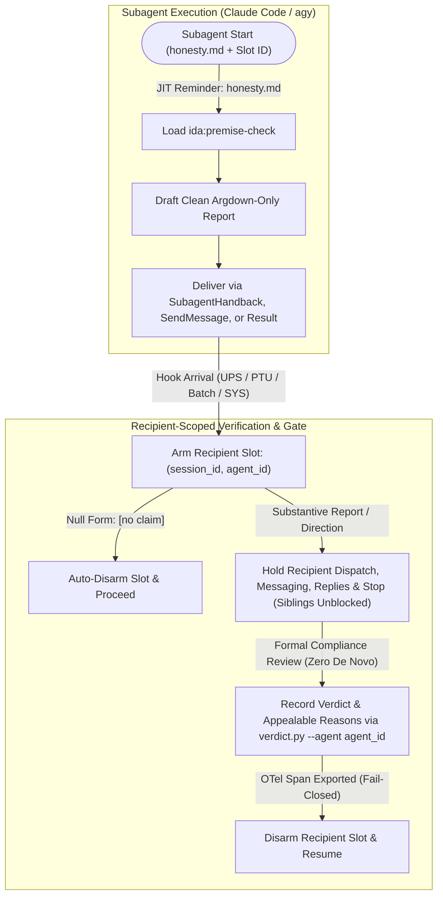

# Enforcing the Evidence Contract

How the framework holds agents to the [evidence contract](evidence-contract.md). The measures in place today are listed in the [enforcement map](../ENFORCEMENT-MAP.md). This spec defines the active enforcement architecture.

## User experience flow



## User stories

### US-1 Report checking

As the user, I want each agent reminded of the contract at the moment it writes or receives a report, and the chain held until a received report has a recorded verdict, so that administrative-law formal compliance review runs consistently without mechanical syntax bureaucracy.

- Reporting and formal compliance review doctrine live solely in [`premise-check`](../../plugins/ida/skills/premise-check/SKILL.md) (with deeper defect taxonomy in [`references/critique-guide.md`](../../plugins/ida/skills/premise-check/references/critique-guide.md)). Every other instruction file, reminder, and gate message points to the skill without duplicating its doctrine.
- Each reminder directs the agent to load `ida:premise-check` before writing or reviewing so non-user-facing reports use clean, human-readable Argdown prose with upfront asks and inline quoted evidence, and reviewers run administrative-law formal compliance review strictly on the face of the record with zero _de novo_ fact-checking.
- Each reminder fires once, at its moment, and stays concise.
- Agents cannot dispatch, message, reply on a channel, or stop while an incoming agent report or non-null direction awaits a verdict in their recipient slot.
- Checking agents perform all qualitative logical and formal compliance judgment. The gate and verdict recorder enforce strictly procedural integrity (recipient slot isolation, valid verdict tokens, non-empty appealable reasons, owner/disarmed guards, optional `--judged-file` content matching, and fail-closed OTel tracing) with zero mechanical parsing of Argdown prose or checker reasons ([ADR-0003](../decisions/0003-retire-mechanical-premise-check-parser-and-adopt-administrative-law-review.md)).
- Tool spans in Phoenix prove execution rather than logical entailment; evaluation and QA inspect durable primary deliverables (repo commits, PRs, PKB notes/tasks) rather than ephemeral container paths (`<appDataDir>/brain/`, `/tmp/`, unpushed worktrees).
- **AC-1.1** Given an agent with no report awaiting a verdict, when an incoming agent message carrying one or more reports or directions arrives on `UserPromptSubmit` (cross-session messages, teammate messages, task notifications with a `<result>`, subagent hand-backs, or directions/briefs from above), then every non-null, non-pointer report envelope outside code fences arms that recipient's gate slot, its next dispatch, message, or channel reply is refused until verdicts are recorded for every armed claim, and its first `Stop` is blocked.
- **AC-1.2** Given concurrent agents sharing a session, when foreground subagent calls (`Agent`, `invoke_subagent`, `Task`) return report bodies on `PostToolUse` or `PostToolBatch`, or when a child subagent completes via `SubagentHandback` or delivers a non-parent peer/upward report via `SendMessage`, then only the targeted recipient agent's gate slot (`(session_id, agent_id)`) arms and holds that agent's next dispatch, message, channel reply, or `Stop` until a verdict is recorded. Completion metadata without report body text, launch acknowledgements, and parent-to-child deliveries leave slots disarmed, and concurrent sibling agents remain unblocked and cannot consume another agent's armed claim.
- **AC-1.3** Given an agent with no report awaiting a verdict, when the user's own message arrives, typed or over a channel, then the agent's next dispatch goes through without arming the gate, and the user prompt is hydrated from the PKB.
- **AC-1.4** When an incoming agent message is a direction brief, the receiving agent verifies Turn-1 required inputs, derivation from `## Ask`, and brief satisfiability before logging deliverables as a frozen acceptance checklist, never declining handed work. On missing required inputs, the recipient asks the supervisor via direct message (skipping `verdict.py` when unarmed, or disarming first via `verdict.py --claim <id> --verdict REVISE --no-claim --reason-file <path>` as a clarification-hold gate token when armed). When ready -- or when flagging unreachable demands or unverified caller prescriptions to the supervisor while executing its role -- an armed recipient disarms via `verdict.py --claim <id> --verdict PASS --no-claim --reason-file <path>` (unarmed briefs skip `verdict.py`).
- **AC-1.5** Given a subagent invoked in agy, when the subagent starts its conversation, then the report-writing reminder (`messages/honesty.md`) is delivered on its first `PreInvocation` turn alongside the session pointer; and when a subagent starts on Claude Code `SubagentStart`, then `messages/honesty.md` is delivered uniformly alongside its `--agent <agent_id>` slot hint and any armed pending-claim reminders.
- **AC-1.6** Given a caller agent in agy receiving messages, when `SYSTEM_MESSAGE` steps arrive across turns, then the hearsay gate arms strictly on messages whose sender is another agent's conversation (ignoring automated `sender=system` idle notices and `sender` values containing `/` for command tasks/timers), ignores XML tags nested inside markdown code fences during `<result>` extraction, and auto-disarms explicit `[no claim]` notices without blocking.

## Reminders

| Moment | Agents | Reminder |
| - | - | - |
| Session start, resume, and compaction | All | `PREMISE_CHECK_POINTER` + `plugins/ida/CORE.md`: non-user-facing agents report only in clean Argdown prose per `ida:premise-check`; evaluators run formal compliance review on the face of the record with zero _de novo_ fact-checking (`handlers.py`: `PREMISE_CHECK_POINTER`, `session_start`, `agy_session_pointer`) |
| Subagent start (`SubagentStart` in Claude Code, first `PreInvocation` in agy) | All subagents | `messages/honesty.md`: reply is a report -- load `ida:premise-check` and write clean Argdown-only prose with upfront ask, atomic claims, and inline quoted evidence (or `[no claim]`), plus `--agent <agent_id>` and any active armed claims (`handlers.py`: `honest_output`, `agy_session_pointer`, `subagent_start`; `hearsay_gate.py`: `subagent_start_gate_notice`) |
| Report or direction arrival (`UserPromptSubmit`, `PostToolUse`, or `PostToolBatch`) | All | `messages/hearsay.md` and `messages/hearsay_armed.md`: load `ida:premise-check`; verify Turn-1 inputs, derivation, and satisfiability for directions, flagging gaps or unverified prescriptions to the supervisor without declining (disarming via `verdict.py --no-claim` when armed -- `PASS` before logging a frozen acceptance checklist or when flagging-and-executing, `REVISE` pending clarification on missing inputs), or run formal compliance review strictly on the face of the record (zero _de novo_ fact-checking) and record appealable reasons (`handlers.py`: `rule_against_hearsay`, `user_prompt_submit`, `post_tool`, `post_tool_batch`; `hearsay_gate.py`: `extract_judged_contents`, `_format_notice_pair`, `hearsay_arm`) |
| Gate refusal or `Stop` block | All | `messages/hearsay_blocked.md`: at most two lines (or multi-command list when multiple claims await judgment) naming claim id(s), recipient scope, and formatted `verdict.py` command(s); one line for the user (`hearsay_gate.py`: `format_verdict_command`, `hearsay_handler`) |

A report arrives as a foreground subagent's result, a background subagent's notification, or a peer message. Each harness carries these moments on its own hook events; the event map is in [ARCHITECTURE.md](../ARCHITECTURE.md).

On agy, the session-start pointer arrives on the first `PreInvocation` of each conversation (tracked via a per-conversation marker file). For a subagent conversation spawned via `invoke_subagent`, the subagent has no `SubagentStart` hook event; instead, `agy_session_pointer` detects subagent context from caller metadata or transcript markers and prepends `messages/honesty.md` on that first `PreInvocation`, achieving wire parity with Claude Code `SubagentStart`.

agy hook payloads carry no direct report return: a subagent's handback arrives in the caller conversation as a `SYSTEM_MESSAGE` step starting a new turn, which the hearsay gate reads from the turn start. Because agy starts a `SYSTEM_MESSAGE` turn for every wake (command tasks, timers, system idle notices, and messages from other agents), `agy_arrival` (`hearsay_gate.py`) extracts bodies strictly from `[Message]` entries whose sender is another agent's conversation, ignoring automated `sender=system` idle notices and `sender` values containing `/` (command tasks/timers).

## The premise-check gate

The gate is procedural friction, the sole exception [enforcement.md](enforcement.md) authorises. It holds the recipient until a verdict is recorded; every semantic and formal-compliance judgment stays strictly with the checking agent.

- **Scope:** Partitioned by recipient (`(session_id, agent_id)`) across concurrent agents sharing a session: root agents and single-slot harnesses use the root session slot (`<session>.json`), while distinct subagents use isolated agent-scoped slots (`<session>.agent-<agent_id>.json`). Concurrent mutations execute under an exclusive session file lock (`<session>.lock`), keeping parent-child coordination metadata separate (`<session>.parents.json`). `SubagentStop` stays OTel-tracer-only with empty stdout.
- **Arms:** on every non-null, non-pointer report reaching a recipient slot:
  - On `UserPromptSubmit`, every non-fenced sequential peer envelope (`<cross-session-message>`, `<teammate-message>`, `<agent-message>`, `<subagent-handback>`, `<task-notification>` carrying non-pointer `<result>`) arms the slot; single-envelope IDs remain unchanged, and XML inside markdown code fences is ignored per envelope. Delivered and waiting `SubagentHandback` pointer stubs are ignored only when they form the `<result>` of a `<task-notification>`, never when quoted inside report prose.
  - On `PostToolUse` and `PostToolBatch` of `Agent`, `Task`, or `invoke_subagent`, completed foreground returns carrying report text arm every item in the batch (disambiguating active same-description collisions deterministically). Metadata-only completion dicts lacking report text do not arm; when a child subagent already delivered via `SubagentHandback`, foreground completion bridges the arming notice to the caller without double-arming, and `PostToolBatch` suppresses duplicates already armed by `PostToolUse`.
  - On `PostToolUse` of child `SubagentHandback` (silent to child) and subagent-to-subagent `PostToolUse` of `SendMessage` (non-parent target), arms the resolved recipient coordinator or root slot silently so intermediate coordinators running without `UserPromptSubmit` are gated before relaying. Calls whose response reports failure (`success: false`, `is_error`, or `isError`) never arm, buffer, or supersede. Parent-child attribution comes strictly from exact runtime identifiers (`subagent_parents`, `pending_spawns`, and `agent-<child_id>.meta.json` sidecar `toolUseId`) rather than heuristic description matching. On `SubagentStart`, injects an `--agent <agent_id>` hint and any currently armed claim reminders alongside uniform `messages/honesty.md`.
  - **One claim per delivered report:** The same report often reaches the caller more than once -- for example via `SubagentHandback` and then a `<task-notification>` or `<agent-message>`, in either order. Before hashing, the gate normalizes harness transport framing (`[Subagent hand-back]` and `The report follows:` banners, a leading `[harness: subagent output matched ...]` notice, uniform line indentation, and `<\` tag neutralization) without mutating stored `*.judged.txt` (`hearsay_gate.py`: `_normalize_peer_body`). A delivery whose normalized digest matches an active claim, or an entry in `disarmed_claims` not marked `superseded`, pairs with it when its delivery reference is already in `seen_refs` or its canonical sender (resolved through registered subagent names) matches `source_agent_id`, or -- for an active claim armed by a foreground return that carried no sender -- when it is the first `UserPromptSubmit` copy (`_find_channel_match`). A paired delivery records its channel and reference and never arms a second claim; the first notifying arrival alerts the caller once (`caller_notified`), and later copies neither re-arm nor re-notify. Resuming a child via `SendMessage` or `Agent(resume=...)` marks that child's disarmed entries `superseded`, so its next report arms under a fresh claim ID.
  - **Null-claim auto-disarm (`[no claim]`):** Incoming messages whose entire normalized body is strictly the canonical `[no claim]` null form -- either a standalone `[no claim]` line or a standalone fenced `argdown` `[no claim]` block with optional `asks: none` frontmatter (`hearsay_gate.py`: `_is_null_claim`, `_apply_incoming_items`) -- auto-disarm as `verdict="no-claim"` (`machine=True`) without holding the recipient. Substantive reports or prose notices that merely quote or end with `[no claim]` still arm the gate uniformly, with zero absent-block branching or pre-handback refusal checks.
- **Stores:** at arm time, recipient-scoped judged text (`*.judged.txt` beside the slot JSON), source reference (`ref`), delivery references seen (`seen_refs`), delivery channels seen (`seen_channels`), normalized content digest (`body_sha256`), source agent identifier (`source_agent_id`), caller notification flag (`caller_notified`), arming event (`armed_via`), and explicit session/agent identifiers. Disarmed entries keep the pairing fields and gain `superseded` on resume.
- **Holds:** while a recipient slot is armed, refuses dispatch tools (`Agent`, `Task`, `invoke_subagent`), `SendMessage`, `send_message`, `SubagentHandback`, `subagent_handback`, `Dump`, `dump`, `AskUserQuestion`, and channel reply tools (matched case-insensitively on full name or last `__` segment) for that agent only (leaving concurrent sibling agents unblocked), and blocks `Stop` once per stop chain. Refusal text (`messages/hearsay_blocked.md`) directs the agent to load `ida:premise-check`, names recipient report scope, the review duty, and the `--no-claim` route for direction briefs within two lines for a single claim; multiple claims are labelled by count with one verdict command each.
- **Disarms:** on a recorded verdict (`PASS`, `REVISE`, or `FAIL`) matching the targeted `--agent` slot (`verdict.py` targets strictly the specified `--agent` slot, or root/out-of-band labels when omitted, never scanning sibling agent slots), or automatically for `[no claim]`. Disarmed gate claims stay recorded in `disarmed_claims` (up to 200 entries) so stale gate IDs cannot be re-judged via `--judged-file` and later copies of the same report cannot re-arm, while unarmed out-of-band task IDs and non-gate-minted report labels allow normal `REVISE -> PASS` re-judging.
- **Configuration:** `PREMISE_CHECK_GATE_MODE` (fallback alias `PREMISE_CHECK_MODE`) defaults to `block`, or accepts `warn` or `off`. Truthy override env vars (`PREMISE_CHECK_OVERRIDE`, `PREMISE_CHECK_GATE_OVERRIDE`, `AOP_FORCE`, `AOP_OVERRIDE`) let an armed gate pass a blocked action. Gate state and coordination metadata live under `AOPS_PREMISE_CHECK_DIR` (or `AOPS_PREMISE_GATE_DIR`, default `$TMPDIR/aops_premise_check/`).

A container worker hands back through its task record's `## Report` section. The decentralised workflow cannot enforce on container workers directly; the task contract is the boundary, and checking happens when the report is read. The gate does not arm automatically on reading a task record: the checker evaluates the report per `ida:premise-check` using the task ID as `--claim`, passes `--judged-file <path>` when judging out-of-band report text so its SHA-256 digest is recorded on the span, records the verdict via `verdict.py` (which accepts task IDs matching `is_task_id` without requiring an armed session gate), and writes `## Premise-Check Verdict` to the task record with the verification ID, verdict token, and appealable reasons.

## The verdict recorder

The recorder ([`plugins/ida/hooks/premise_check_verdict.py`](../../plugins/ida/hooks/premise_check_verdict.py), invoked via `plugins/ida/skills/premise-check/scripts/verdict.py`) enforces procedural recording integrity and fail-closed telemetry export. It runs **zero** mechanical Argdown or reason syntax parsing; substantive formal compliance evaluation stays strictly with the checking agent.

- **CLI flags (`main`):** `--claim` / `--report` (required), `--verdict` (`PASS`, `REVISE`, or `FAIL`, case-insensitive, required), mutually exclusive `--reason` or `--reason-file` (`-` reads stdin; one required), optional `--no-claim` (marks a claim-free notice or armed direction brief explicitly without prose pattern matching), `--title`, `--judged-file`, `--session` (defaults to `$AOPS_SESSION_ID`), and `--agent` / `--recipient` (empty for root coordinator). Accepts an optional leading `verdict` subcommand.
- **Token and reason validation (`record_verdict`):** Requires a non-empty claim ID, a valid verdict token (`PASS`, `REVISE`, or `FAIL`), and a non-empty natural-language reason. Any clear administrative-law prose is accepted without fixed line counts, keyed-line schemas, or waiver syntax.
- **Slot, ownership, and `--judged-file` integrity (`record_verdict`):**
  - Refuses if `claim_id` is actively armed in a _different_ agent slot of the same session (`find_armed_owner`).
  - Refuses re-judging a non-task claim already listed in `disarmed_claims`.
  - When `claim_id` is not active in the caller's slot: task IDs (`is_task_id`) are accepted unarmed, and non-gate-minted out-of-band report labels are accepted when `--judged-file` is supplied; unarmed gate-minted IDs (`claim-<8hex>`, `toolu_*`) or mismatched/unarmed non-task claims without `--judged-file` are refused.
  - When `--judged-file <path>` is supplied: verifies the file exists; if `claim_id` is active in the slot with stored judged text, verifies normalized body SHA-256 parity against the stored text (accepting unwrapped inner text when stored text carries an outer peer XML envelope), refusing on mismatch to prevent judged-file tampering.
- **Explicit no-claim flag (`--no-claim` / `record_verdict`):** Sets `premise_check.no_claim = true` (and `last_verdict.no_claim = true`) strictly when `--no-claim` (`no_claim=True`) is passed explicitly (with `PASS` or `REVISE`, e.g. for claim-free prose notices or armed direction briefs) or during machine null-form auto-disarm; reason prose is never scraped for `"no claim"` substrings.
- **Verification ID & OTel span export (`emit_verdict_span`):** Mints `verdict-<8hex>[-<slug>]` via `mint_verification_id` and ships one `premise_check_verdict` TOOL span via `claude_code_tracer` carrying:
  - `service.name`: `"aops-verdict-hooks"`
  - `aops.surface`: `"claude-code"`, `"agy"`, or `"github-actions"`
  - `premise_check.claim_id`, `premise_check.verdict`, `premise_check.verification_id`, `premise_check.reason_text` (truncated natural-language reason), and optional `premise_check.title`
  - `premise_check.no_claim` (boolean), `premise_check.judged_ref`, `premise_check.judged_text_sha256`, optional `premise_check.recipient_agent_id` (for scoped subagent slots), and optional `premise_check.machine` (`true` when generated mechanically)
- **Command formatting & session resolution (`format_verdict_command`, `resolve_session_id`):** Hook notices format `verdict.py` commands with `--project <plugin-dir>` resolved across workspace symlinks so `uv run` resolves `opentelemetry.sdk`, include `--session <session_id>`, and include `--agent <agent_id>` whenever a subagent slot is scoped. `resolve_session_id` resolves active session identity from `--session`, environment variables (`$AOPS_SESSION_ID`, `$CLAUDE_SESSION_ID`, `$SESSION_ID`, `$ANTIGRAVITY_SESSION_ID`, `$GEMINI_SESSION_ID`), `$CLAUDE_ENV_FILE`, or scoped slot JSON files (strictly matching root vs `.agent-<id>.json` and ignoring `.parents.json`), failing explicitly on corrupt JSON or unavailable session identity.
- **Fails closed (`_export_tool_span`):** When OpenTelemetry tracing is unconfigured (no endpoint) or OTLP span export fails or is unacknowledged, `record_verdict` raises `RuntimeError`, writes an error to stderr, records no verdict, and leaves the gate armed.

## Telemetry

Four observability measures are queryable in Phoenix from the emitted span attributes (`premise_check_verdict`, `hearsay_check`, and `premise_check_override`):

1. **Verdict distribution and remand rate:** count of `premise_check_verdict` spans grouped by `premise_check.verdict`, `premise_check.no_claim`, and `aops.surface` to monitor whether qualitative checking stays active rather than rubber-stamping (`PASS` near 100%).
2. **Appealable reason audit trail:** inspect `premise_check.verification_id`, `premise_check.claim_id`, `premise_check.verdict`, `premise_check.judged_ref`, `premise_check.judged_text_sha256`, `premise_check.recipient_agent_id`, and `premise_check.reason_text` on `premise_check_verdict` spans for qualitative audit and multi-hop provenance lookup.
3. **Arm-to-verdict reconciliation:** join `hearsay_check` spans (`hearsay.claim_id`, `hearsay.event`, `hearsay.judged_ref`, `premise_check.recipient_agent_id`) against `premise_check_verdict` spans on `premise_check.claim_id` to detect armed reports never adjudicated.
4. **Override count:** count of `premise_check_override` spans by `premise_check.override_var` and `premise_check.override_tool` (helper built in `premise_check_verdict.py`, currently bypassed in `hearsay_handler` when an override variable is set).

For example, measure 1 (verdict distribution excluding no-claim notices and armed direction briefs):

```sql
SELECT s.attributes->>'$.aops.surface' AS surface,
       s.attributes->>'$.premise_check.verdict' AS verdict,
       count(*) AS verdict_count
FROM spans s
JOIN traces t ON s.trace_rowid = t.id
JOIN projects p ON t.project_rowid = p.id
WHERE p.name = '<project>'
  AND s.name = 'premise_check_verdict'
  AND coalesce(s.attributes->>'$.premise_check.no_claim', 'false') != 'true'
GROUP BY 1, 2
```

## Proportional interventions

Active procedural controls remain strictly minimal; further escalations are considered only if verdict telemetry shows qualitative formal compliance review rubber-stamping:

- **Recipient-scoped hearsay gate** (built, above): holds dispatch, messaging, channel replies, and `Stop` per `(session_id, agent_id)` until a verdict is recorded (`hearsay_gate.py`).
- **Procedural verdict recorder** (built, above): enforces verdict token validity, non-empty appealable natural-language reasons, slot/owner and `--judged-file` integrity, and fail-closed OTel tracing (`premise_check_verdict.py`).
- **Dedicated arrival checker** (not built): a separate qualitative checking agent invoked on report arrival if telemetry shows working coordinators rubber-stamping their own subagents.
- **Rejected -- mechanical Argdown/reason syntax parsing and pre-handback block checks:** Deterministic Argdown subset parsing, seven-line reason cross-checks, absent-block gating, and pre-handback `send_message` block checks were retired in [ADR-0003](../decisions/0003-retire-mechanical-premise-check-parser-and-adopt-administrative-law-review.md) after empirical audits showed a 0% substantive logical-defect catch rate alongside 21--27% call-level refusal churn, zero-substance syntax loops, and judged-file tampering.
