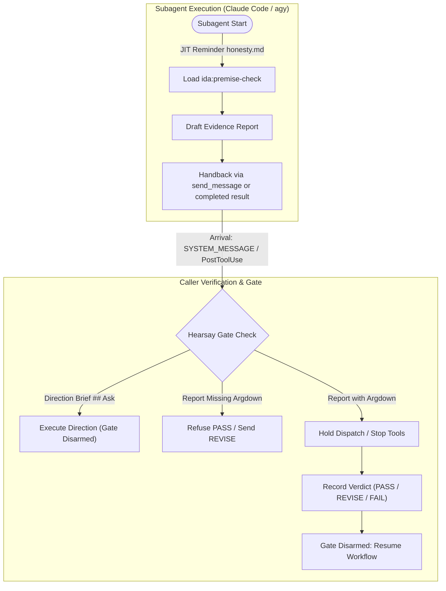

# Enforcing the Evidence Contract

How the framework holds agents to the [evidence contract](evidence-contract.md). The measures in place today are listed in the [enforcement map](../ENFORCEMENT-MAP.md#evidence-contract). This spec gives the designed system.

## User experience flow



## User stories

### US-1 Report checking

As the user, I want each agent reminded of the contract at the moment it writes or receives a report, and the chain held until a received report has a recorded verdict, so that the contract is followed without being repeated every turn.

- The format lives only in the `premise-check` skill. Every other instruction file, reminder and gate message names the skill and adds nothing to it.
- Each reminder tells the agent to load the skill before writing or checking, not only to follow it: a skill named but not loaded leaves the writer to fill the block from general Argdown priors outside the skill's restricted subset, which the recorder refuses ([#3228](https://github.com/nicsuzor/academicOps/issues/3228)).
- Each reminder fires once, at its moment, and is a line or two long.
- Agents cannot dispatch, message, reply on a channel or stop while a report or direction that arrived as an incoming agent message awaits a verdict.
- Agents judge each report. Parsers and presence checks confirm well-formedness only, under [enforcement.md](enforcement.md)'s governing principle. Format-only defects on an argument with at least one inference line (`>= 1`) are waivable on PASS and rewritten by the receiver; 0 inference lines or substantive defects require REVISE or FAIL and cannot pass or relay upward as fact.
- Tool spans in Phoenix prove execution rather than logical entailment; evaluation and QA inspect durable primary deliverables (repo commits, PRs, PKB notes/tasks) rather than ephemeral container paths (`<appDataDir>/brain/`, `/tmp/`, unpushed worktrees).
- **AC-1.1** Given an agent with no report awaiting a verdict, when an incoming agent message carrying one or more reports or directions arrives on `UserPromptSubmit` (cross-session messages, teammate messages, task notifications with a `<result>`, subagent hand-backs, or directions/briefs from above), then every non-null, non-pointer report envelope outside code fences arms that recipient's gate slot, its next dispatch, message or channel reply is refused until verdicts are recorded for every armed claim, and its first `Stop` is blocked.
- **AC-1.2** Given an agent with no report awaiting a verdict, when one or more foreground subagents return results carrying report text on `PostToolUse` or `PostToolBatch` (for `Agent`, `invoke_subagent`, or `Task`), or when a child subagent delivers a report via `PostToolUse` on `SubagentHandback` or a subagent delivers a non-parent peer/upward report via `PostToolUse` on `SendMessage`, then the gate arms strictly the targeted recipient agent's slot (`agent_id`) and holds that agent's next dispatch, message (`SendMessage`, `SubagentHandback`), channel reply or `Stop` until a verdict is recorded. Completion metadata dictionaries lacking report body keys (`content`, `text`, `result`, `output`), spawn/launch acknowledgements (`async_launched`, `teammate_spawned`, "Spawned successfully"), and parent-to-child `SendMessage` deliveries leave slots disarmed, and concurrent sibling agents sharing `session_id` remain unblocked and cannot consume another agent's armed claim.
- **AC-1.3** Given an agent with no report awaiting a verdict, when the user's own message arrives, typed or over a channel, then the agent's next dispatch goes through without arming the gate, and the user prompt is hydrated from the PKB.
- **AC-1.4** When the incoming agent message is a direction, the receiving agent checks that it derives from `## Ask` and refuses unverified caller method or template prescriptions before logging deliverables as a frozen acceptance checklist on a PKB task.
- **AC-1.5** Given a subagent invoked in agy, when the subagent starts its conversation, then the report-writing reminder (`messages/honesty.md`) is delivered on its first `PreInvocation` turn (`invocationNum == 0`), prompting the agent to load `ida:premise-check` before authoring its report. On Claude Code `SubagentStart`, `honest_output` runs uniformly for all subagents alongside an `--agent <agent_id>` hint and any currently armed pending-claim reminders for that waking subagent.
- **AC-1.6** Given a caller agent in agy receiving subagent handbacks, when one or more subagent messages arrive across turns, then the hearsay gate tracks all unseen `SYSTEM_MESSAGE` arrivals across turns, unwraps idle notifications without duplicate arming when the report was already delivered via `send_message`, ignores XML tags nested within markdown code fences during `<result>` extraction, and permits incoming caller direction briefs (`## Ask` with no report claim) without forcing `REVISE`.

## Reminders

| Moment | Agents | Reminder |
| - | - | - |
| Session start, resume and compaction | All | One line: reports follow `premise-check`, written in its shape and checked on receipt; load the skill before writing or checking one ([`plugins/ida/hooks/handlers.py:807-860`](../../plugins/ida/hooks/handlers.py#L807-L860)) |
| A subagent starts (`SubagentStart` in Claude Code, first `PreInvocation` in agy) | All subagents | Your reply is a report; load the skill before writing it, and write it in the skill's form, plus `--agent <agent_id>` and any active armed claims ([`plugins/ida/hooks/handlers.py:172-175,1188-1191`](../../plugins/ida/hooks/handlers.py#L172-L175), [`plugins/ida/hooks/hearsay_gate.py:1871-1910`](../../plugins/ida/hooks/hearsay_gate.py#L1871-L1910)) |
| A report or direction arrives (`UserPromptSubmit`, `PostToolUse`, or `PostToolBatch`) | All | Load the skill if not loaded this turn and check it per the skill; if a direction, check that it derives from `## Ask` and refuse unverified prescriptions before logging deliverables; if a report isn't in shape, REVISE and return it ([`plugins/ida/hooks/handlers.py:949-954,1169-1180`](../../plugins/ida/hooks/handlers.py#L949-L954), [`plugins/ida/hooks/hearsay_gate.py:1262-1356,1916-2006`](../../plugins/ida/hooks/hearsay_gate.py#L1262-L1356)) |
| Gate refusal or `Stop` block | All | At most two lines (or multi-command list when multiple claims await judgment) naming the claim id(s), recipient scope, and skill; one line for the user ([`plugins/ida/hooks/hearsay_gate.py:777-804,2009-2080`](../../plugins/ida/hooks/hearsay_gate.py#L777-L804)) |

A report arrives as a foreground subagent's result, a background subagent's notification, or a peer message. Each harness carries these moments on its own hook events; the event map is in [ARCHITECTURE.md](../ARCHITECTURE.md).

On agy, the session-start line arrives with the first `PreInvocation` of each top-level conversation. For a subagent conversation spawned via `invoke_subagent`, the subagent has no `SubagentStart` hook event; instead, the subagent JIT report-writing reminder (`messages/honesty.md`) is delivered on its first `PreInvocation` turn (`invocationNum == 0`), detecting subagent context from session start metadata or caller relationship, achieving wire parity with `SubagentStart`.

agy hook payloads carry no direct report return: a subagent's handback arrives in the caller conversation as a `SYSTEM_MESSAGE` step that starts a new turn, which the hearsay gate reads from the transcript.

A subagent's handback in agy may arrive twice: first via an explicit `send_message` tool call from the subagent, and subsequently via the harness's idle notification (`Subagent <id> has gone idle. This was the subagent's most recent response: ...` with `sender=system`). The receiver unwraps both forms, but deduplicates arming: when a subagent report was already received and armed from `send_message` in the same cycle, the following idle notification avoids re-arming `block_expected=True`.

## The premise-check gate

The gate is procedural friction, the exception [enforcement.md](enforcement.md) authorises. It and the verdict recorder check form and consistency; every semantic judgement stays with the checking agent.

- **Scope:** Recipient-scoped across concurrent agents sharing a session (`(session_id, agent_id)`): root sessions and harnesses without distinct `agent_id` (`""`, `"main"`, or equal to `session_id`) map to `{session}.json`, while in-process subagents map to `{session}.agent-{safe_agent}.json`. State mutations across concurrent hooks serialize under `fcntl.flock` + atomic `os.replace`, with session coordination metadata (`subagent_parents`, `known_subagents`, `known_subagent_names`, `pending_spawns`, `handbacks`) kept separately in `{session}.parents.json`. `SubagentStop` stays OTel-tracer-only with empty stdout.
- **Arms:** on every non-null report reaching a recipient slot:
  - On `UserPromptSubmit`, every sequential non-fenced peer envelope (`<cross-session-message>`, `<teammate-message>`, `<agent-message>`, `<subagent-handback>`, `<task-notification>` carrying non-pointer `<result>`) arms the slot, deduplicated against currently active armed claims from the same unwrapped `(sender_id, body_sha256)` while preserving Root's arming warning. Single-envelope IDs remain unchanged; pointers (`_HANDBACK_POINTER`) and tags inside markdown code fences are skipped per envelope.
  - On `PostToolUse` and `PostToolBatch` of `Agent`, `Task`, or `invoke_subagent`, completed foreground returns carrying report body keys (`content`, `text`, `result`, `output`) arm all items in the batch (disambiguating active same-description collisions cleanly). Completion metadata dicts lacking report body keys return `""` instead of serializing metadata JSON; when a child subagent already delivered `SubagentHandback` (`handbacks[child_id]` or active `source_agent_id` claim), the completed dispatch call bridges the arming notice to the caller without double-arming, and `PostToolBatch` suppresses duplicates already armed by `PostToolUse`.
  - On `PostToolUse` of `SubagentHandback` (silent to child) and subagent-to-subagent `PostToolUse` of `SendMessage` (non-parent target in `known_subagents`, resolved with `resumedAgentId` / `revivedAgentId` ahead of `known_subagent_names`), arms the resolved recipient sub-coordinator or root slot silently so intermediate sub-coordinators running without `UserPromptSubmit` are gated before relaying. Parent-child attribution comes strictly from exact runtime identifiers (`agentId`, cycle-free non-overwriting `resumedAgentId` / `revivedAgentId`, or `agent-<child_id>.meta.json` `toolUseId` -> `PreToolUse(Agent)` caller map). On `SubagentStart`, merges a `--agent <agent_id>` hint and any currently active armed claim reminders alongside uniform `honest_output`.
  - Every peer message requires a fenced Argdown block: the canonical null form (`asks: none` + `[no claim]`) clears the gate with no agent action; `[no claim]` with non-empty `asks:` is rejected pre-`answers:` and unwaivable under `Waived: block` without self-contradictory remediation; when an expected block is absent, per-claim `block_expected` refuses `PASS` until returned via `REVISE`. On agy, `SYSTEM_MESSAGE` capture via `invocationNum == 0` and idle dedup remain preserved.
- **Stores:** at arm time, recipient-scoped judged text (`{session}[.agent-{safe_agent}].{safe_claim}-{digest}.judged.txt`), source reference (`judged_ref`), normalized `body_sha256`, `source_agent_id`, and per-claim `block_expected` (never shared top-level across distinct claims in a slot), plus explicit `"session_id"` and `"agent_id"` fields.
- **Holds:** while a recipient slot is armed, refuses dispatch tools, `SendMessage`, `send_message`, `SubagentHandback`, `AskUserQuestion`, `Dump`, `dump`, and channel reply tools, matched case-insensitively for that agent only (leaving other concurrent agents unblocked), and blocks `Stop` once per stop chain. Refusal text (`messages/hearsay_blocked.md`) clarifies recipient report scope (`on this agent's received report`), preserves two lines for single claims, and emits all pending claim commands when multiple claims remain armed.
- **Disarms:** on a recorded verdict (`PASS`, `REVISE`, or `FAIL`) matching the targeted `--agent` slot (`verdict.py` targets strictly the passed `--agent` slot, or root `{session}.json` / unarmed out-of-band labels when `--agent` is omitted, never scanning sibling `.agent-*.json` slots), or automatically for canonical null form. Disarming gate-armed claims moves them to bounded slot-local `disarmed_claims` (excluding unarmed out-of-band `task_*` / `report-*` labels so `REVISE -> PASS` re-judging on task reports continues working).
- **Configuration:** `PREMISE_CHECK_GATE_MODE` is `block` by default, or `warn` or `off`. Truthy override env vars let an armed gate pass a blocked action. Gate state and coordination sidecars live under `AOPS_PREMISE_CHECK_DIR` (`$TMPDIR/aops_premise_check/` by default).

A container worker hands back through its task record. The decentralised workflow cannot enforce on polecat or other workers; the task contract is the key boundary, and enforcement regulates when it is read from. The gate does not arm on reading it: the arming and the override-counting span are built but bypassed in the code. The checker who reads the record checks it per the skill, with the task id as claim id; `record_verdict` accepts verdicts recorded against a task id without requiring an armed hearsay gate in the session, accepts out-of-band report text via `--judged-file <path>` to verify the reason against the report's `argdown` block, mints a verification id, emits the verdict span, and the checker adds `## Premise-Check Verdict` to the task with the verification id and verdict.

## The verdict recorder

The recorder holds the checker to the [checker's reason](../../plugins/ida/skills/premise-check/references/checker-reason.md). It gates the checker's reason, never the author's report.

The report argument it reads is the skill's fenced `argdown` block: parser-valid Argdown in standard form (accepting closing fences concatenated with outer XML wrapper tags, e.g. `</result>`), with asks and answers in its frontmatter and premises stated in clean natural language with inline citations (accepting backwards-compatible legacy blocks with `-- <basis phrase> ^note`, `notes:` tables, and `{basis: ...}`). Readers ignore meaning-free whitespace across the block: any common leading indentation (whether across the whole block, frontmatter, or body), trailing whitespace on any line, CRLF line endings, and added or removed blank lines. Whitespace that carries semantic or syntactic meaning -- such as relative nesting within frontmatter mappings or newlines splitting a single-line inference bar across lines -- remains significant and is not normalized away. On PASS, `verdict.py` runs deterministic native machine checks via `report_argument.py` (syntax errors, unconnected statements with no relations or argument membership, undercuts not aimed at an inference, and requiring at least one inference line on PASS). An unparsable block (due to syntax errors, unclosed fences, or invalid frontmatter) yields a refusal stating the block could not be parsed, never "0 inference lines", leaving the gate armed. Evidence sufficiency is evaluated qualitatively by checking agents under `Supported:` rather than via mechanical basis rank arithmetic. `Waived:` lines support semicolon-separated waiver items. On an invalid argument, it refuses PASS with an actionable error, leaving the gate armed.

- **PASS:** refused unless the block passes deterministic Argdown parser checks, has at least one inference line (>= 1; format-only defects are waivable under `Waived:` and rewritten into standard form by the receiver, whereas 0 inference lines, hybrid `[no claim]` blocks with non-empty `asks:`, or substantive defects require REVISE/FAIL and cannot pass or relay upward), and the reason carries the seven keyed lines and passes every mechanical cross-check the skill lists under "What the recorder refuses", run against the judged text the gate stored (or supplied via `--judged-file <path>`). Passing `--judged-file` works for unarmed out-of-band reports (`task_*`, `report-*`, review labels across `REVISE -> PASS` cycles), while refusing already-disarmed gate claims (`disarmed_claims`), claims armed for a different recipient agent, unarmed gate-minted IDs (`claim-<8hex>` / `toolu_*`), and `--judged-file` content differing from stored `.judged.txt`. When judged text was not stored at arm time and not provided via `--judged-file`, PASS is refused with a distinct missing gate storage diagnostic directing the caller to supply the file.
- **No claim:** a one-line `Judged: <claim id>; no claim -- ...` reason is accepted for PASS and the verdict is marked no-claim.
- **REVISE and FAIL:** requires at least one failing inference step (`Valid: (n) fails -- <defect>`) or unanswered ask (`Answered: <ask id> unanswered` or `Ask: ... -> unanswered`); refused when `Valid:` is non-empty and every `Valid:` entry has status `holds` with no unanswered ask. REVISE (not FAIL) is also accepted on a sound argument when the reason carries `Format: <format item> -- <fix>`, so a format slip the checker will not waive can be sent back without being recorded as a reasoning defect. A PASS reason with `Waived: numbering` judges parenthesised `answers:` values (`(6)`) as the line they name. When `Valid:` is omitted (e.g. absent block return), any reason is accepted.
- **Records:** each verdict emits one `premise_check_verdict` span carrying the claim id, verification id, verdict, reason, the judged-text reference, one attribute per reason line, the ask ids, the weakest basis, the inference count, the defect tags, the no-claim flag, recipient `agent_id` attribution (`premise_check.recipient_agent_id` and span `agent_id`), and the machine flag when generated mechanically.
- **Command formatting & session resolution:** Hook remediation messages format the verdict command with `--project <plugin-dir>` resolved to the real plugin project directory (`Path.resolve()` across workspace symlinks) so `uv run` uses the plugin environment with `opentelemetry.sdk`, include `--session <session_id>`, and include `--agent <agent_id>` whenever a subagent slot is scoped. `verdict.py` resolves `--agent` / `--recipient` strictly to that agent slot (or root / unarmed out-of-band claims when omitted), and resolves active `session_id` across subshells from `--session`, env vars (`$AOPS_SESSION_ID`, `$CLAUDE_SESSION_ID`), or JSON `"session_id"` inside scoped slot files (ignoring `.parents.json` and filename stems), failing clearly when unavailable.
- **Fails closed:** when tracing is unconfigured, the span export fails, or the Argdown parser execution, decode, or timeout fails, no verdict is recorded and the gate stays armed.

## Telemetry

Three measures are queryable in Phoenix from the verdict span attributes; the fourth, override count, has no span while override counting is bypassed:

1. Defect-tag rate per inference line: sum of `premise_check.defect_tag_count` over sum of `premise_check.inference_count`, on `premise_check_verdict` spans.
2. Strength distribution: count of `premise_check_verdict` spans by `premise_check.verdict` and `premise_check.weakest_basis_term`.
3. The contents of `Waived`: count of each entry of the `premise_check.waived_items` array.
4. Override count: count of `premise_check_override` spans by `premise_check.override_var` and `premise_check.override_tool`, once the span is enabled.

Each is one SQL query over the project's spans, for example measure 1:

```sql
SELECT sum(CAST(s.attributes->>'$.premise_check.defect_tag_count' AS INTEGER)) * 1.0
     / nullif(sum(CAST(s.attributes->>'$.premise_check.inference_count' AS INTEGER)), 0)
FROM spans s JOIN traces t ON s.trace_rowid = t.id JOIN projects p ON t.project_rowid = p.id
WHERE p.name = '<project>' AND s.name = 'premise_check_verdict'
```

Measure 3 expands the array with `json_each(s.attributes->'$.premise_check.waived_items')`.

## Proportional interventions

Each mechanism is added only when verdict telemetry shows the active checks rubber-stamping, with PASS near 100% and REVISE rare:

- **Verdict recorder** (built, above): gates the checker's reason (`premise_check_verdict.py`).
- **Argdown parser check on PASS** (built, above): runs deterministic native parser checks on the report's `argdown` block (`report_argument.py`, using a native parser without external binary dependencies or regex pre-mutation), refusing PASS with an actionable error when the block fails syntax, connectedness, or undercut-target checks, or has zero inference lines.
- **Subagent pre-handback check & stop reminder**:
  - In Claude Code (not built; staged Level 4 intervention): a one-time `SubagentStop` block that sends the skill's pointer back to the subagent before its report is delivered, or blocks a final message with no `argdown` block.
  - In agy (built, above): a one-time `PreToolUse` check on subagent `send_message` calls (`plugins/ida/hooks/hearsay_gate.py:subagent_pre_handback_check`). If the handback report omits a fenced `argdown` block, the hook refuses the tool call once per handback (`refuse(...)`), instructing the subagent to load `ida:premise-check` and include the required block, with retries passing through to prevent deadlock.
- **Dedicated arrival checker** (not built): a separate checker agent invoked on report arrival.
