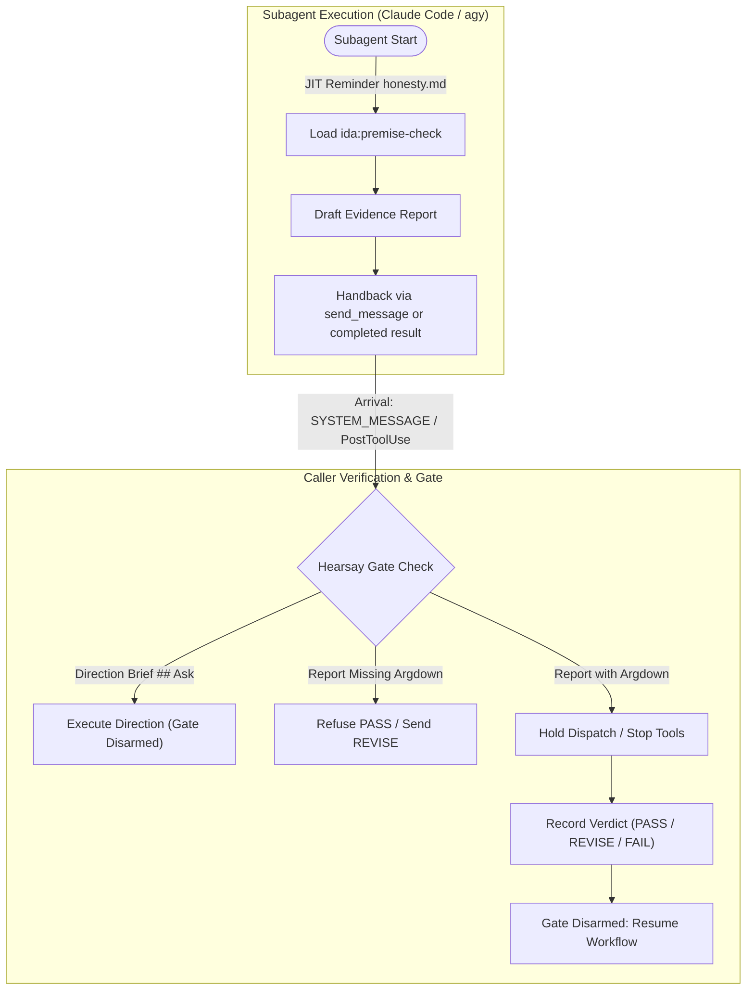

# Enforcing the Evidence Contract

How the framework holds agents to the [evidence contract](evidence-contract.md). The measures in place today are listed in the [enforcement map](../ENFORCEMENT-MAP.md#evidence-contract). This spec gives the designed system.

## User experience flow



## User stories

### US-1 Report checking

As the user, I want each agent reminded of the contract at the moment it writes or receives a report, and the chain held until a received report has a recorded verdict, so that the contract is followed without being repeated every turn.

- The format lives only in the `premise-check` skill. Every other instruction file, reminder and gate message names the skill and adds nothing to it.
- Each reminder tells the agent to load the skill before writing or checking, not only to follow it: a skill named but not loaded leaves the writer to fill the block from general Argdown priors outside the skill's restricted subset, which the recorder refuses ([#3228](https://github.com/nicsuzor/academicOps/issues/3228)).
- Each reminder fires once, at its moment, and is a line or two long.
- Agents cannot dispatch, message, reply on a channel or stop while a report or direction that arrived as an incoming agent message awaits a verdict.
- Agents judge each report. Parsers and presence checks confirm well-formedness only, under [enforcement.md](enforcement.md)'s governing principle. Format-only defects on an argument with at least one inference line (`>= 1`) are waivable on PASS and rewritten by the receiver; 0 inference lines or substantive defects require REVISE or FAIL and cannot pass or relay upward as fact.
- Tool spans in Phoenix prove execution rather than logical entailment; evaluation and QA inspect durable primary deliverables (repo commits, PRs, PKB notes/tasks) rather than ephemeral container paths (`<appDataDir>/brain/`, `/tmp/`, unpushed worktrees).
- **AC-1.1** Given an agent with no report awaiting a verdict, when an incoming agent message carrying a report or direction arrives on `UserPromptSubmit` (a cross-session message, a teammate message, a task notification with a `<result>`, a subagent hand-back, or a direction/brief from above), then the agent's next dispatch, message or channel reply is refused until it records a verdict, and its first `Stop` is blocked.
- **AC-1.2** Given an agent with no report awaiting a verdict, when a foreground subagent returns its result on `PostToolUse` (for `Agent`, `invoke_subagent`, or `Task`), then the gate arms and holds the next dispatch, message, channel reply or stop until a verdict is recorded. When a subagent is launched or spawned rather than returned (`async_launched`, the default when `run_in_background` is omitted, or `teammate_spawned`), or any other of the agent's own tool calls completes, the check remains disarmed, and a claim already pending stays the one armed.
- **AC-1.3** Given an agent with no report awaiting a verdict, when the user's own message arrives, typed or over a channel, then the agent's next dispatch goes through without arming the gate, and the user prompt is hydrated from the PKB.
- **AC-1.4** When the incoming agent message is a direction, the receiving agent checks that it derives from `## Ask` and refuses unverified caller method or template prescriptions before logging deliverables as a frozen acceptance checklist on a PKB task.
- **AC-1.5** Given a subagent invoked in agy, when the subagent starts its conversation, then the report-writing reminder (`messages/honesty.md`) is delivered on its first `PreInvocation` turn (`invocationNum == 0`), prompting the agent to load `ida:premise-check` before authoring its report.
- **AC-1.6** Given a caller agent in agy receiving subagent handbacks, when one or more subagent messages arrive across turns, then the hearsay gate tracks all unseen `SYSTEM_MESSAGE` arrivals across turns, unwraps idle notifications without duplicate arming when the report was already delivered via `send_message`, ignores XML tags nested within markdown code fences during `<result>` extraction, and permits incoming caller direction briefs (`## Ask` with no report claim) without forcing `REVISE`.

## Reminders

| Moment | Agents | Reminder |
| - | - | - |
| Session start, resume and compaction | All | One line: reports follow `premise-check`, written in its shape and checked on receipt; load the skill before writing or checking one ([`plugins/ida/hooks/handlers.py:817-858`](../../plugins/ida/hooks/handlers.py#L817-L858)) |
| A subagent starts (`SubagentStart` in Claude Code, first `PreInvocation` in agy) | All subagents | Your reply is a report; load the skill before writing it, and write it in the skill's form ([`plugins/ida/hooks/handlers.py:136-141,1094-1096`](../../plugins/ida/hooks/handlers.py#L136-L141)) |
| A report or direction arrives (`UserPromptSubmit` or `PostToolBatch`) | All | Load the skill if not loaded this turn and check it per the skill; if a direction, check that it derives from `## Ask` and refuse unverified prescriptions before logging deliverables; if a report isn't in shape, REVISE and return it ([`plugins/ida/hooks/handlers.py:891-895,1086-1088`](../../plugins/ida/hooks/handlers.py#L891-L895), [`plugins/ida/hooks/hearsay_gate.py:805-845,881-949`](../../plugins/ida/hooks/hearsay_gate.py#L805-L845)) |
| Gate refusal or `Stop` block | All | At most two lines naming the claim id and the skill; one line for the user ([`plugins/ida/hooks/hearsay_gate.py:487-510,886-949`](../../plugins/ida/hooks/hearsay_gate.py#L487-L510)) |

A report arrives as a foreground subagent's result, a background subagent's notification, or a peer message. Each harness carries these moments on its own hook events; the event map is in [ARCHITECTURE.md](../ARCHITECTURE.md).

On agy, the session-start line arrives with the first `PreInvocation` of each top-level conversation. For a subagent conversation spawned via `invoke_subagent`, the subagent has no `SubagentStart` hook event; instead, the subagent JIT report-writing reminder (`messages/honesty.md`) is delivered on its first `PreInvocation` turn (`invocationNum == 0`), detecting subagent context from session start metadata or caller relationship, achieving wire parity with `SubagentStart`.

agy hook payloads carry no direct report return: a subagent's handback arrives in the caller conversation as a `SYSTEM_MESSAGE` step that starts a new turn, which the hearsay gate reads from the transcript.

A subagent's handback in agy may arrive twice: first via an explicit `send_message` tool call from the subagent, and subsequently via the harness's idle notification (`Subagent <id> has gone idle. This was the subagent's most recent response: ...` with `sender=system`). The receiver unwraps both forms, but deduplicates arming: when a subagent report was already received and armed from `send_message` in the same cycle, the following idle notification avoids re-arming `block_expected=True`.

## The premise-check gate

The gate is procedural friction, the exception [enforcement.md](enforcement.md) authorises. It and the verdict recorder check form and consistency; every semantic judgement stays with the checking agent.

- **Scope:** All agents receiving messages from teammates or in-session agents, independent of receiving or sending agent identity.
- **Arms:** on every report that reaches any agent as an incoming message from a teammate or an in-session agent, whatever the receiving or sending agent's identity: on `UserPromptSubmit`, when an incoming agent message carries a report or direction (a cross-session message `<cross-session-message>`, a teammate message `<teammate-message>` whether arriving via `SendMessage` or a teammate `idle_notification` event, unwrapped from Claude Code's peer preamble `Another Claude session sent a message:`, a subagent hand-back `<subagent-handback>` or `<agent-message>`, a task notification carrying a `<result>`, or a direction/brief from above); on `PostToolUse` of `Agent`, `Task` or `invoke_subagent`, when a foreground subagent returns its result (`status: "completed"`). Every peer message requires a fenced Argdown block: the null form clears the gate with no agent action; when an expected block is absent, the gate does not open and PASS is refused, so the receiver's only way through is to send the message back for revision (recording REVISE to return it for resending). Premise lines state raw empirical observations quoting deciding values and citations inline, never evaluative conclusions restating an acceptance criterion. Inference lines are judged for construct match and proportional sample adequacy (rejecting quantitative rank checks as proof of qualitative evaluation, and unexplained n=1 or n=2 probes as proof of representative classes; stating a task's primary ask or acceptance criterion is never low-stakes or obvious). Nothing else arms it: not a spawn or launch acknowledgement (`async_launched`, `teammate_spawned`, "Spawned successfully"), not a task notification with no `<result>` (a background command finishing), not a pointer saying the report was delivered by hand-back, not any other tool result, and not the user's own prompts. On agy, a `SYSTEM_MESSAGE` turn arms it only when its `[Message]` comes from another agent's conversation (`sender=<conversation-id>`), captured same-turn across candidate transcripts (`transcript.jsonl` and `transcript_full.jsonl`) without transcript lag; automated harness notices (`sender=system`), the session's own command tasks and timers (`sender=<conversation-id>/task-N`), and stop-hook refusals leave it disarmed. Arming adds the arriving report's claim to those pending and never replaces one. The arming notice reminds the receiver to check that incoming directions derive from `## Ask` and refuse unverified caller method or template prescriptions before logging deliverables as a frozen acceptance checklist on a PKB task.
  - _agy receiver-side arrival tracking & gate semantics:_
    - **Multi-turn arrival tracking:** The gate tracks all unseen `SYSTEM_MESSAGE` arrivals across turns by transcript line offset or message ID, ensuring subagent handbacks spanning multiple turns or parallel worker completions are not dropped behind single-turn `invocationNum == 0` checks.
    - **Idle notification wrapper handling and deduplication:** When a subagent report arrives via `send_message`, the gate arms and captures `.judged.txt`. When the subagent subsequently goes idle and triggers a `sender=system` notice (`Subagent <id> has gone idle. This was the subagent's most recent response: ...`), the gate strips the idle wrapper and unwraps the inner report body; if the subagent already delivered its report in the same execution cycle, duplicate arming is suppressed (`block_expected=False`) so the caller is not forced to record redundant verdicts for the same handback.
    - **Code fence preservation during XML extraction:** In `<task-notification>` and message wrappers, extraction of `<result>` content ignores XML tags nested within markdown code fences (` ``` `), preventing premature string truncation and ensuring complete `.judged.txt` capture.
    - **Direction brief vs. report recognition:** Direction briefs sent from caller agents (`## Ask` with no report claim or null claim block) are recognized as directions rather than evidence reports awaiting verification; they do not set `block_expected=True` and do not force the receiving subagent to `REVISE` its caller's direction.
- **Stores:** at arm time, the judged text (unwrapping JSON `result` strings from teammate `idle_notification` payloads and `<result>` bodies from `<task-notification>` envelopes so fenced `argdown` blocks can be parsed) and an explicit reference to it: the tool-use id, task id, or the envelope id.
- **Holds:** while armed, it refuses dispatch tools, messaging tools (`SendMessage`, `send_message`), `AskUserQuestion`, `Dump`, `dump`, and channel reply tools, matched case-insensitively, and blocks `Stop` once per stop chain.
- **Disarms:** on a recorded verdict (PASS, REVISE or FAIL, with a reason) through the skill's verdict script, or automatically for an expected null form. An absent expected block refuses PASS and clears only when returned for revision via REVISE.
- **Configuration:** `PREMISE_CHECK_GATE_MODE` is `block` by default, or `warn` or `off`. A truthy `PREMISE_CHECK_OVERRIDE`, `PREMISE_CHECK_GATE_OVERRIDE`, `AOP_FORCE` or `AOP_OVERRIDE` lets an armed gate pass a blocked action. Override use is not counted. Gate state is a per-session file under `AOPS_PREMISE_CHECK_DIR`, by default `aops_premise_check/` in the system temp directory.

A container worker hands back through its task record. The decentralised workflow cannot enforce on polecat or other workers; the task contract is the key boundary, and enforcement regulates when it is read from. The gate does not arm on reading it: the arming and the override-counting span are built but bypassed in the code. The checker who reads the record checks it per the skill, with the task id as claim id; `record_verdict` accepts verdicts recorded against a task id without requiring an armed hearsay gate in the session, accepts out-of-band report text via `--judged-file <path>` to verify the reason against the report's `argdown` block, mints a verification id, emits the verdict span, and the checker adds `## Premise-Check Verdict` to the task with the verification id and verdict.

## The verdict recorder

The recorder holds the checker to the [checker's reason](../../plugins/ida/skills/premise-check/references/checker-reason.md). It gates the checker's reason, never the author's report.

The report argument it reads is the skill's fenced `argdown` block: parser-valid Argdown in standard form (accepting closing fences concatenated with outer XML wrapper tags, e.g. `</result>`), with asks and answers in its frontmatter and premises stated in clean natural language with inline citations (accepting backwards-compatible legacy blocks with `-- <basis phrase> ^note`, `notes:` tables, and `{basis: ...}`). Readers ignore meaning-free whitespace across the block: any common leading indentation (whether across the whole block, frontmatter, or body), trailing whitespace on any line, CRLF line endings, and added or removed blank lines. Whitespace that carries semantic or syntactic meaning -- such as relative nesting within frontmatter mappings or newlines splitting a single-line inference bar across lines -- remains significant and is not normalized away. On PASS, `verdict.py` runs deterministic native machine checks via `report_argument.py` (syntax errors, unconnected statements with no relations or argument membership, undercuts not aimed at an inference, and requiring at least one inference line on PASS). An unparsable block (due to syntax errors, unclosed fences, or invalid frontmatter) yields a refusal stating the block could not be parsed, never "0 inference lines", leaving the gate armed. Evidence sufficiency is evaluated qualitatively by checking agents under `Supported:` rather than via mechanical basis rank arithmetic. `Waived:` lines support semicolon-separated waiver items. On an invalid argument, it refuses PASS with an actionable error, leaving the gate armed.

- **PASS:** refused unless the block passes deterministic Argdown parser checks, has at least one inference line (>= 1; format-only defects are waivable under `Waived:` and rewritten into standard form by the receiver, whereas 0 inference lines or substantive defects require REVISE/FAIL and cannot pass or relay upward), and the reason carries the seven keyed lines and passes every mechanical cross-check the skill lists under "What the recorder refuses", run against the judged text the gate stored (or supplied via `--judged-file <path>`). When judged text was not stored at arm time and not provided via `--judged-file`, PASS is refused with a distinct missing gate storage diagnostic directing the caller to supply the file.
- **No claim:** a one-line `Judged: <claim id>; no claim -- ...` reason is accepted for PASS and the verdict is marked no-claim.
- **REVISE and FAIL:** requires at least one failing inference step (`Valid: (n) fails -- <defect>`) or unanswered ask (`Answered: <ask id> unanswered` or `Ask: ... -> unanswered`); refused when `Valid:` is non-empty and every `Valid:` entry has status `holds` with no unanswered ask. REVISE (not FAIL) is also accepted on a sound argument when the reason carries `Format: <format item> -- <fix>`, so a format slip the checker will not waive can be sent back without being recorded as a reasoning defect. A PASS reason with `Waived: numbering` judges parenthesised `answers:` values (`(6)`) as the line they name. When `Valid:` is omitted (e.g. absent block return), any reason is accepted.
- **Records:** each verdict emits one `premise_check_verdict` span carrying the claim id, verification id, verdict, reason, the judged-text reference, one attribute per reason line, the ask ids, the weakest basis, the inference count, the defect tags, the no-claim flag, and the machine flag when generated mechanically.
- **Command formatting & session resolution:** Hook remediation messages format the verdict command with `--project <plugin-dir>` resolved to the real plugin project directory (`Path.resolve()` across workspace symlinks) so `uv run` uses the plugin environment with `opentelemetry.sdk`, and include `--session <session_id>`. `verdict.py` resolves the active session across subshells from CLI `--session`, environment variables (`$AOPS_SESSION_ID`, `$CLAUDE_SESSION_ID`), or on-disk active session state indexed by `--claim <claim_id>` in `AOPS_PREMISE_CHECK_DIR`, failing with a clear diagnostic when neither is available.
- **Fails closed:** when tracing is unconfigured, the span export fails, or the Argdown parser execution, decode, or timeout fails, no verdict is recorded and the gate stays armed.

## Telemetry

Three measures are queryable in Phoenix from the verdict span attributes; the fourth, override count, has no span while override counting is bypassed:

1. Defect-tag rate per inference line: sum of `premise_check.defect_tag_count` over sum of `premise_check.inference_count`, on `premise_check_verdict` spans.
2. Strength distribution: count of `premise_check_verdict` spans by `premise_check.verdict` and `premise_check.weakest_basis_term`.
3. The contents of `Waived`: count of each entry of the `premise_check.waived_items` array.
4. Override count: count of `premise_check_override` spans by `premise_check.override_var` and `premise_check.override_tool`, once the span is enabled.

Each is one SQL query over the project's spans, for example measure 1:

```sql
SELECT sum(CAST(s.attributes->>'$.premise_check.defect_tag_count' AS INTEGER)) * 1.0
     / nullif(sum(CAST(s.attributes->>'$.premise_check.inference_count' AS INTEGER)), 0)
FROM spans s JOIN traces t ON s.trace_rowid = t.id JOIN projects p ON t.project_rowid = p.id
WHERE p.name = '<project>' AND s.name = 'premise_check_verdict'
```

Measure 3 expands the array with `json_each(s.attributes->'$.premise_check.waived_items')`.

## Proportional interventions

Each mechanism is added only when verdict telemetry shows the active checks rubber-stamping, with PASS near 100% and REVISE rare:

- **Verdict recorder** (built, above): gates the checker's reason (`premise_check_verdict.py`).
- **Argdown parser check on PASS** (built, above): runs deterministic native parser checks on the report's `argdown` block (`report_argument.py`, using a native parser without external binary dependencies or regex pre-mutation), refusing PASS with an actionable error when the block fails syntax, connectedness, or undercut-target checks, or has zero inference lines.
- **Subagent stop reminder** (not built; staged Level 4 intervention):
  - In Claude Code: a one-time `SubagentStop` block that sends the skill's pointer back to the subagent before its report is delivered, or blocks a final message with no `argdown` block.
  - In agy: the wire equivalent is a one-time `PreToolUse` check on subagent `send_message` calls directed to the caller conversation. If the handback report omits a fenced `argdown` block, the hook refuses the tool call once per handback (`refuse(...)`), instructing the subagent to load `ida:premise-check` and include the required block.
  - **Staging and telemetry gate:** This Level 4 pre-handback check is held in reserve. Under the proportionality doctrine (§ [enforcement.md](enforcement.md)), it is deployed only after Stage 1 (JIT reminder on subagent `PreInvocation`) and Stage 2 (receiver-side gate repairs) are active and Phoenix telemetry demonstrates that subagents continue to omit fenced `argdown` blocks at a rate justifying mechanical tool-call friction.
- **Dedicated arrival checker** (not built): a separate checker agent invoked on report arrival.
