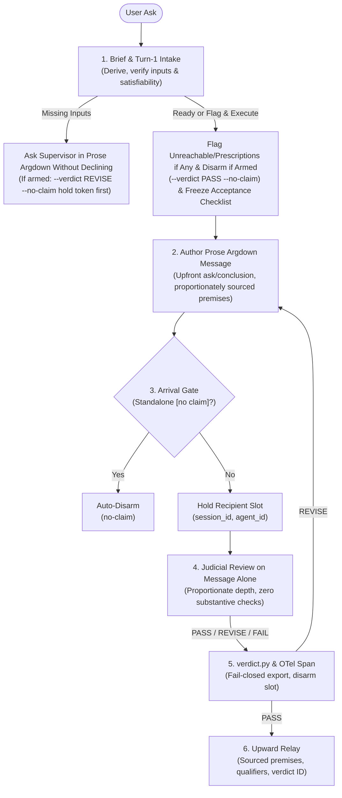

# The Evidence Contract

Every report one agent passes to another meets one contract: load-bearing claims carry checkable inline evidence proportionate to what turns on them (or a stated failure reason), and evaluators conduct administrative-law judicial review on the message alone -- zero substantive checking outside it -- scaling effort and reasons to stakes under a principal-set standard or one reasonable and appropriate in all the circumstances. The contract binds writer and receiver; enforcement mechanics live in [evidence-contract-enforcement.md](evidence-contract-enforcement.md).

## User stories

### 1. Claims I can check

As the user, I want every claim that reaches me to carry evidence I could check, or a plain statement of why the work could not be done, so that I act only on claims someone can back.

- Each load-bearing claim quotes its deciding evidence inline with a pointer to where it was found, or states why the work could not be done.
- Each pointer opens without the writer's transcript and supports what the claim asserts.
- An acceptance criterion is ticked on direct primary evidence of that item. Non-git evaluation datasets, specimen tables, and findings are persisted in the PKB with durable pointers rather than ephemeral container paths (`<appDataDir>/brain/`, `/tmp/`, unpushed worktrees) that vanish on exit.

### 2. Agent-to-agent communication evaluated on the message alone

As the user, I want inter-agent messages written solely in unfenced prose Argdown blocks with load-bearing premises proportionately sourced so evaluators run administrative-law judicial review on the message alone -- scaling effort to stakes and deferring within remit without layout policing or substantive checking outside it.

- Inter-agent messages (briefs, handbacks, reports, reviews, clarifications, remands) consist **solely** of unfenced prose Argdown blocks per [`premise-check`](../../plugins/ida/skills/premise-check/SKILL.md): full upfront ask (ask/task ID) and conclusion in titled blocks, zero prose outside blocks (internal scaffolding passes unless support relations are ambiguous). Subagents await child runs and deliver once at their stopping point (no interim `"still working"` handbacks unless async tracking was requested). Replies to the user and PR/issue outputs remain Markdown.
- Writers break out each load-bearing claim (observed fact, first-person tool claim `"I read..."`/`"I ran..."`, principal direction/rule, relayed finding, assumption, or open question) into its own numbered premise with inline basis (locator/output proportionate to stakes, bounded search, principal ruling, or checked verdict ID + primary locator), never pointing to unquoted prior briefs or opaque IDs. Include version or freshness only when staleness could change the decision; never require forensic micro-precision. Never smuggle unattributed claims via clauses, appositives, parentheticals, or omnibus relays (identifying a verified `verdict-...` without new claims passes); mark unverified premises assumed. Routine or obvious warrants on low-stakes steps need no ceremony; otherwise warrants apply (and justify when unset and non-obvious) a standard reasonable and appropriate in all the circumstances unless set by the principal.
- Ask-specified methods, forms, designs, values, or medium nouns (canvas, diagram, map, code, spec) are paired beside what was done and checked on the face of the message against the ask; silent material swaps fail.
- Evaluators take facially grounded premises as given and scale depth to stakes per `premise-check`: a brief check suffices on low-stakes, read-only, or cheaply redone work; full decomposition and Contrast Testing apply to high-stakes, contested, multi-hop, or irreversible work. Under the **materiality rule**, only defects whose cure could change what is relayed or done next (or non-waivable authority/rule breaches) draw `REVISE`/`FAIL`; immaterial slips pass with a brief non-blocking note omitted from relays. Evaluators defer within remit where not clearly wrong, never remand over layout or micro-precision, catch facial contradictions strictly on the text, and **sever** multi-part messages (drop unneeded weak parts under `PASS` naming strictly the supported subset; on `REVISE`/`FAIL`, optionally note clean severable parts with scope bounds, never relaying failed claims). Once settled, receivers never query refused transports; duplicate packets get concise line-accurate verdicts relaying zero new claims beyond the settled `verdict-<id>`.
- Baseless run-will-settle doubts (`"haven't checked if X works"`) are struck as speculation; admitted unchecked facts readable now (`"haven't checked if merged"`, `"assumed"`) fail material live-state claims whose cure could change user action (immaterial unchecked asides may be severed or omitted).
- Evaluators record `PASS` (valid on the message alone), `REVISE` (curable material defect, directing sender to load `ida:premise-check`; rough presentation on a complete exited-worker record may be restated, while gaps route to a fresh worker), or `FAIL` (facial contradiction, incoherence, _ultra vires_, non-waivable rule breach, or unanswered material ask).

### 3. Appealable verdicts I can audit

As the user, I want every verdict to carry clear, appealable natural-language reasons I can audit against the report it judged, so that a `PASS`, `REVISE`, or `FAIL` demonstrates facial validity and authority rather than asserting a bare outcome.

- Verdict reasons are self-contained natural-language records matched to the message's actual lines (no fixed line counts, regex keys, or pasted prior reasons) scaled to stakes: a brief note (`--reason` or `--reason-file`: claim/ask, why grounds suffice, what relays) suffices for low-stakes, read-only, cheaply redone, or duplicate `PASS`es; full per-premise, rival, standard-of-proof, compliance, and cure breakdowns apply to high-stakes, contested, multi-hop, or `REVISE`/`FAIL` verdicts.
- A bare standalone `[no claim]` line (sole content, including closing settled stale remands) auto-disarms; armed direction briefs or claim-free messages clear via `verdict.py --verdict PASS --no-claim` (or `--verdict REVISE --no-claim` as a gate-disarm clarification hold) with a brief reason.
- Each verdict mints a `verification_id` exported on its OpenTelemetry span alongside judged reference, judged text SHA-256 digest, `premise_check.no_claim`, and recorded reason.

### 4. Strength that survives every hop

As the user, I want each claim to reach me as strong as its evidence and no stronger, so that a guess relayed three times still arrives as a guess.

- Relayed claims preserve qualifiers, scope bounds, and disclosed rule violations across hops; derived claim strength is bounded by supporting premises.
- Intermediate coordinators relay verified child verdicts (`verdict-...`) upward without substantive checking outside the message, putting each finding in its own numbered premise with verdict ID, primary locator, qualifiers, and disclosed breaches (bare stubs and omnibus relays fail).
- Evaluators relay strictly checked conclusions and never add unchecked assertions or open primary sources to patch weak claims; a relaying sender passes evidentiary remands down to the originating agent (or a fresh worker if exited or discredited) rather than gathering primary evidence itself.

### 5. Tested limits

As the user, I want every "it does not exist" or "I cannot" to rest on a test, so that a limit is never asserted from absence alone.

- Scope negative or capability claims to the boundary actually inspected, quoting a failed attempt with verbatim error or a bounded search (query, scope, and zero count) under a standard reasonable and appropriate in all the circumstances.
- Claims blaming something outside the writer's change cite a control run isolating it, or travel qualified as unestablished.

### 6. Honest endings

As the user, I want partial delivery, inability, and unreachability to be accepted as complete, honest answers on the record, so that agents report what happened accurately instead of fabricating completion.

- "I could not do X, because Y" (with quoted evidence of Y) meets the contract; guard or harness refusals are reported verbatim as halts and never bypassed over alternate channels.
- Partial reports quote evidence for what shipped and disclose remainders under `tested | declared-deferred | illegal-gap` ([partial-work spec](../polecat/spec-partial-work-tight-loop-delivery.md)); at a principal-requested pause, checkpoint, handover, or user-reserved choice, open-question premises qualifying settled conclusions satisfy ask coverage.
- An ask unfulfillable by construction at the reporter's stopping point is satisfied when quoted facts prove unreachability; checkers treat it as answered rather than issuing `REVISE` or `FAIL`.

### 7. Directions relayed intact

As the user, I want my directions to reach a worker as I gave them, so that an agent in the chain cannot add to what I asked.

- Relayed directions cite the original ask and derive faithfully from it (by meaning and distinctions, not harmless rewording), demanding only what the recipient can hold when it stops. Dispatchers compose briefs from the ask and task record without inspecting primary sources.
- Recipients verify Turn-1 inputs, derivation, and satisfiability before logging a frozen acceptance checklist, never declining handed work or scraping local JSONL logs (Arize Phoenix via `crew:phoenix` only).
- On omitted required inputs, ask the supervisor in prose Argdown without declining (if armed, disarm first via `verdict.py --claim <id> --verdict REVISE --no-claim` with `--reason`/`--reason-file` as a gate-disarm clarification hold).
- On unreachable demands or unverified prescriptions, flag them in prose Argdown without declining and execute the assigned role; disarm armed briefs via `verdict.py --claim <id> --verdict PASS --no-claim` with `--reason`/`--reason-file` (skip if unarmed).

### 8. Explanations are not reasons (hearsay)

As the user, I want diagnoses and evaluations to trace causes to runtime evidence rather than agent self-reports, so that failure analyses address actual mechanisms rather than rationalised stories.

- An agent's self-explanation of why it acted is post-hoc hearsay ([`explanations-not-reasons`](../../plugins/crew/skills/axioms/explanations-not-reasons.md)) and never taken at face value.
- Diagnoses and evaluations establish causes from external runtime evidence (traces, diffs, inputs, environment state, reproduced runs); Phoenix spans prove execution rather than logical entailment.

## Design

### Evidence-contract lifecycle

### Closed-record rule: zero substantive checking

> **The Closed-Record Principle:**
> The record is the message under review and nothing outside it. Evaluators act as administrative-law reviewing tribunals taking facially grounded premises as given. A checker never relies on, consults, or tests against anything outside the message -- including in-context state, prior unrelated turns, harness telemetry, tool logs, external sources, or other agents -- to verify truth, confirm execution, or authenticate values, and never runs forensic authenticity checks or escalates receipt precision as an anti-fabrication proxy at any stakes level.

- **Bounded consistency & suspected invention:** Independently of truth testing, checkers verify ask coverage against the originating ask and catch unexplained material contradictions across the same sender's own successive submissions on an unchanged claim in an active remand. When a message looks invented, act strictly on material facial defects; without one, `PASS` on the message alone without ad-hoc fact-checkers. Substantive deliverable verification belongs to planned acceptance review/QA, and systemic fabrication escalates out of band to `/learn` outside `premise-check`.
- **Scope & canonical homes:** Binds all coordinators, evaluators, and checking roles across report review, upward relay, and brief dispatch. Spec home here; instruction home in `plugins/ida/skills/premise-check/SKILL.md` (with `references/critique-guide.md`); other personas and skills defer to `premise-check`.
- _Rejected alternative:_ An earlier conflict-settling source-read carve-out and programmatic Argdown/reason parser were retired in [ADR-0003](../decisions/0003-retire-mechanical-premise-check-parser-and-adopt-administrative-law-review.md) after inducing coordinator fact-checking drift and zero-yield syntax churn.

## Terms

- **Load-bearing claim:** A claim the reader would act on, or that a conclusion rests on.
- **Pointer:** Inline locator a reader can open (`path:line`, commit SHA, command + exit code, span ID, PR/task ID, URL); commands count when deciding output or exit code is quoted inline.
- **Ask ID:** Immutable identifier an ask travels under (`tg-<message id>`, `<task id>/AC<n>`).
- **Message format:** Unfenced prose Argdown blocks with load-bearing premises proportionately sourced per [`premise-check`](../../plugins/ida/skills/premise-check/SKILL.md) (distinct from standalone `.argdown` files under [`argdown-toulmin`](../../plugins/ida/skills/argdown-toulmin/SKILL.md)).
- **Task-record handback:** A worker's Argdown report under `## Report` on a task record, evaluated via `verdict.py` with task ID as `--claim` (`--judged-file` when out-of-band) and recorded under `## Premise-Check Verdict`.
