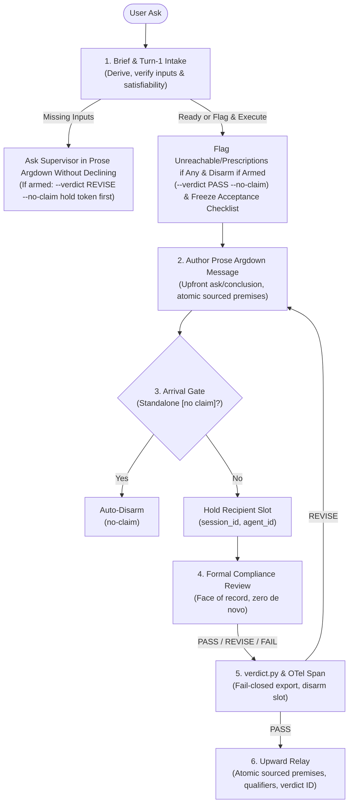

# The Evidence Contract

Every report one agent passes to another meets one contract: each load-bearing claim carries checkable inline evidence or a stated failure reason, and every evaluator conducts administrative-law formal compliance review strictly on the face of the record with zero _de novo_ factual checking. The contract binds both writer and receiver; enforcement mechanics live in [evidence-contract-enforcement.md](evidence-contract-enforcement.md).

## User stories

### 1. Claims I can check

As the user, I want every claim that reaches me to carry evidence I could check, or a plain statement of why the work could not be done, so that I act only on claims someone can back.

- Each load-bearing claim quotes its deciding evidence inline with a pointer to where it was found, or states why the work could not be done.
- Each pointer opens without the writer's transcript and supports what the claim asserts.
- An acceptance criterion is ticked on direct primary evidence of that item. Non-git evaluation datasets, specimen tables, and findings are persisted in the PKB with durable pointers rather than ephemeral container paths (`<appDataDir>/brain/`, `/tmp/`, unpushed worktrees) that vanish on exit.

### 2. Agent-to-agent communication evaluated strictly on the face of the record

As the user, I want all agent-to-agent communication written solely in unfenced prose Argdown blocks with every premise broken out as its own sourced claim so an evaluator reviews formally on the face of the record and remands logical, evidentiary, and authority defects without wasteful _de novo_ fact-checking.

- All agent-to-agent communication (briefs, directions, handbacks, reports, reviews, clarifications, remands, and peer replies) consists **solely** of unfenced prose Argdown blocks per [`premise-check`](../../plugins/ida/skills/premise-check/SKILL.md) -- leading with the full original ask (preserving meaning, distinctions, and ask/task ID) and bottom-line conclusion, organized into independent titled argument blocks restarting at `(1)`, never bolting a block onto a parallel prose summary, conversational framing, loose Markdown bullets, or wrapping the message in one monospace fence. Direct replies to the user and published PR/issue comments or human-facing deliverables remain Markdown.
- Writers break out every factual assertion, background assumption, or relayed finding as its own separate numbered premise carrying its own stated source (inline quote + locator, exact command/exit code, PR URL, bounded search/failed attempt, or checked verdict ID + underlying primary locator), stating observed version or timestamp for live-state claims. Never bundle multiple claims or smuggle an unattributed assertion inside another statement via subordinate clauses, appositives, parentheticals, or omnibus relays; any unverified premise stands as its own numbered claim explicitly marked assumed/unverified. Observations stay above `-- ... --`; evaluations sit below. Warrants and nearest plausible rivals are written in plain prose without closed vocabularies, comma bans, or endnotes.
- Where the ask specifies a method, form, design, value, or medium noun (canvas, diagram, map, code, spec), each specified feature is paired beside what was done with departures named; silent swaps fail.
- Evaluators accept single, atomic primary observations carrying their own inline quote and locator as given and apply the active critique protocol in `premise-check` on the face of the record: unpack every premise clause by clause first (rejecting bundled/embedded unsourced premises, non-Argdown inter-agent prose, secondary summary substitution on live state, and unversioned failures), run the Gap Test (embedded claims inside premises plus quantifier, scope, proxy, and medium/method drift), run the Contrast Test (plausible rivals, rejecting open user deferrals and stakes laundering on stakes-bearing conclusions), verify full ask coverage, delegated authority (no _ultra vires_), and non-waivable deliverable rule compliance, and remand defects in a prose Argdown block using 3-way triage (narrow qualifier, break out bundled/embedded premises or supply bridge/warrant, or gather primary evidence).
- Baseless run-will-settle doubts ("haven't checked if the tool works") are struck as speculation; admitted unchecked facts readable now ("haven't checked if merged", "assumed") are never struck and fail when premises cannot bear stakes or live-state user claims.
- Evaluators record `PASS`, `REVISE` (remanding curable defects with sender directed to load `ida:premise-check`; rough presentation on a complete exited-worker record may be restated by the receiver, while gaps route to a fresh worker), or `FAIL` (incoherence, evidence contradiction, _ultra vires_, non-waivable rule breach, or unanswered ask).

### 3. Appealable verdicts I can audit

As the user, I want every verdict to carry clear, appealable natural-language reasons I can audit against the report it judged, so that a `PASS`, `REVISE`, or `FAIL` demonstrates facial validity and authority rather than asserting a bare outcome.

- Verdict reasons are self-contained natural-language records (no fixed line counts or regex keys) naming the judged claim and asks, explaining per-premise source grounding and why load-bearing inferences hold or fail, rivals tested, evidence-to-stakes fit, ask/authority/rule compliance (with remand cures on `REVISE`/`FAIL`), and which checked conclusions (with qualifiers) may relay upward.
- A bare standalone `[no claim]` acknowledgement (sole message content, zero accompanying prose) auto-disarms; an armed direction brief or claim-free message that arms the gate clears via `verdict.py --verdict PASS --no-claim` (or `--verdict REVISE --no-claim` as a gate-disarm token when holding on missing inputs pending supervisor clarification) with a plain natural-language reason.
- Each verdict mints a `verification_id` exported on its OpenTelemetry span alongside the judged reference, judged text SHA-256 digest, `premise_check.no_claim`, and recorded natural-language reason.

### 4. Strength that survives every hop

As the user, I want each claim to reach me as strong as its evidence and no stronger, so that a guess relayed three times still arrives as a guess.

- Relayed claims preserve qualifiers, scope bounds, and disclosed rule violations across hops; derived claim strength is bounded by supporting premises.
- Intermediate coordinators may relay verified child verdicts (`verdict-...`) upward without _de novo_ re-inspection, breaking out each relayed finding as its own numbered premise carrying its verdict ID, underlying primary locator, qualifiers, and disclosed rule violations (bare `"passed verdict-X"` stubs and omnibus multi-claim relay sentences fail).
- Evaluators relay strictly checked conclusions and never add unchecked assertions after review or open primary sources to patch weak claims.

### 5. Tested limits

As the user, I want every "it does not exist" or "I cannot" to rest on a test, so that a limit is never asserted from absence alone.

- Negative or capability claims quote a failed attempt with verbatim error, or a bounded search with query, scope, and zero count.
- Claims blaming something outside the writer's change cite a control run isolating it, or travel qualified as unestablished.

### 6. Honest endings

As the user, I want partial delivery, inability, and unreachability to be accepted as complete, honest answers on the record, so that agents report what happened accurately instead of fabricating completion.

- "I could not do X, because Y" (with quoted evidence of Y) meets the contract.
- Partial reports quote evidence for what shipped and disclose remainders under `tested | declared-deferred | illegal-gap` ([partial-work spec](../polecat/spec-partial-work-tight-loop-delivery.md)).
- An ask whose demand was unfulfillable by construction at the reporter's stopping point is satisfied when the conclusion validly establishes unreachability; checkers treat it as answered rather than issuing `REVISE` or `FAIL`.

### 7. Directions relayed intact

As the user, I want my directions to reach a worker as I gave them, so that an agent in the chain cannot add to what I asked.

- Relayed directions cite the original ask and derive faithfully from it (judged by meaning and distinctions, not harmless rewording), demanding only what the recipient can hold when it stops. Dispatchers compose briefs from the ask and task record without inspecting primary sources.
- Recipients verify Turn-1 required inputs, derivation, and brief satisfiability before logging a frozen acceptance checklist, never declining handed work or scraping local JSONL transcripts/debug logs (Arize Phoenix via `ida:phoenix` only).
- On omitted required inputs, ask the supervisor in a prose Argdown block without declining (skip `verdict.py` if unarmed; if armed, disarm first via `verdict.py --claim <id> --verdict REVISE --no-claim --reason-file <path>` as a gate-disarm token for a clarification hold).
- On unreachable demands or unverified caller prescriptions, flag them to the supervisor in a prose Argdown block without declining and execute the assigned role; disarm ready or flag-and-execute armed briefs via `verdict.py --claim <id> --verdict PASS --no-claim --reason-file <path>` (skip `verdict.py` when unarmed).

### 8. Explanations are not reasons (hearsay)

As the user, I want diagnoses and evaluations to trace causes to runtime evidence rather than agent self-reports, so that failure analyses address actual mechanisms rather than rationalised stories.

- An agent's self-explanation of why it acted is post-hoc hearsay ([`explanations-not-reasons`](../../plugins/rbg/skills/axioms/explanations-not-reasons.md)) and never taken at face value.
- Diagnoses and evaluations establish causes from external runtime evidence (traces, diffs, inputs, environment state, reproduced runs); Phoenix spans prove execution rather than logical entailment.

## Design

### Evidence-contract lifecycle

### Prohibition on _de novo_ factual checking

> **The Zero-_De-Novo_-Review Rule:**
> Evaluators act as administrative-law reviewing tribunals judging strictly on the face of the record. A checker never opens cited sources, re-reads files or records, re-runs commands, or commissions a third agent to re-check factual claims or settle factual conflicts. When quoted evidence is missing, weak, or conflicting on the record, record `REVISE` or `FAIL` and remand the evidentiary defect to the originating agent.

- **Scope:** Binds all coordinators, evaluators, and checking roles (`ida`, `sara`, `james`, reviewing agents) across report review, upward relay, and brief dispatch.
- **Canonical homes:** Specification home in this document; instruction home in `plugins/ida/skills/premise-check/SKILL.md` (with `references/critique-guide.md`). Other personas and skills defer to `premise-check`.
- _Rejected alternative:_ An earlier conflict-settling source-read carve-out and programmatic Argdown/reason syntax parser were retired in [ADR-0003](../decisions/0003-retire-mechanical-premise-check-parser-and-adopt-administrative-law-review.md) after inducing coordinator fact-checking drift and zero-yield syntax churn.

## Terms

- **Load-bearing claim:** A claim the reader would act on, or that a conclusion rests on.
- **Pointer:** An inline locator a reader can open (`path:line`, commit SHA, exact command and exit code, span ID, PR/task ID, or URL). Commands count as evidence only when deciding output or exit code is quoted inline.
- **Ask ID:** Immutable identifier an ask travels under (`tg-<message id>`, `<task id>/AC<n>`).
- **Message format:** Unfenced prose Argdown blocks with atomic sourced premises per [`premise-check`](../../plugins/ida/skills/premise-check/SKILL.md) (distinct from standalone formal `.argdown` files governed by [`argdown-toulmin`](../../plugins/ida/skills/argdown-toulmin/SKILL.md)).
- **Task-record handback:** A worker's Argdown report under `## Report` on a task record, evaluated via `verdict.py` with the task ID as `--claim` (and `--judged-file` when out-of-band) and recorded under `## Premise-Check Verdict`.
