# The Evidence Contract

Every report one agent passes to another meets one contract: each load-bearing claim in it carries checkable evidence or a stated failure reason. The contract binds the writer of a report and its receiver. How the framework enforces it is in [evidence-contract-enforcement.md](evidence-contract-enforcement.md).

## User stories

### 1. Claims I can check

As the user, I want every claim that reaches me to carry evidence I could check, or a plain statement of why the work could not be done, so that I act only on claims someone can back.

- Each load-bearing claim carries a pointer with its basis, or a stated failure reason.
- Each pointer opens without the writer's transcript, and says what its claim asserts.
- An acceptance criterion is ticked on direct evidence of that item. An item without such evidence stays unticked, with its limit stated beside it. Non-git evaluation datasets, specimen tables, and findings must be persisted in the PKB with durable pointers rather than ephemeral container paths (`<appDataDir>/brain/`, `/tmp/`, unpushed container worktrees) that vanish on exit.

### 2. Reports a receiver can judge as they stand

As an agent receiving a report, I want to judge it from the report alone, so that I can pass it on or send it back without redoing the work.

- The report is in the shape the [`premise-check` skill](../../plugins/ida/skills/premise-check/SKILL.md) defines.
- The report opens with the ask in the asker's own words, one question per line, each carried by an immutable id: `tg-<message id>` for a Telegram message, `<task id>/AC<n>` for a task's acceptance criterion. The writer copies the ask it was given and never substitutes its own title for it.
- Each material premise carries its basis, and a pointer wherever that basis rests on evidence.
- A premise about the state of something outside the report quotes the observed value of the field that decides it, beside the pointer. Premises with an `observed` basis (`I did it`, `I read it`) state raw empirical observations quoting deciding values inline, never evaluative or generalising conclusions restating an acceptance criterion.
- Each state claim rules out the nearest other state that would change the reader's next action. "Blocked on review" says whether review is awaited or changes were requested.
- The conclusion stays within its premises' scope and answers each ask by its id, or says the ask has no answer.
- The receiver takes an observed premise with a pointer as given: it never opens a pointer or re-determines an observed fact. A checker never reads a source to check someone's claim; it reads one only to settle a genuine conflict between two records. A PKB node or another agent's writing is not such a pointer: it is not observed primary evidence and ranks as worker reported, unchecked rather than an observed record. It judges everything else: every warrant, step, scope and fit between rule and case, requiring construct match and proportional sample adequacy (rejecting quantitative rank checks as proof of qualitative evaluation, and unexplained n=1 or n=2 probes as proof of representative classes). When a ruling turns on a fact the report lacks, the receiver sends the report back naming the missing premise.
- The receiver tests each material step for sufficiency. A warrant stands as stated when it is obvious, authority-backed (strictly limited to the user's own words or a governing spec), backed by a cited verdict, or carries a claim cheap to reverse. A task's primary ask or acceptance criterion is never low-stakes or obvious. A premise or warrant citing a PKB node or peer text does not satisfy sufficiency on the citation alone. A warrant that is complex, unbacked and high-stakes goes back for one level of decomposition.
- The receiver answers with a verdict and a reason: PASS, REVISE or FAIL. Format-only defects on a substantively sound argument with at least one inference line (`>= 1`) are waived and rewritten into standard form by the receiver on PASS; 0 inference lines or substantive defects require REVISE or FAIL and cannot be passed or relayed upward as fact.

### 3. Verdicts I can audit

As the user, I want every verdict to carry a reason I can hold against the report it judged, so that a PASS shows what was tested rather than asserting it.

- The reason is a checkable artefact with required content: seven keyed lines (`Judged`, `Valid`, `Supported`, `Answered`, `Sufficient`, `Waived`, `Relay`) in the form the skill's [checker's reason](../../plugins/ida/skills/premise-check/references/checker-reason.md) defines. Its ask ids, inference entries, weakest basis and relay lines can each be held against the judged report.
- A message that makes no claim takes a one-line no-claim reason, and its verdict is marked no-claim.
- Each verdict has a verification id that resolves to the recorded verdict and the text it judged.

### 4. Strength that survives every hop

As the user, I want each claim to reach me as strong as its evidence and no stronger, so that a guess relayed three times still arrives as a guess.

- Every claim keeps its basis at every hop.
- A derived claim takes the weakest basis among its premises.
- A premise resting on another agent's report or a PKB node cites the verdict recorded on that report. A cited verdict resolves to a recorded verification id; a report or PKB node cited without one is weighed as unchecked.
- Each sentence relayed upward names the line of the checked argument it restates. A sentence with no line is not relayed. A sentence relayed upward derives exclusively from a checked line in the judged argument; an agent never reads a source of record to check or verify a claim before relaying. If a claim lacks supporting evidence in the argument, the report is returned for revision or rejected rather than patched by reading the source.

### 5. Tested limits

As the user, I want every "it does not exist" or "I cannot" to rest on a test, so that a limit is never asserted from absence alone.

- A negative or capability claim cites a failed attempt with its verbatim error, or a bounded search with its query, scope and zero count.
- A claim that blames something outside the writer's own change cites a control run that isolates it, or travels as unestablished.

### 6. Honest endings

As an agent that could not finish, I want failure and partial delivery to be complete answers, so that I report what happened as it happened.

- "I could not do X, because Y" meets the contract.
- A partial report carries evidence for what shipped and discloses the deferred remainder under the partial-work coverage partition (`tested | declared-deferred | illegal-gap`, [partial-work spec](../polecat/spec-partial-work-tight-loop-delivery.md)).
- An ask whose demand was unfulfillable by construction at the reporter's stopping point is satisfied when the conclusion validly establishes unreachability. Checkers link the conclusion and do not fail or loop the reporter for an impossible demand.
- A deliverable is complete when the writer's own acceptance items are met, whatever follow-up depends on it.

### 7. Directions relayed intact

As the user, I want my directions to reach a worker as I gave them, so that an agent in the chain cannot add to what I asked.

- A relayed direction cites the original ask, and every detail, constraint and method in it can be derived from that ask. When composing a dispatch or relaying a direction, the dispatching agent derives instructions faithfully from the original ask and task record without reading primary sources to verify claims; workers inspect sources and execute.
- A brief demands only what the recipient can hold at the point it stops. Coordinators and dispatchers never demand downstream pipeline outcomes (such as pull request URLs from subsequent workers, merge states, or decisions delegated to future stages).
- A receiving agent verifies brief satisfiability at intake before logging deliverables, refusing with `REVISE` any direction demanding deliverables belonging to subsequent pipeline stages or unfulfillable at its stopping point.

### 8. Explanations are not reasons (hearsay)

As the user, I want diagnoses and evaluations to trace causes to runtime evidence rather than agent self-reports, so that failure analyses address actual mechanisms rather than rationalised stories.

- An agent's explanation of what it did is not its reason. Asked why it acted, an agent produces a plausible story after the fact; that account is hearsay, because models have no direct knowledge of their own causes ([`explanations-not-reasons`](../../plugins/rbg/skills/axioms/explanations-not-reasons.md)).
- A stated reason is never taken at face value: it is probabilistic evidence and sometimes false.
- Diagnoses, audits, and evaluations establish root causes from external evidence (traces, diffs, inputs, environment state, reproduced runs), never from what an agent claims it thought, intended, or misunderstood.
- Tool spans in Phoenix prove execution rather than logical entailment; evaluations, audits, and QA must inspect durable primary deliverables rather than ephemeral container paths.

## Design

The evidence contract governs the lifecycle of claims and directions across six sequential phases: intake and direction origin, report authoring and handback, reception and gate arming, semantic and sufficiency evaluation, verdict recording and machine validation, and upward relay.

### Aggregated evidence-contract flow

```mermaid
flowchart TD
  subgraph P1["Phase 1: Intake & Direction Origin"]
    direction TB
    A1["A1: User Ask Originated<br/>(tg-id or task AC)"]
    A2["A2: Session Reminders Injected<br/>(Session or turn start reminder)"]
    A3{"A3: Check Direction Derivation<br/>(Does direction derive from Ask?)"}
    A4["A4: Refuse Unverified Prescriptions<br/>(Reject caller method constraints)"]
    A5["A5: Compose Dispatch from Ask & Task<br/>(Derive without inspecting primary source)"]
    A6["A6: Freeze Acceptance Checklist<br/>(Log deliverables on task before work)"]

    A1 --> A3
    A2 --> A3
    A3 -- "No / Drift" --> A4
    A3 -- "Yes" --> A5 --> A6
  end

  subgraph P2["Phase 2: Authoring & Report Generation"]
    direction TB
    B1["B1: Worker Start Reminded<br/>(Worker start: reply is a report)"]
    B2["B2: Produce Durable Deliverables<br/>(Commit to repo or PKB, no ephemeral paths)"]
    B3["B3: Structure Report in Standard Shape<br/>(Frontmatter asks, answers, argdown block)"]
    B4["B4: Copy Ask Verbatim with Immutable ID<br/>(Preserve original words and tg/AC id)"]
    B5["B5: Attach Basis and Direct Pointer<br/>(Closed vocabulary basis and checkable pointer)"]
    B6["B6: Verify Self-Contained Pointer<br/>(Opens without transcript and asserts claim)"]
    B7["B7: Quote Observed Deciding Values<br/>(Inline raw empirical observations)"]
    B8["B8: Rule Out Nearest Alternate States<br/>(State claim eliminates closest action switch)"]
    B9["B9: Test Limits and Negative Claims<br/>(Failed attempt error or bounded zero search)"]
    B10["B10: Isolate External Blame<br/>(Cite control run isolating external cause)"]
    B11["B11: Exclude Hearsay Explanations<br/>(Trace causes to external runtime evidence)"]
    B12["B12: Require Direct Evidence for AC<br/>(Tick AC only on direct observation)"]
    B13{"B13: Handle Deliverable Completion<br/>(Full delivery or partial coverage partition?)"}
    B14["B14: Scope Conclusion to Premises<br/>(Answer each ask by id or state no answer)"]
    B15["B15: Deliver Handback Report<br/>(Send message payload or write task Report)"]

    B1 --> B2 --> B3 --> B4 --> B5 --> B6 --> B7 --> B8
    B8 --> B9 --> B10 --> B11 --> B12 --> B13
    B13 -- "Complete" --> B14
    B13 -- "Partial / Failed" --> B14
    B14 --> B15
  end

  subgraph P3["Phase 3: Reception & Gate Arming"]
    direction TB
    C1{"C1: Inbound Message Type<br/>(Inspect arriving event & sender)"}
    C2["C2: User Prompt Hydration<br/>(Hydrate from PKB; bypass gate)"]
    C3["C3: Inbound Reminder Injected<br/>(Check per skill or REVISE)"]
    C4["C4: Premise-Check Gate Armed<br/>(Universal scope: store text & id reference)"]
    C5["C5: Agent Actions Held<br/>(Refuse dispatch, messaging, user questions, Stop)"]
    C6{"C6: Check Operating Mode & Overrides<br/>(Check mode & active overrides)"}

    C1 -- "User Prompt" --> C2
    C1 -- "Agent Report / Direction" --> C3 --> C4 --> C5 --> C6
  end

  subgraph P4["Phase 4: Semantic & Sufficiency Evaluation"]
    direction TB
    D1{"D1: Inspect Load-Bearing Claims<br/>(Does message make claims?)"}
    D2["D2: Accept Observed Primary Evidence<br/>(Take premise with direct pointer as given)"]
    D3["D3: Rank Peer & PKB Citations<br/>(Rank as worker reported, unchecked)"]
    D4["D4: Judge Construct & Sample Adequacy<br/>(Proportional sample match; reject rank checks)"]
    D5{"D5: Test Material Steps for Sufficiency<br/>(Obvious, authority, cited verdict, or cheap?)"}
    D6["D6: Decompose High-Stakes Warrant<br/>(Return unbacked high-stakes step for breakdown)"]
    D7["D7: Return for Missing Premise<br/>(Return report naming absent material fact)"]
    D8["D8: Formulate 7-Line Checker Reason<br/>(Draft Judged, Valid, Supported, Answered, etc.)"]

    D1 -- "No Claim" --> D8
    D1 -- "Claims Present" --> D2 --> D3 --> D4 --> D5
    D5 -- "Unbacked & High-Stakes" --> D6
    D5 -- "Missing Premise" --> D7
    D5 -- "Sufficient" --> D8
  end

  subgraph P5["Phase 5: Verdict Recording & Machine Validation"]
    direction TB
    E1["E1: Invoke Machine Recorder<br/>(Submit reason and block to recorder)"]
    E2{"E2: Run Deterministic Parser Checks<br/>(Deterministic syntax, links, undercuts)"}
    E3{"E3: Evaluate PASS Criteria<br/>(Sound, >=1 inference line, 7-line cross-checks)"}
    E4["E4: Waive Format Defects & Rewrite<br/>(Waived items rewritten into standard form)"]
    E5{"E5: Evaluate REVISE or FAIL Criteria<br/>(>=1 failing inference line or unanswered ask)"}
    E6["E6: Fail Closed on Error<br/>(Export, tracing, or parser fault keeps gate armed)"]
    E7["E7: Mint Verification ID & Emit Span<br/>(Emit verdict span with telemetry attributes)"]
    E8["E8: Disarm Gate & Record Task Verdict<br/>(Disarm gate; write Premise-Check Verdict to task)"]

    E1 --> E2
    E2 -- "Parser Error / Unconnected" --> E6
    E2 -- "Valid Argdown" --> E3
    E3 -- "PASS Valid" --> E4 --> E7
    E3 -- "Substantive Defects / 0 Inferences" --> E5
    E5 -- "Failing Line / Unanswered Ask" --> E7
    E5 -- "Invalid Rejection" --> E6
    E7 --> E8
  end

  subgraph P6["Phase 6: Upward Relay & Telemetry"]
    direction TB
    F1["F1: Relay Exclusively from Checked Line<br/>(Derive from argument without reading source)"]
    F2["F2: Restate Named Line from Relay Field<br/>(Every relayed sentence names checked line)"]
    F3["F3: Preserve Basis & Inherit Weakest Basis<br/>(Derived claim takes weakest premise basis)"]
    F4["F4: Transmit Relayed Claim Upward<br/>(Attach verification ID and citation)"]
    F5["F5: Query Verdict Telemetry<br/>(Monitor defect rate, strength, waived items)"]

    F1 --> F2 --> F3 --> F4
    E8 -.-> F5
  end

  %% Inter-phase transitions
  P1 ==>|Frozen Acceptance Checklist| P2
  P2 ==>|Report Handback / Payload| P3
  P3 ==>|Stored Judged Text & Armed Gate| P4
  P4 ==>|Checker Reason & Argdown Block| P5
  P5 ==>|Disarmed Gate & Verification ID| P6

  %% Review return loop
  E5 -.->|REVISE: Return for author correction| P2
  D6 -.->|Decompose: Return for breakdown| P2
  D7 -.->|Missing Premise: Return for evidence| P2
```

### Invariants and state transitions

1. **Direction derivation, brief satisfiability, and frozen acceptance:** Incoming directions derive strictly from the originating ask (`tg-<id>` or `<task id>/AC<n>`). Receiving agents verify direction derivation and brief satisfiability at intake, refusing (`REVISE`) directions that include unverified caller method/template prescriptions or that demand downstream pipeline deliverables unfulfillable at the recipient's stopping point. Dispatching agents derive instructions faithfully from the ask and task record without inspecting target repository sources to verify claims, and deliverables are recorded as a frozen acceptance checklist on the task record before work begins.
2. **Durable authoring:** Deliverables and findings are stored in durable repositories or PKB records rather than ephemeral paths. Reports open with the original ask verbatim and follow standard premise-check structure. Each material premise carries its closed-vocabulary basis and self-contained pointer; observed premises quote deciding values inline; nearest alternate states are ruled out; negative claims cite tested limits; and hearsay is excluded by tracing causes to runtime evidence.
3. **Arrival and gating:** User prompts hydrate from the PKB and proceed without arming. Incoming agent reports and directions arm the universal premise-check gate across all agents, holding dispatch, messaging, user questions, and stop actions until a verdict is recorded.
4. **Semantic evaluation and sufficiency:** Checkers accept observed premises with direct pointers as given without reopening, while ranking PKB nodes and peer writing as unchecked. Material steps are tested for sufficiency (obvious, authority-backed, cited verdict, or cheap to reverse); unbacked high-stakes warrants are decomposed, and missing premises are returned for evidence. Under `Answered`, an ask whose demand was unfulfillable by construction at the reporter's stopping point is satisfied when the conclusion validly establishes unreachability, linking the conclusion (`← (n)`) rather than marking `unanswered` or issuing `REVISE`/`FAIL`. Checkers formulate a seven-line checker reason.
5. **Deterministic machine validation:** The verdict recorder validates the argdown block using deterministic native checks (syntax, connectedness, undercut targets, and at least one inference line on PASS). Format-only defects are waived and rewritten into standard form on PASS, while substantive defects or zero inference lines require REVISE or FAIL. Valid verdicts mint a verification ID, emit a telemetry span, disarm the gate, and record task verdicts.
6. **Upward relay:** Relayed claims derive exclusively from checked lines in the validated argument without reading sources of record, explicitly name their validated argument line from the relay field, inherit the weakest basis among premises, and travel with their verification ID.

### Single rule for when a checker reads a source

#### Ruling and scope of authority

The governing ruling for source inspection by checking agents states:

> **The Checker Source-of-Record Rule:**
> A checker never reads a source to check someone's claim; it reads one only to settle a genuine conflict between two records. When a claim lacks evidence or rests on an unchecked basis, do not inspect the source: record REVISE or FAIL naming the defect.

**Where it binds:**

- Binds all checking roles and evaluating personas across the framework (`ida`, `sara`, and reviewing agents) when receiving, evaluating, or relaying reports and handbacks.
- Binds dispatching supervisors when composing instructions or dispatching tasks to workers: dispatchers pass requirements derived faithfully from the ask and task record without inspecting target repository source files or configuration to verify claims.
- Binds all premise-check and hearsay evaluation workflows: a checker judges the argument as presented; it never opens a cited pointer, re-runs commands, or fetches external records to verify an unbacked premise.

#### Single home and deferral architecture

The ruling is placed in exactly one canonical specification home and one canonical instruction home:

- **Specification home:** `specs/enforcement/evidence-contract.md` (US-2 and this Design section).
- **Instruction home:** `plugins/ida/skills/premise-check/SKILL.md` (under "Reports" and Rule 7 "Relay upward").

Other checking roles, evaluating personas, and skills defer strictly to `premise-check`'s relay and checking rules rather than defining independent inspection procedures.

## Terms

- **Load-bearing claim:** a claim the reader would act on, or that a conclusion rests on.
- **Pointer:** an identifier a reader can open: a commit and line, a span id, a PR or task id, a resolving URL. A pinpoint is best. A command counts as evidence only when its output is the evidence, and then the output is quoted.
- **Basis:** how the writer knows the claim. The vocabulary is the skill's.
- **Ask id:** the immutable id an ask travels under, from the asker to the final answer. Its form is defined in the `premise-check` skill.
- **Report format:** the report shape, basis vocabulary, verdict tokens and checker's reason are defined once, in the `premise-check` skill.
- **Task-record handback:** a worker's handback written to its task record's `## Report` section. It is a report like any other: the agent that reads it checks it with the task id as claim id, and writes the verdict back to the task record under `## Premise-Check Verdict`.
