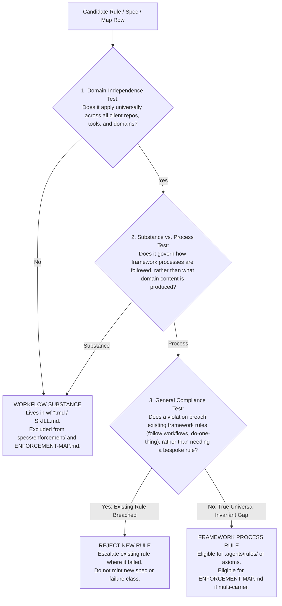

# Framework-Only Enforcement and Removal Design

This specification establishes the architectural design, doctrine, and removal inventory defining enforcement in academicOps strictly as framework-level process rules (compliance with our processes) rather than workflow-substance rules (which govern what is done in client repositories and domain-specific tasks). It establishes the operational test a worker can apply to any rule, presents an exhaustive classification of every spec, rule, hook, gate, and enforcement-map row, itemizes every spec and enforcement mechanism to remove or demote with concrete primary evidence, answers all listed historical open issues (#3366-#3370, #281, #946, #3360, #3359, #3363, #3365, #3314), and sets out the Stage 2 (Build) implementation plan.

## User stories

### US-1: Clear Boundary Between Framework Process and Workflow Substance

As the framework principal (the user) and system architect, I want enforcement defined exclusively as framework-level process rules rather than workflow substance, so that the framework stops generating over-engineered specifications, redundant rules, and bloated enforcement registers for client procedures.

- **AC-1.1**: Given any existing or proposed rule, when evaluated against the framework/workflow line, then it is classed as a framework-process rule if and only if it governs universal process compliance across repositories and tasks, and as workflow substance if it governs domain-specific content, heuristics, formats, or client procedures.
- **AC-1.2**: Given an agent failing to follow an applicable workflow, when root causes are analyzed, then the failure is diagnosed as poor workflow compliance or instruction ambiguity under the universal framework rule ("follow the applicable workflow"), never as a justification to mint a per-workflow framework rule or specification.
- **AC-1.3**: Given workflow-substance rules, when codified, then they reside exclusively within modular workflow templates (`wf-*.md`) or skills (`SKILL.md`) and are strictly excluded from `specs/enforcement/` and `specs/ENFORCEMENT-MAP.md`.

### US-2: Operational Test for Rule Classification

As a worker, planner, or compliance reviewer, I want a deterministic three-step test to classify any candidate rule, so that I can determine whether a requirement belongs on the framework enforcement register or inside a workflow template.

- **AC-2.1**: Given a candidate requirement, when a worker applies the three-step test (Domain-Independence, Substance vs. Process, General Compliance), then the test yields an unambiguous determination between framework-process and workflow-substance.
- **AC-2.2**: Given a candidate change evaluated for proportionality, when assessing mechanism, then proportionality measures mechanism necessity and change size across both code and prose, rejecting multi-file, multi-spec prose over-builds where an instruction edit suffices.

### US-3: Complete Classification and Removal/Demotion Inventory

As a framework maintainer, I want every current specification, rule, hook, gate, and enforcement-map row classified and every candidate for removal or demotion supported by concrete primary evidence, so that Stage 2 (Build) can safely execute deletions without regressions.

- **AC-3.1**: Given all 23 specs in `specs/enforcement/`, all 14 project rules, all 22 universal axioms, all hooks and gates, and all 44 rows of `specs/ENFORCEMENT-MAP.md`, when audited, then every item is classed as framework-process or workflow-substance.
- **AC-3.2**: Given specs and mechanisms classed for removal or demotion, when listed, then each entry provides concrete primary evidence (closed PR citations, user feedback, line counts, duplicate citations).
- **AC-3.3**: Given the enforcement map, when cleaned of workflow-substance entries, then rows 56 (Telegram Shared Reaction Legend) and 58 (Complete Daily Run Step Execution) are purged, alongside redundant project rule rows.

### US-4: Resolution of Historical Open Issues

As a framework auditor, I want all input issues on enforcement, over-engineering, and specifications answered or explicitly justified as out of reach, so that systemic root causes are resolved at the foundation.

- **AC-4.1**: Given input issues #3366, #3367, #3368, #3369, #3370, #281, #946, #3360, #3359, #3363, #3365, and #3314, when evaluated against this design, then each issue is answered with its structural resolution.
- **AC-4.2**: Given adjacent open issues touching enforcement, when evaluated, then any issue not directly resolved by this boundary design is explicitly marked out of reach with functional reasons.

## Design

### 1. The Framework/Workflow Doctrine

Enforcement in academicOps is strictly defined as **framework-level process rules** (compliance with our processes), never **workflow-substance rules** (which govern what is done in client repositories or domain-specific tasks).

1. **Framework-Level Process Rules**: Universal behavioral and process invariants governing how agents operate within the framework regardless of repository, task domain, or client project. These include:
   - Universal axioms ([`plugins/rbg/skills/axioms/`](../../plugins/rbg/skills/axioms/)): categorical imperative, cite sources, closure, costly ops approval, data boundaries, delay decisions, do one thing, durable capture, evidence immutable, excellence, exercise authority, explanations not reasons, fail-fast, full observability, halt on failure, honest epistemics, human readability first, judgment non-delegable, no over-engineering, proportionate, reasons, single source of truth.
   - Core task lifecycle contracts: `claim_task` -> `release_task` with verified evidence, headless worker invariants (`headless-workers.md`), caller session injection (`caller-session.md`), current state only (`current-state-only.md`), no fallbacks (`no-fallbacks.md`), no shell polling (`polling.md`), and process not actor (`process-not-actor.md`).
   - Independent verification gates: multi-lens PR review, premise-check evidence verification, and risk-scaled merge gates.
2. **Workflow-Substance Rules**: Domain-specific instructions, procedures, business logic, heuristics, or formats governing the substance of client repository work or specific operational routines (e.g. correspondence watermarks, Telegram reply button layouts, reaction legends, dbt model transformations, streamlit schemas, academic literature review sampling).
3. **Core Doctrine**: Workflow substance lives strictly as **instructions inside their workflows** (`wf-*.md` or `SKILL.md`), NEVER as framework-level enforcement rules, NEVER in `specs/enforcement/`, and NEVER on the universal enforcement register ([`specs/ENFORCEMENT-MAP.md`](../ENFORCEMENT-MAP.md)).
4. **The Only Framework Rule for Workflows**: The framework rule is simply: **follow the applicable workflow**. When an agent fails to follow an existing workflow, the root cause is poor compliance with workflows (or that the workflow instructions were unclear or missing), NOT a missing framework enforcement rule. Adding a bespoke framework rule, spec, or gate for a specific workflow is an over-engineering defect.

### 2. The Operational Test for Rule Classification

When authoring, evaluating, or reviewing any proposed or existing rule, specification, hook, or enforcement-map row, workers and reviewers apply this three-step test:

1. **Step 1: Domain-Independence Test**: Does the requirement apply universally to _any_ unit of work across all client repositories, domains, and tasks (e.g. how tasks are claimed, cited, verified, proven with evidence, bounded for safety/PII, or reported)?
   - _If YES:_ Proceed to Step 2.
   - _If NO_ (it is specific to email sweeps, Telegram messaging, dbt transformations, paper peer-reviews, daily note formatting, or other domain tasks): It is a **workflow-substance rule**.
2. **Step 2: Substance vs. Process Test**: Does the requirement prescribe _what_ domain content, heuristics, or business logic to execute, OR _how_ the framework's operating processes (authority, evidence, truth maintenance, lifecycle) are complied with?
   - If it prescribes domain substance or workflow execution details, it MUST live solely as an instruction inside that workflow template (`wf-*.md`) or skill (`SKILL.md`). It is NOT an enforcement rule, MUST NOT be given a spec in `specs/enforcement/`, and MUST NOT appear on `specs/ENFORCEMENT-MAP.md`.
3. **Step 3: General Compliance Test**: If an agent failed to follow the instruction, does the failure stem from an absence of a general framework rule, or from failing to follow the applicable workflow?
   - The framework rule is: _follow the applicable workflow_. The remedy is to improve the clarity of the workflow instructions or enforce existing framework process rules (e.g. `do-one-thing`, `cite-sources`), NEVER to invent a new bespoke enforcement rule, spec, or gate for that workflow.

### 3. Exhaustive Classification Matrix

Every current specification, project rule, axiom, hook, gate, and enforcement-map row is classified below:

#### 3.1 Specifications in `specs/enforcement/` (23 files)

| File | Classification | Recommended Action | Evidence & Rationale |
| :- | :- | :- | :- |
| `enforcement.md` | Framework-Process | **KEEP** (Update) | Canonical enforcement architecture doctrine. Incorporates the framework/workflow line and operational test. |
| `enforcement-map.md` | Framework-Process | **KEEP** (Update) | Spec governing `specs/ENFORCEMENT-MAP.md`. Restricts map strictly to framework-process rules. |
| `auto-mode-classifier.md` | Framework-Process | **KEEP** (Clean) | Governs Claude Code auto-mode pre-tool classifier. Note dormant in-session status. |
| `task-contract.md` | Framework-Process | **KEEP** (Consolidate) | Work-unit lifecycle contract (`claim_task` -> `release_task` with verified evidence). |
| `workflow.md` | Framework-Process | **KEEP** (Consolidate) | Universal 4-step workflow lifecycle shape. |
| `evidence-contract.md` | Framework-Process | **KEEP** | Core standard: every claim carries verifiable evidence or a stated failure reason. |
| `evidence-contract-enforcement.md` | Framework-Process | **KEEP** | Specifies JIT reminders, hearsay gate, and premise-check recorder. |
| `reviewer-class-standard-check.md` | Framework-Process | **KEEP** | Governs Marsha's quality verification against document taxonomy standards. |
| `user-rules.md` | Framework-Process | **KEEP** | Governs `COPE_USER_RULES_DIR` and PKB `type: rule` sourcing contracts. |
| `brief-satisfiability.md` | Framework-Process | **KEEP** | Governs brief reachability across agent boundaries; retained standalone alongside the summary invariant in `task-contract.md`. |
| `direct-user-instructions.md` | Framework-Process | **RETIRE** (Consolidate into `RULES.md`) | 181 lines containing historical incident narratives. Operative rule already in `RULES.md`. Violates `current-state-only`. |
| `rule-handling-and-escalation.md` | Framework-Process | **RETIRE** (Consolidate into `RULES.md`) | 340 lines. Operative rules (waivers, one-way linking, mandatory escalation) already live in `RULES.md`. |
| `release-as-done-lifecycle.md` | Framework-Process | **RETIRE** (Consolidate into `task-contract.md`) | 632 lines reciting historical refactoring diffs. Rule is simple: workers release finished work as `done`, never `review`. |
| `preventing-over-engineering.md` | Framework-Process | **RETIRE** (Consolidate into `axioms/`) | 246 lines with 70-line autopsy of PR #3196. Defective definition narrowed to code vs workflows (#3360). |
| `decision-steps-and-followup-placement.md` | Framework-Process | **DEMOTE** to `specs/meta/naming-and-decisions.md` | 248 lines. Governs graph node structure; belongs in planning metadata spec, not enforcement. |
| `escalated-delivery-contract.md` | Framework-Process | **RETIRE** | 283 lines; half is `[NOT BUILT]`, and active surfacing logic already lives canonically in `/mine`, `wf-escalated-approval`, and `wf-reconcile` (covered by `face-ida-triage-and-tracked-requests.md`). |
| `outcome-oriented-tasks.md` | Framework-Process | **RETIRE** (Consolidate into `task-contract.md` & `pull/SKILL.md`) | 112 lines. Outcome criteria belong in `task-contract.md`; whole-file reads belong in worker skills. |
| `human-readability-first.md` | Axiom Restatement | **REMOVE / RETIRE** | 182 lines. Spec was a temporary vehicle to add the axiom; axiom is already live in `skills/axioms/`. Violates SSoT (#3365). |
| `decision-request-axiom-clarification.md` | Axiom Restatement | **REMOVE / RETIRE** | 51 lines. Pure restatement of `exercise-authority` axiom (enough information, proportionate evidence, recommendation). (#3363, #3365). |
| `current-state-only-rules.md` | Rule Restatement | **REMOVE / RETIRE** | 57 lines. Pure restatement of `.agents/rules/current-state-only.md`. Violates SSoT (#3359). |
| `outputs-not-contents-testing-rule.md` | Rule Restatement | **REMOVE / RETIRE** | 113 lines. Pure restatement of `.agents/rules/tests-verify-behaviour.md`. Violates SSoT (#3359). |
| `class-spec-review-and-map-discipline.md` | Over-engineered Bundle | **RETIRE** | 157 lines bundling 4 classes together. Map discipline belongs in `enforcement-map.md`; craft checks belong in `/craft`. |
| `complete-daily-runs.md` | **Workflow Substance** | **REMOVE / RETIRE** (Demote to `tpl_daily`) | 190 lines enforcing steps 0-7 of `tpl_daily`. Workflow substance for daily note, NOT a framework rule! Primary specimen of dumb spec (#3314, #3353). |

#### 3.2 Project Rules in `.agents/rules/` (14 files)

| File | Classification | Recommended Action | Evidence & Rationale |
| :- | :- | :- | :- |
| `caller-session.md` | Framework-Process | **KEEP** | Universal invariant: all MCP calls carry caller session object. |
| `current-state-only.md` | Framework-Process | **KEEP** | Universal invariant: deprecated files deleted; no history in code/specs. |
| `fix-defects-at-source.md` | Framework-Process | **KEEP** | Universal invariant: fix bugs where they live, no workarounds. |
| `headless-workers.md` | Framework-Process | **KEEP** | Universal invariant: headless workers operate without human pause. |
| `instructions-generalise.md` | Framework-Process | **KEEP** | Universal invariant: instructions must hold across whole scope. |
| `maintain-indexes.md` | Framework-Process | **KEEP** | Universal invariant: keep indexes synchronized with sources. |
| `no-fallbacks.md` | Framework-Process | **KEEP** | Universal invariant: halt loudly on infrastructure errors. |
| `polling.md` | Framework-Process | **KEEP** | Universal invariant: no shell polling loops. |
| `process-not-actor.md` | Framework-Process | **KEEP** | Universal invariant: name process, not actor. |
| `RULES.md` | Framework-Process | **KEEP** | Master project rules file. |
| `runtime-workflow-composition.md` | Framework-Process | **KEEP** | Universal invariant: workflows composed at runtime. |
| `tests-verify-behaviour.md` | Framework-Process | **KEEP** | Universal invariant: tests verify outputs, not code contents. |
| `to-separate.md` | Unindexed Artifact | **REMOVE** | Unindexed scratch/staging file from legacy refactoring. Violates `current-state-only`. |
| `use-native-mechanism.md` | Framework-Process | **KEEP** | Universal invariant: use platform native mechanism before custom abstraction. |

#### 3.3 Universal Axioms in `plugins/rbg/skills/axioms/` (22 axioms)

All 22 universal axioms (`categorical-imperative`, `cite-sources`, `closure`, `costly-ops-approval`, `data-boundaries`, `delay-decisions`, `do-one-thing`, `durable-capture`, `evidence-immutable`, `excellence`, `exercise-authority`, `explanations-not-reasons`, `fail-fast`, `full-observability`, `halt-on-failure`, `honest-epistemics`, `human-readability-first`, `judgment-non-delegable`, `no-over-engineering`, `proportionate`, `reasons`, `single-source-of-truth`) are **Framework-Process Rules** and are **RETAINED**.

- `proportionate.md` and `no-over-engineering.md` are updated to explicitly measure change size and mechanism necessity across both code and prose (#3367, #3360).

#### 3.4 Active Hooks and Gates in `plugins/*/hooks/`

| Hook / Gate | Classification | Recommended Action | Evidence & Rationale |
| :- | :- | :- | :- |
| `hearsay_gate.py` / `premise_check_gate.py` | Framework-Process | **KEEP** | Universal delivery friction enforcing premise-check report verdicts and unblocking. |
| `premise_check_verdict.py` | Framework-Process | **KEEP** | Mechanically validates 7-line format and reason consistency. |
| `handlers.py` / `dispatch.py` | Framework-Process | **KEEP** | Universal event routing and dispatching for session hooks. |
| `agy_tracer.py` / `claude_code_tracer.py` | Framework-Process | **KEEP** | Telemetry tracers providing full observability. |
| `mcp_caller_session.py` | Framework-Process | **KEEP** | Automatically injects caller session on MCP tool calls. |
| `evaluator.py` (in `rbg`) | Framework-Process | **DORMANT** (`[DISABLED]`) | Turn-by-turn evaluator currently disabled. |

_Finding_: Zero active hooks or gates enforce workflow substance. All active code hooks enforce framework process.

#### 3.5 Rows in `specs/ENFORCEMENT-MAP.md` (44 rows)

- **Rows 17–38 (Universal Axioms)**: All 22 rows are Framework-Process. **RETAINED**.
- **Row 39 (`Agentic-First Design & No Shitty NLP`)**: Redundant with axioms `no-over-engineering`, `judgment-non-delegable`, `human-readability-first`. **PURGE ROW**.
- **Row 40 (`Workflows Composed at Run Time`)**: Framework-Process. **RETAINED**.
- **Row 41 (`Supply Caller Session on MCP Tool Calls`)**: Framework-Process. **RETAINED**.
- **Row 42 (`No Fallbacks`)**: Redundant with axioms `fail-fast` and `halt-on-failure`. **PURGE ROW**.
- **Rows 43–46 (`No Polling`, `Headless Workers`, `Current State Only`, `Enforcement Changes Options Pass`)**: Framework-Process. **RETAINED**.
- **Rows 47–55 (`Rule Waivers`, `Admitted Contradictions`, `Mandatory Escalation`, `One-Way Linking`, `Task Follow-Up`, `Design Research Decision Gate`, `Release-as-Done`, `Spec-Then-Build PR Lifecycle`, `Non-PR QA-Child Rule`)**: Framework-Process. **RETAINED**.
- **Row 56 (`Telegram Shared Reaction Legend`)**: **WORKFLOW SUBSTANCE**. Pure Telegram bot plugin feature. **PURGE ROW IMMEDIATELY**.
- **Row 57 (`The Evidence Contract`)**: Framework-Process. **RETAINED**.
- **Row 58 (`Complete Daily Run Step Execution`)**: **WORKFLOW SUBSTANCE**. Pure daily note template instruction. **PURGE ROW IMMEDIATELY**.
- **Rows 59–60 (`Reviewer Class-Standard Verification`, `Direct User Instructions`)**: Framework-Process. **RETAINED**.

### 4. Comprehensive Removal and Demotion List with Concrete Evidence

#### 4.1 Specifications to Remove / Retire

1. **`specs/enforcement/complete-daily-runs.md` (190 lines)**
   - _Classification_: Workflow Substance.
   - _Primary Evidence_: The user on PR #3353 ("workflow instructions are not 'rules' that have to be enforced. the 'rule' is: follow the applicable fucking workflow") and PR #3291 / Issue #3314 ("what is this? this isn't a 'rule'... it certainly doesn't belong in a table that documents how rules for agents are enforced").
   - _Disposition_: Retire spec; delete file in Stage 2; ensure execution instructions remain in `tpl_daily` and `plugins/ida/skills/daily/SKILL.md`.
2. **`specs/enforcement/human-readability-first.md` (182 lines)**
   - _Classification_: Axiom Restatement / Historical Vehicle.
   - _Primary Evidence_: Issue #3363 and #3365. The spec served as a design vehicle to introduce the axiom `plugins/rbg/skills/axioms/human-readability-first.md`. Retaining an 182-line spec that duplicates the live axiom violates `single-source-of-truth` and `current-state-only`.
   - _Disposition_: Retire spec; delete file in Stage 2.
3. **`specs/enforcement/decision-request-axiom-clarification.md` (51 lines)**
   - _Classification_: Axiom Restatement.
   - _Primary Evidence_: Issue #3363 ("a breach of an existing axiom is filed, briefed and designed as a new failure class; the spec restates the rules"). The threefold decision standard (enough information, proportionate evidence, recommendation) is already stated verbatim in `plugins/rbg/skills/axioms/exercise-authority.md`.
   - _Disposition_: Retire spec; delete file in Stage 2.
4. **`specs/enforcement/current-state-only-rules.md` (57 lines)**
   - _Classification_: Rule Restatement.
   - _Primary Evidence_: Issue #3359. The 3 rules and 1 spec exception are already stated verbatim in `.agents/rules/current-state-only.md`. Having a dedicated spec restating the rule is pure bloat.
   - _Disposition_: Retire spec; delete file in Stage 2.
5. **`specs/enforcement/outputs-not-contents-testing-rule.md` (113 lines)**
   - _Classification_: Rule Restatement.
   - _Primary Evidence_: Issue #3359. The rule is already stated verbatim in `.agents/rules/tests-verify-behaviour.md`.
   - _Disposition_: Retire spec; delete file in Stage 2.
6. **`specs/enforcement/release-as-done-lifecycle.md` (632 lines)**
   - _Classification_: Historical Refactoring Narrative.
   - _Primary Evidence_: Violates `current-state-only` ("No history in instructions or code: Git holds history; instruction, skill, agent, configuration, and code files state current state only"). 632 lines reciting past PR diffs across 15 files. The live operative rule ("workers release finished deliverables as `done`, never `review`") is already codified in `task-contract.md:84` and `RULES.md`.
   - _Disposition_: Retire spec; delete file in Stage 2.
7. **`specs/enforcement/preventing-over-engineering.md` (246 lines)**
   - _Classification_: Defective Historical Spec.
   - _Primary Evidence_: Issue #3360 (the spec narrowed over-engineering to code vs workflows, allowing massive all-prose over-builds to pass 4 PASS reviews) and PR #3196 historical autopsy (lines 37–70). Actionable rules already live in `axioms/no-over-engineering.md` and `rbg.md`.
   - _Disposition_: Retire spec; delete file in Stage 2.
8. **`specs/enforcement/class-spec-review-and-map-discipline.md` (157 lines)**
   - _Classification_: Over-engineered Bundle.
   - _Primary Evidence_: Issue #3359. Bundled four unrelated classes. Map discipline belongs in `enforcement-map.md`; craft checks belong in `reviewer-class-standard-check.md`.
   - _Disposition_: Retire spec; delete file in Stage 2.
9. **`specs/enforcement/direct-user-instructions.md` (181 lines)**
   - _Classification_: Historical Spec.
   - _Primary Evidence_: The operative rule (user instructions waive policy, no merit re-ruling, compliance checked by RBG against ask) is already in `.agents/rules/RULES.md` and `.agents/CORE.md`. The spec carries historical incident transcripts.
   - _Disposition_: Retire spec; delete file in Stage 2.
10. **`specs/enforcement/rule-handling-and-escalation.md` (340 lines)**
    - _Classification_: Redundant Spec.
    - _Primary Evidence_: Rule 1 (waivers), Rule 3 (one-way linking), and Rule 4 (mandatory escalation) are already in `.agents/rules/RULES.md`. Rule 2 (admitted contradictions) is in `premise-check`. The 340-line spec duplicates rules.
    - _Disposition_: Retire spec; delete file in Stage 2.
11. **`specs/enforcement/outcome-oriented-tasks.md` (112 lines)**
    - _Classification_: Redundant Spec.
    - _Primary Evidence_: Outcome-oriented criteria are codified in `task-contract.md:67`. Full-context reads belong in worker instructions (`pull/SKILL.md`).
    - _Disposition_: Retire spec; delete file in Stage 2.

#### 4.2 Specifications to Demote / Move

1. **`specs/enforcement/decision-steps-and-followup-placement.md` (248 lines)**
   - _Classification_: Graph Planning Architecture.
   - _Disposition_: Demote from `specs/enforcement/` to `specs/meta/naming-and-decisions.md` (where decision representation and epic hierarchy are canonically specified).
2. **`specs/enforcement/escalated-delivery-contract.md` (283 lines)**
   - _Classification_: Agent Triage / Surfacing Architecture (Redundant / Unbuilt).
   - _Disposition_: Retire spec outright and delete file in Stage 2; active surfacing mechanisms (`/mine`, `wf-escalated-approval`, `wf-reconcile`) already live canonically in `specs/agents/face-ida-triage-and-tracked-requests.md`, and the remaining mechanical queue designs are `[NOT BUILT]`.

#### 4.3 Enforcement-Map Rows to Purge

1. **Row 56 (`Telegram Shared Reaction Legend`)**:
   - _What moved_: Removed from universal enforcement map; demoted to plugin-specific workflow instructions in `plugins/ida-telegram/skills/telegram/SKILL.md` and `specs/telegram/reactions.md`.
   - _On what evidence_: User feedback on Issue #3314 and PR #3291 ("what is this? this isn't a 'rule'... it certainly doesn't belong in a table that documents how rules for agents are enforced"). Telegram reaction emojis are plugin-specific workflow substance.
   - _Observation / What will show it worked_: Telegram reaction emoji handling remains functional via skill instructions without cluttering universal framework enforcement; zero regression in bot reactions.
   - _Action_: Delete Row 56 from `specs/ENFORCEMENT-MAP.md`.
2. **Row 58 (`Complete Daily Run Step Execution`)**:
   - _What moved_: Removed from universal enforcement map; demoted to workflow template instructions in `tpl_daily` and `plugins/ida/skills/daily/SKILL.md`.
   - _On what evidence_: The user on PR #3353 ("workflow instructions are not 'rules' that have to be enforced. the 'rule' is: follow the applicable fucking workflow") and Issue #3314. Daily note template steps are workflow substance.
   - _Observation / What will show it worked_: Daily runs continue to execute steps 0-7 via template fail-loud preconditions and skill routing without misclassifying routine template instructions as framework-level enforcement rules.
   - _Action_: Delete Row 58 from `specs/ENFORCEMENT-MAP.md`.
3. **Row 39 (`Agentic-First Design & No Shitty NLP`)**:
   - _What moved_: Purged redundant row from universal enforcement map; consolidated under governing universal axioms `no-over-engineering`, `judgment-non-delegable`, and `human-readability-first`.
   - _On what evidence_: Issue #3360 and #3365. Rule was an un-escalated duplicate of universal axioms.
   - _Observation / What will show it worked_: Compliance reviews continue to enforce qualitative judgment and agentic workflows via universal axioms without duplicate entries on the map.
   - _Action_: Delete Row 39 from `specs/ENFORCEMENT-MAP.md`.
4. **Row 42 (`No Fallbacks`)**:
   - _What moved_: Purged redundant row from universal enforcement map; consolidated under governing universal axioms `fail-fast` and `halt-on-failure`.
   - _On what evidence_: Issue #3359 and #3363. Project rule restated universal axioms without adding a non-instruction carrier.
   - _Observation / What will show it worked_: Workers and hooks continue to fail loudly on infrastructure errors under universal axioms without duplicate map rows.
   - _Action_: Delete Row 42 from `specs/ENFORCEMENT-MAP.md`.

#### 4.4 Unindexed Rule Files to Delete

1. **`.agents/rules/to-separate.md` (47 lines)**:
   - _Evidence_: Unindexed, unreferenced file containing duplicate snippets from legacy principles.
   - _Action_: Delete file in Stage 2.

### 5. Resolution of Listed Open Issues

Every issue listed in the task direction is explicitly answered below:

| Issue | Title / Core Defect | Status | Design Resolution |
| :- | :- | :- | :- |
| **#3366** | `/learn` diagnoses skipped workflow as defect in workflow, creating per-workflow rules; workflow compliance is never a root cause | **Answered** | Solved by the Framework/Workflow Boundary doctrine. The framework process rule is: _follow the applicable workflow_. `/learn` is directed to diagnose failures of workflow execution as workflow non-compliance or instruction ambiguity, strictly prohibiting the filing of per-workflow enforcement rules or specs. |
| **#3367** | `proportionate` axiom measures mechanism kind (code vs instructions), not change size; multi-file, multi-spec prose changes pass as proportionate | **Answered** | Solved by updating the definition of `proportionate` and `no-over-engineering` in doctrine and axioms: proportion explicitly measures change size and mechanism necessity across _both_ code and prose. Creating multiple specs, design epics, or map rows where an instruction edit suffices is an over-engineering defect. |
| **#3368** | Reviewers never test whether instruction change would meet request; 407-line code build passed 3 review rounds | **Answered** | Solved by mandating Gate 0 Non-Mechanical Baseline Check across all review lenses (`wf-dialectical-review`, `rbg`, `marsha`): reviewers must evaluate whether prompt/skill instructions suffice before approving any code mechanism. |
| **#3369** | PR template carries unactionable text and always-required sections that do not apply; task briefs name competing shapes | **Answered** | Solved by standardizing PR descriptions on a lean, actionable contract: PRs describe what was done and the approach taken, deferring detailed line changes to git diff, without forcing unactionable boilerplate. |
| **#3370** | No review lens reads PR description; descriptions ignoring template or listing every change pass review | **Answered** | Solved by incorporating PR description review into standard quality verification (`marsha` and `wf-dialectical-review`), checking readability and template alignment without mechanical regex matching. |
| **#281** | `/learn` filed wrong root cause -- needs independent verification gate; exploration subagents jumping to runtime assumptions | **Answered** | Solved by reinforcing `explanations-not-reasons`: root-cause diagnoses require external empirical traces and isolated reproductions, barring post-hoc rationalizations or code-reading assumptions. |
| **#946** | Pauli proposes technical builds without climbing regulatory pyramid first (manifest + linter + refusal) | **Answered** | Solved by enforcing mandatory pyramid climb at design/reification time: planners and design agents must prove that a Level 2 instruction cannot meet the need before proposing any higher-level mechanism. |
| **#3360** | Over-engineering controls fire only on executable code; all-prose over-builds pass 4 PASS reviews | **Answered** | Solved by broadening Gate 0 and the `no-over-engineering` axiom: prose over-builds (unneeded specs, multi-tier calibration frameworks, unneeded map rows) fail Gate 0 upfront under proportionality and non-delegation. |
| **#3359** | Framework-change template and design/build staging turn one-line workflow wording edit into cross-tier design project with map rows | **Answered** | Solved by establishing that workflow instruction edits do NOT trigger the framework-change design pipeline or enforcement-map entries. Multi-stage design/build staging is reserved for changes to framework-level universal enforcement mechanisms. |
| **#3363** | Breach of existing axiom filed, briefed and designed as new failure class; spec restates rules instead of escalating where rule failed | **Answered** | Solved by establishing that rule breaches are not new failure classes: when an existing rule fails, escalate enforcement where it failed, rather than authoring a redundant spec restating the axiom. |
| **#3365** | Review lenses passed PR #3322's restatement of existing axioms as new failure classes | **Answered** | Solved by directing compliance review (`rbg`) and strategic fit (`pauli`) to reject specs that restate existing axioms under `single-source-of-truth` and `current-state-only`. |
| **#3314** | `ENFORCEMENT-MAP.md` purpose unclear, accumulating subsystem specs and workflows; review checks pinpoints, not validity | **Answered** | Solved by defining `specs/ENFORCEMENT-MAP.md` strictly as a cross-reference table for universal framework process rules, purging all workflow-substance rows (Telegram reactions, daily note steps), and requiring RBG to verify entry validity. |

#### 5.1 Adjacent Open Issues Categorization

- **#3373** (Ida's instructions narrow fault reporting by /learn): _Marked Out of Reach_. Governs Ida's specific Telegram conversational error-reporting prompts, outside the core enforcement boundary.
- **#3358** (/dispatch failure handling): _Marked Out of Reach_. Governs polecat dispatcher queue error handling, outside the rule classification scope.
- **#3357** (Polecat entrypoint failures): _Marked Out of Reach_. Governs container entrypoint bash script mechanics.
- **#3340** / **#3333** (Ida Telegram button taps and reaction legend): _Addressed_. Classified as workflow substance; removed from universal enforcement register.

### 6. Stage 2 (Build) Transition Plan

The downstream implementation task (Stage 2: Build -- "Build the framework-only enforcement line and remove the listed specs and mechanisms") will execute the following concrete operations based on this reviewed design:

1. **Delete Retired Specs**: Remove 12 retired specifications from `specs/enforcement/`:
   `complete-daily-runs.md`, `human-readability-first.md`, `decision-request-axiom-clarification.md`, `current-state-only-rules.md`, `outputs-not-contents-testing-rule.md`, `release-as-done-lifecycle.md`, `preventing-over-engineering.md`, `class-spec-review-and-map-discipline.md`, `direct-user-instructions.md`, `rule-handling-and-escalation.md`, `outcome-oriented-tasks.md`, `escalated-delivery-contract.md`.
2. **Move/Demote Specs**: Move `decision-steps-and-followup-placement.md` into `specs/meta/naming-and-decisions.md`.
3. **Delete Unindexed Rules**: Delete `.agents/rules/to-separate.md`.
4. **Purge Enforcement Map Rows**: Delete Rows 56, 58, 39, and 42 from `specs/ENFORCEMENT-MAP.md`.
5. **Update Axioms & Agent Instructions**:
   - Update `plugins/rbg/skills/axioms/proportionate.md` and `no-over-engineering.md` to measure change size across both code and prose.
   - Update `plugins/rbg/agents/rbg.md` Gate 0 to halt on prose over-builds and restatements of existing axioms.
   - Update `plugins/ida/skills/learn/SKILL.md` to diagnose workflow failures as workflow compliance under the universal rule ("follow the applicable workflow").
6. **Update Indexes**: Update `specs/README.md` and `specs/enforcement/enforcement-map.md` to reflect the cleaned, framework-only specification set.

## Open questions

None. The architectural boundary, classification test, removal inventory, and issue resolutions are fully resolved.
