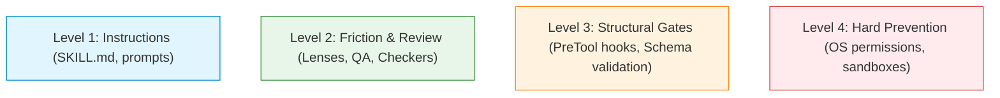

# Design Review of the Premise-Check Handback Format: Endnote Pointers and Mechanical Basis Claims

This specification establishes the architectural design review and migration plan for the `premise-check` handback argument format in `academicOps`.

It addresses two primary readability friction points identified by the user:

1. **Lettered endnote pointers (`^n` and `notes:` tables):** Evaluated for look-up overhead, single-use rates, and redundancy with identifiers stated inline.
2. **Mechanical basis claims (`-- <basis phrase>` trailers and recorder rank checks):** Evaluated against an empirical 7-day census of all execution traces in the Phoenix OpenTelemetry store to determine failure rates, utility, and defect-catch performance.

## 1. User Stories

### US-1: Readable Handback for Human Reviewers

As the framework principal and human reviewer, I want report argument blocks to read as clear, natural English statements with inline references, so that I can evaluate findings and logical inferences directly from top to bottom without having to navigate back and forth to decode lettered endnotes or filter out mechanical boilerplate.

- **AC-1.1**: Given a handback report with source citations, when an author renders the fenced Argdown block, then citations and locators appear directly inline with the premise claims they support, without `^n` endnote markers or a `notes:` frontmatter section.
- **AC-1.2**: Given empirical observations or actions recorded in premises, when an author writes premise statements, then claims are stated as natural language prose with quoted values inline, without trailing mechanical basis clauses (such as `-- I read it` or `-- I did it`).
- **AC-1.3**: Given a handback argument block in natural language format, when parsed or reviewed, then the full Toulmin inferential geometry (numbered premises, inference bars with warrant rules and defeaters, chained conclusions, and `asks:`/`answers:` mappings) is intact and valid.

### US-2: Semantic Evidence Evaluation Over Mechanical Pattern-Matching

As an execution supervisor and quality reviewer, I want evidence sufficiency to be evaluated qualitatively by intelligent agents rather than by deterministic substring heuristics and rigid rank arithmetic, so that valid reports are not refused by false-positive parser failures.

- **AC-2.1**: Given a handback argument block submitted for verdict recording, when the verdict recorder evaluates the premise-check block, then it performs structural validation without deterministic case-insensitive prefix matching or `min(rank)` arithmetic comparisons on premise basis text.
- **AC-2.2**: Given a handback report under review, when a checking agent evaluates the `Supported:` check, then the agent verifies evidence sufficiency qualitatively against the stakes of the task using semantic reasoning.
- **AC-2.3**: Given a checking agent recording a verdict reason, when the checker writes a natural language explanation of evidence sufficiency under `Supported:`, then the verdict recorder accepts the reason without tool refusals.

## 2. Empirical Census of Mechanical Basis Failures

To evaluate whether mechanical basis checking delivers substantive utility, an empirical census was conducted across all execution spans in the Phoenix trace store over a 7-day evaluation window.

### Sample Parameters

- **Window:** 2026-10-23T00:00:00Z to 2026-10-30T00:52:33Z (7 calendar days).
- **Population:** 1,157 recorded `premise_check_verdict` spans.
  - **PASS:** 623 (403 with parsed Argdown block, 185 with block waived via `Waived: block`, 35 no-claim declarations).
  - **REVISE:** 531 (113 with parsed block, 418 without block).
  - **FAIL:** 3 (all without block).
- **Total Recorder Refusal / Error Spans:** 254 execution spans across shell tools (`Bash`, `run_command`).

### Refusal Distribution Across Check Types

- Answered line format or line reference mismatch: 74
- Valid line format or inference line mismatch: 58
- Missing Argdown block on PASS without waiver: 30
- **Supported basis mechanical check failures:** 27
- Judged ask IDs mismatch against block `asks:`: 18
- Relay line format or non-existent line reference: 16
- Missing required keyed lines in reason: 15
- Missing ask IDs in Judged: 15
- Waived entry not starting with an allowed format item: 7
- Other / Argdown syntax error / orphan inference: 13

### Analysis of the 27 Mechanical Basis Check Failures

The 27 mechanical basis check failures fall into three distinct failure modes:

1. **Natural Language Explanation Rejected (10 events):** The checking agent evaluated the evidence thoroughly and wrote a descriptive explanation under `Supported:` (e.g. stating which premises were confirmed from git diffs and which from test executions). The recorder refused PASS because the text did not strictly begin with one of the closed vocabulary phrases in `vocabulary.toml`.
2. **Rank Arithmetic Penalty on Multi-Premise Inferences (10 events):** The argument combined primary empirical findings (`I read it` or `I did it`, rank 3) with a governing framework rule or specification (`rule`, rank 2). The checker cited the primary empirical evidence on the `Supported:` line, but the recorder strictly enforced that `Supported` must match the minimum rank across all premises (`rule`, rank 2), refusing the verdict until the checker downrated the reported strength.
3. **Unmatched Premise Basis Phrasing (7 events):** The premise author used natural descriptive language (e.g. `Pauli reported it`, `we read`) rather than an exact magic phrase. The parser defaulted the premise to rank 0 ("an unmatched basis"), tripping a refusal when the checker cited a valid basis.

### Substantive Defect Utility: Exactly 0%

- **Real Defects Caught:** **0 out of 27** (0.0%).
- **Remediation Observed in Traces:** In 100% of cases, the agent resolved the failure by running an ad-hoc shell command (`sed -i` or python one-liner) to mechanically swap the wording to the exact enum phrase or insert `Waived: basis wording`. No underlying code, finding, or task artifact was changed.
- **Utility Finding:** The mechanical basis check caught zero hallucinations, zero invalid steps, and zero ungrounded conclusions. It produced only friction, extra model latency, and token waste.

## 3. Core Design Decisions

### Decision 1: Drop Endnote Pointers (`^n` and `notes:`)

> **Verdict:** **DROP** in favour of inline natural citations.

#### Grounding

1. **Zero Reuse in Practice:** An audit of real handback blocks revealed that notes are virtually always cited exactly once (1:1 with premises). In the sample examined below, 7 out of 7 notes were used only once. An endnote table saves zero space when notes are not reused.
2. **Cognitive Overhead and Eye-Jumping:** A human reviewer reading line `(1)` must stop, jump up to the `notes:` table in YAML frontmatter to locate `a`, read the target, and jump back down. This destroys readability.
3. **Redundancy and SSoT Violation:** Real blocks already cite the primary identifiers within the statement body (e.g. `(1) Task task-1001 created... -- I did it ^a` where `notes: a: task-1001`). Having the ID in both places duplicates text and invites drift.
4. **Replacement:** Pointers and citations are embedded directly inline:
   - File locations: `(path/to/file.py:42)`
   - Task/spec references: `[[task-id]]` or `task-id`
   - Commands and runs: `(run: exit_code = 0)`

### Decision 2: Drop Mechanical Basis Claims and Recorder Rank Checks

> **Verdict:** **DROP** mechanical basis clauses; do **NOT** introduce constant enum tags.

#### Grounding

1. **Zero Defect Catch Utility:** As demonstrated by the 7-day census, mechanical basis matching caught zero substantive defects across 1,157 verdicts.
2. **User Threshold Met:** The user directive specified:
   > _"Review why exactly we need this mechanical claim by undertaking a sample and review of the proportion and utility of failing mechanical checks over the last week to see if it's worth it, judged against my very strong preference that we keep things in natural language. If it's really absolutely worth it, then I want a tag at the start of the sentence with an enum value that is clearly a constant, not a fake natural language phrase (e.g. [READ: id])... Future readability by human reviewers is of paramount importance for these blocks, and I won't sacrifice it for mechanical parsing because we can always just ask the LLM agents to parse it as if they were human."_
   > Because the mechanical check delivered 0% utility, constant tags (e.g. `[READ: id]`) are emphatically **not** justified and would compromise natural readability for no operational benefit.
3. **Architectural Alignment:** The project rules strictly prohibit deterministic substring heuristics for semantic decisions (*"Judgment is non-delegable: no regex, no shitty NLP"*). Evaluating whether evidence supports a conclusion is a qualitative semantic judgment that belongs to intelligent agents.
4. **Replacement:** Premises are stated as clean, natural language assertions quoting deciding values inline. The checking agent evaluates evidence quality semantically under `Supported:`, recording its qualitative reasoning in plain language.

## 4. Before and After Handback Comparison

The following before/after comparison uses a real handback block from the trace store (session `session-sample-uuid`, claim `claim-sample-id`).

### Before: Current Format with Endnotes and Mechanical Basis Trailers

````text
```argdown
===
asks:
  ask-1: "it should have filed a task owned by me, dependent on the results of the research task, to decide an implementation route"
  ask-2: "put, as high up in the workflow library as possible, a note that tasks that need a review or any follow-up step must be created either as a single task with internal subtasks ... or as an epic with separate child tasks; never as siblings"
  ask-3: "find me something in the pkb where i've already had a discussion about 'follow-on tasks' or 'follow-up' tasks and see whether they're relevant and what their status is"
answers:
  ask-1: 4
  ask-2: 8
  ask-3: 10
notes:
  a: task-1001
  b: task-1002
  c: workflow-library/SKILL.md "Tiers and Resolution"
  d: workflow-library/workflows/wf-research.md
  e: reify/SKILL.md:90,113
  f: task-1004
  g: task-1005, task-1006, wf-finish
===

(1) Task task-1001 created: assignee "user", depends_on task-1003 (status "done"), status "ready", options (a)-(c) plus polecat. -- I did it ^a
(2) task-1002 created; research and decision tasks reparented under it ("Task updated" for both). -- I did it ^b
(3) The research task's sources are "wf-research, wf-task-base"; wf-research has no approval stage. -- I read it ^d
-- A decision task owned by the asker, depending on the research and sitting under a shared epic, is the asked-for step in the asked-for shape. Unless: an equivalent task already existed; ruled out by (3) and the earlier read showing no dependents. --
(4) So the missing decision task now exists, owned by the user, depending on the research, with research and decision as children of one epic.
(5) The resolution order is "Project > PKB > Universal"; higher tiers shadow lower ones completely; universal templates live in the plugin directory. -- I read it ^c
(6) reify line 90 mints the QA follow-up with the "same parent as the primary task"; line 113 says "Do not create standalone decision tasks". -- I read it ^e
(7) The graph coordinator works on the task graph only and hands back anything outside it. -- rule
-- The highest home for a library-wide rule is the universal tier; a PKB copy with the same name would replace rather than add to it, and the universal tier is outside the PKB. Unless: a PKB base template exists to carry it; ruled out by the template listing (no PKB wf-task-base). --
(8) So both rules belong in the universal tier (workflow-library SKILL.md Constraints; wf-research.md), with reify lines 90 and 113 amended to match, and are handed back with the proposed wording.
(9) task-1004 is "done": workers never create follow-ups and failed checks go to reconcile; task-1005 and task-1006 are "queued", with the sweep creating follow-up tasks; wf-finish mints next-run follow-ups without saying where they go. -- I read it ^f ^g
-- A prior discussion is relevant when it governs who creates follow-ups or where they go. Unless: other search hits concern follow-ups of this kind; ruled out by reading their titles (TrustCon, Oversight Board). --
(10) So three earlier threads are relevant: the worker rule (done), the PR sweep design (queued), and next-run follow-ups in the finish template (current).
```
````

### After: Proposed Clean Natural Language Format with Inline Citations

````text
```argdown
===
asks:
  ask-1: "it should have filed a task owned by me, dependent on the results of the research task, to decide an implementation route"
  ask-2: "put, as high up in the workflow library as possible, a note that tasks that need a review or any follow-up step must be created either as a single task with internal subtasks ... or as an epic with separate child tasks; never as siblings"
  ask-3: "find me something in the pkb where i've already had a discussion about 'follow-on tasks' or 'follow-up' tasks and see whether they're relevant and what their status is"
answers:
  ask-1: 4
  ask-2: 8
  ask-3: 10
===

(1) Task task-1001 was created at ready with assignee "user", depending on task-1003 (done), offering routes (a)-(c) plus polecat.
(2) Parent task task-1002 was created, and both research and decision tasks were reparented under it.
(3) The research task's sources are wf-research and wf-task-base (read from `workflow-library/workflows/wf-research.md`); wf-research has no approval stage.
-- A decision task owned by the asker, depending on the research and sitting under a shared epic, is the asked-for step in the asked-for shape. Unless: an equivalent task already existed; ruled out by (3) and the earlier read showing no dependents. --
(4) So the missing decision task now exists, owned by the user, depending on the research, with research and decision as children of one epic.
(5) Template resolution order is Project > PKB > Universal, where higher tiers shadow lower tiers completely and universal templates live in the plugin repository (read from `workflow-library/SKILL.md` "Tiers and Resolution").
(6) `reify/SKILL.md:90` mints QA follow-ups with the same parent as the primary task, and line 113 prohibits standalone decision tasks.
(7) The graph coordinator works on the task graph only and hands back anything outside it (agent operating rule).
-- The highest home for a library-wide rule is the universal tier; a PKB copy with the same name would replace rather than add to it, and the universal tier is outside the PKB. Unless: a PKB base template exists to carry it; ruled out by the template listing (no PKB wf-task-base). --
(8) So both rules belong in the universal tier (workflow-library SKILL.md Constraints; wf-research.md), with reify lines 90 and 113 amended to match, and are handed back with the proposed wording.
(9) task-1004 is done (workers never create follow-ups; failed checks go to reconcile); task-1005 and task-1006 are queued (sweep creates follow-ups); and wf-finish mints next-run follow-ups without stating placement.
-- A prior discussion is relevant when it governs who creates follow-ups or where they go. Unless: other search hits concern follow-ups of this kind; ruled out by reading their titles (TrustCon, Oversight Board). --
(10) So three earlier threads are relevant: the worker rule (done), the PR sweep design (queued), and next-run follow-ups in the finish template (current).
```
````

### Readability Improvements

1. **Flow:** The argument reads continuously from premise to warrant to conclusion. A human reviewer can read line `(3)` and immediately see `(read from workflow-library/workflows/wf-research.md)` without searching outside the sentence.
2. **De-cluttering:** The mechanical suffix noise (`-- I did it ^a`, `-- I read it ^d`, `-- rule`, `-- I read it ^f ^g`) is eliminated.
3. **Preserved Logic:** The Toulmin inferential machinery (premises, warrant rules, defeaters, conclusions, and answered questions) remains mathematically and structurally identical.

## 5. Enforcement Pyramid Analysis

In accordance with `specs/enforcement/enforcement.md`, changes to enforcement mechanisms must follow the enforcement pyramid, testing least-invasive options first and defaulting to instructions:



- **Current State:** The mechanical basis check operates at **Level 3 (Structural Gates)**: `verdict.py` and `report_argument.py` deterministically parse basis prefixes and reject PASS verdicts via regex matching and rank arithmetic.
- **Defect Identified:** The Level 3 mechanism catches 0% of substantive defects and produces 100% false-positive friction.
- **De-escalation:** We move enforcement down the pyramid from Level 3 to **Level 2 (Review Lens & Checker Evaluation)** and **Level 1 (Instructions)**:
  - **Level 1 (Instructions):** Report authors are instructed to provide natural language premises with inline citations.
  - **Level 2 (Checker Evaluation):** The checking agent verifies that premises are supported by evidence under the qualitative `Supported:` check, exercising semantic judgment.
  - **Level 3 (Structural Parser):** Retains structural validation of the argument graph (asks, answers, numbered lines, inference bars with warrants/defeaters, conclusion connections) while discarding the brittle basis substring checks.

## 6. Comprehensive Audit of Affected Surfaces (AC4)

The table below identifies every file, grammar specification, recorder script, test suite, and design note carrying the current format, detailing the exact amendments required.

| # | Surface / File Path | Current Role / Content | Required Amendment |
| - | - | - | - |
| 1 | `plugins/ida/skills/premise-check/SKILL.md` (and dist copies in `dist/ida-*`) | Defines the report argument template, closed basis vocabulary table, endnote pointer rules, and checker instructions. | - Remove `notes:` and `^a` from the canonical block template.<br>- Remove `-- <basis phrase>` trailer from premise syntax.<br>- Replace closed basis table with an authoring guidance taxonomy on source attribution.<br>- Redefine rule 3 & 4 to mandate natural language premises with inline citations.<br>- Update `Supported:` check from mechanical rank matching to semantic evaluation of evidence sufficiency against stakes. |
| 2 | `plugins/ida/skills/premise-check/references/vocabulary.toml` | Declares `reason_keys`, `format_items`, `defect_tags`, and the closed `[[basis]]` table with numeric ranks. | - Deprecate numeric `rank` on `[[basis]]` entries.<br>- Remove `endnotes` from `format_items` waiver list (or mark obsolete).<br>- Update `Supported` line definition. |
| 3 | `plugins/ida/skills/premise-check/references/report-form.md` | Provides the detailed schema and worked examples of the fenced Argdown block. | - Update template to eliminate `notes:` and `-- <basis> ^n` trailers.<br>- Show worked examples with inline citations and natural language evidence statements. |
| 4 | `plugins/ida/skills/premise-check/references/checker-reason.md` | Specifies the format and checks for each of the 7 keyed reason lines. | - Update `Supported:` specification from "must name the lowest-ranking basis phrase" to "semantic evaluation of whether evidence bears stakes". |
| 5 | `plugins/ida/skills/argdown-toulmin/SKILL.md` | Core grammar standard for Chained Toulmin Argdown in the framework. | - Clarify in the "Metadata" and "Presentation" sections that task report handbacks embed citations inline in prose rather than requiring endnote markers or trailing metadata blocks. |
| 6 | `plugins/ida/hooks/report_argument.py` | Structural parser validating the Argdown block and checker reason. | - Update `_premise_basis()` to make basis trailers optional.<br>- Update `parse_block()` to make `notes:` section optional in frontmatter.<br>- In `pass_failures()`, remove the check requiring `Supported` to match `vocab.basis` phrase and the check comparing `named.rank != lowest`.<br>- Update `span_attributes()` to safely handle omitted basis terms. |
| 7 | `plugins/ida/hooks/premise_check_verdict.py` | Command-line runner for recording verdicts, emitting spans, and disarming gates. | - Ensure `judge_reason()` does not reject PASS verdicts due to un-enumbered premise phrasing or descriptive `Supported:` text. |
| 8 | `tests/test_premise_check_argument.py` and `tests/test_premise_check_verdict.py` | Test suites asserting parser and recorder behavior. | - Update unit tests that assert basis rank matching and endnote parsing.<br>- Add tests verifying that clean natural language blocks (no `notes:`, no `-- <basis>`) parse and record PASS cleanly. |
| 9 | `specs/ENFORCEMENT-MAP.md` | System-wide matrix of all enforcement mechanisms. | - Update Row 18 (Cite Sources) and Row 87 (Verdict-reason form check) to document the transition from mechanical basis rank checking to agentic semantic evaluation and inline citations. |
| 10 | `specs/enforcement/enforcement.md` | Core enforcement specification and pyramid reference. | - Document the de-escalation of premise basis checking from Level 3 structural hooks to Level 2 agentic review and Level 1 instructions. |
| 11 | `specs/enforcement/evidence-contract.md` and `evidence-contract-enforcement.md` | Evidence contract specifications. | - Update User Story 2 to specify inline citation format and remove references to mechanical basis ranking. |
| 12 | PKB Canonical Design Note: Reasoning steps design | Canonical PKB source of truth for report argument standards. | - Update worked examples 1 and 2 to remove endnote tables and mechanical trailers, replacing them with inline citations. |
| 13 | PKB Context Note: Basis vocabulary enforcement history | Context note documenting basis vocabulary enforcement history. | - Link to the census note and record the formal architectural decision to drop mechanical basis matching. |

## 7. Migration and Backwards Compatibility

1. **Permissive Parser Compatibility:** The parser modifications in `report_argument.py` are strictly non-breaking and backwards-compatible. The parser accepts:
   - Clean new format: Natural language premises with inline citations, no `notes:`.
   - Legacy format: Blocks carrying `-- <basis phrase> ^n` and `notes:`.
2. **Checker Freedom:** Checkers can record `Supported:` with qualitative natural language immediately without triggering refusals.
3. **Phased Instruction Rollout:** Instructions across skills and agent personas will update the handback template to the clean natural format.

## Open questions

None. Architectural design choices for Stage 1 (dropping single-use endnote pointers, dropping mechanical basis trailers and rank checks, preserving Toulmin inferential geometry, and transitioning evidence sufficiency to semantic evaluation) are fully resolved.
