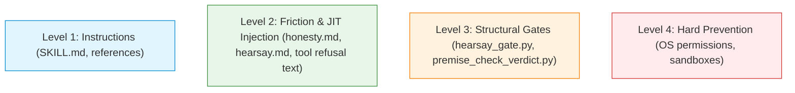

# Premise-Check Instruction and Refusal Tuning for Format Error Reduction

Specifies instruction, reference, and refusal message enhancements across report author and checking surfaces in academicOps to eliminate procedural format errors, ensuring agent attention is focused on substantive logic and empirical claim verification.

## User stories

### US-1 Report Author Argument Formatting

As a report author delivering task results or peer messages, I want clear, affirmative instructions at the moment of authoring, so that my handback contains a valid, well-formed Argdown block on the first attempt without omitting the block or introducing syntax placement slips.

- **AC-1.1** Given a subagent starting execution, when reminded of its reporting obligation at `SubagentStart`, then the prompt reminder instructs the agent that every report must terminate in a fenced `argdown` block in standard form (or the null form if making no claims) and to load `ida:premise-check` before drafting rather than composing from memory.
- **AC-1.2** Given an author declaring method fidelity or departures, when drafting the report, then the instructions specify that `Departures:` pairing lines belong in markdown prose strictly outside and before the `argdown` block.
- **AC-1.3** Given an author numbering premises and conclusions, when formatting statements, then instructions explicitly prohibit markdown list syntax (`1.`), colons after line numbers (`(1):`), non-integer sub-numbering (`(1a)`), and parenthesized answer mappings (`ask-1: (3)`).

### US-2 Checker Reason Formulation and Keyed Lines

As a checking agent evaluating an incoming report or handback, I want unambiguous instructions on the format of the seven-line checker reason, so that my verdict reason passes recorder validation without tool refusals.

- **AC-2.1** Given a report answering multiple asks, when a checker drafts the `Answered:` field, then instructions state that each ask ID requires its own separate `Answered:` line with left arrow and parenthesized line number (`Answered: <ask_id> ← (n)`), prohibiting combined or comma-separated lines.
- **AC-2.2** Given an argument with one or more inference lines, when a checker drafts `Valid:`, then instructions state that `Valid:` entries must be keyed strictly by yielded conclusion line numbers `(n)`, accounting for every inference step via individual lines, continuation lines, or grouped references.
- **AC-2.3** Given a checker copying ask IDs into `Judged:`, when drafting the reason, then instructions mandate copying the exact ask IDs from the report frontmatter verbatim, or recording `Waived: ask wording` if minor wording variations exist.
- **AC-2.4** Given a checker preparing a `Relay:` entry, when drafting the reason, then instructions specify that `Relay:` must be strictly `none` or one or more quoted sentences with pinpoint citations (`Relay: "<sentence>" ← (n)`), prohibiting conversational prose or negative descriptions of what is not relayed.

### US-3 Actionable Recorder Refusal Guidance

As an agent whose verdict or block fails recorder validation, I want recorder stderr messages to state the exact invariant broken with concrete remediation syntax, so that I can correct the formatting error immediately on the next tool call without repeated trial-and-error attempts.

- **AC-3.1** Given a verdict recording attempt refused for an `Answered:` formatting slip, when the recorder emits the refusal, then stderr states the one-line-per-ask rule and quotes valid syntax (`Answered: <ask_id> ← (n)`).
- **AC-3.2** Given a verdict recording attempt refused for `Valid:` conclusion keying or count mismatches, when the recorder emits the refusal, then stderr explains that `Valid:` keys to yielded conclusion lines rather than premise numbers and shows the required format.

### US-4 Handback Instruction Placement and Runtime Protection

As a framework architect, I want the report-writing instruction to reside in a single canonical home with just-in-time delivery while preserving existing execution persona stability, so that DRY invariants are satisfied without introducing behavioral regressions in runtime environments.

- **AC-4.1** Given the report handback instructions across the repository, when locating the authoritative specification and schema, then the canonical definition resides exclusively in `plugins/ida/skills/premise-check/SKILL.md` (and its reference files), while task execution and exit skills (`pull`, `dump`) maintain lean pointers.
- **AC-4.2** Given the established stability of `plugins/ida/agents/james.md` in runtime environments, when updating handback instructions, then `james.md` remains unmodified, avoiding prompt-cache invalidation and execution drift.

## Targeted Format Errors and Empirical Baseline

An empirical census of 254 verdict recorder refusals over a representative 7-day evaluation window (supported by contemporaneous session trace audits and live Phoenix telemetry) established that format-only defects dominate tool refusals, diverting checking models from evaluating claim logic.

### Distribution of Historical Refusals (N = 254)

| Category | Side | Count | Proportion | Removed by PR #3274 or Rejection-Load? | Target in this Spec |
| :- | :- | -: | -: | :- | :- |
| **Answered line format or line mismatch** | Checker | 74 | 29.1% | **No** (unaffected by basis/rejection changes) | **Target 1 (Checker)** |
| **Valid entry format or line mismatch** | Checker | 58 | 22.8% | **No** (unaffected by basis/rejection changes) | **Target 2 (Checker)** |
| **Missing Argdown block on PASS** | Sender | 30 | 11.8% | **Partially** (rejection-load helps retry; initial omission unaddressed) | **Target 3 (Sender)** |
| **Supported basis mechanical checks** | Checker | 27 | 10.6% | **Yes** (100% removed by PR #3274) | _Resolved (PR #3274)_ |
| **Judged ask IDs mismatch against block** | Checker | 18 | 7.1% | **No** | **Target 4 (Checker)** |
| **Relay line format or prose explanations** | Checker | 16 | 6.3% | **No** | **Target 5 (Checker)** |
| **Missing required keyed lines in reason** | Checker | 15 | 5.9% | **No** | **Target 6 (Checker)** |
| **Missing ask IDs in Judged** | Checker | 15 | 5.9% | **No** | **Target 4 (Checker)** |
| **Waived entry format syntax** | Checker | 7 | 2.8% | **No** | **Target 6 (Checker)** |
| **Argdown syntax slips & orphan inferences** | Sender | 13 | 5.1% | **No** | **Target 7 (Sender)** |

### Accounting for Recent Preceding Changes

1. **PR #3274 (Merged 2026-11-01T23:34Z):**
   - Eliminated all 27 mechanical basis check failures (10 natural language explanations rejected under `Supported:`, 10 rank arithmetic penalties on multi-source inferences, and 7 unmatched basis phrase refusals).
   - Dropped lettered endnote tables (`notes:`, `^a`) and mechanical trailers (`-- <basis phrase>`), moving evidence sufficiency evaluation to semantic qualitative judgment under Level 2 review lenses.
   - Left all remaining 227 format error modes (89.4% of historical refusals) in place.
2. **Rejection-Load Instruction Work:**
   - Injected mandatory "load `ida:premise-check`" instructions into hearsay gate notices, verdict recorder refusals, and checker revision requests.
   - Prevents unguided retry loops after a rejection occurs, but does not prevent the first-turn failure caused by ambiguous instructions or non-explanatory refusal diagnostics.

## Detailed Design of Proposed Changes

### Target 1: `Answered:` Line Invariants (Checker Side)

- **Problem & Root Cause:** 74 historical refusals and recurring session failures (e.g. 3 consecutive refusals on a single claim in recent session logs). Checkers routinely combine multiple asks onto one line (e.g. `Answered: a ← (7); b ← (9)` or comma-separated lists) or emit right arrows (`->`). The recorder strictly parses one ask per line, but historical refusal messages did not state the one-line-per-ask requirement.
- **Affected Surfaces:**
  - `plugins/ida/skills/premise-check/references/checker-reason.md`
  - `plugins/ida/skills/premise-check/SKILL.md`
  - `plugins/ida/hooks/report_argument.py` (`remediation_for_failure`)
- **Proposed Text Changes:**
  - In `checker-reason.md` under `## Key Table`:
    ```markdown
    | `Answered` | Exactly one line per ask ID: `Answered: <ask_id> ← (n)` or `Answered: <ask_id> unanswered`. Never combine multiple asks onto a single line with commas, semicolons, or multiple arrows. |
    ```
  - In `report_argument.py` in `remediation_for_failure`:
    ```python
    if "Answered entries not in the form" in failure:
        return (
            "Required remediation format: Each ask ID requires its own separate Answered line:\n"
            "Answered: <ask_id> ← (n)        # exactly one ask per line; note left arrow '←' and parenthesized '(n)'\n"
            "# or:\n"
            "Answered: <ask_id> unanswered   # if unanswered\n"
            "Do not combine multiple asks onto one line (e.g. do not write 'Answered: a ← (1), b ← (2)')."
        )
    ```
- **Observable Verification Metric:** Phoenix spans record 0 occurrences of `Answered entries not in the form` across 50 consecutive verdict executions.

### Target 2: `Valid:` Line Conclusion Keying & Multi-Line Accounting (Checker Side)

- **Problem & Root Cause:** 58 historical refusals. Checkers key `Valid:` lines by premise numbers instead of conclusion numbers (e.g. `Valid: (1) holds` when line 1 is an empirical observation and line 4 is the yielded conclusion), or fail to account for multiple inference bars in chained arguments.
- **Affected Surfaces:**
  - `plugins/ida/skills/premise-check/references/checker-reason.md`
  - `plugins/ida/skills/premise-check/SKILL.md`
  - `plugins/ida/hooks/report_argument.py`
- **Proposed Text Changes:**
  - In `checker-reason.md`:
    ```markdown
    `Valid:` is keyed strictly by yielded conclusion line numbers `(n)` (the line immediately following an inference bar), NEVER by premise line numbers.
    Count: Every inference line in the argument must yield exactly one conclusion accounted for under `Valid:`.
    Single-inference: `Valid: (n) holds -- <rule and why it yields (n)>`
    Multi-inference: Write one `Valid:` line per yielded conclusion, or use grouped syntax:
    Valid: (4) holds -- <rule 1>; (6) holds -- <rule 2>
    Valid: (4), (6) holds -- <shared rule>
    ```
  - In `report_argument.py`:
    ```python
    if "Valid is keyed by lines" in failure:
        return (
            "Required remediation format: Valid entries must be keyed by the conclusion lines yielded by inference bars (the numbered line immediately after '-- ... --'), not premise numbers:\n"
            "Valid: (<conclusion_n>) holds -- <rule and why it yields (<conclusion_n>)>"
        )
    ```
- **Observable Verification Metric:** Recorder refusals matching `Valid is keyed by lines` drop to 0.

### Target 3: Missing Argdown Blocks on First-Time Handbacks (Sender Side)

- **Problem & Root Cause:** 30 historical refusals and 10 of the 20 most recent `REVISE` verdicts in telemetry. Dispatched subagents and workers emit unstructured prose conclusions without fencing an Argdown block, triggering automatic `REVISE` loops.
- **Affected Surfaces:**
  - `plugins/ida/hooks/messages/honesty.md` (JIT prompt injection on `SubagentStart`)
  - `plugins/ida/skills/dump/SKILL.md`
- **Proposed Text Changes:**
  - In `plugins/ida/hooks/messages/honesty.md`:
    ```markdown
    Your reply to this message is a report. Every report must terminate in a fenced ``argdown block in premise-check standard form, or the null form (`asks: none` / `[no claim]`) if making no claims. Load `ida:premise-check` now, before writing your response, to inspect the required frontmatter and inference structure; never omit the ``argdown fence or compose the block from memory.
    ```
  - In `dump/SKILL.md` § 4 ("Release Claimed Tasks"):
    State affirmatively that task releases require the fenced `argdown` block under `## Proof:` or `## Report:` and that markdown prose without the fence is refused by the premise-check gate.
- **Observable Verification Metric:** Proportion of incoming subagent handbacks carrying a valid fenced `argdown` block rises from ~50% to >95% on initial delivery.

### Target 4: `Judged:` Line Ask ID Verbatim Extraction (Checker Side)

- **Problem & Root Cause:** 33 historical refusals (18 ID mismatches, 15 omitted IDs). Checkers paraphrase task objectives or renumber IDs in `Judged:` rather than extracting the exact strings declared in the judged block's `asks:` frontmatter.
- **Affected Surfaces:**
  - `plugins/ida/skills/premise-check/references/checker-reason.md`
  - `plugins/ida/hooks/messages/hearsay.md`
- **Proposed Text Changes:**
  - In `checker-reason.md`:
    ```markdown
    `Judged:` must copy the exact ask IDs declared in the judged block's `asks:` frontmatter verbatim.
    Format: `Judged: <claim_id>; asks <ask_id_1>, <ask_id_2>`
    If minor ask ID wording differences are intentionally accepted by the checker, record `Waived: ask wording -- <justification>`.
    ```
  - In `hearsay.md`:
    Add: `When checking a report, copy its ask IDs verbatim into Judged: Judged: <claim_id>; asks <ask_id>.`
- **Observable Verification Metric:** Refusals with `Judged ask ids ... do not equal` drop to <1% of check attempts.

### Target 5: `Relay:` Field Formatting and Prohibition of Negative Prose (Checker Side)

- **Problem & Root Cause:** 16 historical refusals. Checkers write conversational sentences explaining why findings should not travel upward, violating the strict `Relay:` schema.
- **Affected Surfaces:**
  - `plugins/ida/skills/premise-check/references/checker-reason.md`
  - `plugins/ida/hooks/report_argument.py`
- **Proposed Text Changes:**
  - In `checker-reason.md`:
    ```markdown
    `Relay:` must be strictly either `none` (if nothing is relayed upward) or one or more quoted sentences with pinpoint line citations: `Relay: "<sentence>" ← (n)`. Never write conversational explanations, negative assertions, or justifications under `Relay:`.
    ```
  - In `report_argument.py`:
    ```python
    if "Relay names no line" in failure or "Relay names" in failure:
        return (
            'Required remediation format: Relay must be strictly either:\n'
            '  Relay: none\n'
            'or:\n'
            '  Relay: "<exact quoted sentence to relay>" ← (n)\n'
            'Do not write conversational explanations or describe what is not relayed.'
        )
    ```
- **Observable Verification Metric:** Zero recorder refusals on `Relay:` lines in trace logs.

### Target 6: Reason Schema Integrity and Format-Only REVISE Path (Checker Side)

- **Problem & Root Cause:** 15 missing keyed line refusals and 13 invalid `REVISE` attempts. Checkers omit `Waived: none` or attempt to return a sound report for a format slip by writing `Valid: (n) holds` without including `Format: <format item> -- <fix>`.
- **Affected Surfaces:**
  - `plugins/ida/skills/premise-check/references/checker-reason.md`
  - `plugins/ida/skills/premise-check/SKILL.md`
- **Proposed Text Changes:**
  - In `checker-reason.md` under `## REVISE and FAIL`:
    Explicitly document the format-only revision mechanism:
    ```markdown
    To return a sound argument for a format slip you will not waive:

    1. Keep every `Valid:` line as `holds`.
    2. Add: `Format: <format item> -- <what is off and the required fix>`.
       Format items: `block`, `numbering`, `basis wording`, `ask wording`, `layout`.
       Never record a format slip as a reasoning defect (`Valid: (n) fails`).
    ```
- **Observable Verification Metric:** Elimination of `REVISE refused -- reason has Valid entries that all hold` in Phoenix error spans.

### Target 7: Argdown Syntax Placement Slips (Sender Side)

- **Problem & Root Cause:** 13 syntax errors in sample. Authors place `Departures: none` inside the `argdown` fence (crashing the parser with `Unexpected syntax: 'departures: none'`), format premise numbers with trailing colons `(1):`, or write parenthesized line numbers in frontmatter `answers: (3)`.
- **Affected Surfaces:**
  - `plugins/ida/skills/premise-check/references/report-form.md`
  - `plugins/ida/skills/premise-check/SKILL.md`
- **Proposed Text Changes:**
  - In `report-form.md`:
    ````markdown
    ## Placement of Method Departures

    The method pairing line (`Departures: none` or `Departures: <feature> -> <done>`) MUST sit in markdown prose BEFORE the ```argdown fence. Never place `Departures:` inside the Argdown frontmatter or body.
    ````
  - In `SKILL.md` § "Rules for the Block":
    ````markdown
    - Premise numbering: raw integer in parentheses `(1)`, never with a colon `(1):`, never markdown list `1.`, and never sub-lettered `(1a)`.
    - Frontmatter answers: raw integer line number `ask-1: 3` or `none`, never parenthesized `ask-1: (3)`.
    - Method departures: declare `Departures: none` before the block, never inside the ```argdown block.
    - Inference bars: must start and end on the same line with `-- <warrant rule>. Unless: <defeater>; <status>. --`.
    ````
- **Observable Verification Metric:** Zero syntax errors attributed to `departures:` inside Argdown blocks.

## Evaluation of Handback Instruction Placement

A core design requirement is determining the authoritative location for the report-writing instruction across three architectural options, evaluated for DRY compliance, maintenance overhead, and behavioral regression risk in Antigravity (`agy`).

### Option Comparison

| Dimension | Option 1: Status Quo (Scattered Copies) | Option 2: Consolidate in CORE / Rules (Altering `james.md`) | Option 3: Canonical in `premise-check`, JIT Delivery, `james.md` Unchanged (Recommended) |
| :- | :- | :- | :- |
| **Locations** | `james.md`, `pull/SKILL.md`, `dump/SKILL.md` | `plugins/ida/CORE.md` or `.agents/rules/` | SSoT in `premise-check/SKILL.md`; JIT via `honesty.md`; lean pointers in `pull`/`dump`; `james.md` untouched |
| **DRY Compliance** | **Poor**: 3 copies drift when schemas update | **Good**: Single rule in shared context | **Excellent**: Pure SSoT in skill; zero duplication |
| **Context Overhead** | Low (only when persona or skill is loaded) | High (burns prompt budget on every turn for all agents) | Minimal (JIT delivery only when subagents spawn or report) |
| **Risk to `agy` Behavior** | **Low**: Preserves currently working configuration | **High**: Modifying `james.md` risks degrading proven execution calibration | **Zero**: Leaves `james.md` completely untouched |

### Recommendation Rationale

**Adopt Option 3.**

1. **Preservation of `agy` Runtime Invariants:** In `agy`, `james` operates as the primary lead executor and review supervisor. Its persona prompt is tightly calibrated. Modifying `james.md` carries substantial risk of prompt-cache churn, tone drift, or instruction dilution. It works well in `agy`, so it stays as it is.
2. **Single Source of Truth:** Per `evidence-contract-enforcement.md:19`, _"The format lives only in the `premise-check` skill. Every other instruction file, reminder and gate message names the skill and adds nothing to it."_ Defining the format once in `premise-check/SKILL.md` and referencing it via JIT reminders on `SubagentStart` (`honesty.md`) ensures authors receive the schema exactly when authoring reports without cluttering ambient prompt caches.

## Enforcement Pyramid and Map Alignment

Per `specs/enforcement/enforcement.md`, changes shaping agent behavior must run through the enforcement pyramid options, testing least-invasive measures first and defaulting to instructions:



- **De-escalation & Conformance:** **No new hooks, gates, or mechanical recorder checks are introduced**. Enforcement relies exclusively on Level 1 (`instructions`) and Level 2 (`JIT injection` via prompt templates and actionable tool refusal strings).
- **Proportionality Justification:** Historical format friction was caused by underspecified prompt reminders and uninformative error diagnostics, not an absence of mechanical restraint. Clarifying the prose and error guidance resolves the friction at minimum systemic cost.

### Enforcement Map Extract

The surfaces modified by this specification align with the existing Evidence Contract row in `specs/ENFORCEMENT-MAP.md`:

| Rule | Mechanism | Severity | Detail |
| :- | :- | :- | :- |
| [Rule: The Evidence Contract](evidence-contract.md) | instructions, JIT injection, structural, process, post-hoc | imperative, warning, block, required gate, observability | `specs/enforcement/evidence-contract.md`, `specs/enforcement/evidence-contract-enforcement.md`, `specs/enforcement/handback-format-design.md`, `specs/enforcement/premise-check-instruction-tuning.md`, `plugins/ida/skills/premise-check/SKILL.md`, `plugins/ida/skills/premise-check/references/checker-reason.md`, `plugins/ida/skills/premise-check/references/report-form.md`, `plugins/ida/hooks/messages/honesty.md`, `plugins/ida/hooks/messages/hearsay.md`, `plugins/ida/hooks/report_argument.py`, `plugins/ida/skills/dump/SKILL.md` |

## Open questions

None. Architectural design choices, error classifications, text amendments, and handback instruction placement options are fully resolved.
