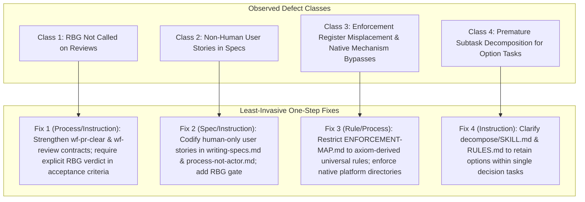

# Pull Request Review Compliance and RBG Verdict Enforcement

This specification defines the architectural contracts, review verification gates, and authoring invariants that ensure every pull request reviewed by autonomous agents carries an authoritative, independent rule-compliance (`rbg`) verdict, eliminating unverified generalist review passes, preventing agent-as-user specification antipatterns, preserving the strict boundaries of the universal enforcement map, and preventing the creation of bespoke rules where native platform mechanisms exist.

## User stories

### US-1 Independent Rule-Compliance Gating on Pull Requests

As a repository maintainer, I want every pull request review posted by an agent to carry an explicit rule-compliance verdict (`PASS`, `REVISE`, or `FAIL`) from an independent compliance reviewer before the review task can be released as completed, so that rule violations and architectural defects are authoritatively caught before human attention is requested.

- **AC-1.1** Given an unreviewed pull request, when an agent executes a review workflow, then an independent compliance reviewer evaluating universal axioms and project rules is dispatched, and its dedicated verdict (`## RBG Review: PASS`, `REVISE`, or `FAIL`) is posted directly to the pull request.
- **AC-1.2** Given a pull request review task or sweep coordinator verifying completed reviews, when checking review satisfaction, then the task release is accepted only if the linked review contains an explicit independent rule-compliance verdict, and is rejected if the review is a generic monolithic review lacking a specialist compliance verdict.
- **AC-1.3** Given an agent reviewing a pull request where it authored any commit, when dispatched to review, then the agent refuses the review assignment and forces assignment to a fresh independent reviewer that wrote none of the pull request's commits.

### US-2 Human-Centered Specification Requirements

As a system architect or reviewer, I want specifications and user stories to center exclusively on human people whom the system serves, so that capabilities are designed to fulfill human needs rather than attributing desires or autonomous agency to software agents.

- **AC-2.1** Given a candidate specification document, when evaluated against authoring standards, then every user story defines a human role as its subject (`As a <human user/role>`), stating what capability the human requires and what outcome it delivers.
- **AC-2.2** Given a specification that casts an agent, persona, worker, or internal software component as the subject of a user story (`As an agent, I want...` or `As <persona>, I want...`), when compliance review evaluates the document, then the reviewer returns an immediate `FAIL` or `REVISE` citing the prohibition against non-human user stories.

### US-3 Native Platform Abstraction and Enforcement Register Discipline

As a compliance auditor, I want platform configurations to adopt standard native facilities rather than bespoke rule documents, and the global enforcement map to remain strictly confined to universal axiom-derived rules, so that repository-local rules and workflows do not dilute global governance.

- **AC-3.1** Given a proposed change introducing platform configuration (such as issue templates, pull request templates, or build configs), when evaluated for architectural form, then standard native directories (`.github/ISSUE_TEMPLATE/`) and configuration fields are adopted, and proposals creating synthetic rule files for native features are rejected.
- **AC-3.2** Given a proposed modification to the global enforcement register (`specs/ENFORCEMENT-MAP.md`), when evaluated by compliance review, then every added or modified row must reference an axiom-derived rule governing agent conduct across third-party projects; rows introducing repository-local project rules or operational workflows are rejected.

### US-4 Decision Graph Parsimony

As a project planner, I want decisions between alternative options to remain as single actionable decision tasks rather than preemptively generating subtasks, so that downstream work is not scheduled before a commitment is made.

- **AC-4.1** Given an objective presenting architectural options without an immediate commitment to execute beyond choosing, when decomposition runs, then the objective is structured as a single decision task carrying option instructions rather than decomposed into preemptive subtasks.
- **AC-4.2** Given an option task decomposed into subtasks without commitment, when compliance review evaluates the task plan, then the reviewer returns `REVISE` requiring consolidation of options into the decision node.

## Design

### 1. Mandatory Rule-Compliance Review Gate on Pull Requests

A pull request review is incomplete and must not satisfy review obligations or mark review tasks as completed unless it includes an explicit rule-compliance verdict (`PASS`, `REVISE`, or `FAIL`) posted on the pull request by an independent reviewer who authored none of the commits under review.

- **Independent specialist dispatch**: When executing pull request review workflows (`wf-pr-clear`, `wf-pr-sweep`, `wf-review`, `strategic-review`), reviews must not be collapsed into a monolithic generalist prompt (`TypeName: "self"`). The review pipeline must explicitly dispatch the specialist compliance reviewer (`rbg` executing `wf-rbg`) alongside quality (`marsha`) and strategic congruence (`pauli`).
- **Review satisfaction predicate**: Verification checks asserting review completion must verify the presence of the compliance verdict on GitHub, rejecting syntactic reviews that lack specialist rule evaluations.
- **Independence verification**: The reviewing agent must confirm via git author metadata that it authored zero commits on the branch under review.

### 2. Empirical Review Audit & Defect Class Analysis (2026-11-04 Audit)

On 2026-11-04, an audit of 12 pull request reviews submitted by repository maintainer Nicolas Suzor on `nicsuzor/academicOps` revealed that 6 pull requests drew change requests for faults that compliance review should have caught. Investigation established four distinct defect classes across these pull requests.

#### Table 1: Maintainer Requested Changes Audit (AC1)

| Pull Request | Maintainer Review URL | Flagged Fault & Discussion Reference | Defect Classification |
| :- | :- | :- | :- |
| **PR #3457** | [Review 5765992655](https://github.com/nicsuzor/academicOps/pull/3457#pullrequestreview-5765992655) | "workflows aren't rules, they don't enforce rules. the applicable rule is 'agents must follow workflows given to them'. Nothing more than that." ([Discussion 4465726136](https://github.com/nicsuzor/academicOps/pull/3457#discussion_r4465726136) on `specs/ENFORCEMENT-MAP.md:61`) | **Class 1: RBG Not Called** (Agent review was monolithic; had RBG been called, enforcement map rules prohibit workflows). |
| **PR #3456** | [Review 5766029093](https://github.com/nicsuzor/academicOps/pull/3456#pullrequestreview-5766029093) | "this is a project local rule; it doesn't belong in a global enforcement map." ([Discussion 4465754185](https://github.com/nicsuzor/academicOps/pull/3456#discussion_r4465754185) on `specs/ENFORCEMENT-MAP.md:47`) | **Class 1: RBG Not Called** (Agent review was monolithic; global vs local map boundary unverified). |
| **PR #3453** | [Review 5766042113](https://github.com/nicsuzor/academicOps/pull/3453#pullrequestreview-5766042113) | "this is dumb. issue templates are a github template and belong in the project local github folder, they're not a fucking rule" | **Class 1: RBG Not Called** (Monolithic review missed rule creation for native platform feature, violating `use-native-mechanism`). |
| **PR #3452** | [Review 5766055122](https://github.com/nicsuzor/academicOps/pull/3452#pullrequestreview-5766055122) | "i have no idea what it is. why do agents want anything? an agent is given capabilities in order to fulfil user requirements." | **Class 2: RBG Called But Missed Rule / Rule Gap** (Initial review 5763825554 lacked RBG; follow-up review 5766249058 gave PASS because rule gap existed regarding non-human user stories). |
| **PR #3448** | [Review 5766096400](https://github.com/nicsuzor/academicOps/pull/3448#pullrequestreview-5766096400) | "rewrite according to the specs spec" | **Class 1: RBG Not Called** (Monolithic review failed to verify document structure against `specs/meta/writing-specs.md`). |
| **PR #3431** | [Review 5766144425](https://github.com/nicsuzor/academicOps/pull/3431#pullrequestreview-5766144425) | "yes, forks can be separated into alternative links, but ONLY where they are decomposed further. A task that has options to choose between but no commitment to doing anything immediately beyond choosing should NOT be created with subtasks; it should be created with the choices in the task and instructions about how to make the decision. fix the decompose skill and assiocated info here." | **Class 1: RBG Not Called** (Monolithic review missed premature subtask decomposition, violating graph decision principles). |

#### Table 2: 2026-11-04 Agent Pull Request Reviews Inventory (AC4)

An audit of all 13 agent reviews submitted on pull requests on 2026-11-04 identified that 10 reviews were posted by a single PR clear coordinator session that suffered instruction dilution, dispatching monolithic generalist subagents that bypassed the specialist review workflow.

| PR # | Review ID | Reviewer Identity | RBG Verdict Present | Review Link | Originating Session & Trace Coordinates | Root Cause of Missing Verdict |
| :- | :- | :- | :-: | :- | :- | :- |
| **#3474** | 5766299620 | `copilot-pull-request-reviewer[bot]` | No | [Review 5766299620](https://github.com/nicsuzor/academicOps/pull/3474#pullrequestreview-5766299620) | GitHub Actions Copilot Bot | Third-party bot failure due to account quota exhaustion. |
| **#3457** | 5763743162 | `botnicbot` | No | [Review 5763743162](https://github.com/nicsuzor/academicOps/pull/3457#pullrequestreview-5763743162) | Early manual smoke test | Body contained only "test". |
| **#3457** | 5763822232 | `botnicbot` | No | [Review 5763822232](https://github.com/nicsuzor/academicOps/pull/3457#pullrequestreview-5763822232) | PR clear coordinator session, Step 136, Subagent `a8dd3675` | Instruction dilution at task reification; coordinator dispatched monolithic self-subagent skipping `wf-rbg`. |
| **#3456** | 5763827307 | `botnicbot` | No | [Review 5763827307](https://github.com/nicsuzor/academicOps/pull/3456#pullrequestreview-5763827307) | PR clear coordinator session, Step 138, Subagent `ef7a8294` | Instruction dilution at task reification; coordinator dispatched monolithic self-subagent skipping `wf-rbg`. |
| **#3453** | 5763839392 | `botnicbot` | No | [Review 5763839392](https://github.com/nicsuzor/academicOps/pull/3453#pullrequestreview-5763839392) | PR clear coordinator session, Step 140, Subagent `8920c35a` | Instruction dilution at task reification; coordinator dispatched monolithic self-subagent skipping `wf-rbg`. |
| **#3452** | 5763825554 | `botnicbot` | No | [Review 5763825554](https://github.com/nicsuzor/academicOps/pull/3452#pullrequestreview-5763825554) | PR clear coordinator session, Step 142, Subagent `23e3fc01` | Instruction dilution at task reification; coordinator dispatched monolithic self-subagent skipping `wf-rbg`. |
| **#3448** | 5763830803 | `botnicbot` | No | [Review 5763830803](https://github.com/nicsuzor/academicOps/pull/3448#pullrequestreview-5763830803) | PR clear coordinator session, Step 144, Subagent `a49bd90a` | Instruction dilution at task reification; coordinator dispatched monolithic self-subagent skipping `wf-rbg`. |
| **#3447** | 5763827994 | `botnicbot` | No | [Review 5763827994](https://github.com/nicsuzor/academicOps/pull/3447#pullrequestreview-5763827994) | PR clear coordinator session, Step 146, Subagent `8a108cb5` | Instruction dilution at task reification; coordinator dispatched monolithic self-subagent skipping `wf-rbg`. |
| **#3442** | 5763830182 | `botnicbot` | No | [Review 5763830182](https://github.com/nicsuzor/academicOps/pull/3442#pullrequestreview-5763830182) | PR clear coordinator session, Step 148, Subagent `d622d449` | Instruction dilution at task reification; coordinator dispatched monolithic self-subagent skipping `wf-rbg`. |
| **#3433** | 5763840565 | `botnicbot` | No | [Review 5763840565](https://github.com/nicsuzor/academicOps/pull/3433#pullrequestreview-5763840565) | PR clear coordinator session, Step 150, Subagent `06b85a87` | Instruction dilution at task reification; coordinator dispatched monolithic self-subagent skipping `wf-rbg`. |
| **#3431** | 5763834128 | `botnicbot` | No | [Review 5763834128](https://github.com/nicsuzor/academicOps/pull/3431#pullrequestreview-5763834128) | PR clear coordinator session, Step 152, Subagent `356ee7b6` | Instruction dilution at task reification; coordinator dispatched monolithic self-subagent skipping `wf-rbg`. |
| **#3430** | 5763833614 | `botnicbot` | No | [Review 5763833614](https://github.com/nicsuzor/academicOps/pull/3430#pullrequestreview-5763833614) | PR clear coordinator session, Step 154, Subagent `f39e40b2` | Instruction dilution at task reification; coordinator dispatched monolithic self-subagent skipping `wf-rbg`. |
| **#3452** | 5766249058 | `botnicbot` | **Yes** | [Review 5766249058](https://github.com/nicsuzor/academicOps/pull/3452#pullrequestreview-5766249058) | Follow-up review session, Subagent `f214d85a` (`rbg`) | Rule gap: Reviewer evaluated PR #3452 under `wf-rbg` and issued PASS; rule against agent user stories was not yet codified. |

### 3. Current Enforcement Placement of Rules Touched

The rules and surfaces touched by the observed defect classes have specific current placements in the framework's enforcement architecture:

| Governed Rule | Current Carrier Mechanism | Current Severity | Documented Coordinates in `specs/ENFORCEMENT-MAP.md` |
| :- | :- | :- | :- |
| **Rule-Compliance Review Lens** | process | required gate | `specs/ENFORCEMENT-MAP.md:13`, `plugins/rbg/agents/rbg.md`, `wf-rbg.md`, `specs/enforcement/enforcement.md:129` |
| **Name the Process, Not the Actor** | instructions, process | imperative, required gate | `specs/ENFORCEMENT-MAP.md:13`, `.agents/rules/process-not-actor.md:1-13`, `specs/meta/writing-specs.md:21-28` |
| **Use the Native Mechanism** | instructions, structural | imperative, protection | `.agents/rules/use-native-mechanism.md:1-13`, `plugins/rbg/skills/axioms/no-over-engineering.md:1-20` |
| **Enforcement Map Boundary & Schema** | instructions, process | imperative, required gate | `specs/ENFORCEMENT-MAP.md:7`, `specs/enforcement/enforcement-map.md:20-55`, `specs/enforcement/enforcement.md:23-42` |
| **Decisions Emerge from Graph Relationships** | instructions, process | advisory, routing | `specs/ENFORCEMENT-MAP.md:22`, `.agents/rules/RULES.md:85-102`, `plugins/ida/skills/decompose/SKILL.md:28-36` |
| **Document Taxonomy Placement** | instructions, process | imperative, required gate | `specs/ENFORCEMENT-MAP.md:59`, `specs/meta/doc-taxonomy.md:1-100`, `.agents/rules/RULES.md:28-34` |

### 4. One-Step Fix per Defect Class (Least Invasive First)

In accordance with the enforcement pyramid, each defect class is resolved through the least-invasive intervention that provides complete coverage across its class, prioritizing clear instructions and verification criteria before escalating to heavier friction.

#### Class 1 Fix: Mandatory Specialist Compliance Gate on Pull Request Reviews

- **Level of Intervention**: `instructions` (`imperative`) and `process` (`required gate`).
- **Remedy**:
  1. Update `wf-pr-clear` obligation 4 to explicitly forbid monolithic subagent fallback: reviewing unreviewed pull requests must dispatch the specialist `rbg` compliance reviewer (`wf-rbg`).
  2. In pull request review task templates (`wf-code-task-base`, `wf-review`), strengthen the acceptance criteria contract: review tasks cannot be marked `[x]` or released as `done` with mere evidence of a review link; acceptance requires the review link AND a valid recorded specialist rule-compliance verdict (`PASS`, `REVISE`, or `FAIL`).
- **Outcome-Level Criteria**: 100% of pull requests cleared by automated workers carry an independent specialist RBG compliance review posted on GitHub before the review task is released as `done`.

#### Class 2 Fix: Codification of Human User Stories in Specifications

- **Level of Intervention**: `instructions` (`imperative`) and `process` (`required gate`).
- **Remedy**:
  1. Update `specs/meta/writing-specs.md` and `.agents/rules/process-not-actor.md` to explicitly state: the subject of a user story (`As a <role>`) must always be a human person whom the system serves; agents do not want anything, and capabilities are granted solely to fulfill human user requirements.
  2. Update the RBG compliance review lens (`plugins/rbg/agents/rbg.md`, `wf-rbg.md`) to verify during specification review that zero user stories cast agents as users, returning an immediate `REVISE` or `FAIL` on violation.
- **Outcome-Level Criteria**: 0 specifications in the repository cast agents, workers, or personas as the subject of user stories.

#### Class 3 Fix: Enforcement Register Scope Restriction and Native Platform Adoption

- **Level of Intervention**: `instructions` (`imperative`) and `process` (`required gate`).
- **Remedy**:
  1. In `specs/enforcement/enforcement-map.md` and `specs/ENFORCEMENT-MAP.md`, codify that the global enforcement map contains strictly axiom-derived universal rules governing agent conduct across third-party repositories; repository-local rules and operational workflows are excluded.
  2. In the RBG compliance review instructions, add an explicit check enforcing `.agents/rules/use-native-mechanism.md`: reject proposals creating synthetic rule files where native platform configuration directories exist (e.g. GitHub issue templates belong in `.github/ISSUE_TEMPLATE/`).
- **Outcome-Level Criteria**: 0 workflow templates or repository-local rules are registered as rows in `specs/ENFORCEMENT-MAP.md`, and 0 bespoke rules are introduced for features supported natively by the host platform.

#### Class 4 Fix: Decision Graph Modeling Parsimony

- **Level of Intervention**: `instructions` (`advisory` → `imperative`).
- **Remedy**:
  1. In `plugins/ida/skills/decompose/SKILL.md` and `.agents/rules/RULES.md` ("Decisions Emerge from Graph Relationships"), add explicit guidance: tasks containing option choices without immediate implementation commitments must remain as single actionable decision tasks containing the choice options and evaluation instructions, rather than minting speculative subtasks.
  2. In RBG review, evaluate proposed task graph modifications against premature subtask decomposition.
- **Outcome-Level Criteria**: 100% of open design questions presenting alternative options are structured as single decision tasks, with 0 uncommitted speculative subtasks minted.

## Open questions

None. The specification is `ready`.
