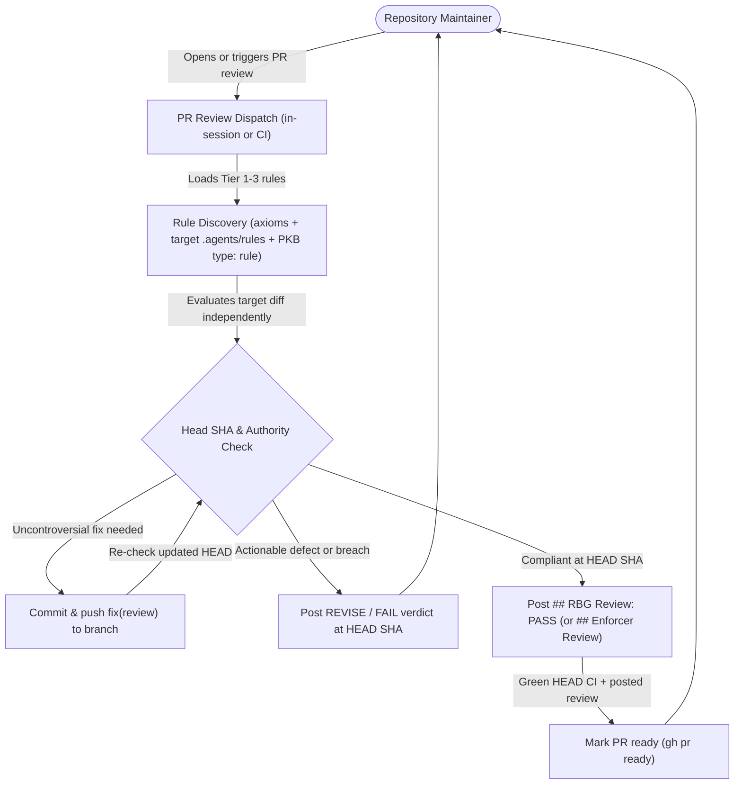

# RBG Review Coverage and Cross-Repository Rule Dispatch

This specification defines complete, head-SHA-matched rule-compliance (`rbg`) review coverage on pull requests and isolated multi-tier rule dispatch across repositories, serving repository and framework maintainers without monolithic review shortcuts or cross-repository rule leakage.

## User experience flow

## Capabilities and user stories

### US-1 Complete SHA-Matched PR Review Coverage

As a repository maintainer, I want every pull request reviewed by agents to receive an independent, head-SHA-matched compliance verdict posted to the PR thread with committed self-fixes verified before readiness, so that compliance defects and stale approvals never pass silently into merge review.

- **AC-1.1** Given a constituent or standalone pull request opened as `--draft`, when an agent marks the PR ready (`gh pr ready`), then the PR thread carries a posted `## RBG Review: PASS` verdict (or CI `## Enforcer Review` approval) matched to the current `HEAD` commit SHA, alongside green `HEAD` CI with `0` errored, bypassed, or `startup_failure` runs and `0` open `CHANGES_REQUESTED` reviews.
- **AC-1.2** Given a consolidated `bundle/<slug>` pull request governed by project bundle rules, when pre-approval readiness is evaluated, then every merged constituent holds prior multi-lens diff receipts and the bundle PR holds green `HEAD` CI plus a head-SHA-matched posted description-only `## RBG Review: PASS`, followed by a full combined-diff review matching the rebased `HEAD` SHA after approval and before merge.
- **AC-1.3** Given a compliance reviewer evaluating a pull request, when uncontroversial deterministic fixes are applied (`fix(review): ...`), then those commits are pushed to the branch so remote `HEAD` matches the inspected diff before posting `PASS`, and `0` verdicts rely on local uncommitted edits or committed verdict files in place of posted PR reviews.
- **AC-1.4** Given a reviewer dispatched on a pull request where that reviewer authored `>= 1` commits on the branch or where prior review comments already exist, when review starts, then commit authors are isolated from self-review and the compliance reviewer forms its verdict independently from the ask, diff, and rules (using prior enforcer comments solely for SHA-skip idempotency or API failure fallback).

### US-2 Cross-Repository Rule Dispatch & Isolation

As a framework maintainer, I want universal axioms, target repository rules, and user compliance rules dispatched consistently across local sessions, polecat containers, and third-party GitHub Actions workflows, so that every reviewed repository receives authoritative governance without leaking rules or secrets across repository boundaries.

- **AC-2.1** Given a pull request review running in any local session or polecat container, when the compliance reviewer gathers governing rules, then it loads injected `always_on` universal axioms (falling back to `plugins/rbg/skills/axioms/*.md` when uninjected), target repository `.agents/rules/*.md`, and active PKB `type: rule` documents, with `0` reads of host runtime `$COPE_USER_RULES_DIR` paths.
- **AC-2.2** Given a CI compliance workflow (`rbg-review.yml` or `agent-enforcer.yml`) running on a first-party or third-party repository, when the workflow prepares the review context, then it fetches canonical `/plugins/rbg/skills/axioms/` and `/specs/enforcement/enforcement.md` from `academicOps` alongside target-repository `.agents/rules/*.md` and emits an explicit failure exit and status if prompt materialization or review posting fails.
- **AC-2.3** Given a pull request spanning repositories inside or outside the user's trust boundary, when review verdicts or self-fixes are evaluated or posted, then `0` foreign repository `.agents/rules/*.md` files bleed into the target repository's rule scope and `0` PR creations, comments, or private identifiers leave an external-audience trust boundary without explicit prior user approval.

## Shared interface contract

- **In-session / container review dispatch (`wf-rbg.md`)**: Receives verbatim originating ask with source identifier, target repository and PR/diff reference, governing document standard, and current `HEAD` commit SHA. Emits structured Markdown under `## RBG Review: PASS | REVISE | FAIL` containing `### Reviewer Self-Fixes Applied`, `### Proportion & Mechanisms` (`Needs judgment: yes|no`), `### Required Changes`, and `### Suggested Improvements`.
- **CI review dispatch (`rbg-review.yml`, `agent-enforcer.yml`)**: `agent-enforcer.yml` accepts `workflow_call` inputs `pr_number`, `ref`, and explicit `sha`; materializes canonical axiom and enforcement sources via sparse checkout (`/plugins/rbg/skills/axioms/`, `/specs/enforcement/enforcement.md`, `rbg.md`, `enforcer.agent.md`, `shared-error-handling.md`); posts exactly one standing `## Enforcer Review` PR review and `enforcer-status` commit status (`success` / `failure` / `pending`) keyed to `inputs.sha`. `rbg-review.yml` triggers on the `request-rbg-review` label for non-bot actors and loads `plugins/rbg/skills/axioms/*.md` plus target `.agents/rules/*.md`.
- **Rule discovery tiers**:
  1. Tier 1 (Universal baseline): `trigger: always_on` axioms from `plugins/rbg/skills/axioms/*.md`.
  2. Tier 2 (Project local): target repository `.agents/rules/*.md` (when present).
  3. Tier 3 (User compliance): active PKB documents carrying `type: rule`. (Host runtime `$COPE_USER_RULES_DIR` belongs strictly to the runtime hook evaluator and is never read by compliance review.)

## Invariants and security boundaries

- **Rule precedence and isolation**: Narrower tiers (Tier 2 local, Tier 3 user) add obligations only and cannot shadow, override, or weaken Tier 1 universal axioms. Target repository `.agents/rules/*.md` are scoped strictly to the repository under review.
- **Authorized operators and credentials**: CI review bots authenticate through scoped `AOPS_BOT_GH_TOKEN` secrets; interactive and container reviews post on GitHub only inside the user's own organisations and designated repositories, gating any external-audience PR or comment on explicit item-by-item user approval under `data-boundaries`.
- **Non-bypassable Gate 0 and fail-closed verification**: Recording `Needs judgment: no` in mechanism tables never bypasses ask-authority, non-mechanical baseline, or fail-fast checks. Missing inputs on Turn 1 return `REVISE` without recording a gate verdict. Stale-SHA approvals, committed verdict files in place of PR thread posts, `startup_failure` CI runs, and uncommitted reviewer edits never satisfy readiness gates.
- **SHA-matched idempotency**: CI enforcer loop-skip matches strictly on `commit_id == HEAD_SHA` for standing `## Enforcer Review` PR reviews or latest terminal non-`Skipped:` `enforcer-status` entries; failed, pending, or `Skipped:` statuses never suppress a fresh review.

## Decisions

- **Single-carrier class-standard verification**: Retired standalone `specs/enforcement/reviewer-class-standard-check.md` because per-file document-class compliance belongs across existing single-carrier enforcement surfaces without a parallel specification: document placement in `.agents/rules/doc-taxonomy.md`, static class-standard checking in `wf-rbg.md`, and qualitative genre/anti-circular excellence scrutiny in `verify/SKILL.md`.
