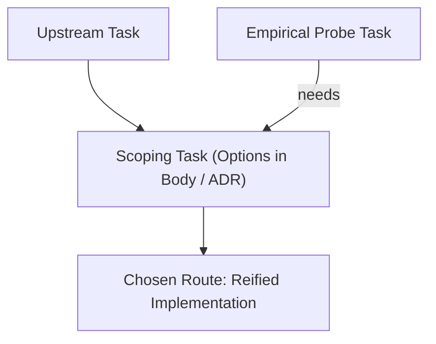

# Task Naming, Filename Standards, and Graph-Relationship Decision Representation

Authoritative specification for task names, filenames, and the structural representation of decisions on the strategic task graph.

- **Stated Purpose:** Establishes unambiguous, enforceable standards for naming tasks and files, resolves the root causes of the historical `<name>: decision: xyz` anti-pattern, and defines how decisions and questions emerge from graph relationships rather than static decision tasks.
- **Primary Audience:** Framework architects, planning agents (`pauli`, `ida`), dispatch engines, and human developers authoring or reviewing tasks, notes, and specs.
- **Current Truth / SSoT:** For task execution boundaries, see [`../enforcement/task-contract.md`](../enforcement/task-contract.md); for document classification, see [`doc-taxonomy.md`](doc-taxonomy.md).

## 1. Task Naming Standard

Tasks are actionable units of work. Their titles must communicate clear operational intent at a glance:

1. **Verb-Led Imperative:** Every task title begins with an active imperative verb describing the concrete outcome to achieve (e.g., `Implement X`, `Refactor Y`, `Verify Z`, `Extract A from B`).
2. **Brief and Descriptive:** Titles must be concise (typically 4–10 words) yet sufficiently descriptive that an executor or supervisor understands the objective without reading the body.
3. **No Person's Name in Titles or Filenames:** A task title, note title, or filename must **never** contain a person's name or moniker (e.g., `<name>: decision: ...`, `<name>-task-...`, `for-<name>.md`). Assignment and human involvement belong exclusively in frontmatter metadata fields (`assigned_to:`, `assignee:`).
4. **No Artificial Type Prefixes:** Do not encode categories into titles (e.g., avoid `DECISION: ...`, `PROBE: ...`, `TASK: ...`). Node taxonomy and classification are expressed through frontmatter (`type:`, `classification:`) and graph topology.

## 2. Filename Standard

Filenames identify files within repositories and knowledge bases:

1. **Kebab-Case:** All lowercase alphanumeric characters separated by hyphens (e.g., `doc-taxonomy.md`, `task-contract.md`).
2. **Purpose-Driven and Descriptive:** Names reflect what the file contains or accomplishes, not historical circumstance or author identity.
3. **No Person's Name:** Filenames never include individual names or personal prefixes.
4. **Appropriate Directory Placement:** Files reside in directories defined by [`doc-taxonomy.md`](doc-taxonomy.md) (`specs/`, `plugins/`, `lib/`, `.agents/`).

## 3. Root-Cause Analysis & Resolution of "<name>: decision: xyz"

### Forensic Root Cause

Historical forensic evidence from the PKB establishes that titles shaped like `<name>: decision: xyz` emerged from three compounding systemic factors:

1. **Legacy Prompt Doctrine:** An early rule in `.agents/CORE.md` (recorded 2026-08-13) explicitly instructed agents: that every question to the user must be filed as a decision node assigned to the user, with the chat sentence as the notification and the node as the record. Agents took this instruction literally and began prefixing task titles with the user's name followed by `decision: ...`, or with `DECISION (<name>): ...`.
2. **Capability Grant & Suppression Gap:** When interactive asking tools (`AskUserQuestion`) were temporarily omitted from agent tool grants or suppressed by agent heuristics against interrupting, agents fell back to dumping questions onto the graph as static tasks.
3. **Absence of a Drain Mechanism:** Decision tasks accumulated indefinitely on the graph (~25 stale open nodes), stalling workflows and creating noise without ever driving execution.

### Resolution at the Source

1. **Abolition of Un-actionable Decision Tickets & Groundwork-First Decisions:** Standalone "decision" tasks filed as holding bins for open conversational questions are strictly prohibited across all prompts, skills, and documentation. When an agent is given a task, it must do the groundwork and make the decision itself; it never files the task back to the user as their decision (`assignee: user`) unless the user explicitly requested to make that decision themselves (tg 1013). Research workflows evaluate options, select the recommended route, and unblock downstream work.
2. **Proper Field Separation:** Identity and assignment are strictly confined to `assigned_to:` / `assignee:`.
3. **Direct Interactive Resolution:** Interactive, in-session questions are asked immediately via `AskUserQuestion` rather than converted into backlog items.

## 4. Graph-Relationship Decision Representation

Decisions and open questions are structural properties of the graph, not static todo-list items. In accordance with the information-theoretic graph taxonomy and ADR-0002:



### Representation Principles

1. **Candidate Options Remain in Task Body or ADR:**
   - A task requiring a choice between design or architectural options with no commitment beyond choosing is created as a single scoping task with the choices and evaluation criteria in its body or an ADR. Candidate options remain inside the body rather than being split into separate option nodes.
   - When chosen, only the selected option is reified into an actionable implementation task under `parent: <task_id>`. Stored `alternative` and `settles` edges are prohibited.
2. **Dynamic Emergence of Questions:**
   - Open architectural decisions are resolved directly by investigating agents doing the groundwork and selecting the recommended path to unblock downstream implementation, rather than filing conversational questions as backlog tickets.
3. **Empirical Unknowns as Probes:**
   - Where a decision depends on missing runtime data, benchmarks, or empirical validation, mint an empirical probe task (`classification: probe`, e.g. `Benchmark SQLite vs DuckDB query latency`). The scoping or waiting task wires standard `needs: [<probe_task_id>]` to the probe.
4. **Resolution by Reification:**
   - Resolving a decision consists of choosing the recommended option in the scoping task/ADR and reifying the chosen path into an actionable downstream task. No artificial decision-node administration or stored alternative edges are created.

## 5. Task Body Brevity, Structure, and Canonical Template

Task bodies are executable instructions for cold executors, not project diaries, architectural essays, or discussion forums.

### Rules of Task Body Authoring

1. **Strictly Concise:** Task bodies are 50–150 words for atomic tasks (up to ~300 words for complex multi-outcome briefed units).
2. **No Extraneous Sections:** Never add sections such as `Background`, `Narrative`, `References`, `Contextual Analysis`, `Task History`, or `Implementation Plan`.
3. **No Prose Task Links:** Never link other tasks from within the body (e.g. no "blocks #123" or "relates to task X"). Task relationships live exclusively as graph edges (`needs`, `serves`, `supports`, `parent`, `supersedes`).
4. **Pointers Point to Knowledge, Not Tasks:** `[[wikilinks]]` in a task body point solely to durable knowledge (specs, notes, references) that the executor must consult, with a ≤1-clause statement of purpose.

### Canonical Task Template

```markdown
## Goal

1. Concrete outcome 1
2. Concrete outcome 2

## Deliverable

`path/to/artifact`

## Scope

- In: Concrete inclusion
- Out: Adjacent exclusion (no rationale)

## Acceptance criteria

- [ ] Observable end-state condition 1
- [ ] Observable end-state condition 2

## Pointers

- [[spec_or_note_id]] -- purpose (e.g. "schema contract", "precedent")
```

### Concrete Example

```markdown
## Goal

1. Migrate configuration loader to Pydantic v2 settings model.
2. Deprecate legacy dict-based config parser.

## Deliverable

`lib/config/loader.py`

## Scope

- In: `Settings` class validation and env var mapping.
- Out: CLI flag parsing (handled in `cli.py`).

## Acceptance criteria

- [ ] `Settings.from_env()` loads valid config from environment variables.
- [ ] Invalid config raises structured `ValidationError`.
- [ ] All existing config unit tests pass.

## Pointers

- [[spec_or_note_id]] -- schema contract
```

## 6. Graph Edge Economy & Hierarchy Invariant

Graph density means meaningful semantic and causal connectivity, not redundant combinatorial wiring (ADR-0002):

1. **Parent/Child is Already an Edge:** Setting `parent_id` (or `parent`) on a node automatically places and connects it within the parent's hierarchy. Subtasks inherit worth from composite parents via closed-form induction.
2. **No Redundant Descendant or Child-to-Ancestor Wiring:** Do **not** wire edges between siblings or descendants under the same parent unless there is a specific, verifiable execution dependency (`needs`). Subtasks decomposed under a parent must **never** carry redundant `serves` edges to targets already served by their ancestors.
3. **Three Edge Purposes & Parsimony:** Distinguish the three edge purposes strictly:
   - **Weight Flow:** `serves` connects top-level deliverables to priced `target` nodes; `supports` connects auxiliary tasks that causally reduce effort or raise success probability. Both require explicit `quantum` and `probability`.
   - **Work Sequencing:** `needs` connects a dependent task to its prerequisite task. Pure Boolean execution gate; carries neither quantum nor probability.
   - **Structural Clustering:** Citations, references, and related artifacts are authored exclusively as markdown body wikilinks (`[[node_id]]` in `## Context` or `## Pointers`). Direct body references already act as clustering/interconnection edges in graph physics; duplicating them as formal frontmatter edges is strictly prohibited.
4. **Stricter Semantics for `supports`:** A task supports another node only if executing it directly eases the effort, mitigates the risk, or raises the success odds of that node. Tracking, logging, and coordination tasks do **not** support the tasks they track (tracking has zero effect on the tracked task's difficulty); tracking tasks serve the strategic target of user understanding and are confined to that target.
5. **Review and Follow-Up Placement Invariant:** Every task requiring review or follow-up must be structured either as a single task with internal subtasks (if executable by the same agent in one session) or as a dedicated epic with separate child tasks (if multi-session or independent context is required); never as loose siblings under an external parent.
