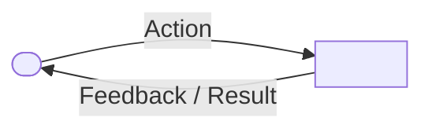

# Writing specs

A spec defines what one feature does and the shared contract it promises. It is a single unified document an agent can read in one go (~150–220 lines) to build and test the feature, and a person can read to judge the design.

## Template

````markdown
---
title: <feature>
status: draft | ready | in_progress | superseded
---

# <Feature>

<One paragraph: intent and scope -- what the feature is for, its operational boundary, and who it serves.>

## User experience flow



## Capabilities and user stories

### US-1 <capability name>

As a <human user>, I want <capability>, so that <outcome>.

- **AC-1.1** Given <state>, when <event>, then <observable result within concrete bound>.
- **AC-1.2** Given <state>, when <event>, then <observable result>.

## Shared interface contract

<The shared endpoints, event signatures, and data payloads client and server agree upon. Stated once, without internal mechanics.>

## Invariants and security boundaries

<Observable system truths, positive security boundaries, replay/idempotency rules, and honest runtime delivery guarantees.>

## Open questions

- <A decision the spec still needs, with options in play. Omitted once ready.>
````

## Rules

**One-read size and unified document.** A spec is a single cohesive document an agent reads in one go (~150–220 lines / ~1,500–2,200 tokens). Cut whatever is doubtfully required; the code documents itself. Do not split into fragments when pruning bloat keeps the spec cohesive.

**One feature, single domain ownership.** A spec covers exactly one feature. It never duplicates or re-specifies capabilities owned by an existing spec.

**User experience flow chart.** Every spec includes a Mermaid flow chart (`flowchart LR` or `flowchart TD`) illustrating the human user's journey, operational interactions, and system responses.

**Stories are for people, never agents.** The subject of a user story (`As a <role>`) is always a human person whom the system serves (the user, operator, researcher, developer) -- never an agent, persona, worker, or internal software component. Agents do not want anything; an agent is given capabilities and permissions solely to fulfil human user requirements.

**Concise, observable acceptance invariants.** Limit acceptance criteria to 1–2 observable invariants per capability (6–8 total across the spec), written as Given / When / Then. Criteria must be pass/fail by observation from outside the system. Never use unbounded or unobservable terms ("immediately", "dynamically", "zero loss", "zero regression"); specify concrete numeric bounds (e.g. "within 500 milliseconds").

**Honest runtime guarantees.** Never make promises the system cannot keep at runtime (such as "zero event loss" without a durable queue, or "immediate model suspension" when an LLM turn is non-preemptible). State honest, achievable contracts: at-least-once delivery with deduplication keys, and high-priority interrupt delivery.

**Shared contract, not internal mechanics.** State the behavioral contracts, payloads, and protocols that external collaborators or boundaries share. Exclude internal mechanics: internal buffer sizes, database tables/columns, loopback ports, Docker hostnames, cookie names, and helper functions belong in self-documenting code.

**Consistent paths and layer namespaces.** All routes and endpoints must share a consistent namespace scheme and explicitly state which layer owns them. Never mix or contradict route structures.

**Positive security boundaries.** State security boundaries as positive rules: who counts as an authorized operator, authentication perimeters, separate credentials per sender, and explicit replay and idempotency protection.

**Exclude decision history and trade-off matrices.** Architectural debates, competing options (e.g. 6.A–6.E), trade-off matrices, post-mortems, and discarded approaches belong in PKB decision tasks or notes, never in specs.

**Exclude transient migration and retirement checklists.** One-off server decommissioning, database cutovers, and migration checklists belong in delivery tasks and pull requests, not enduring system specs.

**No redundant verification prose.** Conformance verification belongs in executable automated test suites alongside code, never in prose verification tables in the spec.

**Open questions remain open until settled.** A draft may identify open decisions under Open questions, but acceptance criteria and design must never assume answers to unsettled questions.

**The contract, not its enforcement.** A spec defines what the feature promises. The checks, gates, reminders, and reviews that hold parties to that promise belong in their own spec (`specs/enforcement/enforcement.md`).

**Self-contained and generic.** A reader needs no other file to understand the spec. Shipped specs contain no private domains, hostnames, installation-specific tokens, or PKB identifiers.

## Review

A spec passes review when a reviewer can answer yes to each question:

1. Does it cover exactly one feature with no overlapping ownership with other specs?
2. Does it fit the one-read size (~150–220 lines), unified in a single document without implementation bloat?
3. Does it include a clear Mermaid flow chart illustrating the user experience?
4. Is every user story written from the perspective of a human person whom the system serves?
5. Is each capability limited to 1–2 observable acceptance invariants with concrete measurable values rather than unbounded terms ("immediately", "zero loss")?
6. Are system guarantees honest and achievable at runtime (e.g. at-least-once delivery with deduplication, priority halt delivery)?
7. Does the interface contract define shared protocols and consistent namespaces while excluding internal mechanics (ports, buffer sizes, database schemas)?
8. Are security boundaries stated positively (authorized operator defined, per-boundary credentials, replay protection)?
9. Is it free of decision history, comparison matrices, migration steps, and redundant verification prose?
10. Are open questions kept out of acceptance criteria and resolved before marking `ready`?
