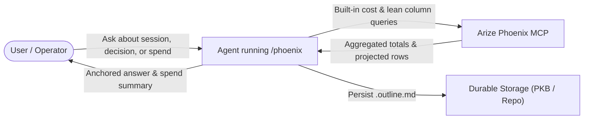

# Agent-assisted Phoenix querying and session outlines

Anyone working in a project where the framework's plugins are installed can ask what a past session did, how an agent reached a decision, or where time and token spend went, and receive a concise, verifiable answer backed by Arize Phoenix telemetry without pulling raw span archives into model context. The `/phoenix` skill in `plugins/ida/skills/phoenix/` equips agents with reusable GraphQL and SQL templates and outline-generation instructions, serving as the agent-assisted complement to [cross-surface observability](observability.md).

## User experience flow

## Capabilities and user stories

### US-1 Assemble a readable session outline and trace decisions

As a user working in a project where the framework's plugins are installed, I want to ask what a session ran or how a decision got made and receive a clear, scannable markdown outline alongside an anchored answer, so that I can audit agent reasoning and tool actions without reading megabytes of raw payloads.

- **AC-1.1** Given a full session or conversation UUID, a 6–8 character session slug, or a 32-character hex trace ID, when a session transcript or decision trace is requested, then the agent resolves the owning `session.id`, selects only scalar metadata and bounded text excerpts (omitting raw attribute maps, event arrays, and passive debug-hook spans), and writes a single condensed markdown outline (`<slug>.outline.md`, with no full-payload transcript variant) to durable storage carrying session and turn-span Phoenix deep-links when a UI base URL is configured.
- **AC-1.2** Given `<slug>.outline.md` and a question whose answer depends on a specific step's untruncated input or output, when the bounded excerpt in the outline is insufficient, then the agent fetches full payload fields only for the targeted `span_id` values and cites the turn and step anchors (`#t<turn>` and `#t<turn>-<step>`) where the decision occurred.

### US-2 Query built-in token spend and audit tool calls on the server

As a user monitoring token spend and operational bottlenecks, I want cost summaries, session audits, and cross-session searches computed directly by the trace store from its built-in pricing and structured telemetry fields, so that investigations finish in a few turns without whole-span fetches or brittle client-side parsers.

- **AC-2.1** Given a project, session, or UTC time window, when token usage or spend is requested, then the agent reads Phoenix's built-in cost and token totals (deduplicating dual-emitted model calls when multiple emitters cover the same session) rather than paging spans or maintaining custom model price tables.
- **AC-2.2** Given a session or bounded UTC time window, when a session audit, per-call-type tool and MCP profile, or cross-session search is requested, then the agent executes declarative query templates from `plugins/ida/skills/phoenix/resources/` that aggregate call counts, latencies, error counts, and payload byte sizes on the server from structured telemetry fields, without hardcoded server lists or regular-expression parsing of code-mode payloads.

### US-3 Operate portably across Phoenix deployments

As a developer or operator running Arize Phoenix across local or hosted environments, I want the `/phoenix` skill and its query templates to run through the client's configured Phoenix MCP connection without custom transport wrappers or deployment-specific assumptions, so that trace workflows survive backend and authentication changes.

- **AC-3.1** Given any Arize Phoenix instance reachable via the client's Phoenix MCP surface, when an agent executes `/phoenix` templates or authors an ad-hoc query, then it checks the server's advertised schema and SQL dialect before running custom SQL and surfaces server or configuration errors verbatim without silent default endpoints, projects, or fallback branches.

## Shared interface contract

### Skill and template layout

- **Skill router and instructions**: `plugins/ida/skills/phoenix/SKILL.md` defines query efficiency rules, identifier resolution, outline generation, durable persistence, and single-span drill-down.
- **Declarative query templates**: `plugins/ida/skills/phoenix/resources/` ships portable, configuration-neutral templates executed through the Phoenix MCP `phoenix_execute` tool (`executeGraphqlQuery` and `executeSql`):
  - `session-costs.graphql` -- single-operation project and per-session built-in token and cost summaries (`GetProjectCosts` via `costSummary` and `GetSessionCosts` via `tokenUsage`, `costSummary`, and per-token-type `costDetailSummaryEntries`).
  - `session-outline.sql` -- keyset-pageable, column-projected chronological step query for one session, returning scalar timing, model, token, built-in cost, tool summary, and bounded prompt/reply/argument excerpts while excluding bulky attribute and event blobs.
  - `session-audit.sql` -- server-side aggregation of model spend (with dual-emitter deduplication) and tool / upstream MCP call counts, latencies, errors, and payload sizes.
  - `cost-by-task.sql` -- server-side token and built-in cost rollups grouped by task identifier and model, plus fast session-spend ranking directly from `span_costs` over a bounded UTC window.
  - `cross-session-search.sql` -- time-bounded server-side prompt, tool, error, subagent-correlation, and single-span detail lookups.
  - `span-store.md` -- identifier shapes, session-vs-trace grouping rules, dual-emitter and subagent correlation semantics, and query size bounds.
- **Decision-trace workflow**: `plugins/ida/skills/workflow-library/workflows/trace-decision.md` defines the input/output contract (`<slug>.outline.md` persisted durably plus an answer anchored to `#t<turn>-<step>`).

### Session outline document contract (`<slug>.outline.md`)

Every generated session outline contains, in order:

1. **Top-level heading & session header**:
   - `# Session Outline: {slug}` H1 heading.
   - Session header block: session ID, project name, UTC start/end timestamps and wall duration, turn/model/tool/error counts, built-in token breakdown (`input`, `cache_read`, `cache_write`, `output`), built-in comparable USD cost, active subagent labels, and Phoenix session redirect link (`/redirects/sessions/{session_id}`) when a UI base URL is available.
2. **`## Overview` executive summary tables**:
   - `### Turns`: turn number linked to `#t{n}`, concise turn title (capped at ~5--8 words describing the prompt intent so the overview table never wraps excessively), start time, duration, model calls, tool calls, output tokens, and turn cost.
   - `### Cost & Tool Profile`: per-model calls, token breakdown, and built-in cost; plus per-tool / upstream MCP service call count, total and max latency, and error count.
   - `### Errors` (included when errors > 0): step anchor link `#t{n}-{m}`, failing span/tool name, and status message.
3. **Chronological turn sections (``, `## Turn {n} · {title}`)**:
   - Turn metadata line with UTC timestamp, duration, model/tool counts, turn cost, and Phoenix `[session]` and root `[span]` (`/redirects/spans/{span_id}`) links when a UI base URL is available.
   - Substantive prompt blockquote (with injected skill/system wrapper boilerplate stripped).
   - Ordered model prose steps (``, `### {n}.{m}`) showing model name, measured duration (omitted when telemetry records only synthetic `<= 1.5ms` post-turn timestamps), built-in cost, token breakdown, and assistant reasoning prose (omitting raw tool-call request JSON arrays, omitting empty `### {n}.{m}` headings when a model step dispatches only tool calls with no prose, and snapping truncated excerpts to clean word boundaries with trailing `...`), interleaved with single-line tool and subagent bullets (`* {n}.{m}`) showing action summary, tool/service name, duration, error status, and target path/command/arguments (with embedded newlines collapsed).
   - `### Turn {n} reply` blockquote when the turn's final response differs from the last model step's prose.

## Invariants and security boundaries

- **Authenticated MCP perimeter**: All Phoenix reads execute through the caller's authenticated Phoenix MCP server connection using read-only GraphQL and analytics SQL tools; shipped templates embed zero endpoints, credentials, project names, hostnames, or personal identifiers.
- **Session-scoped grouping**: Multi-turn sessions are filtered and assembled by `session.id` rather than `trace_id`, because a single trace can span cross-agent boundaries while a multi-turn session spans one trace per turn.
- **Bounded context footprint**: Routine cost, audit, and outline queries never select raw `attributes` or `events` JSON blobs across a session or time window, and keep individual code-mode responses within portal size bounds via server-side projection and keyset pagination.
- **Durable persistence and path hygiene**: Generated `<slug>.outline.md` artifacts are persisted to the knowledge base or committed to a designated repository path rather than left in ephemeral container scratch space, with literal local user home paths (`~/...`) sanitized prior to knowledge-base ingestion.
- **No local log fallback**: When Phoenix spans are absent, unreachable, or refused, `/phoenix` reports the exact failure and halts rather than scraping local client transcript or debug JSONL files.
