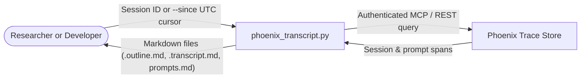

# Session decision transcripts and prompt-window outlines

Anyone working in a project where the framework's plugins are installed can inspect how an agent session reached a decision or review every human prompt submitted across sessions since a UTC cursor, receiving navigable markdown transcripts and condensed outlines assembled directly from the OpenTelemetry trace store. Tool inputs and outputs, model responses, token usage, estimated spend, and latencies are preserved without truncation in the full transcript while condensed outlines keep per-step summaries compact for rapid human and agent review.

This capability complements [cross-surface observability](observability.md), which covers direct operator inspection of telemetry dashboards without markdown export or agent synthesis.

## User experience flow

## Capabilities and user stories

### US-1 Audit how a session arrived at a decision

As a researcher or developer auditing agent work, I want to request the transcript of any session by its session ID, prefix slug, or trace ID, so that I can read every turn's prompt, model reasoning, tool calls, wall-clock latencies, and token spend with direct deep-links into Phoenix.

- **AC-1.1** Given a valid session UUID, unique session-ID prefix slug, or 32-character hex trace ID and configured Phoenix endpoint variables, when `phoenix_transcript.py <ident>` runs, then it resolves the owning session and writes both `<slug>.transcript.md` (full untruncated payloads in `
` folds) and `<slug>.outline.md` (condensed step bullets without folded payloads), completing within 15 seconds for a 1,000-span session.
- **AC-1.2** Given generated transcript and outline files, when rendered as markdown, then every turn header (`#t<N>`) and step anchor (`#t<N>-<M>`) displays wall-clock duration, token totals (`in`, `cache read`, `cache write`, `out`), estimated USD list-price spend, and direct links to `/redirects/sessions/{session_id}` and `/redirects/spans/{span_id}`.

### US-2 Recover human prompts across sessions since a UTC cursor

As a researcher or operator reviewing open requests across interactive channels and terminals, I want to scan all human prompts submitted since a given UTC timestamp and generate condensed session outlines for matches, so that morning briefings and prompt sweeps verify logged work in seconds without scanning full session histories.

- **AC-2.1** Given `--since <iso-timestamp>` with an explicit timezone offset (such as `Z` or `+00:00`), when `phoenix_transcript.py --since <iso-timestamp> --out <dir>` runs, then it discovers human-submitted prompts since that cursor across interactive CLI turns, messaging channel envelopes (deduplicated by channel `message_id`), and Antigravity user turns while excluding automated system notifications, subagent delegation briefs, and bare headless worker launch commands, completing within 30 seconds across a 48-hour project window.
- **AC-2.2** Given one or more matched prompts in the `--since` window, when export finishes, then `<dir>/prompts.md` lists a summary index table and chronological blockquoted prompt entries linking each prompt to its Phoenix session/span URLs and to the exact turn anchor (`<slug>.outline.md#t<N>`) in the generated `<dir>/<slug>.outline.md` file; when zero human prompts match in the window, `prompts.md` records zero matches and the command exits `0`.

### US-3 Fail fast on missing or ambiguous configuration

As an operator running trace exports in automated workflows, I want missing endpoints, missing project names, conflicting target flags, or timezone-naive cursors to fail with a non-zero configuration exit code, so that misconfigured runs never guess defaults or silently drop windows.

- **AC-3.1** Given execution without `--from-file` when either `PHOENIX_MCP_URL` / `--base-url` or `PHOENIX_MCP_PROJECT` / `--project` is unset, when `phoenix_transcript.py` starts, then it exits with code `2` (`ConfigError`) without falling back to default URLs or project names.
- **AC-3.2** Given neither `<ident>` nor `--since`, both `<ident>` and `--since`, or a `--since` timestamp lacking an explicit timezone offset, when `phoenix_transcript.py` parses arguments, then it writes an actionable diagnostic to `stderr` and exits with code `2`.

## Shared interface contract

- **Single-session CLI**:
  `phoenix_transcript.py <session-id | slug | trace-id> [--out <file.transcript.md>] [--base-url <url>] [--ui-base-url <url>] [--project <name>] [--from-file <spans.json>] [--prices <prices.json>] [--sanitize-paths]`
  - Exit codes: `0` when spans are rendered; `1` (`EXIT_EMPTY`) when the target session holds zero spans; `2` (`EXIT_CONFIG`) on configuration, argument, or transport errors.
- **Cross-session `--since` CLI**:
  `phoenix_transcript.py --since <iso-8601-with-tz> [--out <dir>] [--base-url <url>] [--ui-base-url <url>] [--project <name>] [--from-file <spans.json>] [--prices <prices.json>] [--sanitize-paths]`
  - Writes `<dir>/prompts.md` and one `<dir>/<slug>.outline.md` per session containing at least one matched human prompt since `--since`.
  - Exit codes: `0` when the window scan succeeds (including zero matched prompts); `2` (`EXIT_CONFIG`) on missing timezone offset, conflicting flags, missing endpoint/project configuration, or upstream query failure.
- **Turn and step anchor contract**:
  - Turn headers emit `<a id="t<N>"></a>` (`1`-indexed per session in chronological order); step entries emit `<a id="t<N>-<M>"></a>`.
  - Prompt entries in `prompts.md` emit `<a id="p<K>"></a>` and link directly to `<slug>.outline.md#t<N>`.
- **UI URL derivation**:
  - Resolved from `--ui-base-url`, `$PHOENIX_UI_URL`, or derived from the configured gateway endpoint (mapping `https://mcp.<domain>/mcp` to `https://phoenix.<domain>`).

## Invariants and security boundaries

- **Authenticated read-only access**: Authorized operators and worker containers authenticate to the Phoenix MCP proxy using per-environment access credentials (`CF-Access-Client-Id` and `CF-Access-Client-Secret` when configured in environment variables) over HTTPS; trace queries are strictly read-only.
- **Host path sanitization for durable storage**: Passing `--sanitize-paths` replaces literal user home paths (`/home/<user>`, `/Users/<user>`, `C:\Users\<user>`) and ephemeral session temp directories with `~` or generic placeholders before writing markdown outputs destined for shared or knowledge-base storage.
- **Idempotent deterministic rendering**: Re-running `phoenix_transcript.py` over an identical span set produces identical turn clustering, deduplicated tool/model steps, and anchor identifiers, deduplicating repeated channel webhook deliveries by `(source, message_id)` and repeated client hook emissions by `(session_id, prompt_text)`.
