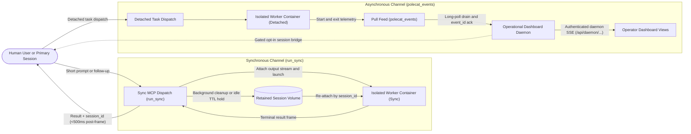

# Container Dispatch Return Channels

This specification defines the dual return contract for isolated worker containers launched through the container MCP server: a synchronous single-call RPC channel (`run_sync`) with optional ephemeral session continuation for short interactive turns, and an asynchronous pull-based lifecycle channel routing detached worker runs through `polecat_events` and the operational dashboard daemon to subscribed operator views.

This document owns the caller-to-container return contract, session continuation rules, and cross-boundary namespace separation. It complements [`specs/polecat/polecat-system.md`](polecat-system.md) (container runtime isolation and CLI execution), [`specs/observability/observability.md`](../observability/observability.md) and [`specs/observability/mcp-caller-session-tracing.md`](../observability/mcp-caller-session-tracing.md) (OpenTelemetry container labels and caller `_session` / `traceparent` forwarding), and the operational dashboard daemon's own event-return specification (ring-buffer persistence and UI rendering) without duplicating their internal rules.

## User experience flow

## Capabilities and user stories

### US-1 Short-run synchronous MCP dispatch

As a developer or researcher working in an interactive session, I want to send a focused question or instruction to an isolated container in one MCP tool call and receive the answer before post-turn cleanup finishes, so that I avoid manual status polling and teardown delays.

- **AC-1.1** Given a valid `run_sync` invocation whose worker emits its terminal structured result frame before the configured sync deadline (at most `85` seconds), when that terminal frame arrives on standard output, then the container MCP server returns `status`, `response`, and `session_id` within `500` milliseconds -- prior to background log harvest or container removal -- while recording container exit OpenTelemetry spans and inserting `0` completion entries into `polecat_events`.
- **AC-1.2** Given a `run_sync` invocation whose worker exceeds the configured sync deadline (at most `85` seconds), when the timeout expires, then the container MCP server returns a structured `"timeout"` error within `2` seconds of deadline expiry (preserving `session_id` only when `keep_session` is `true` and the harness has already emitted its initialization frame, or on Turn 2+) and releases the worker slot and container cleanly in the background.

### US-2 Ephemeral multi-turn session continuation

As a developer iterating across follow-up turns, I want subsequent calls passing a retained `session_id` to re-attach the prior workspace and harness conversation state without keeping an active daemon container running, so that follow-up prompts preserve local branch edits and context within a bounded expiry window.

- **AC-2.1** Given a completed `run_sync` turn with `keep_session: true` whose idle TTL (explicitly configured between `60` and `3600` seconds) has not expired, when a caller sends a follow-up `run_sync` call with that `session_id`, then the server acquires an exclusive per-session lock, re-attaches the retained workspace and harness state volume on its existing branch without running a fresh clone, resumes that exact session ID, and resets the idle TTL clock on completion (rejecting concurrent turns for the same `session_id` within `500` milliseconds).
- **AC-2.2** Given a `run_sync` call supplying an unknown, expired, or purged `session_id`, when pre-launch validation inspects session volume and harness state before container startup, then the server fails closed with an actionable error instead of falling back to a fresh unlinked conversation.

### US-3 Asynchronous completion return through operational dashboard

As an operator supervising detached background runs, I want worker start and exit transitions to drain cleanly from `polecat_events`, preserve task, branch, session, and trace identity back to the originating instance, and update subscribed dashboard views without shadowing application proxy routes, so that completions and failures remain accurate across server restarts.

- **AC-3.1** Given detached worker lifecycle events recorded in `polecat_events`, when the operational dashboard daemon drains the feed with a bounded long-poll wait (`<= 25` seconds inside an explicit client RPC timeout `>= wait + 20` seconds), then the daemon parses multi-item MCP content blocks completely, deduplicates on durable `event_id` prior to `ack_up_to`, routes to the originating `instance_id` or `dispatcher` before attempting repository matching (never silently defaulting to an unrelated instance), and delivers normalized events to subscribed dashboard streams within `2` seconds of exit telemetry arrival.
- **AC-3.2** Given the operational dashboard serving both application proxy routes and daemon streams, when clients connect to per-instance daemon events, then streams are served exclusively under `/api/daemon/instances/:instance/events` -- leaving `/api/app/instances/:instance/*` unshadowed -- include normalized `branch`, `session_id`, trace correlation, and sanitized outcome `summary` excerpts (`<= 512` UTF-8 bytes), and keep automated agent-session prompt injection disabled unless explicitly enabled.

## Shared interface contract

### Synchronous dispatch contract (`run_sync`)

| Field | Role | Contract & Validation Rule |
| - | - | - |
| `repo` | Input | Repository identifier; required on Turn 1, optional on Turn 2+ when derived from retained session metadata (explicit mismatch fails closed). |
| `prompt` | Input | Required instruction or question string delivered to the agent harness. |
| `branch` | Input | Optional target branch on Turn 1; explicit conflicting override on Turn 2+ is rejected before launch. |
| `session_id` | Input / Output | Omit on Turn 1 (returned from harness initialization frame); required on Turn 2+ to re-attach and resume exact conversation state. |
| `runner` | Input | Explicitly configured harness profile on Turn 1; optional on Turn 2+ when derived from retained session metadata (must match Turn 1 harness; explicit mismatch fails closed). |
| `keep_session` | Input | Optional boolean defaulting to `false` (`false` reclaims container and volume post-turn; `true` retains stopped named workspace/state volume until idle TTL). |
| `sync_timeout_s` | Input | Optional numeric deadline; callers may omit `sync_timeout_s` to adopt the configured server default, validated against explicit server configuration (hard ceiling `85` seconds; missing server configuration fails closed). |
| `status` | Output | Enum: `"success"`, `"error"`, or `"timeout"`. |
| `response` / `error` | Output | Final assistant response string or sanitized error detail. |
| `resumable` / `expires_at` | Output | Boolean continuation eligibility flag and ISO-8601 expiry timestamp when retained. |

### Asynchronous exit feed contract (`polecat_events`)

Every detached lifecycle transition recorded in `polecat_events` uses normalized field names across producers and consumers:

| Field | Semantics & Bounds |
| - | - |
| `event_id` / `seq` | Opaque globally unique `event_id` for idempotent deduplication; monotonic queue `seq` for post-commit `ack_up_to`. |
| `event_type` | `"container_start"` or `"container_exit"`. |
| `task_id` / `instance_id` / `dispatcher` | Optional task ID; explicit originating `instance_id` and `dispatcher` identity propagated from launch parameters/caller context. |
| `caller_session_id` / `session_id` / `trace_id` | Originating session identifier, worker harness conversation ID, and W3C trace ID. |
| `repo` / `branch` | Repository and checked-out git branch associated with the container run. |
| `task_status` / `exit_code` | Container exit status enum and integer exit code (on `"container_exit"`). |
| `summary` | Bounded (`<= 512` UTF-8 bytes) redacted final output or error excerpt scrubbed of private identifiers and credentials. |
| `timestamp` / `finished_at` | ISO-8601 event emission and completion timestamps. |

### Layer ownership and route namespaces

- **Container MCP server**: Owns synchronous output-stream parsing, scoped host-credential caching, per-session exclusive locking, pre-launch resume validation, idle-TTL volume reaping, `mode = "sync"` queue exclusion, and `polecat_events` cursor storage.
- **Operational dashboard daemon and UI**: Owns bounded `polecat_events` draining, multi-item MCP response parsing, `event_id` deduplication before `ack_up_to`, origin-aware routing, UI view synchronization, and authenticated SSE delivery under `/api/daemon/instances/:instance/events`. Application proxy forwarding retains exclusive ownership of `/api/app/instances/:instance/*`.

## Invariants and security boundaries

- **Container and credential isolation**: Synchronous and continuation containers inherit strict network egress restrictions, resource limits, unshared credentials, and scoped worker caller tokens defined in [`specs/polecat/polecat-system.md`](polecat-system.md). Stopped idle volumes hold workspace/state at zero active worker slots.
- **Fail-closed continuation and explicit configuration**: Timeouts, TTL ceilings, runner profiles, and instance routes must be explicitly configured; unknown or expired `session_id` resume requests never fall back silently to new sessions, and concurrent turns on one `session_id` are blocked deterministically.
- **Honest delivery guarantees**: `run_sync` provides at-most-once execution per call bounded by transport timeout (no automatic retry on deadline expiry). `polecat_events` provides at-least-once delivery deduplicated per `event_id` prior to cursor acknowledgment (`ack_up_to`).
- **Positive access and privacy boundaries**: External MCP callers authenticate via scoped gateway credentials; `/api/daemon/instances/:instance/events` requires an explicit bearer token bound to operator daemon permissions; public telemetry and `summary` excerpts scrub tokens, credentials, private hostnames, internal PKB identifiers, and raw transcripts in accordance with cross-boundary data rules.
- **Anti-polling contract preservation**: `run_sync` returns within one synchronous tool invocation with zero caller polling; detached dispatch continues to prohibit status-check polling.

## Open questions

- Which optional startup hooks and external MCP tool bundles should the synchronous fast-start profile omit by default to guarantee predictable sub-10-second worker cold starts?
- Once external gateway proxies are verified to stream incremental MCP progress notifications without buffering, should callers opt into longer streaming deadlines past `85` seconds or keep `run_sync` strictly capped at `85` seconds?
