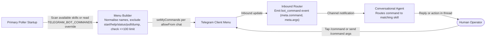

# Native Telegram Bot Command Menu for Ida

This specification defines how the `ida-telegram` plugin builds and registers the native Telegram bot command menu and delivers command invocations to the conversational agent. At each primary poller startup, the plugin builds a single unified command menu from every skill available to Ida across installed plugins, project-local skills, and user skill directories, unless an explicit `TELEGRAM_BOT_COMMANDS` JSON list is configured to override it. Every Ida bot instance presents the same command surface, while what each command does when invoked is governed by the agent's instructions (`telegram` skill).

## User experience flow



## Capabilities and user stories

### US-1 Unified Every-Skill Command Menu

As an operator talking to Ida in any Telegram window, I want every Ida bot to register a native command menu listing all skills available to Ida at poller startup (including Ida's own local skills such as `nudge`), with `TELEGRAM_BOT_COMMANDS` retained as an explicit override, so that every skill is one tap away across all Ida instances without manual list maintenance or persona splits.

- **AC-1.1 (Generated menu from available skills at startup)** Given `TELEGRAM_BOT_COMMANDS` is unset or empty, when the primary poller starts for any Ida channel folder, then the plugin builds the menu from every available skill across installed plugins, project-local skill directories (`.agents/skills`, `.claude/skills`), and user skill directories (`~/.claude/skills` or `$CLAUDE_CONFIG_DIR/skills`), normalises skill names to `[a-z0-9_]{1,32}` (converting hyphens to underscores and prefixing colliding skill names across sources), omits reserved (`start`, `help`, `status`) and headless worker (`pull`, `dump`) commands, and registers the identical menu via `setMyCommands` scoped to each authorised `allowFrom` chat.
- **AC-1.2 (Explicit override and 100-command limit reporting)** Given `TELEGRAM_BOT_COMMANDS` is set to a JSON array, when the menu is resolved, then only the valid non-excluded entries from `TELEGRAM_BOT_COMMANDS` are registered; and given more than 100 skills or commands in either mode, when resolution runs, then the plugin logs an explicit error reporting the total count above Telegram's 100-command limit rather than silently truncating without notice.

### US-2 Tapping or Sending a Command

As an operator tapping a command in the Telegram menu or sending a command with arguments, I want the command delivered to Ida with its normalised identifier and arguments intact, so that tapping a menu entry runs the corresponding skill on the active conversation.

- **AC-2.1 (Bare command delivery and agent-side skill routing)** Given an authorised operator taps a bare command `/cmd` (or `/cmd@botname`), when the inbound update arrives, then the plugin strips any `@botname` suffix, normalises hyphens to underscores, and emits a `bot_command` channel event with `meta.command` set to `/cmd` and `meta.args` set to `""`, leaving skill invocation to the agent's `telegram` skill instructions.
- **AC-2.2 (Command arguments and reply context preservation)** Given an authorised operator sends `/cmd <arguments>` (optionally replying to or quoting an earlier message in a thread), when the inbound update arrives, then `meta.args` preserves `<arguments>` verbatim alongside thread and reply metadata (`message_thread_id`, `reply_to_message_id`, `quoted_text`).

### US-3 Interactive Menu Proposal Workflow

As an operator reviewing or customizing the Telegram command surface, I want an interactive agent workflow that samples skill usage telemetry and inspects available skills before proposing a custom `TELEGRAM_BOT_COMMANDS` override when requested, so that any custom override stays aligned with platform constraints and actual operational use.

- **AC-3.1 (Telemetry-backed proposal and identifier validity)** Given an operator requests a menu review or custom override in an interactive session, when the `menu-proposal` workflow runs, then the agent samples recent skill and command invocations from telemetry, inspects all available skills and any active `TELEGRAM_BOT_COMMANDS` override, excludes reserved (`start`, `help`, `status`) and headless worker (`pull`, `dump`) commands, and presents recommendations whose identifiers match `^[a-z0-9_]{1,32}$` with descriptions of 1 to 256 characters.
- **AC-3.2 (Operator approval and override codification)** Given the presented recommendation, when the operator approves a custom override list of at most 100 commands in the interactive session, then the approved JSON list is written to `TELEGRAM_BOT_COMMANDS` in the channel's `$STATE_DIR/.env` for registration on the next poller startup.

## Shared interface contract

1. **Skill Discovery Sources (when `TELEGRAM_BOT_COMMANDS` is unset):**
   - **Project-local and Ida skills:** `<projectDir>/.agents/skills/*/SKILL.md` and `<projectDir>/.claude/skills/*/SKILL.md` (where `<projectDir>` is `$CLAUDE_PROJECT_DIR` or the working directory, plus `~/ida/.agents/skills` and `~/ida/.claude/skills` when present), capturing Ida's own skills such as `nudge`.
   - **User skills:** `<claudeConfigDir>/skills/*/SKILL.md` (where `<claudeConfigDir>` is `$CLAUDE_CONFIG_DIR` or `~/.claude`) and `~/.agents/skills/*/SKILL.md`.
   - **Installed plugin skills:** `$CLAUDE_PLUGIN_ROOT/skills/*/SKILL.md`, sibling plugins in the plugin root's parent or versioned plugin cache (`cache/<marketplace>/<plugin>/<version>/skills/*/SKILL.md`), plugin paths recorded in `<claudeConfigDir>/plugins/installed_plugins.json` and `known_marketplaces.json`, and repository `plugins/*/skills/*/SKILL.md`.
   - Symlinked skill directories are deduplicated by canonical real path so a skill reachable through multiple links is registered once.
2. **Command Naming, Descriptions, and Disambiguation:**
   - Each skill's `name` and `description` are parsed from `SKILL.md` YAML frontmatter (falling back to the directory basename and `Execute /<name>`).
   - Command names are normalised via `normalizeCommandName()`: strip leading `/` and any `@botname` suffix, convert to lowercase, replace hyphens (`-`) with underscores (`_`), drop characters outside `[a-z0-9_]`, and cap at 32 characters (`^[a-z0-9_]{1,32}$`).
   - Descriptions are trimmed to 1–256 characters.
   - When two distinct skill directories produce the same normalised command name, the first source retains `<command>` and subsequent sources are disambiguated as `<source_prefix>_<command>` (or `<source_prefix>_<command>_<n>`) within 32 characters.
   - Commands are sorted lexicographically by `command` name so every Ida instance produces a deterministic, identical list.
3. **Explicit Override (`TELEGRAM_BOT_COMMANDS`):**
   - When `TELEGRAM_BOT_COMMANDS` is set to a non-empty string, the plugin parses it as a JSON array of `{ command, description }` objects instead of scanning skill directories.
   - Each entry is normalised to `^[a-z0-9_]{1,32}$`, filtered against the exclusion set and 1–256 character description bounds. Invalid JSON logs a parse error and yields an empty list.
4. **Telegram 100-Command Limit Reporting:**
   - Telegram's Bot API allows at most 100 commands per `setMyCommands` call.
   - When resolved commands exceed 100 entries, the plugin logs an explicit error (`console.error`) stating the total discovered count and the 100-command platform limit rather than silently dropping commands.
5. **Registration Payload (`setMyCommands`):**
   - At primary poller start (`isPrimary === true`), `registerCommands()` resolves the current menu and calls `POST /bot<token>/setMyCommands` for each `chatId` in `allowFrom`:
     ```json
     {
       "commands": [
         {
           "command": "nudge",
           "description": "Ida's own learn-and-unlearn loop..."
         }
       ],
       "scope": { "type": "chat", "chat_id": 1111111111 }
     }
     ```
6. **Inbound Event Payload (`bot_command`):**
   - Inbound text messages starting with `/` from an `allowFrom` sender emit a `notifications/claude/channel` event with `content: "/<cmd>"` (or `"/<cmd> <args>"`) and `meta`:
     - `event: "bot_command"`
     - `command: "/<normalised_cmd>"`
     - `args: "<remaining_text>"`
     - `message_id`, `chat_id`, `user_id`, and optional `user`, `message_thread_id`, `thread_id`, `reply_to_message_id`, `quoted_text`.

## Invariants and security boundaries

- **Single uniform menu across all Ida instances:** Menu generation depends only on the available skills (or explicit `TELEGRAM_BOT_COMMANDS` override); channel state directory names (`telegram-prime`, `telegram-ida`, `telegram-secondary`) and persona environment variables (`IDA_TELEGRAM_PERSONA`, `TELEGRAM_PERSONA`) have zero effect on the registered menu.
- **Reserved and headless-worker exclusions:** Official Telegram plugin reserved commands (`start`, `help`, `status`) and headless worker lifecycle commands (`pull`, `dump`) are excluded from both skill-generated menus and `TELEGRAM_BOT_COMMANDS` overrides.
- **Primary poller and authorised sender boundary:** Only an instance configured with `IDA_TELEGRAM_ROLE=primary` calls `setMyCommands` or polls `getUpdates`. Commands are registered exclusively at `scope: { type: "chat", chat_id }` for configured `allowFrom` user/chat IDs, and inbound commands from senders outside `allowFrom` are dropped without agent notification.
