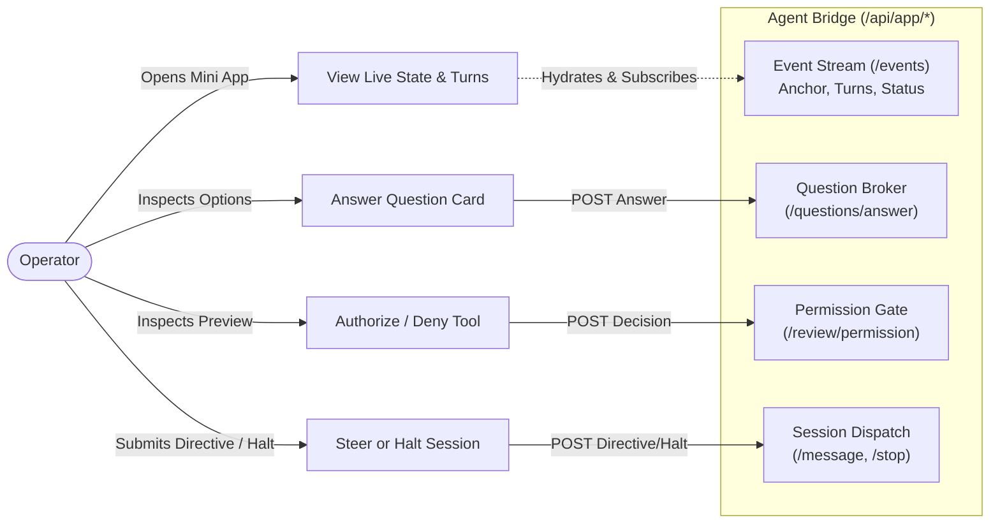

# Telegram Mini App Operator Experience and Agent Bridge

The Telegram Mini App provides an embedded mobile and desktop interface for supervising and directing conversational agents. It serves operators seeking continuous cognitive orientation, real-time context tracking, interactive decision resolution, tool execution governance, and bidirectional steering across mobile and desktop environments.

## User experience flow



## Capabilities and user stories

### US-1 Live Cognitive Anchor and Turn Synchronization

As an operator observing session execution, I want to view the agent's current focus, active tasks, token consumption, and recent turns in real time, so that I maintain continuous cognitive orientation without interrupting active work.

- **AC-1.1** Given an active agent session, when the agent updates its cognitive focus, task bindings, token metrics, or interaction turns, then connected clients receive and render the updated anchor via SSE within 500 milliseconds without requiring a page reload.
- **AC-1.2** Given a client reconnecting after transient network disconnection, when it supplies its last received sequence identifier, then the bridge streams missed buffered events or provides a fresh snapshot to reconcile state.

### US-2 Interactive Structured Question Resolution

As an operator directing an agent, I want to answer structured multiple-choice questions with recommendations and contextual background, so that I can resolve design choices and clarifications asynchronously across any active channel.

- **AC-2.1** Given a pending structured question emitted by the agent, when the card renders in the interface, then options display with the primary recommendation highlighted first and expandable background detail accessible.
- **AC-2.2** Given a pending question, when answered via the Mini App, an in-session tool, or a Telegram chat card, then the waiting agent receives the resolution within 100 milliseconds, the card transitions to resolved, and the item leaves all pending lists across all interfaces.

### US-3 Tool Permission Authorization and Expiration

As an operator supervising tool executions, I want to authorize or deny sensitive tool invocations with automatic expiration safeguards, so that autonomous operations execute only with verified human oversight.

- **AC-3.1** Given a tool invocation requiring authorization, when emitted by the agent, then the interface displays a permission card with tool name and parameter preview, unblocking or denying runtime execution within 100 milliseconds of operator submission.
- **AC-3.2** Given a pending permission request exceeding 300 seconds without operator response, when timeout occurs, then the request automatically transitions to expired, denying tool execution and disabling card actions.

### US-4 Operator Directives and Priority Session Halt

As an operator guiding an active session, I want to dispatch freeform steering directives or trigger an emergency halt, so that I can provide ad-hoc guidance or pause execution when necessary.

- **AC-4.1** Given an active session, when the operator submits a freeform message, then the text is delivered into the session context as an inbound turn within 500 milliseconds and recorded in turn history.
- **AC-4.2** Given an active session, when the operator issues a stop directive, then a high-priority halt interrupt signal is delivered into the session context and the status card updates to halted within 500 milliseconds.

## Shared interface contract

### 1. Snapshot Hydration Endpoints

- `GET /api/app/anchor`: Returns the current cognitive anchor snapshot (focus summary, active task, waiting-on items), token metrics (used tokens, total tokens, percentage), recent turns, and current sequence counter (`seq`).
- `GET /api/app/questions`: Returns all currently pending questions with option arrays, recommendations, and current `seq`.
- `GET /api/app/review`: Returns pending tool permission requests and artifact review diffs.

### 2. Reactive Event Stream (`GET /api/app/events`)

Streams `text/event-stream` frames with monotonic sequence numbering:

```http
id: <seq>
event: <eventType>
data: {"seq": <seq>, ...payload}
```

- Supported event types: `anchor`, `question_posted`, `question_resolved`, `permission_requested`, `permission_resolved`, and `turn_recorded`.
- Emits `: keepalive\n\n` comments every 15 seconds during idle periods.
- When a client reconnects with `Last-Event-ID: <seq>` or `?since=<seq>`, the bridge replays buffered events with sequence numbers greater than the requested sequence, or supplies a fresh snapshot if the sequence gap exceeds buffer capacity.

### 3. Action Endpoints

- `POST /api/app/questions/answer`: Payload `{"question_id": "string", "option_index": 0, "option_indices": [0], "custom_text": "string"}`. Resolves question in the local broker, unblocks the waiting agent turn, broadcasts `question_resolved`, and removes inline keyboard buttons on linked chat cards.
- `POST /api/app/review/permission`: Payload `{"permission_id": "string", "decision": "allow" | "deny"}`. Resolves runtime execution gate, broadcasts `permission_resolved`, and updates card display with outcome.
- `POST /api/app/message`: Payload `{"text": "string", "priority": "normal" | "high"}`. Injects directive directly into agent session context as an inbound turn and emits `turn_recorded`.
- `POST /api/app/stop`: Payload `{"reason": "string"}`. Delivers a high-priority interrupt notification into the session context, updates card display to halted, and returns `{"success": true, "status": "stop_dispatched"}`.

## Invariants and security boundaries

- **Monotonic Total Ordering**: Every state snapshot and event frame carries a strictly increasing integer sequence counter (`seq`) to guarantee total ordering, duplicate detection, and gap recovery.
- **At-Least-Once Delivery**: Reconnection contracts provide at-least-once delivery for state changes across network disruptions; resolution operations are idempotent on unique entity IDs (`question_id`, `permission_id`).
- **Positive Security Perimeter**: All `/api/app/*` routes require verification via signed Telegram `initData` or bearer bridge secret; each inbound request is attributed to a single authorized operator identity.
- **Fail-Closed Authorization Safeguard**: Tool permissions expire after 300 seconds; unhandled requests automatically fail closed by transitioning to `status: "expired"`, denying execution to prevent unauthorized operations after session abandonment.
- **Honest Interrupt Dispatch**: Emergency halt guarantees high-priority delivery of an interrupt prompt into the session context; it does not claim immediate physical preemption of running external sub-processes.
