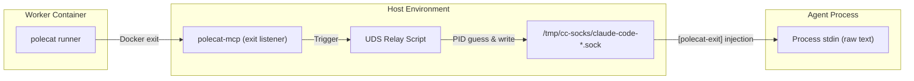
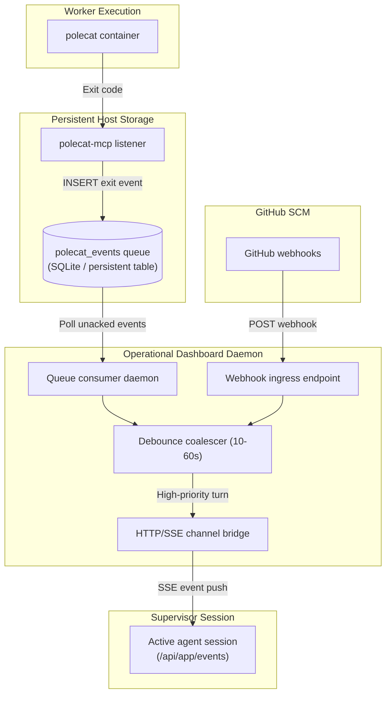
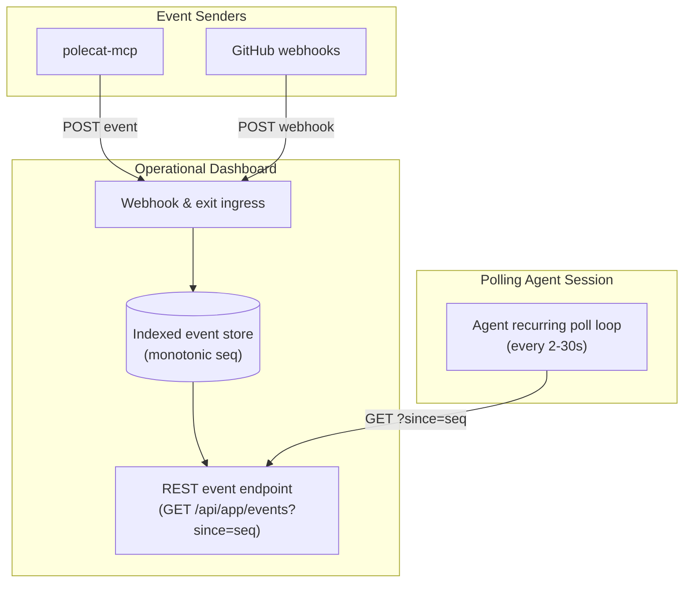
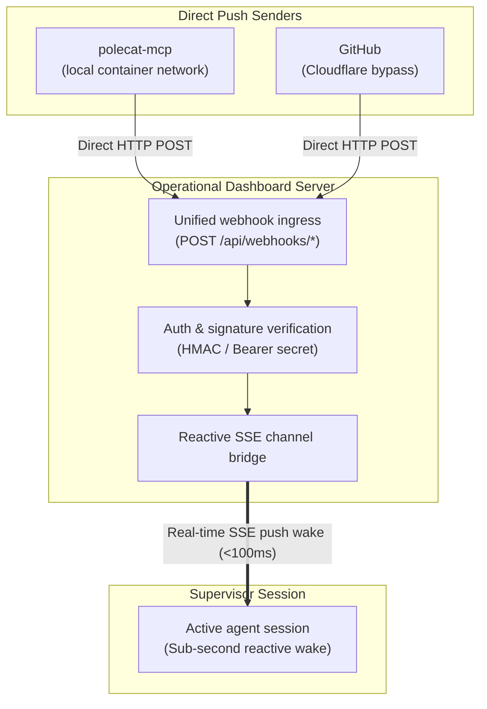
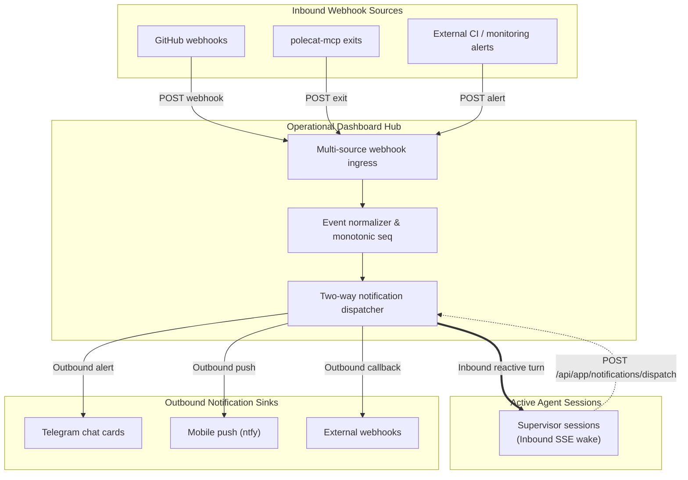
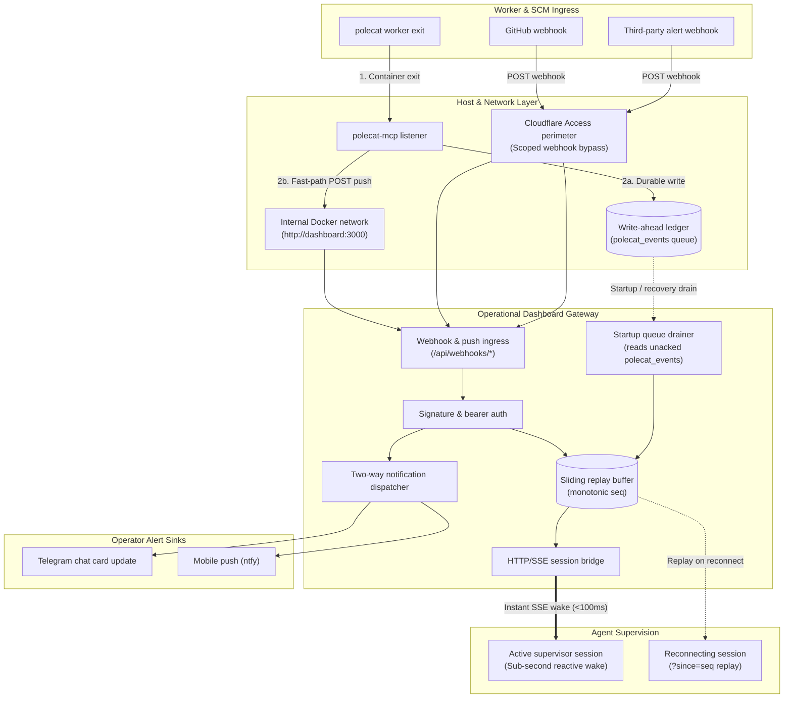
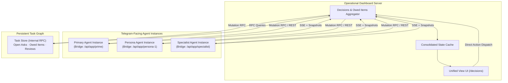

# Telegram Mini App Dashboard Integration

This specification defines the architecture, protocol contract, and operational behaviour for hosting the conversational agent's mobile Mini App within the central operational dashboard domain. It serves operators seeking unified cognitive orientation, real-time session tracking, and bi-directional interaction across mobile and desktop environments.

## User stories

### US-1 Unified Dashboard Serving and Perimeter Access

As an operator, I want to access the agent's cognitive anchor, interactive cards, and session controls directly through the operational dashboard domain, so that I can supervise and guide active work without maintaining separate tunnel configurations.

- **AC-1.1** Given an authenticated dashboard session, when the operator navigates to the agent control interface, then the application renders the cognitive anchor, context usage, and recent turns without prompting for secondary credentials.
- **AC-1.2** Given an operator opening the Mini App within a native Telegram client, when the application initialises, then the backend validates the signed Telegram authentication payload and grants access to the dedicated responsive interface.
- **AC-1.3** Given an unauthenticated HTTP request lacking both valid dashboard perimeter credentials and valid Telegram authentication data, when accessing any protected endpoint, then the server rejects the request with HTTP 401 Unauthorized.
- **AC-1.4** Given a request carrying a `Cf-Access-Jwt-Assertion` header, when the assertion is forged, malformed, expired, missing or mismatched issuer, or issued for an unauthorized email, then the server rejects the request with HTTP 401 Unauthorized across all authenticated routes.

### US-2 Dynamic Real-Time State Population

As an operator observing session execution, I want the interface state to update reactively as the agent works, so that cognitive focus, token consumption, and pending decisions reflect live runtime state.

- **AC-2.1** Given an active agent session, when the agent updates its cognitive focus, task bindings, or context token counts, then connected dashboard clients receive and render the updated state within 500 milliseconds without page reloading.
- **AC-2.2** Given a newly posted question or tool permission request, when the agent emits the request, then the interface dynamically displays the corresponding interactive card with selection options.
- **AC-2.3** Given an unexpected connection interruption, when the client reconnects to the event stream, then the client automatically requests a full state snapshot to reconcile missed updates.
- **AC-2.4** Given a pending artifact or pull request review assigned to the operator, when the operator inspects reviews in the interface, then the application displays the change diff with approve and request-changes actions.
- **AC-2.5** Given a question with fuller background (`detail`), when rendered in the Mini App, then the question displays a details button that opens the fuller background.
- **AC-2.6** Given a question asked as Mini-App-only (`mini_app_only: true` or `chat: false`), when emitted by the agent, then the question appears in the Mini App without posting a card to Telegram chat.

### US-3 Bi-directional Agent Channel

As an operator directing the agent, I want a direct communication channel through the dashboard, so that I can send prompts, answer structured questions, and approve tool permissions.

- **AC-3.1** Given a pending tool permission request displayed in the dashboard, when the operator submits an allow or deny decision, then the agent receives the decision immediately and unblocks execution.
- **AC-3.2** Given a pending question card in the interface, when the operator selects options or inputs custom text and submits, then the agent receives the structured answer and the question card transitions to resolved.
- **AC-3.3** Given an active session, when the operator dispatches a prompt or directive through the dashboard interface, then the agent receives the turn as an inbound notification and acknowledges receipt.
- **AC-3.4** Given a question or permission resolved via the dashboard interface, when the resolution completes, then the corresponding Telegram chat card updates to show the resolved outcome.
- **AC-3.5** Given an active session, when the operator dispatches a halt directive, then the agent immediately suspends execution and returns a status summary.

### US-4 Automatic Question Lifecycle and Dismissal

As an operator, once a question I was asked has been answered, by any channel, it leaves my outstanding questions without my doing anything.

- **AC-4.1** Given a pending question in the Mini App's outstanding list, when the question is answered or resolved in the asking session, then the agent resolves or closes the question and it leaves the outstanding list without manual intervention.
- **AC-4.2** Given a pending question in the Mini App's outstanding list, when the question is answered outside the Mini App and outside the asking session (such as via a plain Telegram reply to the question card), then the question transitions to answered and leaves the outstanding list without manual intervention.
- **AC-4.3** Given a posted question that has not been answered in any channel, when viewing the outstanding questions list, then the question remains listed and pending.
- **AC-4.4** Given a question whose Telegram delivery fails (via API error, network failure, missing bot, or missing messageId), when delivery failure occurs, then the failure is detected and surfaced immediately to the asking agent (the PreToolUse hook denies with a delivery failure reason, the MCP `ask_user` tool returns an error, and a `question_delivery_failed` channel notification is emitted), the question is marked status `failed` in the broker and excluded from pending questions, and any legacy undelivered questions without a messageId are swept and marked failed on startup.

### US-5 Retirement of Standalone Hosting and Infrastructure Consolidation

As an operator, I want all agent interface surfaces hosted and routed exclusively by the operational dashboard domain, so that the agent runtime is decoupled from static web serving, separate tunnel lifecycles, and redundant network ingress points.

- **AC-5.1** Given the retirement of standalone Mini App hosting, when an operator accesses the agent interface via Telegram WebApp or browser, then the operational dashboard handles all static asset delivery and client-side routing.
- **AC-5.2** Given the agent runtime service configuration, when the standalone web server is decommissioned, then the agent process binds only internal communication interfaces for state synchronization and exposes no public-facing static web endpoints.
- **AC-5.3** Given the consolidated hosting architecture, when external ingress routing is configured, then external traffic routes exclusively to the central dashboard ingress, eliminating dedicated agent WebApp tunnels.
- **AC-5.4** Given the migration of standalone surfaces to the dashboard, when the standalone Mini App web server is terminated, then all interactive capabilities (questions, details, reviews, cognitive anchor) continue operating through the dashboard service with zero regression in state synchronization.

### US-6 Unified Operational Event Ingestion and Session Waking

As an autonomous framework supervisor or human operator, I want the operational dashboard to ingest asynchronous infrastructure events (worker container completions, repository webhooks, and external operational notifications) and wake agent sessions across its HTTP/SSE channel bridge, so that task completions, pull request updates, and external events trigger immediate supervision and reconciliation passes without client polling loops, data loss, or ad-hoc host socket relays.

- **AC-6.1** Given completed worker containers recorded in `polecat_events`, when unacknowledged completion events are present, then the daemon consumes the events, dispatches a wake notification to the active supervisor session over the bridge, and marks the events acknowledged.
- **AC-6.2** Given an inbound repository webhook (such as PR review comments, CI status completion, or PR merges), when received by the dashboard daemon's webhook ingress, then the daemon validates the payload signature, translates the event into a structured operational event, and wakes the target agent session.
- **AC-6.3** Given an active agent session connected over the HTTP/SSE bridge, when an operational event is dispatched, then the bridge delivers the structured notification to the session within the configured debounce window.
- **AC-6.4** Given an active supervisor session awaiting completion signals, when events arrive at the dashboard, then notifications are pushed reactively into the session context without requiring the agent to poll the dashboard.
- **AC-6.5** Given a direct worker exit callback (`POST /api/webhooks/workers`), when received from the container runtime, then the dashboard validates the bearer credential, records or correlates the task exit, and delivers an immediate reactive wake notification to the supervisor session.
- **AC-6.6** Given an arbitrary external notification source, when authenticated at the webhook ingress, then the dashboard normalizes the payload into a structured operational event and routes it to subscribed sessions or outward to operator alert channels.
- **AC-6.7** Given a dashboard daemon outage or restart, when events arrive or were queued during downtime, then unacknowledged events persisted in the write-ahead event queue are flushed as a batch snapshot upon daemon recovery, ensuring zero event loss.

### US-7 Unified Pending Decisions and Owed Items View

As an operator managing multiple concurrent agent streams and background tasks, I want a single unified dashboard view that aggregates all pending decisions, permissions, reviews, and items owed back to me across every agent instance and the task graph, so that no request or directive I issued is lost or forgotten.

- **AC-7.1** Given multiple active Telegram-facing agent instances and the central task graph, when the operator accesses the unified decisions view, then the interface displays pending items gathered from all sources: structured questions, tool permissions, and artifact reviews from every agent instance bridge, alongside active open asks and items waiting on operator feedback from the task graph.
- **AC-7.2** Given an item displayed in the unified view, when rendered, then the card displays its originating agent instance or project, classification (decision, permission, review, or owed ask), summary text, recommendation or preview diff where applicable, elapsed waiting time, and contextual action controls.
- **AC-7.3** Given an open ask or pending decision in the unified view, when an agent session disconnects, restarts, or crashes, then the item remains persisted in the view and cannot be removed without an explicit, recorded resolution event.
- **AC-7.4** Given an active item in the unified view, when the item is answered, permitted/denied, reviewed, or when its underlying task transitions to a terminal state (`done` or `cancelled`) with recorded evidence, then the item transitions out of the pending view; if closed without resolution, an audited reason must be recorded.
- **AC-7.5** Given a pending decision, permission request, or review in the unified view, when the operator acts directly within the dashboard interface, then the resolution is dispatched to the originating agent bridge and updates the corresponding source state across connected channels.

### US-8 Multi-Instance Bridge Discovery and Upstream Proxying

As an operator running multiple concurrent agent instances (such as primary and persona channels), I want the dashboard proxy layer to dynamically discover and route to each running agent's local HTTP/SSE bridge, so that every instance's state is queryable and streamable through the central dashboard perimeter.

- **AC-8.1** Given a set of running agent instances configured in the dashboard environment, when querying `GET /api/app/instances`, then the response lists all registered instances with their identifier, display label, and connectivity status (`online` or `offline`).
- **AC-8.2** Given an instance-scoped REST request (`GET /api/app/instances/:instance/anchor`, `/questions`, or `/review`), when the upstream agent instance is reachable, then the dashboard forwards the request to that instance's local bridge with upstream authorization, returning the live JSON payload and monotonic sequence number.
- **AC-8.3** Given an instance-scoped event stream request (`GET /api/app/instances/:instance/events`), when the upstream agent bridge emits SSE frames, then the dashboard streams the frames in real time with sequence numbers intact, relays reconnection parameters (`Last-Event-ID` or `?since`), and emits periodic keepalive comments.
- **AC-8.4** Given a request to an upstream agent instance that is unreachable, stopped, or disconnected, when the dashboard attempts to proxy the request, then the proxy responds with HTTP 503 Service Unavailable and a structured error payload without crashing or blocking other instances.

### US-9 Dual-Surface (/agent and /app) Multi-Instance State and Action Routing

As an operator supervising and directing work from either the desktop `/agent` interface or the mobile Mini App (`/app/`), I want to view live state and dispatch actions to any running agent instance, so that my directives reach the target agent directly and update connected chat channels immediately.

- **AC-9.1** Given the desktop `/agent` interface, when the operator selects an active agent instance from the instance selector, then the interface hydrates that instance's live cognitive anchor, token metrics, and recent turns, and establishes an active SSE stream to that instance's event endpoint.
- **AC-9.2** Given the `/agent` interface switched to the embedded shell view, when an agent instance is selected, then the embedded iframe synchronizes to `/app/?instance=:instance`, binding the shell directly to the selected instance.
- **AC-9.3** Given the standalone Mini App loaded via chat client or browser with an `instance` query parameter, when initialised, then all API requests for state snapshots, event streaming, and operator actions automatically route to that specific instance's bridge.
- **AC-9.4** Given a pending structured decision or tool permission on either interface, when the operator submits a choice or allow/deny decision, then the action dispatches to `POST /api/app/instances/:instance/questions/answer` or `POST /api/app/instances/:instance/review/permission`, unblocking the agent session and updating the corresponding chat card in place.
- **AC-9.5** Given a freeform prompt or halt directive submitted through the interface, when dispatched to `POST /api/app/instances/:instance/message` or `POST /api/app/instances/:instance/stop`, then the target agent receives the directive into its active session context and halts or responds accordingly.
- **AC-9.6** Given a client issuing a request to an instance-scoped endpoint without an instance identifier (such as `/api/app/anchor`), when received by the dashboard, then the server rejects the request with HTTP 400 Bad Request requiring an explicit instance parameter.

## Design

### 1. Unified Serving and Perimeter Authentication (US-1)

#### 1.1 Context and Problem

The agent interface must serve two client topologies: (a) standalone mobile access embedded as a Telegram WebApp inside a mobile messenger, and (b) integrated desktop access embedded within the operator's central dashboard application. The hosting layer must securely identify the operator across both surfaces while preserving single-tap mobile launching.

#### 1.2 Architectural Options

- **Option 1.1 (Telegram-Only Authentication):** Require Telegram WebApp signature validation on every request. Direct desktop browser access to the dashboard requires launching via Telegram desktop or passing synthetic Telegram parameters.
- **Option 1.2 (Perimeter-Only Authentication):** Place the entire application behind dashboard perimeter identity (such as Cloudflare Access with OAuth). All requests must satisfy perimeter identity headers.
- **Option 1.3 (Dual-Mode Perimeter Authentication -- Recommended):** Employ perimeter identity as the primary gate for direct web visits, combined with an authenticated bypass and validation bridge for signed Telegram WebApp launches.
  - _Recommendation Rationale:_ Mobile WebViews in chat clients struggle with third-party OAuth redirect loops and external identity providers, whereas desktop operators already hold active dashboard sessions. Dual-mode authentication guarantees friction-free access on both devices while strictly enforcing cryptographic identity checks on every request.

#### 1.3 Recommended Serving and Authentication Contract

1. **Perimeter Ingress and Bridge Transport:**
   - The primary dashboard ingress terminates at the central web application.
   - Standalone client routes are published under `/app/*` (static bundle and responsive standalone shell) and API endpoints under `/api/app/*` (with multi-instance routes scoped under `/api/app/instances/:instance/*`).
   - Desktop operators access the embedded view under the primary dashboard layout at `/agent`.
   - **Bridge Transport:** The agent process hosts the internal HTTP/1.1 and SSE channel bridge on a private loopback interface or internal service mesh, proxied by the dashboard service layer or accessed directly over private network mesh as specified under multi-instance proxy architecture.
2. **Authentication Flow:**
   - **Mode A (Telegram Launch):** The client transmits the cryptographic initialization payload via `POST /api/app/auth`. The server verifies the cryptographic hash against the bot secret token using HMAC-SHA256, validates timestamp freshness (maximum age: 3600 seconds), and checks user identity against the authorized operator list. On success, the server issues an HTTP-only, secure, strict SameSite session cookie (`ida_session`) with a 1-hour expiry.
   - **Mode B (Dashboard Perimeter and Service Bridge):** For requests arriving from the dashboard domain or internal services:
     - The bridge accepts bearer credentials in the `Authorization: Bearer <token>` or `X-Bridge-Token: <token>` header, verified against the shared bridge secret (`IDA_BRIDGE_TOKEN`) or valid session secret.
     - Alternatively, the server verifies the perimeter identity assertion header (`Cf-Access-Jwt-Assertion`). The server validates the assertion cryptographically using Cloudflare Access public keys / JWKS (RS256), checking `iss` (matching the configured team domain), `aud` (matching the configured application AUD tag), temporal validity (`exp` and `nbf`), and ensures the `email` claim matches an authorized operator. Mere presence of the header without successful cryptographic and claim verification never grants access.
   - **Rejection:** Any request to protected endpoints (`/api/app/*`) lacking a valid session cookie, valid bridge token, or verified perimeter assertion (including forged, malformed, expired, or missing/mismatched issuer assertions) receives HTTP 401 Unauthorized (`{"error": "Unauthorized"}`).

### 2. Dynamic State Population (US-2)

#### 2.1 Context and Problem

The agent's state encompasses multiple components:

- _Cognitive Anchor:_ Current focus summary, active task identifier, waiting-on items, subagent delegations, and token gauge metrics (used tokens, total tokens, percentage).
- _Pending Decisions:_ Interactive multi-choice questions awaiting operator selection.
- _Tool Permissions:_ Pending tool invocations requiring human authorization.
- _Turn History:_ Recent inbound and outbound interaction turns.
- _Artifact Reviews:_ Pending pull request diffs and reviews.

The dashboard host runs on a dedicated service host, while the active agent session executes in an execution runtime. State must synchronize dynamically without manual browser polling.

#### 2.2 Architectural Options

- **Option 2.1 (Periodic Client Polling):** The client polls `GET /api/app/anchor` and `GET /api/app/questions` at fixed intervals (e.g. every 2 seconds).
  - _Trade-off:_ High query churn, unnecessary network overhead, and unacceptable latency (up to 2 seconds) for interactive permission prompts.
- **Option 2.2 (Shared Database Polling):** Centralise state in a shared database accessed by both the agent runtime and the dashboard.
  - _Trade-off:_ Introduces schema coupling and database maintenance overhead for transient interactive promises (such as in-flight permission requests).
- **Option 2.3 (Server-Sent Events with REST Snapshot Hydration -- Recommended):** Use REST endpoints for initial state hydration and on-demand lookups, supplemented by a real-time Server-Sent Events (SSE) stream (`GET /api/app/events`) for instant push updates.
  - _Recommendation Rationale:_ SSE provides unidirectional, lightweight HTTP streaming compatible with standard reverse proxies, corporate tunnels, and mobile WebViews without WebSocket upgrade complexity. State updates propagate in sub-second time.

#### 2.3 Recommended Dynamic Data Contract

1. **Monotonic Sequence Numbering:**
   - The channel bridge maintains a strictly increasing monotonic sequence counter (`seq: number`, starting at 1).
   - Every state mutation increments `seq` (anchor update, question posted or resolved, permission requested, resolved, or expired, and turn recorded).
2. **Initial Hydration Snapshots:**
   - `GET /api/app/anchor`: Returns the current anchor snapshot, token gauge, pending questions summary, recent turns, and current `seq`.
   - `GET /api/app/questions`: Returns the active list of unresolved questions and current `seq`.
   - `GET /api/app/review`: Returns pending permission requests, PR diff reviews, and current `seq`. Each permission item carries `status: "pending" | "expired"`.
3. **Reactive Event Stream (`GET /api/app/events`):**
   - The server maintains a persistent `text/event-stream` connection to authenticated clients.
   - Each event frame includes standard SSE id and event fields, with `seq` in the payload:
     ```
     id: <seq>
     event: <eventType>
     data: {"seq": <seq>, ...payload}
     ```
   - Event types emitted:
     - `anchor`: Payload contains updated cognitive anchor, token metrics, and `seq`.
     - `question_posted`: Payload contains newly issued question card and `seq`.
     - `question_resolved`: Payload contains question identifier, chosen answer, and `seq`.
     - `permission_requested`: Payload contains permission request identifier, tool name, input preview, and `seq`.
     - `permission_resolved`: Payload contains permission identifier, outcome (`allow` | `deny` | `expired`), decision, and `seq`.
     - `turn_recorded`: Payload contains direction (`in` | `out`), text summary, timestamp, and `seq`.
4. **Resilience and Invariants:**
   - The SSE stream includes keep-alive heartbeat comments (`: keepalive\n\n`) every 15 seconds.
   - When a client disconnects and reconnects, it supplies `Last-Event-ID: <seq>` or query parameter `?since=<seq>`. The bridge replays buffered events with `seq > sinceSeq` or the client fetches a fresh state snapshot via `GET /api/app/anchor` to guarantee convergence.
   - **Expired Permissions:** If a tool permission request exceeds its timeout (default: 300 seconds / 5 minutes) or is cut by an agent session restart, the bridge transitions its status to `"expired"`, unblocks the tool call with denial, broadcasts `event: "permission_resolved"` with `outcome: "expired"`, and edits any associated Telegram card to show `*Expired ⏱️*` with buttons disabled.

### 3. Bi-directional Operator Communication Channel (US-3)

#### 3.1 Context and Problem

The operator must be able to interact with the active agent directly from the dashboard: providing feedback, answering multiple-choice questions, deciding on tool executions, sending freeform steering instructions, or triggering an emergency stop.

#### 3.2 Architectural Options

- **Option 3.1 (Telegram Webhook Proxying):** The dashboard forwards operator inputs to the Telegram Bot API as simulated chat messages.
  - _Trade-off:_ Dependent on external third-party API availability, adds latency, and forces web-specific interactions through Telegram message constraints.
- **Option 3.2 (Direct Agent Channel Bridge -- Recommended):** The dashboard server forwards operator inputs directly to the agent's channel bridge via authenticated HTTP endpoints, dispatching channel notifications into the agent session.
  - _Recommendation Rationale:_ Decouples dashboard communication from external chat networks, provides sub-100ms response delivery, and maintains local custody of operator commands.

#### 3.3 Recommended Communication Protocol

1. **Freeform Direct Messaging (`POST /api/app/message`):**
   - Request: `{ "text": string, "priority"?: "normal" | "high", "chat_id"?: number, "message_id"?: number }`
   - The channel bridge delivers the text as an inbound channel notification directly into the agent session context, records the turn in history, and increments `seq`.
   - If `chat_id` and `message_id` are provided (or if an active chat card exists in store), the bridge edits the Telegram card in place to reflect the directive.
   - Response: `{ "success": true, "message_id": string, "seq": number }`
2. **Structured Question Posting and Resolution (`ask_user` and `POST /api/app/questions/answer`):**
   - Question Posting (`ask_user`):
     - The agent posts structured decisions with options, recommendation, context, and optional fuller background (`detail`).
     - When `mini_app_only: true` or `chat: false` is set (globally or on a question), the question is saved in runtime and rendered in the Mini App, but no card is sent to Telegram chat.
     - When `detail` is provided, the Mini App displays a `🔍 Details` button on the question card that opens its fuller background. If the question also posts to chat, the chat card includes an inline `🔍 Details` button linking directly to the Mini App details view.
   - Question Resolution (`POST /api/app/questions/answer`):
     - Request: `{ "question_id": string, "option_index"?: number, "option_indices"?: number[], "custom_text"?: string }` (aliases: `questionId`, `optionIndex`, `optionIndices`, `customText`)
     - The server marks the question resolved in runtime, emits a channel event (`question_answered`) to the agent, broadcasts `question_resolved` over SSE, and triggers an in-place edit on any associated Telegram card to display the selected choice with buttons removed (`inline_keyboard: []`).
     - Response: `{ "success": true, "resolved_at": string, "seq": number }`
3. **Tool Permission Resolution (`POST /api/app/review/permission`):**
   - Request: `{ "permission_id": string, "decision": "allow" | "deny" }` (alias: `permId`)
   - The server resolves the pending permission promise, unblocking tool execution in the agent runtime, and broadcasts `permission_resolved` over SSE.
   - Associated Telegram chat cards update immediately with status "Allowed via Dashboard ✅" or "Denied via Dashboard ❌" (or "Allowed via Mini App ✅" / "Denied via Mini App ❌") and clear buttons (`inline_keyboard: []`).
   - Response: `{ "success": true, "decision": "allow" | "deny", "seq": number }`
4. **Session Intervention (`POST /api/app/stop`):**
   - Request: `{ "reason"?: string, "chat_id"?: number, "message_id"?: number }`
   - The server emits a high-priority interrupt notification (`stop_requested`) into the agent session instructing the agent to halt current work and provide a summary report.
   - Associated Telegram cards update in place to show `*Halted via Dashboard 🛑*` and disable buttons (`inline_keyboard: []`).
   - Response: `{ "success": true, "status": "stop_dispatched", "seq": number }`

### 4. Cross-Channel State Synchronization Invariants (US-4)

1. **Single Source of Truth:**
   - The running agent session runtime and local persistent stores (pending questions store, tool permissions store, and cognitive anchor store) maintain the authoritative state of active tasks, anchors, questions, and permission requests.
   - Late button taps or callbacks from Telegram for an item already resolved or expired in runtime are rejected gracefully via `answerCallbackQuery` and do not alter runtime state.
2. **Mutual Invalidation:**
   - An action completed on one surface immediately updates all connected surfaces.
   - Answering a question in Telegram chat broadcasts `question_resolved` to all dashboard SSE subscribers and removes the pending prompt.
   - Conversely, resolving a question or tool permission in the dashboard immediately edits the Telegram chat card to disable inline buttons (`inline_keyboard: []`) and display the chosen resolution.
3. **Zero Orphaned Permissions:**
   - Tool permissions have a default lifespan of 300 seconds (5 minutes). If a request times out, it transitions automatically to `status: "expired"`, denies execution to prevent dangling tools, and emits `permission_resolved` with `outcome: "expired"`.
   - If the agent service restarts while permissions remain unfulfilled, the bridge startup pass sweeps lingering pending records, transitions them to `"expired"`, and edits their Telegram cards in place to show `*Expired ⏱️*` with buttons disabled.
4. **Autonomous Question Dismissal Across Channels:**
   - When a question is answered on any channel -- directly within the asking agent session (via session tool resolution), via a plain Telegram reply to the question card or prompt message, or inside the Mini App -- the question broker transitions the question status from pending to answered or closed.
   - The question is immediately excluded from `GET /api/app/questions` and leaves the Mini App outstanding questions list without requiring the operator to manually dismiss it.
   - Any question that has not been answered across any channel persists in the store and remains listed as pending.
5. **Delivery Verification and Failure Isolation:**
   - When a question card cannot be delivered to Telegram (due to Telegram Bot API failure, network dropouts, missing bot client, or missing chat/thread target), the system must never report delivery success.
   - The PreToolUse hook denies tool execution with a delivery failure reason, the MCP `ask_user` tool returns an error (yielding JSON-RPC `isError: true`), and a `question_delivery_failed` channel event is emitted to the asking session.
   - The broker marks the question status as `failed` with the recorded failure reason, excluding it from active pending questions.
   - On broker startup, any legacy questions left in `pending` status without a confirmed `messageId` (and not marked `mini_app_only` or `chat: false`) are swept, marked `failed`, and broadcast as `question_delivery_failed` notifications.

### 5. Retirement of Standalone Hosting and Infrastructure Consolidation (US-5)

#### 5.1 Context and Problem

The conversational agent plugin previously bundled an internal HTTP server and dedicated ingress tunnel process to host and publish the Mini App externally. This dual-stack architecture introduced operational overhead, duplicate ingress attack surfaces, and tunnel lifecycle synchronization failures.

#### 5.2 Architectural Options

- **Option 5.1 (Co-existence):** Maintain both the standalone agent web server and the dashboard deployment concurrently.
  - _Trade-off:_ Redundant runtime resource usage, split ingress endpoints, and persistent configuration drift between standalone and dashboard interfaces.
- **Option 5.2 (Complete Hosting Retirement -- Recommended):** Decommission the standalone static web hosting server and dedicated ingress tunnel in the agent runtime entirely. Consolidate all user-facing interface serving into the central operational dashboard application, while restricting the agent process to an internal state and event bridge.
  - _Recommendation Rationale:_ Eliminates dedicated tunnel failures, unifies perimeter authentication and observability at the dashboard gateway, and simplifies the agent runtime footprint.

#### 5.3 Target Architecture and Migration Contract

1. **Component and Serving Boundary:**
   - The central operational dashboard application assumes exclusive responsibility for delivering static interface assets, responsive layouts, and client-side routing for both desktop browsers and Telegram mobile WebViews.
   - The standalone static file server in the agent plugin is decommissioned and retired.
2. **Ingress and Network Boundary:**
   - External ingress tunnels and reverse proxy endpoints terminate solely at the operational dashboard gateway.
   - Dedicated external tunnels for the agent process are retired.
   - The agent runtime binds only internal network interfaces or local IPC for communication with the dashboard service proxy, eliminating direct external exposure.
3. **Client Continuity and Backward Compatibility:**
   - Telegram Bot configuration updates the Mini App launch URL to route to the operational dashboard domain (`/app/*`), ensuring single-tap mobile access functions seamlessly without disruption.
   - All interactive capabilities (cognitive anchor inspection, question answering with details expansion, tool permission authorization, and emergency stopping) operate identically through the dashboard serving layer.

### 6. Unified Operational Event Ingestion and Session Waking (US-6)

#### 6.1 Context and Problem

Background worker containers (polecats) operate headless and asynchronously in isolated worktrees. External repository activity--including pull request reviews, automated CI check suite completions, branch merges, and third-party monitoring alerts--occurs outside the local agent process boundary. Active supervisory agents (such as primary coordinators and dispatchers) must receive completion signals and operational events promptly to evaluate returned evidence, perform verification and premise checks, advance dependent workflows, or close the loop with the operator.

Closing this operational loop requires resolving two distinct architectural choices that must not be conflated:

1. **Ingress:** How events reach the central operational dashboard (queue polling, direct HTTP webhook push, or filesystem socket relays).
2. **Delivery:** How agent sessions learn of ingested events (reactive Server-Sent Events push wakeups, client polling buffers, or raw process stdin injection).

##### Historical Trajectory and Design Evolution

- **Retired Baseline: Per-Session Unix Domain Socket Push:** The initial attempt to notify dispatching sessions relied on a host script listening for container exits and pushing `[polecat-exit]` text lines directly into agent session processes via Unix Domain Sockets in `/tmp/cc-socks/`. This mechanism was retired because it broke across five fundamental structural boundaries:
  1. _Host Container Isolation:_ The desktop environment was decoupled into an independent container, isolating its `/tmp` directory and network namespace from worker containers and other host tools.
  2. _Process ID Fragility:_ Agent sessions lacked deterministic socket names, forcing the relay script to guess target sockets based on process names, thread scans, and alphabetical ordering.
  3. _Unauthenticated Stdin Injection:_ Injecting unescaped text into an active agent's stdin violated message provenance, caused syntax parsing confusion, and risked corrupting interactive turns.
  4. _Silent Event Loss:_ The relay script marked events as handled even when falling back to arbitrary sockets or when delivery failed, dropping completion signals silently.
  5. _Axiom Non-Compliance:_ Ad-hoc fallback heuristics and silent error swallowing directly breached core platform axioms (anti-fallback, fail-fast, and single source of truth).
- **Settled Baseline: Queue Consumption and Channel Bridge Waking (Option 3C):** Option 3C settled the baseline architecture where the container runtime listener records container exits in a persistent database queue (`polecat_events`), and the operational dashboard daemon acts as the unified event consumer. The daemon consumes the queue and incoming repository webhooks, coalescing events over a configurable debounce window (10-60 seconds) and waking connected supervisory sessions over its authenticated HTTP/SSE channel bridge.
- **Architectural Design Explorations:** Several design alternatives evaluate how to close the loop effectively:
  1. _Agent Polling Buffer:_ Whether the dashboard should support an indexed event store where agents poll for completed workers and GitHub hook results on demand.
  2. _Multi-Source Inbound Webhooks:_ Expanding the dashboard ingress to ingest arbitrary external webhooks and operational alerts.
  3. _Two-Way Notification Hub:_ Establishing a bi-directional notification pipeline connecting inbound webhooks with outbound operator chat cards and mobile pushes.
  4. _Direct Webhook Push Endpoint:_ Whether a single dashboard webhook endpoint could receive both external GitHub events and direct push callbacks from the worker container runtime (eliminating daemon queue-polling latency), how that differs from existing options, and whether it replaces or refines Option 3C.

#### 6.2 Architectural Options for Closing the Loop

##### Option 6.A (Retired Baseline): Per-Session Unix Domain Socket Push (`[polecat-exit]`)

The container runtime exit listener triggers a host Python relay script upon container termination. The script scans `/tmp/cc-socks/` for active agent sockets, matches target sessions via process heuristics, and injects raw text lines (`[polecat-exit] <task_id> <exit_code>`) directly into the agent process stdin.

- **What it carries:** Unstructured text string containing container exit code, task identifier, and container reference.
- **Who polls or is notified:** Local socket listener in the agent session process receives the injected text line.
- **Trade-offs:** Avoids external HTTP dependencies, but introduces irrecoverable failure modes: filesystem path coupling, lack of message authentication, inability to span isolated container network namespaces, and silent drops when target processes terminate.



##### Option 6.B (Settled Baseline 3C): Queue Consumption and Channel Bridge Waking

The container runtime exit listener writes every container exit into a persistent database queue table (`polecat_events`). The operational dashboard daemon polls the database table for unacknowledged records, correlates them with active tasks, and consumes inbound GitHub webhooks. The daemon coalesces events within a configurable debounce window (10-60 seconds) and delivers high-priority notification turns to connected supervisory agent sessions over the authenticated HTTP/SSE channel bridge (`/api/app/instances/:instance/events`).

- **What it carries:** Structured worker completion records (`task_id`, `container_id`, `exit_code`, `status`, `duration`) and repository webhook events (`check_suite`, `pull_request`, `review`).
- **Who polls or is notified:** The dashboard daemon polls the persistent queue table; the supervisory agent session is notified reactively via SSE push turns without polling.
- **Trade-offs:** Provides maximum durability and zero event loss across dashboard or agent restarts (unacknowledged events remain persisted in the queue). However, worker completion signals incur a polling latency floor imposed by the daemon's query cadence and debounce window.



##### Option 6.C: Dashboard Event Store with Agent Polling Buffer

The operational dashboard exposes an inbound ingestion endpoint for GitHub webhooks and worker exits. Received events are assigned monotonic sequence numbers (`seq`) and appended to an indexed event buffer in dashboard memory or local storage. Agent sessions do not receive unprompted push notifications; instead, agents query the dashboard periodically via a REST endpoint (`GET /api/app/events?since=<seq>`) or an MCP read tool to discover recent completions.

- **What it carries:** Normalized event objects with monotonic sequence identifiers, timestamps, event categories, and structured payload bodies.
- **Who polls or is notified:** The agent session polls the dashboard REST API periodically (every 2-30 seconds); no proactive wake turns are pushed.
- **Trade-offs:** Simplifies client implementation for stateless or pull-only worker scripts that cannot host listening servers. However, it introduces significant notification latency, consumes recurring API requests and context tokens in polling loops, and directly violates the project's strict prohibition against agent polling loops.



##### Option 6.D: Direct Unified Webhook Endpoint for GitHub and Worker Pushes

The operational dashboard exposes a unified HTTP webhook ingress gateway (`POST /api/webhooks/*`). External GitHub webhooks post directly to this endpoint with HMAC-SHA256 signature headers. Concurrently, the container runtime exit listener (`polecat-mcp`) publishes worker exit callbacks via direct HTTP POST to `POST /api/webhooks/workers` immediately upon container termination, authenticated via a shared bearer secret. Upon receipt, the dashboard validates the payload and immediately pushes a reactive wake notification over the SSE channel bridge into the active supervisor session.

- **What it carries:** GitHub repository event payloads and worker container exit payloads (`task_id`, `session_id`, `exit_code`, `status`, `summary`, `pr_url`, `completion_evidence`).
- **Who polls or is notified:** Both external senders push directly into the dashboard via HTTP POST; the dashboard pushes directly to active supervisor sessions via SSE. Nobody polls.
- **Trade-offs:** Delivers sub-second end-to-end notification latency (<100ms) by eliminating daemon queue-polling intervals. However, if implemented as a pure replacement for Option 3C without persistent queueing, events emitted while the dashboard is down or restarting would be permanently dropped.



##### Option 6.E: Multi-Source Webhook Gateway and Two-Way Notification Hub

The operational dashboard serves as a centralized, bi-directional operational communication hub. Inbound: The dashboard exposes generalized webhook endpoints (`POST /api/webhooks/:source`) capable of ingesting and normalizing heterogeneous webhooks from GitHub, container runtimes, external CI/CD pipelines, and infrastructure monitoring systems into canonical operational event envelopes. Outbound: The dashboard integrates a two-way notification dispatcher capable of routing events and agent directives across multiple communication sinks, including active agent SSE streams, Telegram chat cards, mobile push notifications, and external webhook callbacks.

- **What it carries:** Canonical operational event envelopes (`seq`, `source`, `event_type`, `correlation`, `status`, `summary`, `payload`, `timestamp`) across all inbound sources; outbound notification alerts and action prompts.
- **Who polls or is notified:** External services push in; the dashboard pushes inbound events to subscribed agent sessions via SSE; agents push outbound notifications through the dashboard to operator channels.
- **Trade-offs:** Establishes a complete, extensible event and alerting fabric across the entire multi-agent ecosystem. Requires maintaining ingress signature validators and payload normalization mappers for each external provider.



#### 6.3 Consolidated Trade-Off Matrix and Decision Choice

The following matrix evaluates the five loop-closing architectural options across critical operational dimensions:

| Evaluation Dimension | Option 6.A: UDS Push (Retired) | Option 6.B: 3C Baseline | Option 6.C: Polling Buffer | Option 6.D: Direct Webhook Push | Option 6.E: Multi-Source Hub |
| :- | :- | :- | :- | :- | :- |
| **Ingress Mechanism** | Local filesystem socket | Persistent DB queue (`polecat_events`) | Inbound HTTP to indexed memory/DB | Direct HTTP POST from GitHub & worker | Multi-source HTTP webhook gateway |
| **Delivery Mechanism** | Stdin raw text injection | SSE push turn over HTTP bridge | Client-initiated REST polling | SSE push turn over HTTP bridge | SSE push turn + two-way multi-channel |
| **Notification Latency** | Low (<100ms, when working) | Moderate (10-60s debounce window) | High (2-30s polling interval) | Sub-second (<100ms) | Sub-second (<100ms) |
| **Agent Polling Overhead** | None | None | High (recurring API/token churn) | None | None |
| **Downtime Loss Resilience** | Zero (silent drops on failure) | Maximum (durable queue replay) | High (persisted buffer replay) | Low (lost if dashboard down) | Medium (buffer replay on reconnect) |
| **Network & Isolation Fit** | Fails (breaks across containers) | Excellent (shared DB/service layer) | Good (HTTP REST query) | Excellent (internal network + ingress) | Excellent (unified perimeter ingress) |
| **Authentication Standard** | None (unauthenticated socket write) | Internal DB trust + Webhook HMAC | Perimeter bearer / session token | HMAC SHA-256 + Bearer secret | Modular HMAC + Bearer + Tokens |
| **Anti-Polling Compliance** | Passes | Passes | **Fails** (requires agent polling) | Passes | Passes |
| **Implementation Scope** | Retired baseline (rejected) | Settled baseline | Low | Low-Medium | Medium |

##### Recommendation First: Refined Option 3C with Direct Push Ingress (Hybrid Architecture)

**Recommendation:** Adopt a **Hybrid Architecture that refines Option 3C by combining Option 6.D (Direct Push Ingress) with Option 6.B (Persistent Write-Ahead Queue Backup) and the multi-source routing of Option 6.E**.

**Architectural Rationale:**

1. **Sub-Second Latency without Axiom Compromise:** Option 6.D eliminates the 10-60 second daemon queue-polling delay by allowing the worker runtime exit listener to push directly into the dashboard webhook endpoint via HTTP POST, inducing immediate sub-second SSE wake turns in active supervisor sessions. This complies fully with the framework's strict prohibition against agent polling loops.
2. **Refining Rather than Replacing Option 3C:** Direct webhook push must **refine** Option 3C rather than replace it. In a pure push architecture (Option 6.D alone), any worker container terminating while the dashboard is restarting, upgrading, or offline drops its exit event irretrievably. By retaining `polecat_events` as an authoritative write-ahead ledger, the container runtime listener executes a dual-write:
   - _Primary Ledger:_ The exit is written durably to `polecat_events`.
   - _Fast-Path Push:_ The exit listener immediately fires a direct HTTP POST to the dashboard.
   - _Recovery Replay:_ If the direct POST fails (e.g. dashboard unreachable), the event remains unacknowledged in the persistent queue. When the dashboard daemon starts up, it sweeps unacknowledged records from `polecat_events`, guaranteeing zero event loss across downtime.
3. **Unified Perimeter Security:** Ingesting external GitHub webhooks, internal worker exit pushes, and third-party alert webhooks through the central dashboard perimeter leverages established cryptographic verification standards (HMAC-SHA256 for GitHub, bearer authorization for internal runtimes) while eliminating fragile filesystem socket relays.
4. **Two-Way Notification Extensibility:** Incorporating Option 6.E's two-way notification pipeline allows supervisory agents to not only receive reactive wakes from background tasks, but also dispatch proactive alerts and decision prompts directly to operator chat cards and mobile notifications.

#### 6.4 Target Architecture and Ingress Protocol Contracts

The recommended hybrid loop-closing architecture operates according to the following contracts:



##### 1. GitHub Webhook Ingress (`POST /api/webhooks/github`)

- **Security & Headers:**
  - Headers: `X-GitHub-Event: <event>`, `X-Hub-Signature-256: sha256=<hmac>`
  - The endpoint validates the HMAC-SHA256 signature against the configured repository webhook secret (`GITHUB_WEBHOOK_SECRET`). Requests failing verification are rejected with HTTP 401 Unauthorized.
- **Payload Handling:**
  - Ingests repository events: `check_suite` (completed), `pull_request` (opened, closed, merged), `pull_request_review` (submitted), and `workflow_run` (completed).
  - Normalizes payloads into canonical operational events, assigns the next monotonic sequence number (`seq`), and broadcasts to the active supervisor session.

##### 2. Worker Exit Callback Ingress (`POST /api/webhooks/workers`)

- **Security & Headers:**
  - Headers: `Authorization: Bearer <bridge_token>` or `X-Bridge-Token: <token>`
  - Validates the bearer credential against the platform's configured bridge secret.
- **Request Body Contract:**
  ```json
  {
    "task_id": "task_1234abcd",
    "session_id": "session_5678ef01",
    "exit_code": 0,
    "status": "done",
    "summary": "Completed deliverables against criteria AC1-AC4",
    "pr_url": "https://github.com/org/repo/pull/100",
    "completion_evidence": "Report verified and passing unit tests",
    "duration_seconds": 142.5,
    "timestamp": "2026-11-04T00:15:30Z"
  }
  ```
- **Execution Behaviour:**
  - The dashboard marks the task transition, appends the record to the in-memory sliding-window replay buffer, acknowledges receipt with HTTP 200, and emits an immediate `worker_completed` event frame over the SSE stream to connected supervisor sessions.
  - If the active session is connected, receipt induces an unprompted reactive turn for review and workflow progression.

##### 3. Generic Inbound Webhook Ingress (`POST /api/webhooks/generic/:source`)

- **Security & Headers:**
  - Headers: `Authorization: Bearer <token>` or source-specific signature headers.
- **Payload Handling:**
  - Wraps arbitrary JSON alert payloads from external CI, uptime monitors, or external services into canonical operational event envelopes tagged with `source: ":source"` and monotonic sequence IDs.

##### 4. Two-Way Outbound Notification Dispatch (`POST /api/app/notifications/dispatch`)

- **Security & Headers:**
  - Headers: `Authorization: Bearer <bridge_token>` or valid session cookie.
- **Request Body Contract:**
  ```json
  {
    "target": "telegram" | "ntfy" | "all",
    "priority": "normal" | "urgent",
    "title": "Build Failed on PR #100",
    "message": "Integration test suite failed in CI step 3",
    "action_url": "https://github.com/org/repo/pull/100"
  }
  ```
- **Execution Behaviour:**
  - Dispatches immediate notifications outward: posting or editing Telegram chat cards and pushing mobile alert banners via notification relays.

##### 5. Replay Buffer and Downtime Recovery Invariants

1. **Sliding-Window Event Buffer:**
   - The dashboard daemon maintains an in-memory ring buffer (last 500 events) indexed by monotonic sequence counter `seq`.
   - Connected clients specify `?since=<seq>` or header `Last-Event-ID: <seq>`. Any missed events within the buffer window replay immediately upon connection.
2. **Persistent Write-Ahead Queue Drainage:**
   - Upon service initialisation, the dashboard daemon queries `polecat_events` for any rows marked `unacknowledged = 1`.
   - All unacknowledged exits are ingested, assigned sequence numbers, emitted into the SSE stream as a consolidated recovery batch snapshot, and marked acknowledged in the database queue table. This guarantees zero event loss even if the dashboard was offline when workers finished.

#### 6.5 Operational Invariants and Load-Bearing Architecture Inquiries

The direct webhook design resolves four load-bearing inquiries grounded in verified primary evidence:

1. **Cloudflare Access Perimeter Reachability for GitHub:**
   - _Inquiry:_ Can external GitHub webhook deliveries reach the dashboard path through the Cloudflare Access security perimeter?
   - _Verified Evidence:_ The central dashboard domain is protected by Cloudflare Access. By default, Cloudflare Access enforces authentication policies (e.g. Google OAuth and Telegram OIDC on path-scoped `/app/*` and `/api/app/*` routes). GitHub webhook deliveries originate from GitHub's public IP ranges without Cloudflare session cookies or JWT identity assertions.
   - _Architectural Rule:_ To admit GitHub webhooks without compromising dashboard security, a specific path-scoped Cloudflare Access application must be configured for public webhook paths (`/api/webhooks/github` and `/api/webhooks/public/*`) with a **Bypass** policy (or verified by an edge worker). Cryptographic authenticity is strictly delegated to and enforced by the dashboard endpoint via HMAC-SHA256 signature verification (`X-Hub-Signature-256`). Internal worker exit callbacks (`POST /api/webhooks/workers`) are restricted to internal network interfaces and rejected with HTTP 401 Unauthorized if arriving from external untrusted routes without internal bridge credentials.
2. **Sender Authentication and Authorization Boundaries:**
   - _Inquiry:_ How is each sender authenticated at the ingress boundary?
   - _Verified Evidence:_ Senders are partitioned by trust domain:
     - _GitHub Webhooks:_ Authenticated via HMAC-SHA256 signatures generated with the repository webhook secret. Payloads failing cryptographic verification are rejected with HTTP 401.
     - _Worker Runtime Callbacks:_ Authenticated via shared bearer token (`Authorization: Bearer <IDA_BRIDGE_TOKEN>`) matching the internal daemon bridge secret.
     - _Third-Party Webhooks:_ Authenticated via source-specific tokens or HMAC signatures registered in the dashboard configuration.
3. **Local Host Reachability of Container Runtime to Dashboard:**
   - _Inquiry:_ Can the container runtime exit listener running on the host reach the dashboard service directly?
   - _Verified Evidence:_ Both the dashboard web service and the container runtime components execute on the same host environment within a common Docker container network bridge. The container runtime reaches the dashboard via internal Docker DNS (`http://dashboard:3000`) or private host loopback without traversing the external public internet or Cloudflare Access perimeter.
4. **Downtime Fault Semantics and Zero-Loss Guarantees:**
   - _Inquiry:_ What happens to worker completion events emitted while the dashboard is down, restarting, or upgrading?
   - _Verified Evidence:_ If worker exit notifications relied solely on ephemeral HTTP POST callbacks (Option 6.D alone), any exit occurring during dashboard downtime would be lost permanently. Under the recommended hybrid model, the container runtime writes to the persistent `polecat_events` queue _before_ executing the direct HTTP POST. If the HTTP push fails due to connection refusal or HTTP 5xx errors, the event remains unacknowledged in the persistent queue. Upon dashboard startup, the daemon drains all unacknowledged events from `polecat_events`, guaranteeing zero event loss across all failure modes.

### 7. Unified Pending Decisions and Owed Items View (US-7)

#### 7.1 Context and Problem

In multi-agent operations, multiple agent instances execute concurrently across distinct bots, personas, and work streams. Operators interact asynchronously through multiple Telegram channels, mobile Mini Apps, and desktop dashboard sessions. Without a unified aggregation surface, pending decisions and delegated deliverables risk fragmentation:

- Questions and permission requests issued by different agent instances remain siloed within each instance's individual Mini App route.
- Asks directed to background workers and task graph epics lack a unified tracker showing what is currently owed back to the operator.
- Stalled tasks or interrupted sessions risk dropping threads silently if not continuously tracked against a persistent baseline.

The operational dashboard requires a unified aggregation view--spanning all agent Mini App instances and the persistent task graph--that ensures every pending decision and owed item is visible in one place and cannot silently disappear.

#### 7.2 Aggregation Architecture and Federated Sources

The dashboard backend aggregates items across two primary substrate tiers:

1. **Multi-Instance Agent Bridge Federation:**
   - The dashboard daemon maintains connections to all configured agent instances (e.g. primary coordinator and specialized persona routes) via their local HTTP/SSE state bridges (`/api/app/<instance>/*`).
   - For each connected instance, the daemon subscribes to state snapshots and real-time SSE event streams:
     - `GET /api/app/<instance>/questions` for pending structured decision cards (`ask_user`).
     - `GET /api/app/<instance>/review` for pending tool permission requests and artifact reviews.
     - Real-time updates via `GET /api/app/<instance>/events` (`question_posted`, `question_resolved`, `permission_requested`, `permission_resolved`).
   - When an instance is temporarily unreachable or offline, its last known pending items are retained with an `offline` indicator; items are never dropped due to transient connection loss.

2. **Persistent Task Graph Ingestion:**
   - The dashboard connects directly to the central task graph service over internal RPC.
   - The aggregator queries:
     - Open asks: Tasks created from operator directives that remain active or in progress (`status: in_progress`, `status: queued`).
     - Awaiting feedback: Tasks flagged as waiting for operator review or guidance (`status: review`, `status: inbox`, or tagged `waiting_on: operator`).
     - Owed deliverables: Descendant tasks serving active operator goals whose deliverables have not yet been accepted.



#### 7.3 Item Representation and Information Architecture

Each item rendered in the unified view carries standardized visual and metadata attributes:

| Field | Source Type | Content & Visual Presentation |
| - | - | - |
| **Origin & Channel** | All | Badges showing originating agent instance (e.g. `Primary`, `Persona A`), project name, and originating Telegram topic or thread. |
| **Classification** | All | Explicit category chip: `Decision` (question card), `Permission` (tool authorization), `Review` (artifact/diff), or `Owed Item` (task deliverable). |
| **Summary & Prompt** | All | The core question text, shell script command preview, pull request title, or task objective. |
| **Context & Drill-down** | Decisions / Reviews / Owed | Primary recommendation highlighted first for decisions; expandable `>!` collapsible quotes or details modal for fuller background; unified diff viewer for code/permission reviews; task parent chain for owed items. |
| **Freshness & Urgency** | All | Relative elapsed time since creation (e.g. `2h ago`), urgency indicator (P0-P4), and stalled warning markers for inactive work streams (>24h without progress). |
| **Resolution Actions** | All | In-place interactive controls: vertical option buttons for decisions, `Allow`/`Deny` for permissions, `Approve`/`Request Changes` for reviews, and status update / claim controls for task items. |

#### 7.4 Guaranteed Retention and Item Exit Lifecycle

To enforce the invariant that no open ask or decision is silently dropped:

1. **Non-Vanishing Invariant:**
   - Items enter the pending state upon creation in an agent bridge or task graph.
   - An item **never** vanishes due to:
     - Client page reloads or local cache clearance.
     - Agent session terminations, restarts, or crashes.
     - Bridge network timeouts or transient communication failures.
     - Idle expiration (except tool permissions which transition to an explicit `expired` status with audit trail).
2. **Explicit Exit Criteria:**
   - An item transitions out of the active view **only** through one of the following documented events:
     - **Decision / Question:** Operator submits a valid choice (via unified view, Mini App, or Telegram card) resulting in `question_resolved`, or an agent explicitly closes the question via `close_question` with a mandatory recorded reason (`answered elsewhere`, `no longer needed`, `superseded`).
     - **Tool Permission:** Operator clicks `Allow` or `Deny` via `POST /api/app/<instance>/review/permission`, or permission timeout triggers transition to `expired` with denial.
     - **Artifact Review:** Operator submits approval/feedback, or the underlying pull request / branch is merged or closed.
     - **Owed Item / Open Ask:** The task graph transitions the item to `status: done` accompanied by verifiable completion evidence, or to `status: cancelled` with an explicit cancellation rationale.
3. **Dropped Thread Escalation:**
   - If an open ask or delegated task ceases activity without transitioning to a terminal state, the view does not expire or hide the item; instead, it visually tags the item as a "Dropped Thread" requiring operator or supervisory triage.

#### 7.5 Verification and Criteria Mapping

Every acceptance criterion defined in US-7 maps directly to an observable verification check:

| Criterion | Target Requirement | Verification Check & Observable Proof |
| - | - | - |
| **AC-7.1** | Federated Source Ingestion | Given two running agent bridges with active questions/permissions and the task graph with an open ask, `GET /api/dashboard/owed` returns an aggregated array containing items from all three distinct sources with their respective source identifiers. |
| **AC-7.2** | Item Representation and Context | Given rendered items in the UI, inspection of the DOM and API payload verifies that every item contains `origin`, `classification`, `summary`, `timestamp`, and appropriate action payloads (e.g. option list for decisions, diff preview for reviews). |
| **AC-7.3** | Non-Vanishing Invariant | Given active pending items in the dashboard view, simulate an agent process kill (`SIGKILL`) or container restart; verify that upon bridge reconnect, all pending items remain intact in the view without loss or eviction. |
| **AC-7.4** | Explicit Exit and Lifecycle Transitions | Given an active question and task item, verify they remain visible until: (a) calling `POST /api/app/<instance>/questions/answer` removes the question from the active view, and (b) updating the task to `status: done` with completion summary removes the task item. Unresolved deletion requests lacking terminal status or reasons are rejected. |
| **AC-7.5** | Direct In-View Resolution | Given a decision card in the unified dashboard view, submitting an option selection via `POST /api/dashboard/resolve` dispatches the resolution to the originating agent's bridge (`/api/app/<instance>/questions/answer`), verifies that the agent session receives the answer event, and confirms that connected Telegram cards update. |

### 8. Multi-Instance Bridge Discovery and Upstream Proxy Architecture (US-8)

#### 8.1 Context and Problem

Multiple agent instances execute concurrently across distinct bots, personas, and work streams, each hosting an independent HTTP/1.1 and SSE state bridge bound to an internal loopback port or service mesh interface. The operational dashboard acts as the single authenticated perimeter gateway. The dashboard backend must discover and maintain reverse-proxy routing to each upstream bridge without cross-instance interference or hard-coded sample data.

#### 8.2 Architectural Options

- **Option 8.1 (Direct Client Connection):** Require the client browser to connect directly to each agent's individual HTTP port.
  - _Trade-off:_ Fails perimeter authentication requirements, requires opening multiple external ports or tunnels, and breaks in mobile WebViews.
- **Option 8.2 (Centralized Reverse Proxy Gateway -- Recommended):** The dashboard backend acts as a reverse proxy and event relay. It exposes a unified routing prefix (`/api/app/instances/:instance/*`) and maps incoming requests to configured upstream bridge endpoints.
  - _Recommendation Rationale:_ Enforces perimeter security at a single ingress point, abstracts internal port allocations, and allows graceful fault isolation when individual agents are stopped or restarted.

#### 8.3 Upstream Proxy Contract

1. **Instance Configuration:**
   - The dashboard daemon ingests an instance registry from environment configuration:
     ```json
     [
       {
         "id": "prime",
         "label": "Primary Coordinator",
         "bridgeUrl": "http://127.0.0.1:8093",
         "bridgeToken": "shared-bridge-token"
       },
       {
         "id": "persona-1",
         "label": "Specialist Persona",
         "bridgeUrl": "http://127.0.0.1:8094",
         "bridgeToken": "shared-bridge-token"
       }
     ]
     ```
   - Each entry defines the unique instance slug (`id`), display label, internal HTTP bridge base URL, and optional bridge authentication token.
2. **Discovery Endpoint (`GET /api/app/instances`):**
   - Returns the active registry:
     ```json
     {
       "instances": [
         {
           "id": "prime",
           "label": "Primary Coordinator",
           "status": "online"
         },
         {
           "id": "persona-1",
           "label": "Specialist Persona",
           "status": "online"
         }
       ]
     }
     ```
   - The `status` field reflects real-time connectivity derived from upstream health checks or recent bridge interaction.
3. **Ingress Path Translation and Forwarding:**
   - **Instance-Scoped Routes:** Requests to `/api/app/instances/:instance/:endpoint` are mapped directly to `<bridgeUrl>/api/app/:endpoint`.
   - **Missing Instance Parameter:** Requests to `/api/app/:endpoint` omitting the instance identifier reject with HTTP 400 Bad Request (`{"error": "Missing instance identifier", "message": "Specify instance via /api/app/instances/:instance/:endpoint"}`).
   - **Authentication Forwarding:** The dashboard proxy strips perimeter assertion headers, validates the perimeter session, and injects the configured `X-Bridge-Token` or `Authorization: Bearer <bridgeToken>` before forwarding to the local bridge.
4. **SSE Event Stream Proxying (`GET /api/app/instances/:instance/events`):**
   - The proxy opens an upstream SSE connection to `<bridgeUrl>/api/app/events`, relaying any incoming `Last-Event-ID` or `?since=` parameter.
   - Event chunks are piped downstream to the authenticated client with headers:
     ```http
     Content-Type: text/event-stream
     Cache-Control: no-cache, no-transform
     Connection: keep-alive
     X-Accel-Buffering: no
     ```
   - The proxy maintains a 15-second heartbeat timer: if the upstream bridge emits no frame within 15 seconds, the proxy injects `: keepalive\n\n` downstream.
5. **Fault Isolation and Reconnection:**
   - If an upstream agent bridge is down or unreachable:
     - REST requests return HTTP 503 Service Unavailable: `{"error": "Instance unavailable", "instance": ":instance", "status": "offline"}`.
     - SSE connections emit a synthetic event `event: instance_status\ndata: {"status": "offline", "instance": ":instance"}\n\n` and attempt reconnecting with exponential backoff (1s, 2s, 5s) up to 30 seconds before terminating the stream.

### 9. Dual-Surface UI Navigation and Bidirectional Action Delivery (US-9)

#### 9.1 Context and Problem

Operators switch between two presentation surfaces: the desktop operational dashboard (`/agent`) and the mobile Mini App (`/app/`). Both surfaces must bind dynamically to any configured agent instance and guarantee that decisions, permissions, steering directives, and emergency stops route accurately to that instance.

#### 9.2 `/agent` Desktop Interface Multi-Instance Contract

1. **Instance Selector:**
   - The header displays an instance selector populated from `GET /api/app/instances`.
   - The active instance is maintained in client state, populated from the URL query parameter `?instance=:instance`.
   - When no instance is specified in the URL query parameter, the interface displays an instance selection prompt requiring the operator to choose an active instance before rendering state.
2. **Dynamic Binding:**
   - Changing the active instance:
     - Closes the active SSE connection to the previous instance.
     - Fetches fresh cognitive anchor and recent turns from `/api/app/instances/:instance/anchor`.
     - Opens a new SSE event stream to `/api/app/instances/:instance/events`.
   - If the selected instance is offline, the interface displays an offline banner with the last known timestamp, disabling action controls while preserving inspection of historical turns.
3. **Embedded Shell Synchronization:**
   - When the operator switches between `Overview` and `Embedded Mini App Shell`, the embedded iframe points to `/app/?instance=:instance`.
   - When the user changes the instance in the desktop header, the iframe `src` updates automatically to maintain instance parity.

#### 9.3 Standalone Mini App (`/app/`) Multi-Instance Contract

1. **Target Instance Resolution:**
   - The Mini App binds to an agent instance through explicit launch parameters:
     1. URL query parameter: `?instance=:instance`.
     2. Telegram WebApp start parameter: `tgWebAppStartParam` (passed via direct bot deep-link).
   - If opened without an instance parameter, the application displays an instance selection prompt requiring the operator to choose an active agent instance before rendering state.
2. **Instance Indicator and Switcher:**
   - The Mini App header displays an instance indicator badge showing the current agent label and connectivity indicator.
   - Tapping the badge opens an instance selection sheet allowing the operator to switch instances without reloading the application shell.
3. **Scoped Network Client:**
   - All REST fetch calls (`/anchor`, `/questions`, `/review`) and SSE subscriptions (`/events`) automatically prepend the resolved instance prefix `/api/app/instances/:instance/`.

#### 9.4 Bidirectional Action Dispatch Protocol

Actions dispatched from either `/agent` or `/app/` route to the instance's bridge:

| Action | Ingress Route | Target Agent Bridge Handling |
| - | - | - |
| **Answer Question** | `POST /api/app/instances/:instance/questions/answer` | Resolves question in agent broker, unblocks waiting turn, broadcasts `question_resolved` over SSE, and updates chat card in place. |
| **Tool Permission** | `POST /api/app/instances/:instance/review/permission` | Resolves permission relay promise with `allow` or `deny`, resumes paused tool execution, broadcasts `permission_resolved`, and edits chat card. |
| **Operator Directive** | `POST /api/app/instances/:instance/message` | Injects directive text as inbound turn into the agent session, appends to recent turns, and broadcasts `turn_recorded`. |
| **Session Stop** | `POST /api/app/instances/:instance/stop` | Emits high-priority halt interrupt into agent session, records reason, updates chat card to `*Halted via Dashboard*`, and returns status summary. |

#### 9.5 Verification and Criteria Mapping

| Criterion | Target Requirement | Verification Check & Observable Proof |
| - | - | - |
| **AC-8.1** | Instance Configuration & Discovery | Given configured instances in environment, `GET /api/app/instances` returns HTTP 200 with JSON matching registry schema, showing IDs, labels, and online statuses. |
| **AC-8.2** | Upstream REST Proxying | Given two running agent bridges on distinct ports, `GET /api/app/instances/prime/anchor` and `GET /api/app/instances/persona-1/anchor` return distinct anchor payloads reflecting each agent's live state. |
| **AC-8.3** | Upstream SSE Event Proxying | Given an active SSE connection to `/api/app/instances/:instance/events`, triggering an anchor mutation on the upstream agent produces an `event: anchor` frame downstream within 500ms with sequence number intact. |
| **AC-8.4** | Upstream Fault Isolation | Given one stopped agent instance and one running instance, querying the stopped instance returns HTTP 503 with `status: "offline"`, while queries to the running instance succeed with HTTP 200. |
| **AC-9.1** | `/agent` Instance Switching | Given `/agent` UI, selecting a different instance in the dropdown triggers a snapshot load and reconnects the SSE listener to the selected instance without full page reload. |
| **AC-9.2** | Embedded Shell Synchronization | Given `/agent` in embedded view, changing the selected instance in the header updates the iframe URL to `/app/?instance=:instance`. |
| **AC-9.3** | Mini App Instance Scoping | Given `/app/?instance=persona-1`, inspecting network requests verifies all API calls target `/api/app/instances/persona-1/*`. |
| **AC-9.4** | Action Resolution & Card Edit | Given a pending question on an instance, `POST /api/app/instances/:instance/questions/answer` returns HTTP 200, unblocks the agent session, and updates the associated chat card. |
| **AC-9.5** | Steering & Halt Dispatch | Given an active agent session, `POST /api/app/instances/:instance/stop` dispatches halt interrupt, resulting in execution suspension and updated card status. |
| **AC-9.6** | Explicit Missing Instance Rejection | Given a request to an instance-scoped endpoint omitting the instance slug (e.g. `GET /api/app/anchor`), the proxy rejects with HTTP 400 Bad Request requiring explicit instance parameter. |

## Open questions

- **Closing the Loop Architecture Selection:** Which design option should be approved for closing the operational loop between GitHub, background worker containers, external notifications, and agent sessions?
  - _Recommendation First:_ Adopt **Refined Option 3C + Direct Push Ingress with Dual-Write Queue Backup (Hybrid Architecture from Options 6.D & 6.E)**. Direct HTTP push provides sub-second session wakeups (<100ms) without daemon polling latency, while retaining the persistent `polecat_events` queue as a write-ahead replay log guarantees zero event loss during dashboard downtime. This strictly adheres to the anti-polling axiom, eliminates client polling loops, and extends smoothly to two-way operator notification channels.
  - _Options Considered:_
    - Option 6.A (Retired): Per-Session Unix Domain Socket Push (rejected due to namespace isolation, PID matching heuristics, and ack-on-fallback silent drops).
    - Option 6.B (Settled Baseline 3C): Queue Ingestion & Session Bridge Waking (durable, but relies on daemon polling interval over `polecat_events`).
    - Option 6.C: Dashboard Event Store with Agent Polling Buffer (rejected due to token burn, latency, and anti-polling axiom violation).
    - Option 6.D: Direct Unified Webhook Endpoint for GitHub and Worker Pushes (sub-second latency; refines 3C when paired with write-ahead queue).
    - Option 6.E: Multi-Source Webhook Gateway and Two-Way Notification Hub (unifies inbound event waking and outbound operator notifications).
