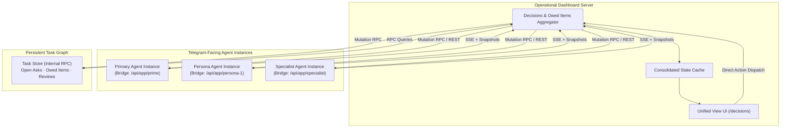

# Telegram Mini App Dashboard Integration

This specification defines the architecture, protocol contract, and operational behaviour for hosting the conversational agent's mobile Mini App within the central operational dashboard domain. It serves operators seeking unified cognitive orientation, real-time session tracking, and bi-directional interaction across mobile and desktop environments.

## User stories

### US-1 Unified Dashboard Serving and Perimeter Access

As an operator, I want to access the agent's cognitive anchor, interactive cards, and session controls directly through the operational dashboard domain, so that I can supervise and guide active work without maintaining separate tunnel configurations.

- **AC-1.1** Given an authenticated dashboard session, when the operator navigates to the agent control interface, then the application renders the cognitive anchor, context usage, and recent turns without prompting for secondary credentials.
- **AC-1.2** Given an operator opening the Mini App within a native Telegram client, when the application initialises, then the backend validates the signed Telegram authentication payload and grants access to the dedicated responsive interface.
- **AC-1.3** Given an unauthenticated HTTP request lacking both valid dashboard perimeter credentials and valid Telegram authentication data, when accessing any protected endpoint, then the server rejects the request with HTTP 401 Unauthorized.
- **AC-1.4** Given a request carrying a `Cf-Access-Jwt-Assertion` header, when the assertion is forged, malformed, expired, missing or mismatched issuer, or issued for an unauthorized email, then the server rejects the request with HTTP 401 Unauthorized across all authenticated routes.

### US-2 Dynamic Real-Time State Population

As an operator observing session execution, I want the interface state to update reactively as the agent works, so that cognitive focus, token consumption, and pending decisions reflect live runtime state.

- **AC-2.1** Given an active agent session, when the agent updates its cognitive focus, task bindings, or context token counts, then connected dashboard clients receive and render the updated state within 500 milliseconds without page reloading.
- **AC-2.2** Given a newly posted question or tool permission request, when the agent emits the request, then the interface dynamically displays the corresponding interactive card with selection options.
- **AC-2.3** Given an unexpected connection interruption, when the client reconnects to the event stream, then the client automatically requests a full state snapshot to reconcile missed updates.
- **AC-2.4** Given a pending artifact or pull request review assigned to the operator, when the operator inspects reviews in the interface, then the application displays the change diff with approve and request-changes actions.
- **AC-2.5** Given a question with fuller background (`detail`), when rendered in the Mini App, then the question displays a details button that opens the fuller background.
- **AC-2.6** Given a question asked as Mini-App-only (`mini_app_only: true` or `chat: false`), when emitted by the agent, then the question appears in the Mini App without posting a card to Telegram chat.

### US-3 Bi-directional Agent Channel

As an operator directing the agent, I want a direct communication channel through the dashboard, so that I can send prompts, answer structured questions, and approve tool permissions.

- **AC-3.1** Given a pending tool permission request displayed in the dashboard, when the operator submits an allow or deny decision, then the agent receives the decision immediately and unblocks execution.
- **AC-3.2** Given a pending question card in the interface, when the operator selects options or inputs custom text and submits, then the agent receives the structured answer and the question card transitions to resolved.
- **AC-3.3** Given an active session, when the operator dispatches a prompt or directive through the dashboard interface, then the agent receives the turn as an inbound notification and acknowledges receipt.
- **AC-3.4** Given a question or permission resolved via the dashboard interface, when the resolution completes, then the corresponding Telegram chat card updates to show the resolved outcome.
- **AC-3.5** Given an active session, when the operator dispatches a halt directive, then the agent immediately suspends execution and returns a status summary.

### US-4 Automatic Question Lifecycle and Dismissal

As an operator, once a question I was asked has been answered, by any channel, it leaves my outstanding questions without my doing anything.

- **AC-4.1** Given a pending question in the Mini App's outstanding list, when the question is answered or resolved in the asking session, then the agent resolves or closes the question and it leaves the outstanding list without manual intervention.
- **AC-4.2** Given a pending question in the Mini App's outstanding list, when the question is answered outside the Mini App and outside the asking session (such as via a plain Telegram reply to the question card), then the question transitions to answered and leaves the outstanding list without manual intervention.
- **AC-4.3** Given a posted question that has not been answered in any channel, when viewing the outstanding questions list, then the question remains listed and pending.

### US-5 Retirement of Standalone Hosting and Infrastructure Consolidation

As an operator, I want all agent interface surfaces hosted and routed exclusively by the operational dashboard domain, so that the agent runtime is decoupled from static web serving, separate tunnel lifecycles, and redundant network ingress points.

- **AC-5.1** Given the retirement of standalone Mini App hosting, when an operator accesses the agent interface via Telegram WebApp or browser, then the operational dashboard handles all static asset delivery and client-side routing.
- **AC-5.2** Given the agent runtime service configuration, when the standalone web server is decommissioned, then the agent process binds only internal communication interfaces for state synchronization and exposes no public-facing static web endpoints.
- **AC-5.3** Given the consolidated hosting architecture, when external ingress routing is configured, then external traffic routes exclusively to the central dashboard ingress, eliminating dedicated agent WebApp tunnels.
- **AC-5.4** Given the migration of standalone surfaces to the dashboard, when the standalone Mini App web server is terminated, then all interactive capabilities (questions, details, reviews, cognitive anchor) continue operating through the dashboard service with zero regression in state synchronization.

### US-6 Unified Operational Event Ingestion and Session Waking

As an autonomous framework supervisor, I want the operational dashboard daemon to ingest asynchronous infrastructure events (`polecat_events` and repository webhooks) and wake agent sessions across its HTTP/SSE channel bridge, so that task completions, pull request updates, and repository events trigger immediate supervision and reconciliation passes without client polling loops or ad-hoc host socket relays.

- **AC-6.1** Given completed worker containers recorded in `polecat_events`, when unacknowledged completion events are present, then the daemon consumes the events, dispatches a wake notification to the active supervisor session over the bridge, and marks the events acknowledged.
- **AC-6.2** Given an inbound repository webhook (such as PR review comments, CI status completion, or PR merges), when received by the dashboard daemon's webhook ingress, then the daemon translates the event into a structured session event and wakes the target agent session.
- **AC-6.3** Given an active agent session connected over the HTTP/SSE bridge, when an operational event is dispatched, then the bridge delivers the structured notification to the session within the configured debounce window.

### US-7 Unified Pending Decisions and Owed Items View

As an operator managing multiple concurrent agent streams and background tasks, I want a single unified dashboard view that aggregates all pending decisions, permissions, reviews, and items owed back to me across every agent instance and the task graph, so that no request or directive I issued is lost or forgotten.

- **AC-7.1** Given multiple active Telegram-facing agent instances and the central task graph, when the operator accesses the unified decisions view, then the interface displays pending items gathered from all sources: structured questions, tool permissions, and artifact reviews from every agent instance bridge, alongside active open asks and items waiting on operator feedback from the task graph.
- **AC-7.2** Given an item displayed in the unified view, when rendered, then the card displays its originating agent instance or project, classification (decision, permission, review, or owed ask), summary text, recommendation or preview diff where applicable, elapsed waiting time, and contextual action controls.
- **AC-7.3** Given an open ask or pending decision in the unified view, when an agent session disconnects, restarts, or crashes, then the item remains persisted in the view and cannot be removed without an explicit, recorded resolution event.
- **AC-7.4** Given an active item in the unified view, when the item is answered, permitted/denied, reviewed, or when its underlying task transitions to a terminal state (`done` or `cancelled`) with recorded evidence, then the item transitions out of the pending view; if closed without resolution, an audited reason must be recorded.
- **AC-7.5** Given a pending decision, permission request, or review in the unified view, when the operator acts directly within the dashboard interface, then the resolution is dispatched to the originating agent bridge and updates the corresponding source state across connected channels.

## Design

### 1. Unified Serving and Perimeter Authentication (US-1)

#### 1.1 Context and Problem

The agent interface must serve two client topologies: (a) standalone mobile access embedded as a Telegram WebApp inside a mobile messenger, and (b) integrated desktop access embedded within the operator's central dashboard application. The hosting layer must securely identify the operator across both surfaces while preserving single-tap mobile launching.

#### 1.2 Architectural Options

- **Option 1.1 (Telegram-Only Authentication):** Require Telegram WebApp signature validation on every request. Direct desktop browser access to the dashboard requires launching via Telegram desktop or passing synthetic Telegram parameters.
- **Option 1.2 (Perimeter-Only Authentication):** Place the entire application behind dashboard perimeter identity (such as Cloudflare Access with OAuth). All requests must satisfy perimeter identity headers.
- **Option 1.3 (Dual-Mode Perimeter Authentication -- Recommended):** Employ perimeter identity as the primary gate for direct web visits, combined with an authenticated bypass and validation bridge for signed Telegram WebApp launches.
  - _Recommendation Rationale:_ Mobile WebViews in chat clients struggle with third-party OAuth redirect loops and external identity providers, whereas desktop operators already hold active dashboard sessions. Dual-mode authentication guarantees friction-free access on both devices while strictly enforcing cryptographic identity checks on every request.

#### 1.3 Recommended Serving and Authentication Contract

1. **Perimeter Ingress and Bridge Transport:**
   - The primary dashboard ingress terminates at the central web application.
   - Standalone client routes are published under `/app/*` (static bundle and responsive standalone shell) and API endpoints under `/api/app/*`.
   - Desktop operators access the embedded view under the primary dashboard layout at `/agent`.
   - **Bridge Transport:** The agent process hosts the internal HTTP/1.1 and SSE channel bridge on a private loopback interface or internal service mesh, proxied by the dashboard service layer or accessed directly over private network mesh.
2. **Authentication Flow:**
   - **Mode A (Telegram Launch):** The client transmits the cryptographic initialization payload via `POST /api/app/auth`. The server verifies the cryptographic hash against the bot secret token using HMAC-SHA256, validates timestamp freshness (maximum age: 3600 seconds), and checks user identity against the authorized operator list. On success, the server issues an HTTP-only, secure, strict SameSite session cookie (`ida_session`) with a 1-hour expiry.
   - **Mode B (Dashboard Perimeter and Service Bridge):** For requests arriving from the dashboard domain or internal services:
     - The bridge accepts bearer credentials in the `Authorization: Bearer <token>` or `X-Bridge-Token: <token>` header, verified against the shared bridge secret (`IDA_BRIDGE_TOKEN`) or valid session secret.
     - Alternatively, the server verifies the perimeter identity assertion header (`Cf-Access-Jwt-Assertion`). The server validates the assertion cryptographically using Cloudflare Access public keys / JWKS (RS256), checking `iss` (matching the configured team domain), `aud` (matching the configured application AUD tag), temporal validity (`exp` and `nbf`), and ensures the `email` claim matches an authorized operator. Mere presence of the header without successful cryptographic and claim verification never grants access.
   - **Rejection:** Any request to protected endpoints (`/api/app/*`) lacking a valid session cookie, valid bridge token, or verified perimeter assertion (including forged, malformed, expired, or missing/mismatched issuer assertions) receives HTTP 401 Unauthorized (`{"error": "Unauthorized"}`).

### 2. Dynamic State Population (US-2)

#### 2.1 Context and Problem

The agent's state encompasses multiple components:

- _Cognitive Anchor:_ Current focus summary, active task identifier, waiting-on items, subagent delegations, and token gauge metrics (used tokens, total tokens, percentage).
- _Pending Decisions:_ Interactive multi-choice questions awaiting operator selection.
- _Tool Permissions:_ Pending tool invocations requiring human authorization.
- _Turn History:_ Recent inbound and outbound interaction turns.
- _Artifact Reviews:_ Pending pull request diffs and reviews.

The dashboard host runs on a dedicated service host, while the active agent session executes in an execution runtime. State must synchronize dynamically without manual browser polling.

#### 2.2 Architectural Options

- **Option 2.1 (Periodic Client Polling):** The client polls `GET /api/app/anchor` and `GET /api/app/questions` at fixed intervals (e.g. every 2 seconds).
  - _Trade-off:_ High query churn, unnecessary network overhead, and unacceptable latency (up to 2 seconds) for interactive permission prompts.
- **Option 2.2 (Shared Database Polling):** Centralise state in a shared database accessed by both the agent runtime and the dashboard.
  - _Trade-off:_ Introduces schema coupling and database maintenance overhead for transient interactive promises (such as in-flight permission requests).
- **Option 2.3 (Server-Sent Events with REST Snapshot Hydration -- Recommended):** Use REST endpoints for initial state hydration and on-demand lookups, supplemented by a real-time Server-Sent Events (SSE) stream (`GET /api/app/events`) for instant push updates.
  - _Recommendation Rationale:_ SSE provides unidirectional, lightweight HTTP streaming compatible with standard reverse proxies, corporate tunnels, and mobile WebViews without WebSocket upgrade complexity. State updates propagate in sub-second time.

#### 2.3 Recommended Dynamic Data Contract

1. **Monotonic Sequence Numbering:**
   - The channel bridge maintains a strictly increasing monotonic sequence counter (`seq: number`, starting at 1).
   - Every state mutation increments `seq` (anchor update, question posted or resolved, permission requested, resolved, or expired, and turn recorded).
2. **Initial Hydration Snapshots:**
   - `GET /api/app/anchor`: Returns the current anchor snapshot, token gauge, pending questions summary, recent turns, and current `seq`.
   - `GET /api/app/questions`: Returns the active list of unresolved questions and current `seq`.
   - `GET /api/app/review`: Returns pending permission requests, PR diff reviews, and current `seq`. Each permission item carries `status: "pending" | "expired"`.
3. **Reactive Event Stream (`GET /api/app/events`):**
   - The server maintains a persistent `text/event-stream` connection to authenticated clients.
   - Each event frame includes standard SSE id and event fields, with `seq` in the payload:
     ```
     id: <seq>
     event: <eventType>
     data: {"seq": <seq>, ...payload}
     ```
   - Event types emitted:
     - `anchor`: Payload contains updated cognitive anchor, token metrics, and `seq`.
     - `question_posted`: Payload contains newly issued question card and `seq`.
     - `question_resolved`: Payload contains question identifier, chosen answer, and `seq`.
     - `permission_requested`: Payload contains permission request identifier, tool name, input preview, and `seq`.
     - `permission_resolved`: Payload contains permission identifier, outcome (`allow` | `deny` | `expired`), decision, and `seq`.
     - `turn_recorded`: Payload contains direction (`in` | `out`), text summary, timestamp, and `seq`.
4. **Resilience and Invariants:**
   - The SSE stream includes keep-alive heartbeat comments (`: keepalive\n\n`) every 15 seconds.
   - When a client disconnects and reconnects, it supplies `Last-Event-ID: <seq>` or query parameter `?since=<seq>`. The bridge replays buffered events with `seq > sinceSeq` or the client fetches a fresh state snapshot via `GET /api/app/anchor` to guarantee convergence.
   - **Expired Permissions:** If a tool permission request exceeds its timeout (default: 300 seconds / 5 minutes) or is cut by an agent session restart, the bridge transitions its status to `"expired"`, unblocks the tool call with denial, broadcasts `event: "permission_resolved"` with `outcome: "expired"`, and edits any associated Telegram card to show `*Expired ⏱️*` with buttons disabled.

### 3. Bi-directional Operator Communication Channel (US-3)

#### 3.1 Context and Problem

The operator must be able to interact with the active agent directly from the dashboard: providing feedback, answering multiple-choice questions, deciding on tool executions, sending freeform steering instructions, or triggering an emergency stop.

#### 3.2 Architectural Options

- **Option 3.1 (Telegram Webhook Proxying):** The dashboard forwards operator inputs to the Telegram Bot API as simulated chat messages.
  - _Trade-off:_ Dependent on external third-party API availability, adds latency, and forces web-specific interactions through Telegram message constraints.
- **Option 3.2 (Direct Agent Channel Bridge -- Recommended):** The dashboard server forwards operator inputs directly to the agent's channel bridge via authenticated HTTP endpoints, dispatching channel notifications into the agent session.
  - _Recommendation Rationale:_ Decouples dashboard communication from external chat networks, provides sub-100ms response delivery, and maintains local custody of operator commands.

#### 3.3 Recommended Communication Protocol

1. **Freeform Direct Messaging (`POST /api/app/message`):**
   - Request: `{ "text": string, "priority"?: "normal" | "high", "chat_id"?: number, "message_id"?: number }`
   - The channel bridge delivers the text as an inbound channel notification directly into the agent session context, records the turn in history, and increments `seq`.
   - If `chat_id` and `message_id` are provided (or if an active chat card exists in store), the bridge edits the Telegram card in place to reflect the directive.
   - Response: `{ "success": true, "message_id": string, "seq": number }`
2. **Structured Question Posting and Resolution (`ask_user` and `POST /api/app/questions/answer`):**
   - Question Posting (`ask_user`):
     - The agent posts structured decisions with options, recommendation, context, and optional fuller background (`detail`).
     - When `mini_app_only: true` or `chat: false` is set (globally or on a question), the question is saved in runtime and rendered in the Mini App, but no card is sent to Telegram chat.
     - When `detail` is provided, the Mini App displays a `🔍 Details` button on the question card that opens its fuller background. If the question also posts to chat, the chat card includes an inline `🔍 Details` button linking directly to the Mini App details view.
   - Question Resolution (`POST /api/app/questions/answer`):
     - Request: `{ "question_id": string, "option_index"?: number, "option_indices"?: number[], "custom_text"?: string }` (aliases: `questionId`, `optionIndex`, `optionIndices`, `customText`)
     - The server marks the question resolved in runtime, emits a channel event (`question_answered`) to the agent, broadcasts `question_resolved` over SSE, and triggers an in-place edit on any associated Telegram card to display the selected choice with buttons removed (`inline_keyboard: []`).
     - Response: `{ "success": true, "resolved_at": string, "seq": number }`
3. **Tool Permission Resolution (`POST /api/app/review/permission`):**
   - Request: `{ "permission_id": string, "decision": "allow" | "deny" }` (alias: `permId`)
   - The server resolves the pending permission promise, unblocking tool execution in the agent runtime, and broadcasts `permission_resolved` over SSE.
   - Associated Telegram chat cards update immediately with status "Allowed via Dashboard ✅" or "Denied via Dashboard ❌" (or "Allowed via Mini App ✅" / "Denied via Mini App ❌") and clear buttons (`inline_keyboard: []`).
   - Response: `{ "success": true, "decision": "allow" | "deny", "seq": number }`
4. **Session Intervention (`POST /api/app/stop`):**
   - Request: `{ "reason"?: string, "chat_id"?: number, "message_id"?: number }`
   - The server emits a high-priority interrupt notification (`stop_requested`) into the agent session instructing the agent to halt current work and provide a summary report.
   - Associated Telegram cards update in place to show `*Halted via Dashboard 🛑*` and disable buttons (`inline_keyboard: []`).
   - Response: `{ "success": true, "status": "stop_dispatched", "seq": number }`

### 4. Cross-Channel State Synchronization Invariants (US-4)

1. **Single Source of Truth:**
   - The running agent session runtime and local persistent stores (pending questions store, tool permissions store, and cognitive anchor store) maintain the authoritative state of active tasks, anchors, questions, and permission requests.
   - Late button taps or callbacks from Telegram for an item already resolved or expired in runtime are rejected gracefully via `answerCallbackQuery` and do not alter runtime state.
2. **Mutual Invalidation:**
   - An action completed on one surface immediately updates all connected surfaces.
   - Answering a question in Telegram chat broadcasts `question_resolved` to all dashboard SSE subscribers and removes the pending prompt.
   - Conversely, resolving a question or tool permission in the dashboard immediately edits the Telegram chat card to disable inline buttons (`inline_keyboard: []`) and display the chosen resolution.
3. **Zero Orphaned Permissions:**
   - Tool permissions have a default lifespan of 300 seconds (5 minutes). If a request times out, it transitions automatically to `status: "expired"`, denies execution to prevent dangling tools, and emits `permission_resolved` with `outcome: "expired"`.
   - If the agent service restarts while permissions remain unfulfilled, the bridge startup pass sweeps lingering pending records, transitions them to `"expired"`, and edits their Telegram cards in place to show `*Expired ⏱️*` with buttons disabled.
4. **Autonomous Question Dismissal Across Channels:**
   - When a question is answered on any channel -- directly within the asking agent session (via session tool resolution), via a plain Telegram reply to the question card or prompt message, or inside the Mini App -- the question broker transitions the question status from pending to answered or closed.
   - The question is immediately excluded from `GET /api/app/questions` and leaves the Mini App outstanding questions list without requiring the operator to manually dismiss it.
   - Any question that has not been answered across any channel persists in the store and remains listed as pending.

### 5. Retirement of Standalone Hosting and Infrastructure Consolidation (US-5)

#### 5.1 Context and Problem

The conversational agent plugin previously bundled an internal HTTP server and dedicated ingress tunnel process to host and publish the Mini App externally. This dual-stack architecture introduced operational overhead, duplicate ingress attack surfaces, and tunnel lifecycle synchronization failures.

#### 5.2 Architectural Options

- **Option 5.1 (Co-existence):** Maintain both the standalone agent web server and the dashboard deployment concurrently.
  - _Trade-off:_ Redundant runtime resource usage, split ingress endpoints, and persistent configuration drift between standalone and dashboard interfaces.
- **Option 5.2 (Complete Hosting Retirement -- Recommended):** Decommission the standalone static web hosting server and dedicated ingress tunnel in the agent runtime entirely. Consolidate all user-facing interface serving into the central operational dashboard application, while restricting the agent process to an internal state and event bridge.
  - _Recommendation Rationale:_ Eliminates dedicated tunnel failures, unifies perimeter authentication and observability at the dashboard gateway, and simplifies the agent runtime footprint.

#### 5.3 Target Architecture and Migration Contract

1. **Component and Serving Boundary:**
   - The central operational dashboard application assumes exclusive responsibility for delivering static interface assets, responsive layouts, and client-side routing for both desktop browsers and Telegram mobile WebViews.
   - The standalone static file server in the agent plugin is decommissioned and retired.
2. **Ingress and Network Boundary:**
   - External ingress tunnels and reverse proxy endpoints terminate solely at the operational dashboard gateway.
   - Dedicated external tunnels for the agent process are retired.
   - The agent runtime binds only internal network interfaces or local IPC for communication with the dashboard service proxy, eliminating direct external exposure.
3. **Client Continuity and Backward Compatibility:**
   - Telegram Bot configuration updates the Mini App launch URL to route to the operational dashboard domain (`/app/*`), ensuring single-tap mobile access functions seamlessly without disruption.
   - All interactive capabilities (cognitive anchor inspection, question answering with details expansion, tool permission authorization, and emergency stopping) operate identically through the dashboard serving layer.

### 6. Unified Operational Event Ingestion and Session Waking (US-6)

#### 6.1 Context and Problem

Background worker containers operate headless and asynchronously. Distributed task completion and external repository activity (such as pull request reviews, CI check completions, and branch merges) must wake active supervisor sessions promptly without relying on client polling loops or host-specific socket daemons.

#### 6.2 Event Ingestion and Delivery Architecture

The operational dashboard daemon centralises operational event ingestion across worker container exits and repository webhooks, acting as the singular session bridge:

1. **Worker Completion Event Ingestion:**
   - The daemon continuously monitors the unacknowledged queue of worker completion events emitted by the container runtime exit listener.
   - Completions are debounced over a short window (10–60 seconds) to coalesce concurrent container exits into a single supervisory notification turn.
   - Each notification carries the task identifier, container reference, exit code, terminal task status, and execution duration.
   - Upon confirmed delivery to the session bridge, the daemon marks the processed events acknowledged in the queue.
2. **Repository Webhook Ingestion:**
   - The dashboard daemon hosts an authenticated webhook ingress endpoint protected by cryptographic signature verification.
   - The ingress accepts repository lifecycle events, including pull request mutations, review submissions, and automated check completions.
   - Inbound webhook events matching active supervisory contexts are translated into structured operational notifications.
3. **Session Waking and Turn Dispatch:**
   - Operational notifications are delivered to the active supervisor session over the authenticated HTTP channel bridge as high-priority inbound turns.
   - Receipt of a notification induces an immediate reactive execution turn in the supervisor session to evaluate returned evidence, perform verification, and advance dependent workflows.
4. **Offline Session Persistence Invariant:**
   - When no active supervisor session is connected to the channel bridge, unacknowledged events remain persisted in the event queue without expiration or loss.
   - Upon supervisor session connection or bridge re-attachment, the daemon flushes all unacknowledged events as a consolidated batch snapshot, waking the session to reconcile accumulated state.

### 7. Unified Pending Decisions and Owed Items View (US-7)

#### 7.1 Context and Problem

In multi-agent operations, multiple agent instances execute concurrently across distinct bots, personas, and work streams. Operators interact asynchronously through multiple Telegram channels, mobile Mini Apps, and desktop dashboard sessions. Without a unified aggregation surface, pending decisions and delegated deliverables risk fragmentation:

- Questions and permission requests issued by different agent instances remain siloed within each instance's individual Mini App route.
- Asks directed to background workers and task graph epics lack a unified tracker showing what is currently owed back to the operator.
- Stalled tasks or interrupted sessions risk dropping threads silently if not continuously tracked against a persistent baseline.

The operational dashboard requires a unified aggregation view--spanning all agent Mini App instances and the persistent task graph--that ensures every pending decision and owed item is visible in one place and cannot silently disappear.

#### 7.2 Aggregation Architecture and Federated Sources

The dashboard backend aggregates items across two primary substrate tiers:

1. **Multi-Instance Agent Bridge Federation:**
   - The dashboard daemon maintains connections to all configured agent instances (e.g. primary coordinator and specialized persona routes) via their local HTTP/SSE state bridges (`/api/app/<instance>/*`).
   - For each connected instance, the daemon subscribes to state snapshots and real-time SSE event streams:
     - `GET /api/app/<instance>/questions` for pending structured decision cards (`ask_user`).
     - `GET /api/app/<instance>/review` for pending tool permission requests and artifact reviews.
     - Real-time updates via `GET /api/app/<instance>/events` (`question_posted`, `question_resolved`, `permission_requested`, `permission_resolved`).
   - When an instance is temporarily unreachable or offline, its last known pending items are retained with an `offline` indicator; items are never dropped due to transient connection loss.

2. **Persistent Task Graph Ingestion:**
   - The dashboard connects directly to the central task graph service over internal RPC.
   - The aggregator queries:
     - Open asks: Tasks created from operator directives that remain active or in progress (`status: in_progress`, `status: queued`).
     - Awaiting feedback: Tasks flagged as waiting for operator review or guidance (`status: review`, `status: inbox`, or tagged `waiting_on: operator`).
     - Owed deliverables: Descendant tasks serving active operator goals whose deliverables have not yet been accepted.



#### 7.3 Item Representation and Information Architecture

Each item rendered in the unified view carries standardized visual and metadata attributes:

| Field | Source Type | Content & Visual Presentation |
| - | - | - |
| **Origin & Channel** | All | Badges showing originating agent instance (e.g. `Primary`, `Persona A`), project name, and originating Telegram topic or thread. |
| **Classification** | All | Explicit category chip: `Decision` (question card), `Permission` (tool authorization), `Review` (artifact/diff), or `Owed Item` (task deliverable). |
| **Summary & Prompt** | All | The core question text, shell script command preview, pull request title, or task objective. |
| **Context & Drill-down** | Decisions / Reviews / Owed | Primary recommendation highlighted first for decisions; expandable `>!` collapsible quotes or details modal for fuller background; unified diff viewer for code/permission reviews; task parent chain for owed items. |
| **Freshness & Urgency** | All | Relative elapsed time since creation (e.g. `2h ago`), urgency indicator (P0–P4), and stalled warning markers for inactive work streams (>24h without progress). |
| **Resolution Actions** | All | In-place interactive controls: vertical option buttons for decisions, `Allow`/`Deny` for permissions, `Approve`/`Request Changes` for reviews, and status update / claim controls for task items. |

#### 7.4 Guaranteed Retention and Item Exit Lifecycle

To enforce the invariant that no open ask or decision is silently dropped:

1. **Non-Vanishing Invariant:**
   - Items enter the pending state upon creation in an agent bridge or task graph.
   - An item **never** vanishes due to:
     - Client page reloads or local cache clearance.
     - Agent session terminations, restarts, or crashes.
     - Bridge network timeouts or transient communication failures.
     - Idle expiration (except tool permissions which transition to an explicit `expired` status with audit trail).
2. **Explicit Exit Criteria:**
   - An item transitions out of the active view **only** through one of the following documented events:
     - **Decision / Question:** Operator submits a valid choice (via unified view, Mini App, or Telegram card) resulting in `question_resolved`, or an agent explicitly closes the question via `close_question` with a mandatory recorded reason (`answered elsewhere`, `no longer needed`, `superseded`).
     - **Tool Permission:** Operator clicks `Allow` or `Deny` via `POST /api/app/<instance>/review/permission`, or permission timeout triggers transition to `expired` with denial.
     - **Artifact Review:** Operator submits approval/feedback, or the underlying pull request / branch is merged or closed.
     - **Owed Item / Open Ask:** The task graph transitions the item to `status: done` accompanied by verifiable completion evidence, or to `status: cancelled` with an explicit cancellation rationale.
3. **Dropped Thread Escalation:**
   - If an open ask or delegated task ceases activity without transitioning to a terminal state, the view does not expire or hide the item; instead, it visually tags the item as a "Dropped Thread" requiring operator or supervisory triage.

#### 7.5 Verification and Criteria Mapping

Every acceptance criterion defined in US-7 maps directly to an observable verification check:

| Criterion | Target Requirement | Verification Check & Observable Proof |
| - | - | - |
| **AC-7.1** | Federated Source Ingestion | Given two running agent bridges with active questions/permissions and the task graph with an open ask, `GET /api/dashboard/owed` returns an aggregated array containing items from all three distinct sources with their respective source identifiers. |
| **AC-7.2** | Item Representation and Context | Given rendered items in the UI, inspection of the DOM and API payload verifies that every item contains `origin`, `classification`, `summary`, `timestamp`, and appropriate action payloads (e.g. option list for decisions, diff preview for reviews). |
| **AC-7.3** | Non-Vanishing Invariant | Given active pending items in the dashboard view, simulate an agent process kill (`SIGKILL`) or container restart; verify that upon bridge reconnect, all pending items remain intact in the view without loss or eviction. |
| **AC-7.4** | Explicit Exit and Lifecycle Transitions | Given an active question and task item, verify they remain visible until: (a) calling `POST /api/app/<instance>/questions/answer` removes the question from the active view, and (b) updating the task to `status: done` with completion summary removes the task item. Unresolved deletion requests lacking terminal status or reasons are rejected. |
| **AC-7.5** | Direct In-View Resolution | Given a decision card in the unified dashboard view, submitting an option selection via `POST /api/dashboard/resolve` dispatches the resolution to the originating agent's bridge (`/api/app/<instance>/questions/answer`), verifies that the agent session receives the answer event, and confirms that connected Telegram cards update. |
