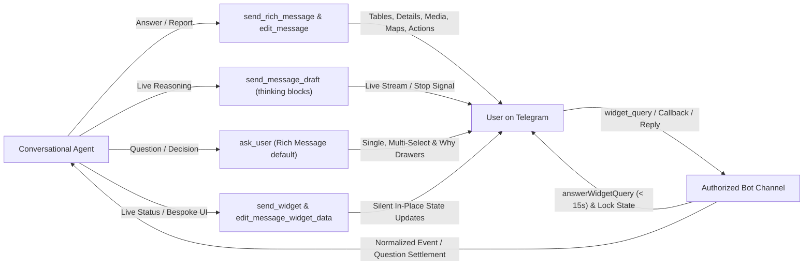

# Telegram Rich Messages and HTML Widgets

This specification defines native Telegram Bot API 10.1–10.4 Rich Message and HTML Widget interfaces across conversational message kinds (answers, reports, decisions, questions, live progress, and streaming drafts), extending the core transport specified in [`specs/telegram/shared-telegram-channel.md`](shared-telegram-channel.md) and [`specs/telegram/question-delivery.md`](question-delivery.md).

## User experience flow

## Capabilities and user stories

### US-1 Structured Answers, Reports, and Live Drafts via Rich Messages

As a user reading complex answers or reports on a phone, I want responses delivered with structured headings, native tables, math expressions, inline charts and maps, collapsible supporting details, and streaming thinking previews, so that the bottom line stands out immediately without long text walls or chunked split messages.

- **AC-1.1 (Rich Message Delivery & Bounds):** Given mutually exclusive `markdown`, `html`, or `blocks` content (`<= 32,768` UTF-8 bytes/chars and `<= 500` blocks) plus up to `50` `media` attachments (with `id` matching `^[A-Za-z0-9_-]{1,64}$`), when `send_rich_message` executes, then local files upload via `multipart/form-data` (`attach://...`) while `file_id`/HTTPS references pass inline, resolving thread routing, `quote_rich_texts`, optional `feedback_buttons` (`👍`/`👎`), and `reply_markup` / `<tg-button-row>` actions cleanly; empty, conflicting, or oversized payloads fail fast before network calls.
- **AC-1.2 (Voice Mirror & Non-Destructive Callback Edits):** Given a Rich Message sent when inbound voice mirroring or `voice: true` applies, the channel synthesizes spoken audio from summary text alongside the Rich Message; given an inline callback tap (action or feedback button) on a Rich Message lacking plain `text`, the channel updates `reply_markup` via `editMessageReplyMarkup` and reads excerpts from `rich_message` without wiping rich formatting.
- **AC-1.3 (Private-Chat Streaming Rich Drafts):** Given a private chat (`chat_id > 0`) and `draft_id` plus one of `text`, `markdown`, `html`, or `blocks` (supporting `<tg-thinking>` and optional `can_stop` / `keep_on_stop`), `send_message_draft` streams live drafts via `sendRichMessageDraft`, rejecting unsupported file/URL media on drafts locally and delivering authorized `stopped_message_generation` user interrupts to the runtime.

### US-2 Unified HTML Widget Questions and Decisions

As a user making choices or answering multi-part prompts from my phone, I want calm, height-safe interactive cards inside the chat bubble with optional rationale, recommendation highlights, and non-pushy `Defer` and `Other` exits that lock visibly in place when resolved, so I can act quickly without button truncation or notification clutter.

- **AC-2.1 (Rich Message Default, Explicit Widget, & Decision Metadata):** Given `ask_user` invoked without `presentation`, the channel sends a Rich Message card (`sendRichMessage`) backed by the persistent question broker (`q:<qid>:`), supporting single-select, multi-select, optional `kind: "decision"` metadata (`stakes`, `recommended`, `pros`/`cons` expandable drawers, `allowDefer`, `allowOther` defaulting `true`). When `presentation: "widget"` is explicitly requested, the channel sends a Profile-1 HTML Widget (`sendWidget`) with client-side multi-select bitmasks (`q:<qid>:m:<base36>`), mobile viewport pagination above 2–3 options (`<= 560px` height), and a concise 1-line notification `caption`; if `sendWidget` fails, the channel fails fast verbatim with Telegram's error without silent downgrade.
- **AC-2.2 (State Lock within Timeout & Cross-Surface Synchronization):** Given an authorized user taps a brokered widget choice (`q:<qid>:opt:<i>`, `q:<qid>:m:<mask>`, `q:<qid>:defer`, or `q:<qid>:other`), submits via the Mini App dashboard, or settles by chat reply, then the channel acknowledges `answerWidgetQuery` within Telegram's `15s` window, updates the widget silently in place via `editMessageWidgetData` (`chat_data` lock/awaiting state with local 24h `HH:MM` timestamp), and emits the settled question event to the agent.

### US-3 Custom Live HTML Widgets & Pre-Flight Validation

As a user tracking background progress or interacting with live views inside chat, I want status widgets updated silently in place without repetitive messages and invalid payloads rejected immediately before send, so chat history stays crisp and transparent.

- **AC-3.1 (Pre-Flight Widget Validation & In-Place Data Edits):** Given `send_widget`, the channel enforces `0` NUL bytes, `1–32,768` UTF-8 HTML bytes, **`<= 4,096` bytes when compressed via `zlib.deflateSync` level 9**, and `0–1,024` UTF-8 bytes on `public_data`/`chat_data` locally (`allow_queries` defaulting to `false`); `edit_message_widget_data` updates `public_data`/`chat_data` in place, returning `{ success: true, not_modified: true }` on `"message is not modified"`.
- **AC-3.2 (Honest Custom Query Timing & Inline Error Surfacing):** Given an interactive custom `widget_query` update (`allow_queries: true`) not owned by the built-in `q:<qid>:` protocol, the channel emits the query to the agent, which responds via `answer_widget_query` within Telegram's `15s` budget; the channel never runs a silent auto-ack timer masking slow or failed turns, and widgets surface `WidgetRequestError` (`TIMEOUT`, `NOT_ALLOWED`, `RATE_LIMITED`) inline.

## Shared interface contract

| Tool | Bot API Backing | Core Inputs & Validation Bounds | Return Payload |
| :- | :- | :- | :- |
| `send_rich_message` | `sendRichMessage` | Exactly one of `markdown` \| `html` \| `blocks` (`<= 32,768` bytes/chars, `<= 500` blocks); optional `media` (`<= 50`, `id` regex), `is_rtl`, `skip_entity_detection`, `quote_rich_texts`, `voice`, `feedback_buttons`, `buttons`, thread routing. | `{ success: true, message_id, message_thread_id?, voice_message_id?, voice_sent?, voice_error? }` |
| `send_message_draft` | `sendRichMessageDraft` | Non-zero integer `draft_id`; mutually exclusive `markdown` \| `html` \| `blocks`; private-chat rich mode (`can_stop?`, `keep_on_stop?`); rejects `media` on drafts. | `{ success: true, draft_id, message_thread_id? }` |
| `edit_message` | `editMessageText` | `message_id`; mutually exclusive `markdown` \| `html` \| `blocks` (`rich_message`); optional `buttons`. | `{ success: true }` |
| `send_widget` | `sendWidget` | `html` (`1–32,768` bytes, no NUL, `<= 4,096 B` zlib-9), `width?`, `height?`, `public_data?`/`chat_data?` (`<= 1,024 B`), `caption?`, `allow_queries?` (default `false`), routing, `buttons?`. | `{ success: true, message_id, message_thread_id? }` |
| `edit_message_widget_data` | `editMessageWidgetData` | `message_id` (or `inline_message_id`), `public_data?` (`<= 1,024 B`), `chat_data?` (`<= 1,024 B`). | `{ success: true, updated?: true, not_modified?: true }` |
| `answer_widget_query` | `answerWidgetQuery` | `widget_query_id` (required), `data?` (`<= 1,024 B`). | `{ success: true, answered: true }` |
| `ask_user` | `sendRichMessage` / `sendWidget` | Defaults `presentation` to `"rich"` (explicit `"widget"` option); supports `kind` (`"question" \| "decision"`), `stakes`, `allowOther`, `allowDefer`, option `recommended`/`pros`/`cons`. | `{ question_ids, status: "posted", presentation?, message }` |

## Invariants and security boundaries

- **Update polling & sender allowlist:** `getUpdates` includes `"widget_query"` and `"stopped_message_generation"`. `widget_query` drops any update whose `from.id` is outside `allowFrom`; `stopped_message_generation` emits only for authorized chats.
- **Widget Sandbox Profile 1 conformance:** Built-in widgets use `font-family: system-ui, sans-serif`, inline SVG iconography, `--tg-theme-*` + `light-dark()` colors, zero forbidden controls (`<input>`, `<select>`, `<textarea>`, `<progress>`, `<meter>`), zero external network/font URLs, zero scrollbars (`overflow: auto/scroll`), swipe clearance (`padding-left >= 22px`), safe-area bottom/right spacing, and compact CSS/HTML keeping headroom under `4,096 B` zlib-9.
- **Timeout & no-fallback boundaries:** Tool timeouts exempt `send_rich_message` strictly when `media` includes local filesystem paths requiring multipart upload (`120s` HTTP timeout); JSON Bot API calls adhere to the standard `30s` deadline. No silent format downgrade, auto-truncation, or auto-ack masks failures.
