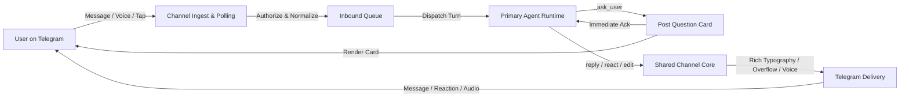

# Shared Telegram channel

The shared Telegram channel provides a unified conversational transport layer between the user on Telegram and the primary conversational agent across both interactive and containerized runtimes. It consolidates update ingestion, sender authorization, rich-text entity formatting, paragraph overflow splitting, voice synthesis, and asynchronous question posting into a single shared engine, ensuring an identical communication contract regardless of host execution topology. Higher-level conversational capabilities, including dashboard web views and operator review cards, operate above this transport layer.

## User stories

### US-1 Multi-turn inbound conversation across runtimes

As a user on Telegram, I want my messages, commands, reply quotes, attachments, and voice notes to reach the agent and continue the active conversation for my chat, so that I can direct work seamlessly whether the agent runs in an interactive session or an isolated container.

- **AC-1.1** Given an authorized user sends a text message, command, attachment, or voice note in a Telegram chat, when the channel polls the update, then the channel places an eyes (`👀`) reaction on the message and delivers a normalized inbound event containing sender identity, chat and message identifiers, any quoted reply text, local attachment paths, and transcribed voice text to the agent runtime.
- **AC-1.2** Given an unauthorized user sends a message or taps a button, when the channel receives the update, then the channel drops the update without invoking the agent or emitting a reply.
- **AC-1.3** Given a chat already has a recorded session identifier, when a subsequent inbound event arrives for that chat, then the channel resumes that existing agent session so prior turn context is preserved across turns and container restarts.
- **AC-1.4** Given a turn is already running for a chat and auto-interrupt is enabled, when the user sends a follow-up free-text message in that chat, then the channel cancels the in-flight turn and starts a new turn combining the interrupted prompt with the follow-up message.

### US-2 Progressive-disclosure replies, reactions, and voice responses

As a user reading on a phone, I want agent replies formatted with scannable typography, expandable detail blocks, paragraph-level overflow protection, emoji reactions, and spoken audio when I spoke to the agent, so that every response is easy to scan without walls of text.

- **AC-2.1** Given the agent invokes the reply, react, or edit tool during a turn, when the channel processes the call, then the channel formats replies with Telegram-compatible rich typography (including expandable blockquotes), splits replies exceeding 1,200 characters at whole-paragraph boundaries with a continuation notice, and delivers the payload to Telegram.
- **AC-2.2** Given the user's most recent inbound turn in a chat was a voice message and speech synthesis is configured, when the agent sends a reply in that chat, then the channel synthesizes spoken audio from the top-level summary text (excluding blockquotes and code blocks) and sends a Telegram voice note alongside the text.

### US-3 Asynchronous interactive questions

As a user asked to make a choice, I want a vertical button card on Telegram supporting single-select, multi-select, and custom text entry, so that I can answer from my phone at my own pace and have my selection resume the conversation in a subsequent turn.

- **AC-3.1** Given an agent invokes the question tool during a turn, when the channel posts the question card to Telegram, then the channel acknowledges the post immediately and the agent turn concludes without blocking on user input.
- **AC-3.2** Given a pending question card in single-select, multi-select, or custom-reply mode, when the authorized user selects an option, confirms a multi-select set, or replies with custom text, then the channel updates the card state on Telegram and delivers the user's choice as a new inbound event to continue the conversation in a subsequent turn.

### US-4 Asynchronous background completion and explicit failure reporting

As a user delegating background work or diagnosing a failed turn, I want completed background work to wake the conversation automatically and any runtime or transport error to surface verbatim, so that delegated results arrive without manual polling and failures are immediately inspectable.

- **AC-4.1** Given a turn finishes while delegated background work is still running, when the background work completes with an undelivered result, then the channel starts a continuation turn on the same conversation so the agent processes the result and replies on Telegram.
- **AC-4.2** Given another consumer is already polling the bot token or the channel encounters a conflict response, when the channel attempts to fetch updates, then the channel halts immediately and surfaces the collision error without retrying.
- **AC-4.3** Given an agent turn exits with a non-zero status, times out, references an invalid session identifier, or encounters a channel communication error, when the failure occurs, then the channel halts the turn immediately and surfaces the verbatim error output and exit status.

## Design

### Channel architecture and interaction lifecycle

The lifecycle separates update ingestion and turn dispatch from tool execution:

1. **Inbound Ingestion:** The channel poller receives Telegram updates, authenticates the sender against authorized identifiers, places an immediate receipt reaction (`👀`), transcribes voice audio or stores attachments, and packages the data into a normalized inbound event.
2. **Turn Dispatch:** Events queue serially per chat. When the channel dispatches an event, it supplies the persisted session identifier to preserve conversational continuity. If a turn is active and auto-interrupt is enabled, the channel cancels the running turn and launches a replacement turn incorporating the new message.
3. **Outbound Execution:** During turn execution, the agent calls transport tools (`reply`, `react`, `ask_user`, `edit_message`). For questions, the channel renders interactive buttons and returns immediately so the turn finishes cleanly. When the user later taps an option, the callback arrives as a new inbound event triggering the next turn.

### Shared channel core and dual transport boundary

The channel core provides identical formatting, overflow handling, question card lifecycle, and voice synthesis across two transport adapters:

1. **In-session channel transport:** In interactive runtime environments where the host process accepts asynchronous event streaming directly, the channel core runs in-process, polls updates, pushes inbound events into the active turn queue, and handles outbound tool calls directly.
2. **Container gateway transport:** In headless container environments where turns run as isolated per-turn invocations, a dedicated gateway process hosts the shared channel core and manages local IPC. For each inbound event, the gateway executes the per-turn process with serialized event parameters and the recorded session identifier. Outbound tool calls connect back to the gateway over a local IPC bridge.

Separating the protocol engine from transport adaptation ensures that parsing, formatting, 1,200-character paragraph splitting, voice synthesis, and question state logic remain implemented once without coupling to specific execution runtimes.

### Outbound tool contracts

Every supported runtime invokes the core tools:

#### `reply`

Sends an agent response to the Telegram chat with rich typography, expandable blockquotes, paragraph overflow splitting, thread routing parameters (`message_thread_id`, `thread_id`), and optional voice notes.

- **Parameters:**
  - `text` (string, required): Response body formatted in Markdown.
  - `chat_id` (integer, optional): Telegram chat identifier; defaults to the chat that initiated the session.
  - `message_thread_id` (integer, optional): Telegram message thread ID (for forum supergroups or topics-enabled chats; defaults to active thread).
  - `thread_id` (integer, optional): Alias for `message_thread_id`.
  - `reply_to` (integer, optional): Message identifier to quote or reply to.
  - `voice` (boolean, optional): When true, generates and sends spoken audio for top-level summary text.
  - `detail` (string, optional): Supplementary Markdown content linked when overflow occurs.
- **Returns:** Object with `message_id` (integer), `message_thread_id` (integer when sent in a thread), and optional `voice_message_id` (integer); or `{ success: false, error: string }` if delivery or thread verification fails.

#### `react`

Sets an emoji reaction on a specific message.

- **Parameters:**
  - `message_id` (integer, required): Message identifier to react to.
  - `reaction` (string, required): Target emoji from the supported reaction set.
  - `chat_id` (integer, optional): Telegram chat identifier.
- **Returns:** Object with `success` (boolean) and `reaction` (string).

#### `ask_user`

Posts a non-blocking interactive question card to Telegram. The tool records the question and returns immediately; the agent turn does not wait for user input.

- **Parameters:**
  - `chat_id` (integer, optional): Destination chat identifier.
  - `message_thread_id`, `thread_id` (integer, optional): Destination forum topic ID.
  - `turn_id` (string, optional): Correlation identifier for the question.
  - `questions` (array of objects, required): One or more question specifications, each containing:
    - `question` (string, required): The prompt text.
    - `header` (string, optional): Short context label.
    - `options` (array of objects, required): Selectable options, each with `label` (string) and optional `description` (string).
    - `multi_select` (boolean, optional): Whether multiple options may be selected.
    - `allow_custom` (boolean, optional): Whether free-text responses are permitted.
- **Returns:** Object with `question_ids` (array of strings) and `status` (`"posted" | "failed"`), plus `success: false` and `error` (string) on card delivery failure.

#### `edit_message`

Modifies the text of a message previously sent by the agent.

- **Parameters:**
  - `message_id` (integer, required): Message identifier to modify.
  - `text` (string, required): Replacement Markdown text.
  - `chat_id` (integer, optional): Telegram chat identifier.
- **Returns:** Object with `success` (boolean).

### State and invariants

- **Single-consumer polling and user channel isolation:** Only a single primary channel or gateway instance polls Telegram updates. Non-primary background worker processes never have access to Telegram tools under any circumstances; direct user communication is reserved exclusively for the primary agent.
- **Session continuity:** The channel persists mappings between chat identifiers and runtime session identifiers across turns and container restarts.
- **Asynchronous question lifecycle:** Pending questions are indexed by question identifier. When an agent posts a question, the turn ends; incoming user choices correlate to the pending question identifier and trigger a fresh continuation turn.
- **Strict failure propagation:** Any process fault, timeout, invalid session identifier, or communication failure halts execution and surfaces raw failure details verbatim, without synthetic fallbacks or silent error retries.
