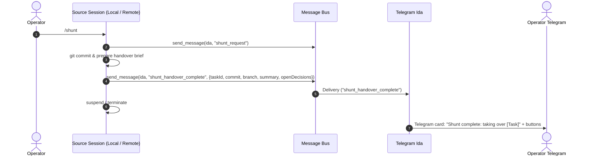
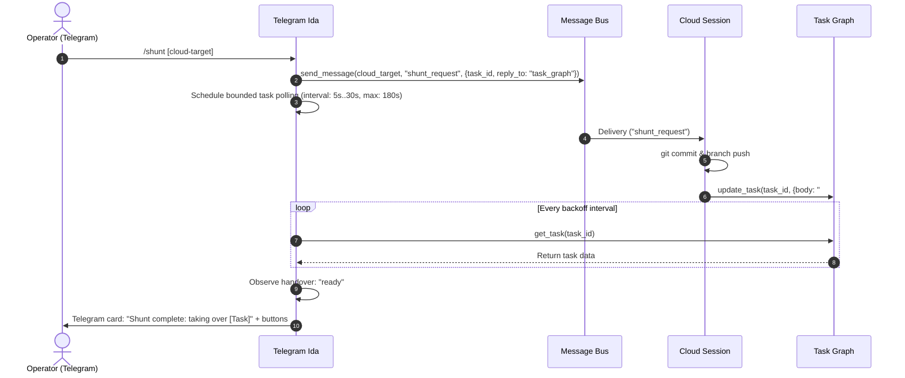

# Telegram Shunt Handover

The `shunt` capability enables an operator to transition an ongoing conversation from any active agent session onto a Telegram-capable agent with a single command. It coordinates across execution environments--local terminal sessions, remote-control bridges, and cloud containers--ensuring conversation continuity, state preservation, and zero message leakage to unauthorized surfaces.

## User stories

### US-1 Single-Command Shunt Trigger

As an operator stepping away from a workstation or switching to mobile, I want to invoke `shunt` from my active session or directly via Telegram, so that an authorized Telegram agent assumes responsibility for the conversation without loss of task context.

- **AC-1.1** Given an active session with an ongoing conversation, when the operator invokes `shunt` (with an explicit target session or defaulting to current context), then a structured shunt directive is dispatched across the cross-session message bus to the target.
- **AC-1.2** Given a Telegram conversation with an authorized agent, when the operator sends `/shunt <target>`, then the Telegram agent dispatches the shunt directive to the specified target session.
- **AC-1.3** Given an invalid or unreachable target session identifier, when `shunt` is invoked, then the invoking session immediately reports a descriptive routing error without modifying local task state.

### US-2 Target Session Adaptation by Environment

As an operator, I want each target environment to adapt its handover behavior to its architectural communication limits, so that sessions never hang attempting unsupported network or bus operations.

- **AC-2.1** Given a local CLI session receiving a shunt directive, when adapting to handover, then the session pauses interactive prompts, persists uncommitted changes to git, writes a handover summary, and either transfers full execution authority or enters a headless relay mode according to configured policy.
- **AC-2.2** Given a remote-control session receiving a shunt directive, when adapting to handover, then the session checkpoints active work, releases operational locks on the task graph, and transfers execution authority to the Telegram agent.
- **AC-2.3** Given a cloud container session receiving a shunt directive, when adapting to handover, then the session acknowledges its one-way bus boundary, commits pending workspace changes, records its handover state directly onto the active task graph, and refrains from attempting outbound cross-session bus sends or external channel calls.

### US-3 Handover Completion & Mobile Notification

As an operator monitoring Telegram on a mobile device, I want the Telegram agent to announce when the handover is complete with a concise overview and actionable decision buttons, so that I can resume directing work immediately.

- **AC-3.1** Given a local or remote-control target completing handover, when the target emits a completion event on the message bus, then the Telegram agent immediately ingests the state and notifies the operator.
- **AC-3.2** Given a cloud target completing handover, when the active task graph reflects the updated handover record, then the Telegram agent detects the state change via bounded task observation and notifies the operator.
- **AC-3.3** Given a successful handover, when the Telegram agent notifies the operator, then the message complies with Telegram progressive disclosure: a headline (~100 words), expandable evidence blockquotes (`>!`) containing git commit/branch and context summaries, and vertical option buttons for any pending decisions.

### US-4 Bounded Wait and Failure Recovery

As an operator, I want the shunt operation to time out gracefully if a target fails to respond, so that sessions do not hang indefinitely and uncompleted handovers are surfaced cleanly.

- **AC-4.1** Given a target session that fails to record handover state or acknowledge within the deadline window (default 180 seconds), when the deadline expires, then the Telegram agent halts observation and delivers a failure notification.
- **AC-4.2** Given a failed or timed-out shunt, when the failure notification is sent, then it includes the target's last known task status, current branch, and actionable steps to recover the session manually.

## Design

### 1. Target Environment Taxonomy & Bus Capabilities

Agent execution surfaces exhibit differing communication and trust boundaries:

| Environment | Host Location | Cross-Session Bus Capability | Filesystem / Git Access | Primary Handover Constraint |
| - | - | - | - | - |
| **Local CLI** | Primary host / container | Full bidirectional messaging (`send_message`, `ListAgents`) | Direct local filesystem and repository | Preserving active process state vs. clean context transfer |
| **Remote-Control** | Remote bridge / gateway | Bidirectional messaging subject to device trust boundaries | Host filesystem via remote bridge | Network disconnects or bridge process restarts |
| **Cloud Container** | Isolated cloud container | Strictly one-way bus: receives inbound messages; outbound sends are rejected; `ListAgents` returns no reachable agents | Ephemeral container filesystem; task graph via API | Zero outbound bus communication; cannot notify via bus |

### 2. Alternatives Analysis & Recommendations per Target Kind

Two core architectural models exist for target behavior upon receiving a shunt directive:

- **Model A: Clean Handover (State Transfer)**: The target session saves working state, commits files, updates the task graph, releases execution authority, and terminates or sleeps. The Telegram agent becomes the primary executor.
- **Model B: Interactive Relaying (Proxy Window)**: The target session remains running in its environment. It routes all user prompts, questions, and status updates through the Telegram agent as a conversational proxy, receiving operator replies back across the bus.

#### A. Local CLI Targets

- **Alternative 1: Clean Handover (Recommended Default)**
  - _Mechanism_: Target commits dirty working tree, writes a structured handover block to the active task, dispatches a `shunt_handover_complete` bus event to the Telegram agent, and exits or suspends its prompt loop.
  - _Trade-offs_: Clean separation of concerns; avoids burning concurrent tokens across two sessions; adheres strictly to the single-voice invariant. Slight loss of transient in-memory model context, mitigated by structured handover briefs.
- **Alternative 2: Interactive Relaying (Optional Flag `--relay`)**
  - _Mechanism_: Target continues running background builds or interactive commands, suppressing local stdout prompts and sending decision requests over the bus to the Telegram agent.
  - _Trade-offs_: Preserves warm runtime context and active child processes; doubles turn latency and token spend; risks orphaned processes if the bus disconnects.
- _Recommendation_: **Clean Handover** as the standard default. Relaying is supported as an opt-in parameter (`--relay`) strictly when a user explicitly requests keeping a long-running execution thread warm.

#### B. Remote-Control Targets

- **Alternative 1: Clean Handover (Recommended Default)**
  - _Mechanism_: Target commits changes, persists task state, emits `shunt_handover_complete`, and disconnects from the remote bridge.
  - _Trade-offs_: Resilient against laptop sleep, network disconnection, or bridge crashes. Ensures persistent graph truth.
- **Alternative 2: Interactive Relaying**
  - _Mechanism_: Target relays turns across the remote bridge and message bus.
  - _Trade-offs_: Fragile over intermittent network connections; high likelihood of dropped turns or unhandled bridge errors.
- _Recommendation_: **Clean Handover**. State persistence on the task graph provides fault isolation against network instability.

#### C. Cloud Container Targets

- **Alternative 1: Task-Mediated Handover (Recommended & Mandatory)**
  - _Mechanism_: Target receives the inbound shunt notification. Recognizing that it cannot send bus messages, it commits all workspace changes to a feature branch, pushes if authenticated, appends a standardized `## Handover` section to the active task, updates task metadata to `handover: ready`, and concludes its turn.
  - _Trade-offs_: Operates strictly within available capabilities; robust and durable. Requires the Telegram agent to detect completion through the task graph rather than a push event.
- **Alternative 2: Interactive Relaying (Infeasible / Rejected)**
  - _Mechanism_: Target relays interactive turns across the bus.
  - _Feasibility_: Infeasible. Cloud sessions cannot emit outbound bus messages (`ListAgents` returns no reachable agents; `send_message` is refused).
- _Recommendation_: **Task-Mediated Handover**. This is the only physically viable approach under current cloud sandbox invariants.

### 3. Handover Completion Protocols

#### A. Local and Remote-Control Protocol (Push Event)



1. The target session packages current state into a JSON payload:
   ```json
   {
     "event": "shunt_handover_complete",
     "source_session_id": "session-string",
     "target_kind": "local",
     "task_id": "task-identifier",
     "branch": "feature/branch-name",
     "git_commit": "sha-hash",
     "summary": "Completed step 2 of 4; awaiting decision on schema.",
     "open_decisions": [
       {
         "question": "Which database engine should be used?",
         "options": ["PostgreSQL (Recommended)", "SQLite"]
       }
     ]
   }
   ```
2. The Telegram agent receives this event reactively on the bus. It assumes ownership of the task, registers open questions with the question broker, and posts an initial card to chat.

#### B. Cloud Target Protocol (Task-Mediated Polling)



1. The cloud session cannot send a bus reply. It writes a structured handover record to the task body:
   ```markdown
   ## Handover

   - **Handover status**: ready
   - **Branch**: feature/branch-name
   - **Commit**: sha-hash
   - **Summary**: Implemented parser; tests pass; ready for verification.
   - **Pending decisions**: None.
   ```
   and patches task metadata with `handover: "ready"`.
2. The Telegram agent monitors the task via periodic checks (5s initial, doubling up to 30s, capped at 180s total). Once `handover: "ready"` is detected, the agent assumes task control and announces the takeover on Telegram.

### 4. Telegram Presentation & Single-Voice Contract

In accordance with Telegram channel invariants, the shunted session never communicates directly with the operator. All outbound user-facing interaction is mediated exclusively by the Telegram agent:

- **Tier 1 (Chat headline)**: `**Shunt complete: resumed <Task Title>**` followed by a concise 2–3 bullet summary of active progress (~100 words total).
- **Tier 2 (Expandable evidence)**: Expandable quote (`>!`) containing the git branch, commit hash, and handover rationale.
- **Tier 3 (Details page)**: Stored Details Markdown containing extended tool logs, test outputs, or background discussion, accessible via the `🔍 Details` Mini App button.
- **Decision Cards**: If the target session left unresolved questions, they are formatted as vertical option buttons with the recommended action first.

## Open questions

The following architectural choices are submitted for determination during strategic review:

1. **Local Session Default Mode**: Should local sessions exclusively perform Clean Handover (exiting/suspending), or should interactive relaying be supported as an automatic fallback when uncommitted interactive sub-processes are detected?
   - _Option A (Recommended)_: Clean Handover only by default; relaying requires explicit `--relay` invocation flag.
   - _Option B_: Automatic heuristic switching: relay if child processes are actively running; otherwise clean handover.
2. **Cloud Task Observation Timeout**: Is 180 seconds with exponential backoff (5s, 10s, 20s, 30s) the appropriate threshold for cloud container handovers, or should it be tighter (e.g. 120s) to minimize mobile operator wait times?
   - _Option A (Recommended)_: 180 seconds to allow slow git commits and remote API updates.
   - _Option B_: 120 seconds with immediate notification if progress is not detected within 60 seconds.
