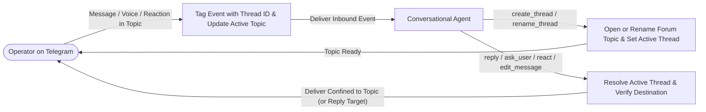

# Telegram Threaded Conversations by Default

This specification defines default message routing, thread confinement, and topic creation and renaming (`create_thread`, `rename_thread`) for Telegram forum topics and message threads. Conversational agents operating in supergroups or private chats with topics enabled receive incoming messages tagged with their thread context, keep all outbound paths (replies, voice notes, question cards, edits, and reactions) confined to the active thread without opt-in flags, and can open or rename topics to organize multi-topic conversations. Broader topic lifecycle management (closing, reopening, deleting, General topic administration) and batch message management are specified in `specs/telegram/topic-and-message-management.md`.

## User experience flow

## Capabilities and user stories

### US-1 Inbound Thread Identity Delivery

As an operator communicating with an agent inside a specific Telegram forum topic or thread, I want messages, bot commands, attachments, voice notes, callback queries, and reactions delivered to the agent with their thread identity, so that conversation history and context remain isolated to that specific topic.

- **AC-1.1** Given a text message, bot command, attachment, voice note, button callback query, or emoji reaction arriving in a Telegram thread (`message_thread_id: 4242`), when the update is processed, then the emitted channel event carries `meta.message_thread_id = "4242"` and `meta.thread_id = "4242"`.

### US-2 Outbound Thread Confinement Without Configuration

As an operator interacting with an agent inside a forum topic, I want every outbound response (reply text, spoken voice note, question card, custom-answer prompt, message edit, and emoji reaction) to remain confined to that topic automatically without requiring configuration flags, so that messages never leak into the General topic or clutter other channels.

- **AC-2.1** Given an active conversation in a Telegram thread, when the agent invokes `reply` (text or `voice: true`), `ask_user`, or when the operator taps `✏️ Other` on a question card without an explicit thread override, then the outbound message, voice note, or prompt is sent with `message_thread_id` matching the active thread.
- **AC-2.2** Given an incoming or existing message in a Telegram thread, when `react` or `edit_message` is invoked, then the reaction or in-place text update applies directly to that message within the thread.

### US-3 Unthreaded Chats Backward Compatibility

As an operator using direct messages (private chats) or regular unthreaded group chats, I want standard unthreaded behaviour preserved without synthetic thread IDs or invalid API parameters.

- **AC-3.1** Given a message arriving in an unthreaded chat (no `message_thread_id`), when the update is processed and the agent calls `reply` or `ask_user`, then `meta.message_thread_id` and `meta.thread_id` are absent on the inbound event and outbound API requests omit `message_thread_id`.

### US-4 Thread Renaming via Tool Call

As an operator interacting with an agent in a forum topic or thread, I want the agent to rename the thread to reflect the active conversation topic, task, or state, so that threads in chat carry meaningful names.

- **AC-4.1** Given an active or explicitly specified non-General thread (`message_thread_id` / `thread_id`), when the agent invokes `rename_thread({ name: "..." })` (with optional `icon_custom_emoji_id`), then the topic is renamed via `editForumTopic` and the tool returns `{ success: true, chat_id, message_thread_id, thread_id, name }`.
- **AC-4.2** Given an empty or >128-character `name`, missing thread context in an unthreaded chat, General topic `#1`, or a Telegram API rejection, when `rename_thread` is invoked, then the tool returns `{ success: false, error: "..." }` with `isError: true`.

### US-5 Routing When No Thread is Defined & Outbound Verification

As an operator interacting with an agent in a chat where no thread is defined (after a restart, or when writing messages outside any topic in a topics-enabled chat), I want outbound replies to attach to my inbound message rather than landing in an unopenable General `#` topic, active thread memory preserved across restarts, and sends that land in an unexpected thread caught as errors.

- **AC-5.1** Given a message arriving outside any thread in a chat (no `message_thread_id`), when the agent calls `reply` without specifying a thread or reply parameter, then the outbound request sets `reply_parameters.message_id` to that inbound message ID and omits `message_thread_id`, and the tool result reports `message_thread_id` whenever a thread was used.
- **AC-5.2** Given a process restart or reconnect, when the channel initializes, then active thread, last inbound message, and topics-enabled state per chat are restored from durable state; if a topics-enabled chat has neither an active thread nor an inbound reply target, or if Telegram delivers an unthreaded send into an unexpected thread (`message_thread_id: 1`), `reply` returns `{ success: false, error: "..." }`.

### US-6 Thread Creation via Tool Call

As an operator conversing with an agent in the main chat or an existing thread, I want the agent to open a new titled thread (forum topic) and continue our conversation directly inside that newly created thread, so that distinct discussions or tasks are organized into dedicated topics without manual topic setup.

- **AC-6.1** Given a valid topic `name` (1–128 characters, with optional integer RGB `icon_color` and `icon_custom_emoji_id`), when the agent invokes `create_thread({ name: "..." })`, then a new forum topic is created via `createForumTopic`, the active thread for that chat is updated to the new `message_thread_id` so subsequent outbound calls route into it by default, and the tool returns `{ success: true, chat_id, message_thread_id, thread_id, name }`.
- **AC-6.2** Given an empty or >128-character `name`, a non-integer `icon_color`, or a Telegram API rejection, when `create_thread` is invoked, then the tool returns `{ success: false, error: "..." }` with `isError: true`.

## Shared interface contract

### 1. Inbound Event Metadata & Thread Resolution

- Inbound events originating inside a forum topic include `meta.message_thread_id` and `meta.thread_id` as stringified integers. Events outside a thread omit both fields.
- Per-chat routing state tracks the active `message_thread_id`, the most recent inbound `message_id` and its thread context, and whether the chat has forum topics enabled. State is persisted across restarts.
- Outbound `reply` and `ask_user` calls resolve their target thread in priority order: (1) explicit `message_thread_id` / `thread_id` tool argument, (2) thread indexed for an explicit `reply_to` message, (3) active thread for the chat, or (4) when unthreaded, attaching `reply_parameters.message_id` to the last inbound message ID without `message_thread_id`.

### 2. Thread Creation and Renaming Tool Contracts

| MCP Tool | Parameters | Return Payload | Validation & Error Contract |
| :- | :- | :- | :- |
| `create_thread` | `name` (string, required, 1–128 chars), `chat_id` (integer, optional), `icon_color` (integer RGB, optional), `icon_custom_emoji_id` (string, optional) | `{ success: true, chat_id, message_thread_id, thread_id, name }` | Rejects empty/whitespace `name`, `name` > 128 chars, or non-integer `icon_color` locally; activates the created `message_thread_id` for subsequent sends; surfaces `createForumTopic` API errors verbatim as `{ success: false, error }` (`isError: true`). |
| `rename_thread` | `name` (string, required, 1–128 chars), `chat_id` (integer, optional), `message_thread_id` / `thread_id` (integer, optional; defaults to active thread), `icon_custom_emoji_id` (string, optional) | `{ success: true, chat_id, message_thread_id, thread_id, name }` | Rejects empty/whitespace `name`, `name` > 128 chars, missing thread context, or General topic `#1` locally; surfaces `editForumTopic` API errors verbatim as `{ success: false, error }` (`isError: true`). |

## Invariants and security boundaries

- **Authorized sender boundary:** Only updates from authorized user IDs (`allowFrom`) mutate active thread state or trigger outbound replies.
- **Outbound thread verification:** When an unthreaded reply is sent without an explicit thread override and Telegram places the message into an unexpected topic (such as General topic `#1`), or when a topics-enabled chat has no active thread and no inbound reply target after restart, delivery fails fast with `{ success: false, error }` (`isError: true`).
- **General topic `#1` protection:** `rename_thread` refuses `message_thread_id: 1` locally; General topic `#1` is renamed exclusively via `edit_general_thread` (specified in `specs/telegram/topic-and-message-management.md`).
