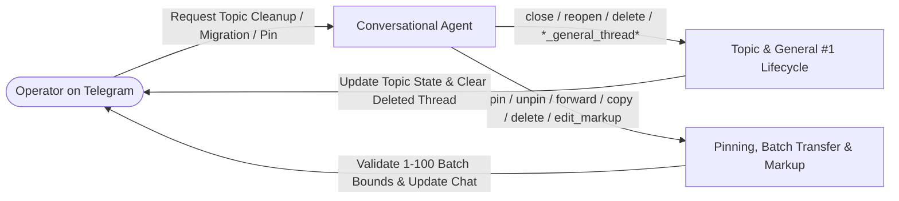

# Telegram Topic and Message Management Tools

This specification defines the MCP tools for forum-topic lifecycle administration (`close_thread`, `reopen_thread`, `delete_thread`, `unpin_all_thread_messages`), custom topic icon discovery (`get_forum_topic_icon_stickers`), General topic `#1` administration (`edit_general_thread`, `close_general_thread`, `reopen_general_thread`, `hide_general_thread`, `unhide_general_thread`, `unpin_all_general_thread_messages`), and message management (`pin_message`, `unpin_message`, `unpin_all_messages`, `forward_messages`, `copy_messages`, `delete_messages`, `edit_message_reply_markup`). Default thread routing and topic creation/renaming (`create_thread`, `rename_thread`) are specified in `specs/telegram/threaded-conversations.md`, and core outbound messaging (`reply`, `react`, `ask_user`, `edit_message`) is specified in `specs/telegram/shared-telegram-channel.md`.

## User experience flow

## Capabilities and user stories

### US-1 Topic Lifecycle Management (Close, Reopen, Delete, Unpin Topic)

As an operator interacting with an agent in a forum supergroup or private chat with topics enabled, I want the agent to close resolved topics, reopen previously closed topics, unpin all topic messages, and delete obsolete topics on demand, so that forum topics reflect active work without manual management.

- **AC-1.1 (Topic Close, Reopen, and Unpin)** Given an active or explicitly specified non-General forum topic (`message_thread_id` / `thread_id`), when the agent invokes `close_thread`, `reopen_thread`, or `unpin_all_thread_messages`, then the tool dispatches `closeForumTopic`, `reopenForumTopic`, or `unpinAllForumTopicMessages` and returns `{ success: true, chat_id, message_thread_id, thread_id, closed | reopened | unpinned_all: true }`.
- **AC-1.2 (Topic Deletion, Active Thread Cleanup, and General Guard)** Given an active or specified forum topic, when `delete_thread` succeeds via `deleteForumTopic`, then active thread tracking for that chat is cleared if the deleted topic was active and the tool returns `{ success: true, chat_id, message_thread_id, thread_id, deleted: true }`; any call to `close_thread`, `reopen_thread`, or `delete_thread` targeting General topic `#1`, missing a thread ID, or rejected by Telegram returns `{ success: false, error: "..." }` with `isError: true`.

### US-2 Message Pinning and Unpinning

As an operator managing important announcements or task decisions in Telegram, I want the agent to pin critical messages, unpin specific obsolete pins, and clear all pins in a chat or active topic, so that pinned headers remain uncluttered and current.

- **AC-2.1 (Pin and Unpin Single Message)** Given a `message_id`, `pin_message({ message_id, disable_notification })` dispatches `pinChatMessage` (`disable_notification: true` by default) returning `{ success: true, chat_id, message_id, pinned: true }`, and `unpin_message({ message_id? })` dispatches `unpinChatMessage` for the specified or most recent pin returning `{ success: true, chat_id, unpinned: true }`.
- **AC-2.2 (Context-Aware Unpin All)** When `unpin_all_messages` is invoked, it dispatches `unpinAllForumTopicMessages` when `message_thread_id` or an active session thread is present, or `unpinAllChatMessages` when unthreaded, returning `{ success: true, chat_id, unpinned_all: true }`.

### US-3 Batch Message Transfer (`forward_messages` & `copy_messages`)

As an operator moving context or consolidating discussions across chats or forum topics, I want the agent to batch-forward messages with attribution or batch-copy messages without attribution for 1 to 100 messages per call, so that bulk message migration avoids single-message loops.

- **AC-3.1 (Batch Forward and Copy)** Given an array of 1 to 100 integer `message_ids`, `forward_messages` and `copy_messages` dispatch `forwardMessages` or `copyMessages` to the target `chat_id` and optional `message_thread_id` (`from_chat_id` defaulting to `chat_id`) and return `{ success: true, chat_id, forwarded_count | copied_count, message_ids }`.
- **AC-3.2 (Batch Size Validation)** Given an empty array or more than 100 `message_ids`, `forward_messages` and `copy_messages` reject the request locally with `{ success: false, error: "Batch size must be between 1 and 100 messages" }` (`isError: true`) without calling Telegram.

### US-4 Batch Message Deletion (`delete_messages`)

As an operator wanting clean channels after migrating messages into a topic or pruning transient outputs, I want the agent to delete batches of 1 to 100 messages within Telegram's 48-hour deletion window, with explicit error reporting if deletion is rejected.

- **AC-4.1 (Batch Delete and Error Propagation)** Given 1 to 100 integer `message_ids`, `delete_messages` dispatches `deleteMessages` and returns `{ success: true, chat_id, deleted_count, message_ids }`; batch counts outside 1–100 fail locally with `"Batch size must be between 1 and 100 messages"`, and Telegram API rejections (such as messages older than 48 hours) return `{ success: false, error }` (`isError: true`).

### US-5 Sent Message Inline Keyboard Editing (`edit_message_reply_markup`)

As an operator interacting with dynamic message cards in chat, I want the agent to attach, update, or clear inline keyboard buttons on previously sent messages in-place without reposting message text.

- **AC-5.1 (Button Update, Clear, and Idempotent No-Op)** Given `message_id` and optional `buttons` (`button_layout`, `buttons_per_row`), `edit_message_reply_markup` dispatches `editMessageReplyMarkup` (passing an empty keyboard when `buttons` is empty or omitted) and returns `{ success: true, chat_id, message_id, updated: true }`, or `{ success: true, chat_id, message_id, not_modified: true }` when Telegram reports `"message is not modified"`.

### US-6 General Forum Topic & Topic Icon Stickers

As an operator using forum supergroups, I want the agent to inspect available custom forum-topic icon stickers and manage the General topic `#1` directly.

- **AC-6.1 (Icon Stickers Discovery)** When the agent invokes `get_forum_topic_icon_stickers()`, the tool dispatches `getForumTopicIconStickers` and returns `{ success: true, stickers: [...] }`.
- **AC-6.2 (General Topic Lifecycle)** `edit_general_thread({ name })` (validating 1–128 trimmed characters), `close_general_thread()`, `reopen_general_thread()`, `hide_general_thread()`, `unhide_general_thread()`, and `unpin_all_general_thread_messages()` dispatch the corresponding `*GeneralForumTopic*` Bot API methods and return `{ success: true, chat_id, ... }` or `{ success: false, error }` (`isError: true`).

## Shared interface contract

| MCP Tool | Backing Telegram Bot API Method | Parameters & Validation Contract | Return Payload |
| :- | :- | :- | :- |
| `close_thread` | `closeForumTopic` | `chat_id?`, `message_thread_id?` / `thread_id?` (defaults to active thread; rejects `#1`). | `{ success: true, chat_id, message_thread_id, thread_id, closed: true }` |
| `reopen_thread` | `reopenForumTopic` | `chat_id?`, `message_thread_id?` / `thread_id?` (defaults to active thread; rejects `#1`). | `{ success: true, chat_id, message_thread_id, thread_id, reopened: true }` |
| `delete_thread` | `deleteForumTopic` | `chat_id?`, `message_thread_id?` / `thread_id?` (defaults to active thread; rejects `#1`; clears active thread on success). | `{ success: true, chat_id, message_thread_id, thread_id, deleted: true }` |
| `unpin_all_thread_messages` | `unpinAllForumTopicMessages` | `chat_id?`, `message_thread_id?` / `thread_id?` (defaults to active thread). | `{ success: true, chat_id, message_thread_id, thread_id, unpinned_all: true }` |
| `get_forum_topic_icon_stickers` | `getForumTopicIconStickers` | No required parameters. | `{ success: true, stickers }` |
| `edit_general_thread` | `editGeneralForumTopic` | `name` (required, 1–128 trimmed chars), `chat_id?`. | `{ success: true, chat_id, name }` |
| `close_general_thread` | `closeGeneralForumTopic` | `chat_id?`. | `{ success: true, chat_id, closed: true }` |
| `reopen_general_thread` | `reopenGeneralForumTopic` | `chat_id?`. | `{ success: true, chat_id, reopened: true }` |
| `hide_general_thread` | `hideGeneralForumTopic` | `chat_id?`. | `{ success: true, chat_id, hidden: true }` |
| `unhide_general_thread` | `unhideGeneralForumTopic` | `chat_id?`. | `{ success: true, chat_id, unhidden: true }` |
| `unpin_all_general_thread_messages` | `unpinAllGeneralForumTopicMessages` | `chat_id?`. | `{ success: true, chat_id, unpinned_all: true }` |
| `pin_message` | `pinChatMessage` | `message_id` (required integer), `chat_id?`, `disable_notification?` (default `true`). | `{ success: true, chat_id, message_id, pinned: true }` |
| `unpin_message` | `unpinChatMessage` | `message_id?` (optional integer; defaults to most recent pin), `chat_id?`. | `{ success: true, chat_id, message_id?, unpinned: true }` |
| `unpin_all_messages` | `unpinAllForumTopicMessages` / `unpinAllChatMessages` | `chat_id?`, `message_thread_id?` / `thread_id?` (scopes to topic when present/active, else chat-wide). | `{ success: true, chat_id, message_thread_id?, unpinned_all: true }` |
| `forward_messages` | `forwardMessages` | `message_ids` (required array of 1–100 integers), `chat_id?`, `from_chat_id?`, `message_thread_id?` / `thread_id?`, `disable_notification?`, `protect_content?`. | `{ success: true, chat_id, message_thread_id?, forwarded_count, message_ids }` |
| `copy_messages` | `copyMessages` | `message_ids` (required array of 1–100 integers), `chat_id?`, `from_chat_id?`, `message_thread_id?` / `thread_id?`, `disable_notification?`, `protect_content?`, `remove_caption?`. | `{ success: true, chat_id, message_thread_id?, copied_count, message_ids }` |
| `delete_messages` | `deleteMessages` | `message_ids` (required array of 1–100 integers), `chat_id?`. | `{ success: true, chat_id, deleted_count, message_ids }` |
| `edit_message_reply_markup` | `editMessageReplyMarkup` | `message_id` (required integer), `chat_id?`, `buttons?`, `button_layout?`, `buttons_per_row?`. | `{ success: true, chat_id, message_id, updated?: true, not_modified?: true }` |

## Invariants and security boundaries

- **General topic `#1` separation:** Standard topic tools (`close_thread`, `reopen_thread`, `delete_thread`, `rename_thread`) reject `message_thread_id: 1` locally with `{ success: false, error: "Cannot modify or delete the General forum topic" }` (`isError: true`). General topic `#1` is administered exclusively through the `*_general_thread*` tools.
- **Active thread cleanup on deletion:** Deleting the currently active topic via `delete_thread` clears active thread state for that chat so subsequent outbound messages never target a deleted topic.
- **Local batch bounds and explicit failure surfacing:** Batch message operations (`forward_messages`, `copy_messages`, `delete_messages`) enforce `1 <= message_ids.length <= 100` before network dispatch. Any local validation error or Telegram Bot API error (`ok: false`) returns `{ success: false, error }` with MCP `isError: true`.
