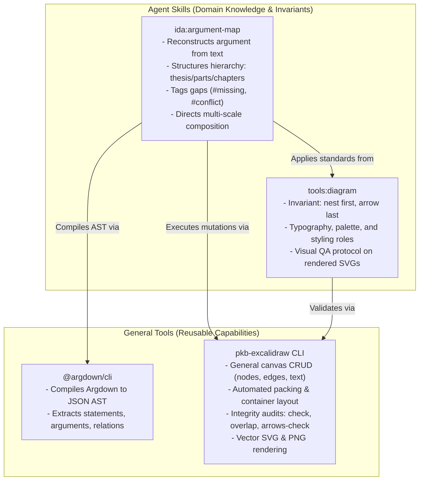

# Rendering Argument Maps from Argdown Sources

The architectural specification defining how agents rebuild visual argument maps from canonical Argdown sources into Excalidraw whiteboards, vector SVGs, and readable overview pages using composable agent skills and general CLI tools, rather than single-purpose procedural scripts.

- **Stated Purpose:** Establishes the contract, division of labour, and outcome-level build criteria for automated argument map compilation without hand layout, replacing prescriptive monolithic scripts with agentic workflow execution.
- **Primary Audience:** Framework developers, agent personas (`ida`, `marsha`, `pauli`), and tool authors maintaining `plugins/ida/skills/argument-map/`, `plugins/tools/skills/diagram/`, and `pkb-excalidraw`.
- **Current Truth / SSoT:** Visual standards derive from [`diagram-pkb-graphs.md`](diagram-pkb-graphs.md) and [`plugins/tools/skills/diagram/SKILL.md`](../../plugins/tools/skills/diagram/SKILL.md); argument reconstruction derives from [`plugins/ida/skills/argument-map/SKILL.md`](../../plugins/ida/skills/argument-map/SKILL.md).

## User Stories

### US-1 Automated Argument Rebuild Without Hand Layout

As a researcher or supervisor reading an argument map, I want the visual diagram and overview page to rebuild automatically from updated Argdown source text, so that visual maps never fall out of sync with the underlying logical reconstruction and require no manual coordinate editing.

- **AC-1.1** Given a canonical Argdown document in the PKB, when the rebuild procedure runs, then valid Excalidraw whiteboard files (`.excalidraw`), vector SVGs (`.svg`), and an overview markdown page are produced without requiring manual pixel placement.
- **AC-1.2** Given the complex academic argument benchmarks (the multi-leg research paper skeleton, the long-form chapter argument, and the multi-chapter doctoral narrative argument), when the rebuild procedure executes, then all three benchmark topologies compile cleanly into multi-level canvases with zero manual intervention.

### US-2 Referential Integrity and Collision-Free Geometry

As a developer auditing generated diagram artifacts, I want generated canvases to pass automated referential integrity and spatial collision audits, so that whiteboards remain interactively editable and legible.

- **AC-2.1** Given any generated `.excalidraw` file, when audited with `pkb-excalidraw check`, then referential integrity passes with valid bidirectional container-text bindings and valid base-62 fractional indices without trailing fractional zeros.
- **AC-2.2** Given any generated `.excalidraw` file, when audited with `pkb-excalidraw overlap` and `pkb-excalidraw arrows-check`, then zero non-nested shape collisions and zero arrow-box crossings are reported.

### US-3 Visual QA and Multi-Scale Readability

As an academic peer reviewing an argument map, I want diagrams that respect visual hierarchy ("nest first, arrow last"), so that top-level thesis claims and part structures are discernible at a glance while warrants and evidence remain inspectable on detailed sub-maps.

- **AC-3.1** Given an argument map with multiple parts or chapters, when rendered, then the output comprises a top-level overview canvas (root headline, part panels, section columns) and dedicated sub-canvases per part with warrant premise-conclusion blocks.
- **AC-3.2** Given rendered vector SVGs, when subjected to visual QA, then arrowheads terminate cleanly at container perimeters, text does not overflow container borders, and kind/status encodings remain distinguishable under greyscale.

### US-4 Dynamic Change Propagation

As an author refining premises or tagging open gaps in Argdown, I want edits to propagate directly to existing diagrams, so that modifying a claim or warrant immediately reflects in the visual canvas without recreating unrelated elements.

- **AC-4.1** Given an existing argument map canvas, when a claim's text or tag is edited in the Argdown source and the rebuild runs, then the corresponding canvas node is updated in place, preserving existing element IDs.

## Architectural Context & Enforcement-Map Extract

### Forensic Root Cause of Rejected PR 2983

AcademicOps PR #2983 attempted to fulfill the need for automated argument map rendering by introducing a 967-line monolithic Python script (`render.py`). The PR was closed unmerged with the ruling:

> _"too prescriptive. make a skill and general tools, not a script."_ (PR #2983 review comment; relayed under reconcile, Telegram 702).

The script-based approach failed architectural standards across five fundamental dimensions:

1. **Prescriptive Monolith:** Hardcoded geometry, coordinates, box-wrapping heuristics, and layout rules into a brittle, deterministic procedural script rather than composing modular tools.
2. **Substituted Determinism for Agentic Judgment:** Violated _Judgment Is Non-Delegable_ by attempting to parse, classify, cluster, and layout heterogeneous argument topologies with rigid heuristics instead of leveraging agentic reasoning and visual QA.
3. **Violated Categorical Imperative:** Invented a bespoke, one-off Excalidraw renderer inside `ida:argument-map`, duplicating element creation, fractional indexing, and styling logic that belongs in general diagramming tools (`pkb-excalidraw` and `tools:diagram`).
4. **Ignored Native Mechanisms:** Bypassed the existing zero-dependency `pkb-excalidraw` CLI in favour of custom JSON serialization.
5. **Rigid Layout Brittle to Topology Changes:** Handled only a single assumed tree depth, failing or overlapping when encountering complex real-world argument structures (e.g. cross-chapter undercuts, multi-parent lemmas, or lateral support edges).

### Enforcement-Map Extract

The move from a monolithic script to a skill and general tools directly complies with active framework rules and axioms recorded in [`specs/ENFORCEMENT-MAP.md`](../ENFORCEMENT-MAP.md):

| Rule / Axiom | Mechanism | Severity | Direct Application to Argument Map Rendering |
| - | - | - | - |
| [Axiom: Categorical Imperative](../plugins/rbg/skills/axioms/categorical-imperative.md) | instructions, process | imperative, required gate | Reject single-purpose, ad-hoc renderer scripts. Design general diagramming and layout capabilities in general tools (`pkb-excalidraw`) and compose them via skills (`ida:argument-map`, `tools:diagram`) covering all whiteboards and graphs. |
| [Axiom: Judgment Is Non-Delegable](../plugins/rbg/skills/axioms/judgment-non-delegable.md) | instructions, structural, process | absolute, required gate | Qualitative visual balance, readability assessment, and semantic hierarchy cannot be delegated to deterministic regex or hardcoded geometry scripts. Agents exercise qualitative visual QA on rendered SVGs. |
| [Axiom: Single Source of Truth](../plugins/rbg/skills/axioms/single-source-of-truth.md) | instructions, structural, process | imperative, protection | Diagramming palettes, typography ratios, and Excalidraw invariants are defined canonically in `tools:diagram` and `pkb-excalidraw`. They must never be duplicated or re-implemented in private skill scripts. |
| [Axiom: Proportionate](../plugins/rbg/skills/axioms/proportionate.md) | instructions, process | imperative, required gate | Meet the rebuild requirement with the least mechanism that works across all arguments. Leverage general CLI utilities rather than maintaining 1,000 lines of custom rendering code. |
| [Rule: No Shitty NLP and Agentic-First Design](../.agents/rules/RULES.md) | instructions, process | imperative | Work requiring semantic reasoning, structure evaluation, or visual QA must be designed as an agent skill or workflow that capable agents execute directly, not as an API wrapper or monolithic script. |
| [Rule: Use Native Mechanism](../.agents/rules/RULES.md) | instructions, process | imperative | Use the platform's native CLI (`pkb-excalidraw` and standard `@argdown/cli`) rather than building bespoke Excalidraw JSON manipulation scripts. |

## Division of Labour

The rendering architecture partitions responsibilities cleanly between domain knowledge (the skills) and execution capabilities (the general tools):



### Detailed Responsibility Matrix

| Component | Nature | Scope & Responsibilities |
| - | - | - |
| **`ida:argument-map`** | Agent Skill | **Domain Semantics & Rebuild Orchestration:**<br/>- Guides the agent in parsing canonical Argdown into structured AST using general tools.<br/>- Maps semantic elements (thesis, parts, chapters, sections, warrants) to visual hierarchy.<br/>- Defines the multi-scale canvas breakdown (overview map + per-part detail sub-canvases).<br/>- Generates the overview markdown document linking diagrams and open issue audits. |
| **`tools:diagram`** | Agent Skill | **Diagramming Standards & Visual Invariants:**<br/>- Mandates "nest first, arrow last" containment rules (panels for parts, columns for sections, cards for leaves).<br/>- Establishes canonical palette roles (claim, evidence, theory, gap, objection).<br/>- Defines visual QA criteria for inspecting rendered SVGs (perimeter arrow terminations, no text clipping). |
| **`@argdown/cli`** | General Tool | **Syntax Compilation:**<br/>- Standalone, domain-agnostic parser/compiler.<br/>- Emits raw JSON AST containing statements, arguments, relations, and frontmatter without layout or styling knowledge. |
| **`pkb-excalidraw`** | General Tool | **Whiteboard Manipulation & Validation Engine:**<br/>- Zero-dependency CLI companion operating on `.excalidraw` scenes.<br/>- Provides atomic node addition (`add-node`), connections (`connect`), text fitting (`fit`, `set-text`), and batch transactions (`batch`).<br/>- Provides general hierarchical packing/layout algorithms without domain-specific hardcoding.<br/>- Enforces structural integrity (`check`), non-overlapping AABBs (`overlap`), and arrow clearing (`arrows-check`).<br/>- Renders zero-dependency vector SVGs (`screenshot --format svg`). |

## Core Behaviour & Rebuild Contract

### 1. Structural Mapping: From Argdown to Whiteboard Panels

The skill directs the agent to map the Argdown abstract syntax tree to spatial Excalidraw structures following the "nest first, arrow last" hierarchy from `tools:diagram`:

| Argdown Construct | Excalidraw Visual Element | Styling / Layout Treatment |
| - | - | - |
| **Thesis / Root Statement** | Title Banner / Hero Headline | Large prominent headline text at the top of the canvas, outside any box, with ample white space. |
| **Part / Chapter Headings** (`#`, `##`) | Zone Panels (`--preset zone`) | Enclosing background panel (`backgroundColor: #f1f3f5`, subtle border). Nesting conveys high-level structure without arrows. |
| **Section Headings** (`###`) | Columns within Panels | Vertical column lanes within the part panel, partitioning thematic argument threads. |
| **Claims & Premises** | Cards (`rectangle`, sharp corners) | Sized dynamically to text via `fit`. Fill and stroke bound to semantic role (claim: gold, evidence: green, theory: purple). |
| **Open Gaps & Objections** | Annotated Cards (`dashed` border) | Sized to text. `#missing` and `#needs-evidence`: warning orange with dashed stroke; `#unanswered` and `#conflict`: soft red stroke. |
| **Warrant Blocks** (`-- Warrant --`) | Premise-Conclusion Clusters | Placed on per-part detail canvases beside the main panel. Warrants rendered with dotted neutral border and explicit premise relations. |
| **Support Relations** (`+>`) | Containment or Solid Arrows | Direct vertical containment within columns for hierarchical support; solid directed arrows (`#404040`) only for moves between distinct columns or panels. |
| **Attack Relations** (`->`, `_>`) | Solid Directed Arrows | Directed arrows in error red (`#e03131`) connecting the objection/rebuttal to the target claim or inference bar. |

### 2. General Rebuild Workflow

When an argument map is created or updated, the executing agent follows a four-stage process using general tools:

```
[Argdown Source]
       │
       ▼ (1. Compile via general CLI: @argdown/cli)
 [AST JSON Data]
       │
       ▼ (2. Structure & pack layout via pkb-excalidraw)
[.excalidraw Canvases] (Overview + Per-Part Sub-maps)
       │
       ▼ (3. Validate & render via pkb-excalidraw)
 [Vector SVGs & Audit Logs]
       │
       ▼ (4. Visual QA & Markdown assembly via ida:argument-map)
[Final Deliverable Page]
```

1. **AST Extraction:** The agent invokes `@argdown/cli compile --to-json` to extract statements, arguments, relations, and tags into structured data.
2. **Layout & Mutation:** The agent passes structured container and node specifications to `pkb-excalidraw batch` (or general layout primitives). `pkb-excalidraw` computes non-overlapping bounding boxes, wraps text according to Virgil typography constants, binds containers to text, and routes connectors around shapes.
3. **Automated Audits:** The agent executes:
   - `pkb-excalidraw <canvas> check` to verify referential integrity and fractional index validity.
   - `pkb-excalidraw <canvas> overlap` to guarantee zero AABB collisions.
   - `pkb-excalidraw <canvas> arrows-check` to verify connectors do not pass through unrelated cards.
4. **Rendering & Visual QA:** The agent invokes `pkb-excalidraw <canvas> screenshot --format svg` and inspects the rendered image against the visual QA criteria (verifying arrow terminations, readability, and visual balance).
5. **Page Synthesis:** The agent updates the PKB note or overview markdown document, embedding the generated SVGs, summary statistics, and part-by-part gap analyses.

## Outcome-Level Build Criteria

Any implementation of this design must satisfy the following verifiable build criteria:

### BC-1: Automated Rebuild from Source Without Hand Layout

Given any valid Argdown source, an agent executing `ida:argument-map` with general tools produces complete `.excalidraw` scenes, vector `.svg` images, and an overview `.md` page without manual coordinate calculations or hand pixel adjustments. Specifically, this must hold across three representative benchmark argument topologies:

- **Research paper argument skeleton**: 7 statements, 20 arguments, 29 relations. Rebuilds cleanly into an overview canvas with 4 leg panels and zero manual coordinate edits.
- **Long-form chapter argument**: 105 statements, 29 arguments, 19 explicit relations. Rebuilds into an overview canvas plus 8 per-part sub-canvases with zero collisions.
- **Multi-chapter narrative doctoral thesis argument**: 123 statements, 34 arguments, 41 explicit relations. Rebuilds into an overview canvas plus 7 chapter sub-canvases with zero collisions.

### BC-2: Referential Integrity and Index Key Validity

All generated `.excalidraw` files pass `pkb-excalidraw check`:

- Bidirectional binding: Every text element carries `containerId` pointing to its shape, and shapes carry reciprocal entries in `boundElements`.
- Fractional indexing: Every element's `index` key strictly complies with the base-62 fractional-indexing schema, containing no trailing zeros in the fractional part (preventing editor freeze or corruption).

### BC-3: Zero Spatial Collisions

All generated `.excalidraw` files pass `pkb-excalidraw overlap` and `pkb-excalidraw arrows-check`:

- Zero overlapping non-nested sibling bounding boxes.
- Zero connector polylines intersecting unrelated intermediate boxes.

### BC-4: Visual QA Compliance on Rendered SVGs

All rendered vector SVGs pass visual inspection per `tools:diagram`:

- Arrowheads terminate strictly at container boundaries (never buried inside boxes).
- Text labels fit completely within container boundaries with no clipped text.
- Contrast ratios meet or exceed 4.5:1, and encodings are distinguishable under greyscale.

### BC-5: In-Place Editability and Change Propagation

Modifications to the Argdown source (e.g. altering a premise, adding an assumption with `{basis: "assumed"}`, or tagging `#needs-evidence`) update the existing canvas elements in place without deleting elements or changing unaffected element IDs, preserving manual annotations where present.

## Boundaries and Constraints

- **No Custom Single-Purpose Canvas Scripts:** No monolithic renderer script (e.g. `render.py`) may be committed to `plugins/ida/skills/argument-map/scripts/`. Canvas creation and layout logic belong in general tools (`pkb-excalidraw`).
- **No Hand Layout:** Agents must not manually calculate arbitrary coordinates in prompt text; coordinate calculations and packing are delegated to `pkb-excalidraw`.
- **Argdown is the Source of Truth:** Canvas elements are strictly projected from the canonical Argdown text. The canvas must never introduce claims, warrants, or relations not present in the Argdown source.
- **No Mechanical Quality Decisions:** General tools validate geometry and referential integrity; semantic assessment of argument validity and visual legibility remains with the agent.
