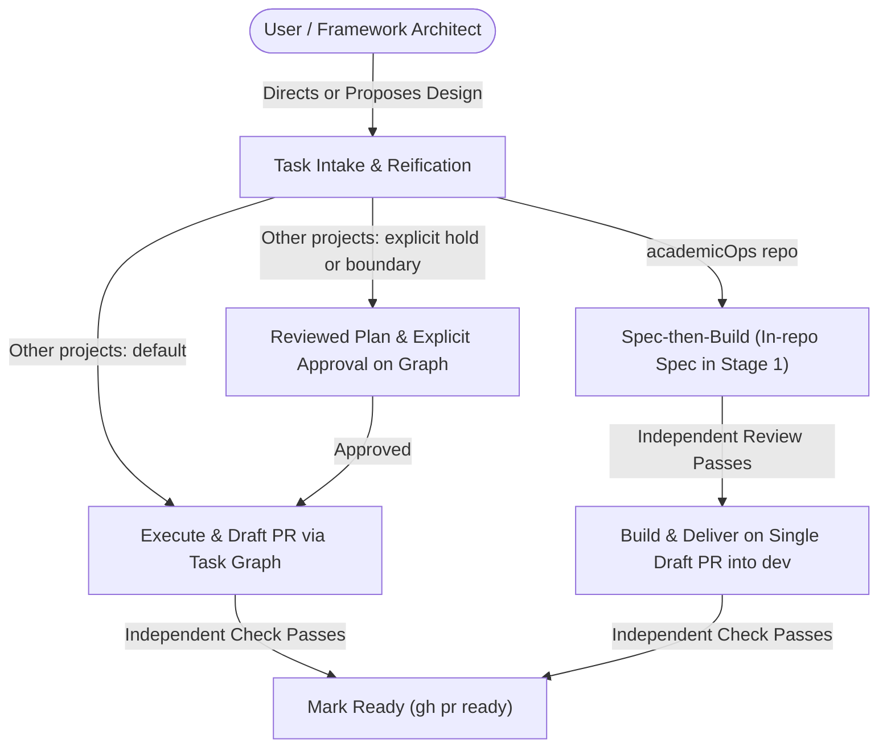

# Default Planning Workflow

Defines the planning workflow across projects: in academicOps, design changes require an in-repository technical specification reviewed by independent agents and delivered alongside implementation code on a single pull request into `dev`; across all other projects, plans are captured directly on the knowledge base task graph rather than repository markdown documents, gating execution on plan approval only when explicitly requested by the user or required by an external, merge, or unbounded-cost boundary.

## User experience flow

## User stories

### US-1 Specification-first design for academicOps changes

As a framework architect contributing to academicOps, I want proposed design changes specified in the repository's specification format, reviewed by independent agents, and delivered alongside implementation code on a single pull request into `dev`, so that system architecture remains documented and vetted without opening code-less pull requests or requiring manual approval of specifications without code.

- **AC-1.1** Given a proposed design change in academicOps, when planning starts, then the design is authored as an in-repository specification following the canonical specification template and document taxonomy.
- **AC-1.2** Given an authored academicOps specification preceding a build, when submitted for review, then it is recorded in a knowledge base note or task record and reviewed by independent agents, without opening a pull request carrying a specification without code and without releasing the specification for principal approval on its own.
- **AC-1.3** Given an academicOps specification with all independent agent review findings resolved, when implementation proceeds, then implementation builds the feature and the specification together on the feature branch.
- **AC-1.4** Given implementation and specification changes, when delivered, then a single pull request is opened into `dev` as a draft (`gh pr create --draft`) carrying both the specification and its implementation code.
- **AC-1.5** Given a draft pull request carrying specification and code, when the independent check passes and mandatory independent review verdicts are posted to the pull request thread, then the pull request is marked ready for review (`gh pr ready`) without waiting for approval.

### US-2 Direct task-graph planning for general projects

As a developer planning work for repositories outside academicOps, I want implementation plans recorded directly on the task graph as tasks, so that project repositories remain focused on code and documentation while task tracking stays on the knowledge base.

- **AC-2.1** Given a proposed change or feature outside academicOps, when planning is initiated, then the plan is captured directly onto the knowledge base task graph through intake and reification.
- **AC-2.2** Given a general project planning workflow, when tasks are dispatched, then pull requests target functional implementation only.

### US-3 Proportionately reviewed plan holds when explicitly requested

As a user explicitly requesting to approve an architectural plan before implementation begins outside academicOps, I want that plan documented and independently reviewed on the task graph while holding execution until my approval is recorded, so that explicit pre-build holds are honoured without adding approvals to directed work by default.

- **AC-3.1** Given work directed by the user without an explicit pre-implementation approval hold or external/merge/unbounded-cost boundary, when planning and reification run outside academicOps, then the task proceeds directly to execution on the task graph without creating a separate plan-approval gate.
- **AC-3.2** Given an initiative where the user explicitly requests pre-implementation plan approval (or an external, unruled-merge, or unbounded-cost boundary exceeds the direction), when executed, then the reviewed plan is captured on the task graph with objective-level criteria, weighed alternatives, and independent agent review resolved before surfacing for approval.
- **AC-3.3** Given a reviewed plan task held under AC-3.2 with findings resolved, when awaiting approval, then downstream implementation remains blocked until approval is recorded on the record, at which point execution is queued and delivered via standard pull request.

## Design

### 1. The Planning Boundary: Repository Specs vs Task-Graph Plans

Planning artifacts are partitioned by repository governance:

1. **academicOps Design Changes**:
   - academicOps maintains an authoritative, version-controlled architecture specification corpus in the repository.
   - Every design change in academicOps (architectural overhaul, rule change, multi-component refactor, or new capability) is authored as a formal specification following the repository's specification standard and document taxonomy.
   - In a spec-then-build workflow (one pull request, opened by the build), the design stage records its design, any drafted specification change, and its independent agent review verdicts on the knowledge base in a note or task record that the implementation task references. The design stage commits no plan or design file to the repository and opens no pull request.
   - Mandatory review of the specification in the design stage is carried out by independent agents, never by the principal. Review findings are resolved before implementation proceeds, and the design stage never puts a specification to the principal for approval on its own.
   - The implementation stage builds on the feature branch, committing both the specification and the implementation code together.
   - The implementation stage opens a single pull request into `dev` as a draft (`gh pr create --draft`) carrying both the specification and its implementation code. The specification remains editable on the branch as implementation progresses.
   - The draft pull request is marked ready for review (`gh pr ready`) only after the independent check passes and proportionate review by independent agents is posted to the pull request thread, without waiting for principal approval.
   - The specification and its implementation code reach the principal for approval together on that single pull request, merging together after full review.

2. **General Projects (The Default Planning Workflow)**:
   - For all repositories other than academicOps, implementation plans, design proposals, and decision alternatives reside on the knowledge base task graph.
   - Planning workflows direct tasks onto the knowledge base task graph by default and execute user-directed work directly (including resolving architectural and design routes via groundwork) without inserting plan-approval holds by task complexity or component class. Target repositories receive functional code and documentation only, with pull requests reserved for functional changes.

3. **Explicit Plan Approval via the Knowledge Base**:
   - Triggered strictly when the user explicitly requests plan approval prior to implementation, or when an external-audience, unruled-merge, or unbounded reach/cost boundary requires prior confirmation:
     a. **Plan Task Authoring**: The planning task captures the plan on the knowledge base following canonical task invariants (concise 50–150 words, objective-level acceptance criteria, trade-off analysis factored to linked knowledge notes; zero plan files committed to repositories and zero pre-build PRs).
     b. **Proportionate Independent Review & Remediation**: An independent reviewer evaluates quality, strategic fit, and compliance, resolving defects on the record prior to escalating for approval.
     c. **Headless Approval Boundary**: Workers release the completed plan on the record as `partial` documenting the pending approval decision; downstream implementation depends on that decision and remains blocked until approval is recorded.
     d. **Execution**: Once approved, execution queues cleanly and opens the implementation pull request as a draft (`gh pr create --draft`), moving to ready (`gh pr ready`) once independent checks pass.

## Open questions

None.
