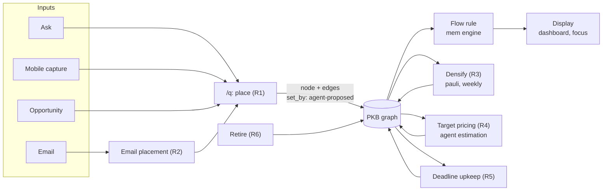

# Graph valuation: skills and agent logic for the flow rule

**Home:** `specs/workflows/graph-valuation.md` in nicsuzor/academicOps. Skills and templates it
changes are listed in §9.

**Depends on:** the settled flow-rule spec,
[`specs/flow-rule.md` in nicsuzor/mem](https://github.com/nicsuzor/mem/blob/main/specs/flow-rule.md).
That spec owns the maths, the edge fields and the scales. This spec owns everything an agent does
around them: who writes which field, when, on what evidence, affordable loss assessment, decomposition probes,
capital stock wiring, and valuation.

**Brief:** _Ranking physics redesign: requirements brief_. Tags follow settled numbering:
`S1`-`S30` settled points, `I1`-`I17` invariants. `U1`-`U20` are the weighting user stories in
_PKB Architecture & Prioritization Framework_. `FQn` are settled decisions in flow-rule §15.
`Kn` are the workflow decisions settled in §12.

**Status: settled (points 1–30 of spec_866ee53d).** This canonical specification governs how agents
(Pauli, Ida) triage, capture, place, densify, and maintain the task graph under the settled flow model.

## 0. Executive Summary

**What this is.** The flow rule sets how worth moves through the graph. This spec covers the
agents' side of that: placing new work, evaluating affordable loss, connecting decomposition probes,
wiring capital stock hubs, proposing values, handling dates, retiring dead opportunities, and asking you things.

**The principal's role shrinks to direct corrections.**

1. **Target pricing by agent estimation.** Agents work out the best approximate worth for each target
   and write it directly to the graph on the bounded continuous scale ($W_t \in [-1.0, 1.0]$; positive
   aspirations up to +1.00, core commitments around +0.70 to +0.80, and negative anti-targets down to -1.00)
   with one line of evidence, never set `intent`, and the principal corrects values directly on the graph.
2. **Densify link values in batches of fifty.** Agents draft and write values for unvalued edges ordered
   by reach: how much of the target it delivers and how likely, with one sentence each, written as
   `agent-proposed`. Corrections are made directly on the graph.
3. **Say when something is dead.** "Drop the Yale thing" is enough. The agent cancels the
   opportunity and it stops pulling. Nothing is ever retired for being old or quiet.

**Affordable loss outside maths (S24).** Agents (Pauli, Ida) evaluate affordable loss during intake and
triage. If a commitment or project exceeds affordable loss, it is rejected, paused, or escalated on the record
before entering the graph. Flow maths is kept unpolluted by subjective risk gating.

**Three purposes of graph edges and edge parsimony (ADR-0002).** Edges serve three distinct, non-overlapping purposes:

1. **Weight flow (Strategic valuation):** Injects worth from priced targets down through the graph (`serves` pointing directly to priced targets or to existing epics that `serves` priced targets, and `supports` where auxiliary work modifies difficulty or success probability). Both require explicit `quantum` and `probability`.
2. **Sequencing of work (`needs` / execution prerequisite):** Defines strict temporal blocking (dependent $\to$ prerequisite). Purely Boolean execution gate; carries neither quantum nor probability.
3. **Structural clustering, human understanding & strategic alignment:** Connects concepts, references, citations, and related artifacts. Represented exclusively as markdown `[[wikilinks]]` in the task body (`## Context`, `## Pointers`). Direct body references already act as clustering/interconnection edges in graph physics; duplicating them as formal frontmatter edges is strictly prohibited.

**Project hierarchies and push-to-top rule.** Redundant child-to-ancestor links are prohibited. Weight links (`serves`) are pushed as far up the parent hierarchy chain as accurate (single injection at the deliverable level): a top-level deliverable task wires `serves` either directly to a priced `target` node or to an existing epic that `serves` a priced `target` (allowing valuation down the chain without duplicate links to the same target); subtasks inherit worth via closed-form induction. Weight links go exclusively to targets or target-serving epics; weight propagates to other nodes via real blocking (`needs`) and supporting (`supports`) tasks.

**Stricter semantics for `supports`.** Task $B$ `supports` task/target $A$ if and only if executing $B$ directly reduces the effort, cost, or difficulty of $A$, or increases $A$'s probability of success. A tracking or coordination task does NOT support the tasks it tracks (tracking makes zero difference to the tracked task's difficulty). A tracking task serves the strategic target of user understanding / observability and is confined to that target edge.

**Decisions and empirical probes.** Competing architectural or design options stay inside the body of the scoping task or ADR until chosen. When chosen, only the selected option is reified into an actionable task under `parent: <task_id>`. Empirical probes are active investigative tasks (`classification: probe`) wired to the scoping task via standard `needs: [<probe_task_id>]`.

**Opening futures and capital stocks (S27).** Foundational investments (reputation, funding reserves,
infrastructure, relationships) that expand future optionality are wired to capital stock hubs. Rather than
inventing speculative multi-hop downstream chains, work feeds the hub target directly.

**Dates.** Every date gets a class. _Fake_ is the default: a date someone else wrote creates no
pressure. _Soft_ is a date you agreed to. _Hard_ means a real loss lands on the day, and only hard
dates surface on their own as they near. Agents may mark a date soft from your own sent mail.
Marking it hard needs your word, or the rule below. Settled rule: a soft date that has been pushed
back twice becomes hard on the second push. The agent records why and tells you in one line, and one
word from you reverses it.

**Email.** Each message is placed against the graph before it becomes a task: what it would serve,
and how much. A bcc circular with a date in it becomes a note or nothing, never an emergency. A
sender's name adds no weight.

**How often you are asked.** One sitting a week of about twenty minutes: one link batch (up to 50 rows)
or one pricing set (at most 10 targets). At most one other valuation question a day, sent in the daily
digest, and only for a proposed hard date within 14 days or a new opportunity that would rank in your
top twenty. Everything else waits for the batch. Mid-conversation interruptions are prohibited.

**What goes.** The seven-word "stated weight" scale on links. Severity as an agent-set field.
Defaulting new asks to "planned". Turning an email date into a deadline. `soft_depends_on` and
`supersedes` wiring at intake. The weight-repair template becomes the densify template. Duplicate
formal frontmatter edges for body citations. Tracking tasks linking `supports` to tracked tasks.
Redundant child-to-ancestor weight edges. Stored `alternative` and `settles` edges.

## 1. Problem and target

**Problem.** Agents set values today under instructions written for the old engine, and link density suffered an over-correction:

- `/q` wires `contributes_to` with "quantum and certainty" but no field contract
  (`plugins/ida/skills/q/SKILL.md:18`). It also defaults `intent` to 3
  (`plugins/ida/skills/q/SKILL.md:24`).
- pauli authors "target severity magnitude vs contributing edge weight probability"
  (`plugins/ida/agents/pauli.md:104`).
- Over-dense linking: ambiguous prohibitions on body interconnections led agents to duplicate every
  markdown body wikilink as a formal frontmatter edge with weights.
- Tracking tasks authored frontmatter `supports` links to every task they tracked,
  misclassifying tracking as supporting the tracked tasks.
- Redundant child-to-ancestor weight links: subtasks duplicated `serves` links to targets already served
  by their parents, distorting flow induction.
- The weight-repair template validates a seven-word scale that mixes amount with likelihood (S2).
- No routine turns agent proposals into approved values at a sustainable rate (S7, U20).
- Email dates become hard emergencies (calibration case 1, U1).
- Nothing classes deadlines (S5) or retires opportunities (S6).

**Target.**

- The three edge purposes are strictly distinguished: weight flow (`serves`/`supports`), sequencing
  (`needs`), and structural clustering (markdown body wikilinks without frontmatter duplication).
- Target worth is estimated and written directly by agents with evidence on the bounded continuous
  scale ($W_t \in [-1.0, 1.0]$), leaving `intent` untouched, with corrections made directly
  on the graph. Agents propose link values (`agent-proposed`), which are read at the default until
  calibrated (FR:474).
- Weight links are pushed as far up the parent hierarchy as accurate (single injection invariant); top-level
  tasks link to targets or target-serving epics; subtasks inherit worth via closed-form induction without
  redundant child-to-ancestor weight links.
- Stricter semantics for `supports`: tracking tasks link to user understanding targets, never to tracked tasks.
- Weight requirements contract: target weight edges require probability and quantum; `needs` edges require neither;
  `supports` requires weights when propagating value.
- Every categorical choice the flow rule moved out of the maths has exactly one agent owner here:
  deadline class, soft-to-hard, ripeness, triage, and human gates (S1, FR:422-433).

## 2. Architecture and data flow



**Roles** (each a single owner, so no routine is implemented twice):

| Role | Owner | Reads | Writes |
| - | - | - | - |
| Placement at intake | `/q` (`plugins/ida/skills/q/SKILL.md`) | graph search, the input | node, edges at `set_by: agent-proposed`, `due` + `deadline_class` |
| Email placement | correspondence sweep, module C (PKB-tier template `wf-email-sweep`) → `/q` | mailbox, graph | through `/q` only |
| Densify | pauli, run by universal template `wf-densify` | flow outputs (`stake`), edges | edge proposals (`set_by: agent-proposed`) |
| Target pricing | pauli, run by universal template `wf-price-targets` | targets, their contributors | writes approximate target worth directly, leaves `intent` untouched |
| Deadline upkeep | `/reconcile` (`plugins/ida/skills/workflow-library/workflows/wf-reconcile.md`) | `due`, class, history, sent mail | class transitions per R5 |
| Retirement | `/reconcile` for source-stated closures; pauli for direct instructions | input, world facts | `status: cancelled` + reason |

pauli estimates target worth and edge weights, leaving `intent` untouched. Corrections are made directly on the graph.

## 3. R1 -- Placement at intake (`/q`)

Covers U8, U9, U10, U11, S7, S24, S27, I7, I9.

1. **Search before creating & mandatory consolidation.** Search the graph across both open
   and closed tasks (`include_done: true`) before creating. Aggregating similar work is
   preferred: when an incoming ask can be handled inside an existing open epic-sized repo
   task as the same chunk of work, consolidate or merge into it rather than creating
   duplicate tasks.
2. **Place (One-Task-per-Repo Rule).** Give the node its container. When a minted ask spans
   two or more repositories, create related repo-specific tasks with strictly one task per
   repository (never a monolithic multi-repo task). Under FQ1 this is a `part_of` edge if
   the parent edge goes, or the parent field if it stays.
3. **Affordable Loss Check (S24).** Agents (Pauli, Ida) evaluate affordable loss (Sarasvathy 2001)
   before admitting commitments. If prospective downside or commitment cost violates affordable loss,
   the agent flags it as a priority ask rather than admitting it to the flow. Flow maths
   remains unpolluted by subjective risk gating.
4. **Wire what it serves under the Three-Purpose Taxonomy (ADR-0002).**
   Edges serve three distinct purposes. Agents must select the least mechanism required:
   - **Purpose 1: Weight flow (`serves`, `supports`).**
     - `serves`: Connects a top-level deliverable task directly to a priced `target` node ($W_t \in [-1.0, 1.0]$) OR to an existing epic that `serves` a priced `target` (allowing valuation down the chain without duplicate links to the same target). Injects worth into the work graph.
     - `supports`: Connects an auxiliary task to an upstream task or target when and only when executing the supporting task directly reduces the effort, risk, or difficulty of the supported node, or increases its probability of success.
     - **Weight contract for flow edges:** Requires explicit `quantum` (word or float $0.0..=1.0$) and `probability` (word or float $0.0..=1.0$, default 1.00). Ask the quantum question: "If this were never done and everything else were, how much of the target/task would be lost?".
     - `effect: harms` when work endangers a target (S12, U13).
     - `justification`: One sentence on what the work delivers to the target or how it assists the supported node.
     - `set_by: agent-proposed`.
   - **Purpose 2: Work sequencing (`needs`).**
     - Points upward from a dependent task to its execution prerequisite task ($B \to A$).
     - **Boolean contract:** Pure execution gate. Requires **neither** quantum nor probability (the engine reads blockers as $q=1.0, p=1.0$).
   - **Purpose 3: Structural clustering, human understanding & strategic alignment (Body wikilinks).**
     - Connects concepts, references, parent contexts, tracking targets, and cited documentation.
     - Authored exclusively as markdown `[[wikilinks]]` in the task body (`## Context`, `## Pointers`, `## Report`).
     - **Zero frontmatter duplication:** Direct references in task bodies already act as clustering/interconnection edges in graph physics and semantic search. Anything cited in the body must **not** have duplicate formal frontmatter edges with weights.
5. **Project hierarchies and push-to-top rule.**
   - Weight links (`serves`) must be pushed as far up the parent hierarchy chain as they can go and still be accurate. Wire `serves` exclusively on the highest task defining the deliverable, pointing either directly to a priced `target` or to an existing epic that `serves` a priced `target`.
   - Subtasks inherit worth from their composite parent via closed-form induction ($V(C_i) = V(E) \times (p_{\text{task}})^{k-1}$). Subtasks must **never** carry redundant `serves` links to targets already served by ancestors.
   - Child-to-ancestor weight edges are strictly prohibited.
   - Weight links go exclusively to targets or target-serving epics; weight propagates to other nodes via real blocking (`needs`) and supporting (`supports`) tasks.
6. **Stricter semantics for `supports`.**
   - Functional test: Task $B$ `supports` task/target $A$ if and only if executing $B$ causally changes $A$'s execution parameters (reduced effort, mitigated risk, higher success odds).
   - **Tracking tasks do NOT support tracked tasks:** Creating a tracking task, observing progress, logging status, or assembling reports makes zero difference to the tracked task's difficulty or probability of completion.
   - A tracking task serves the strategic target of user understanding (operational visibility, cognitive orientation). Its flow edge must be confined strictly to pointing at that user understanding target (via `serves` or `supports` to the target), never to the tracked tasks.
   - Tracked tasks are referenced exclusively via markdown body wikilinks (`[[task_id]]`).
7. **Capital Stock Hubs for Opening Futures (S27).** Foundational investments that expand future
   optionality (reputation, relationships, tool scaffolding, capital reserves) are wired directly
   to capital stock targets, avoiding speculative deep dependency trees.
8. **A bare idea stays bare.** An idea with no clear link to anything priced gets its container and
   no other edge (U9, I7). Inventing a link to make it count is a defect.
9. **An opportunity is one node plus its edges** (I9, U10). Mark it as an opportunity: proposed as
   `classification: opportunity`, with storage decided by the migration spec. Adding it changes no
   other node's fields: no reparenting, and no edits to the targets' worth.
10. **Dates.** Record any date as `due` with a `deadline_class` set by R5's capture rule. Never derive
    a date from urgency.
11. **Effort.** Record `effort` when the input states it or the work is a known kind. The cliff lane
    reads it (FR:425).
12. **Decisions & Empirical Probes.** When an input is a choice between options with no
    commitment to doing anything immediately beyond choosing, keep the choices and instructions on how to make
    the decision inside the single task body without subtasks or option nodes. Competing options remain in the
    task body or ADR until chosen. When chosen, only the selected option is reified into an actionable task under
    `parent: <task_id>`. Empirical probes are active investigative tasks (`classification: probe`) wired to the
    scoping task via standard `needs: [<probe_task_id>]`. Stored `alternative` and `settles` edges are prohibited.
13. **Do not write:**
    - `intent` (FQ10), `severity` (FQ24), `stakeholder` as a weight (FQ25), target worth, `soft_depends_on`, or `supersedes` (FR:448).
    - Stored `alternative` or `settles` edges.
    - Duplicate frontmatter edges for documents or tasks cited in markdown body wikilinks.
    - `supports` edges from tracking/coordination tasks to the tasks they track.
    - Redundant child-to-ancestor `serves` edges on decomposed subtasks.
    - `quantum` or `probability` on `needs` prerequisite edges.

**Headless context** (mobile capture, email). The same steps, headless with no interactive prompt.
Where the container or the targets cannot be identified, leave the input untouched for the next
interactive pass. This matches the capture-intake contract (`specs/workflows/capture-intake.md`).

## 4. R2 -- Email placement

Covers U1, U15, S5, S7, and calibration case 1.

The correspondence sweep (PKB-tier template `wf-email-sweep`) already captures unmatched inbound
asks "through intake" (module C). This spec adds a placement judgment to that step:

1. **Classify first**: `noise`, `reference`, `action` or `opportunity`. This keeps the existing
   classification (email triage guide) and adds `opportunity` for invitations and offers.
2. **`noise`** gets nothing. **`reference`** becomes a knowledge note or nothing. A circular or bcc
   message is `reference` unless it asks by name for something only they can give.
3. **`action` and `opportunity`** go to `/q` in the headless context, carrying the message id. The
   edges `/q` proposes cite the message in their justification.
4. **Dates in the message** are captured `fake`. They become `soft` only where sent mail
   accepts the date, and `hard` only through R5. A sender's own stated date ("by next Monday")
   creates no pressure (U15).
5. **The sender's name adds no worth** (FR:498). Who is waiting is context in the body, and moves
   worth only through an edge to a priced target.
6. **Strategic contacts.** Some senders bear on a target, for example institutional leadership
   (calibration case 4). The agent proposes the edge to that target. If no target fits, it adds a
   one-line "no target fits" entry to the ask queue (R7). It never forces a mismatched target.

## 5. R3 -- The densify routine (batches of fifty)

Covers S7, U20, FR:474, and FR:472.

**Trigger.** Weekly, as one step of the sleep-cycle run (`specs/agents/sleep-cycle.md`). It drafts
one batch and runs again only after the previous batch is answered or expires (R7).

**Candidate pool.** Rows are drawn in this order. Pricing comes first, through R4, before any link
batch. Densify evaluates only genuine weight flow edges (`serves`, and valid `supports` that causally
alter an upstream task or target). Converting markdown body citations into frontmatter edges is strictly prohibited.

1. Edges at `set_by: migrated` that await confirmation: 51 `supports` quanta and 83 `serves` words
   on today's graph (FR:467-468).
2. Edges at `set_by: agent-proposed`.
3. Edges with no quantum, for which pauli drafts a proposal.

**Ordering.** Each row's _reach_ is `|worth of the priced targets the edge leads to| × proposed
strength`. It is read from the flow outputs' `stake` map (FR:604-610). Rows are sorted by reach,
highest first, then by age of proposal. Reach is used only to order the rows. It is never shown as
a value and never summed across tasks (FR:207).

**Granularity before value.** Wire at the highest node where the answer is the same for everything
beneath it. This carries over from the weight-repair template's rule. A row covering fungible
siblings is one row for their container, not one row each.

**The batch table** (one message, at most 50 rows):

| # | Work | → Target (worth) | Label | Proposed quantum | Probability | Effect | Why (one sentence) |
| - | - | - | - | - | - | - | - |

**Proposal and direct write.** Agents write proposals directly with `set_by: agent-proposed`.

- pauli evaluates each row in the batch, writes the edge with `set_by: agent-proposed`, and reports proposals without readback.
- Direct corrections are made on the graph as needed.
- `drop` sets the quantum to `none`. It does not delete the edge.

**Agent corrections.** An agent may correct a row without asking on evidence in
the node itself. This keeps the weight-repair template's four tests: a word outside the scale; an
edge to the wrong class of node; a justification describing a different target; a weight
contradicting its own justification. The correction is written as `agent-proposed`.

## 6. R4 -- Pricing every target

Covers S14, S12, S16, S26, S27, U20, FR:377-391.

- **Scale.** The bounded continuous scale within server-enforced engine bounds ($W_t \in [-1.0, 1.0]$).
  Mirrored anchors for positive aspirations (+0.05 up to +1.00, with core commitments around +0.70 to +0.80 and top-tier moonshots at +1.00) and negative anti-targets (-0.05 down to -1.00 for ruinous catastrophe). These replace the standing-weight instrument's five positive-only anchors (FQ7, FQ28). Targets may also be configured as capital stock hubs (S27).
- **Agent estimation and direct write.** pauli works out the best approximate worth for each unpriced target and one line of evidence. The evidence is what serves the target, how much open work sits behind it, and its old `severity` used only as a prompt (FR:391). pauli writes the estimated `worth` directly to the target node via `pkb.update_task` and leaves `intent` untouched. Corrections are made directly on the graph.
- **Batches.** At most ten targets per run, outer bounds first: one Critical and one Low-or-Minor anchor evaluated first. Gain and loss targets are priced in the same pass, so their ratios are judged together (S16).
- **Consistency pass**: Ordering is transitive, and the ratios are plausible ("about one Critical balances three Substantial"). This is the existing instrument's procedure, kept.
- **Re-confirmation.** A target priced more than 180 days ago is re-evaluated in a routine pricing pass (K5). Its stored worth never decays.
- **New targets.** An agent never creates a target. Work that fits no target is recorded as a finding.

## 7. Rules outside the maths

### 7.1 R5 -- Deadline classes

Covers S5, S13, U14, U15, G11, FR:424-426.

**Classes:**

| Class | Meaning | Who may set it |
| - | - | - |
| `fake` | Someone wrote a date; no loss lands on it | default for every captured date (FQ18) |
| `soft` | the date was accepted; slipping it has a cost but can be negotiated | an agent, citing explicit acceptance or sent mail that accepts it |
| `hard` | A real loss lands on the date (a round closes, a legal or employment duty) | the principal; or the soft-to-hard rule below |

**Capture rule.** A new date is `fake` unless one of these holds:

- the input carries the principal's acceptance: `soft`;
- direct instruction indicates the date is hard: `hard`.

An agent that judges a date hard on evidence (a published closing date, say) _proposes_ `hard`. A
proposed hard date within 14 days goes into the ask queue as a priority ask (§8). One further away
waits for the next batch.

**Extension.** An extension is a later `due` written while the class is `soft`. Each change of
`due` or class appends `{previous_due, new_due, class, changed_at, by, reason}` to a
`deadline_history` list on the node (storage: migration spec).

**Soft → hard (proposed; G11, K1).** When a soft deadline is extended for the second time, the
agent writing the extension sets the class to `hard`. It records the reason "extended twice"
together with the history, and puts one line in the next daily digest. A reply of `soft` reverses
it. A `fake` date never hardens by extension, because nobody is holding it.

**Hard → anything** is the principal's call only.

**Who checks.** `/reconcile` re-reads open `soft` and `hard` dates against sent mail and inbound
mail. It records a counterpart's extension as an extension, and a counterpart's withdrawal as
grounds for retirement (R6).

### 7.2 R6 -- Retiring an opportunity that is no longer ripe

Covers S6, U19, I9, G10, FQ13.

**One input.** Two kinds of statement retire an opportunity:

- the principal's statement in any channel ("drop X", "X is dead");
- a statement from the opportunity's own source (for example, the call has closed) found by
  `/reconcile` as a world fact.

**Effect.** The node is set `cancelled`, with the reason quoting the statement and its source. The
flow rule does not read cancelled nodes (FR:136), so its pull goes at once, with no edits to edges
or targets. Nothing lingers.

**Never.** No agent retires an opportunity for age, silence, a passed `fake` date, or a low
ranking. Agents do not ask "is this still ripe?" on a timer (S6; age is not staleness,
`specs/agents/sleep-cycle.md:106`).

**Revival.** `inbox` restores the node with its edges intact.

### 7.3 Decisions

Covers U12, I10, ADR-0002.

Standalone decision backlog nodes with stored `alternative` and `settles` edges are prohibited. When a task requires selecting among competing design or architectural options with no commitment beyond choosing, the candidate options and evaluation criteria remain inside the body of the scoping task or ADR. When chosen, only the selected option is reified into an actionable task under `parent: <task_id>`. Empirical probes or spikes are active tasks (`classification: probe`) wired to the scoping task via standard `needs: [<probe_task_id>]`. No agent authors stored `alternative` or `settles` edges.

### 7.4 Explaining a weight

Covers U18, I12.

When asked "why does X carry this?", an agent answers from the flow outputs only. It lists the
priced targets in X's `stake` map and the edge route to each. It never answers from a ranking
position or a display order.

## 8. R7 -- Budget for direct queries

Covers U20, S11, and the attention rules already in `plugins/ida/agents/ida.md:79-85`. The brief
sets no budget; the figures below are proposed (K2).

| Channel | Budget | Content |
| - | - | - |
| Routine notice | 1 per week | summary of direct graph pricing and densify changes |
| Priority ask | ≤ 1 per day, in the daily digest | a proposed `hard` date within 14 days; or a new opportunity whose `gain` or `loss_averted` would place it in the top 20 under the current key |
| In conversation | 0 valuation questions | valuation never asks in conversation; questions follow the one decision or question per message rule |
| Notices | 1 line each in the digest, no reply needed | soft→hard hardenings, retirements from source statements |

**The ask queue.** Every item that would otherwise interrupt the principal goes into one queue: ambiguous
placements, "no target fits", proposed hard dates further out, and pricing for new targets. Items
are ordered by reach (§5) and drained only through the channels above. An item over budget waits.
It never escalates by repetition, and an unanswered item is not re-asked in the same week. This
keeps pauli's rule "never raise the same non-blocking concern twice"
(`plugins/ida/agents/pauli.md:117`).

**Expected load.**

- Backlog of 154 inputs (FR:472): two pricing sittings (19 targets), then about three link batches
  (134 rows). That is five weeks at one sitting a week.
- Steady state: one sitting a week plus at most seven priority asks.

## 9. Skills and workflows that change

| File | Change |
| - | - |
| `plugins/ida/skills/q/SKILL.md` | Steps 4-6 are replaced by R1. Description :4 changes from "wire contributes_to/depends_on" to "wire what it serves, propose values". :18 becomes the FR §5.1 edge contract with `set_by: agent-proposed`. :19 keeps `needs` and drops `soft_depends_on` and `supersedes`. :23 keeps effort and adds dates with class (R5). :24: the default `intent` of 3 is removed, and the line goes entirely if FQ10 drops the field. A headless context is added (R1). |
| `plugins/ida/agents/pauli.md` | :104 "two-axis model (target severity magnitude vs contributing edge weight probability)" becomes: pauli drafts link proposals and estimates target prices directly, leaving intent untouched. :23 "carry … severity magnitude" becomes "carry worth". |
| `plugins/ida/agents/ida.md` | Adds that valuation asks reach the attention queue through routine notice and the digest (R7). Governed by the one decision or question per message rule at :76. |
| `plugins/ida/skills/remember/SKILL.md` | :22 "carry only graph weights and severity" becomes "carry only worth". :37 "a wikilink … is a real graph edge" is qualified as not read by the flow, pending FQ23. :45 `/pkb:q` becomes `/ida:q`. |
| `plugins/ida/skills/remember/references/consolidation.md` | Adds a weekly densify stage that runs `wf-densify` (R3). |
| `plugins/ida/skills/workflow-library/workflows/wf-reconcile.md` | Adds deadline upkeep (R5) and source-stated retirement (R6). :49 reserved fields add `deadline_class: hard` and target worth. |
| `plugins/ida/skills/decide/SKILL.md` | Draws open items from the daily note (which carries ask queue items from reconcile per R7). |
| `plugins/ida/skills/decompose/SKILL.md` | ADR-0002: Three-Purpose Taxonomy. Competing options stay inside task bodies; probes wire `needs`; contextual citations in `## Pointers`. |
| `plugins/ida/skills/reify/SKILL.md`, `plugins/ida/skills/dispatch/SKILL.md` | `depends_on` becomes `needs` in :20, :43, :79-80 and dispatch :14. Readiness keeps its meaning (FR:517). |
| `plugins/ida/skills/pull/SKILL.md`, `plugins/ida/skills/dump/SKILL.md` | "wire directed `blocks` edges" becomes "wire a `needs` edge from the blocked task" (FR:334). |
| `plugins/ida/skills/workflow-library/SKILL.md` and templates `wf-escalated-approval`, `wf-research-and-implement`, `wf-code-task-base`, `wf-finish` | `depends_on` becomes `needs` in the skill and the first three templates. The parent in `wf-finish` follows FQ1. |
| New universal template `wf-densify` (in `plugins/ida/skills/workflow-library/workflows/`) | R3 as an outline: pool, ordering, granularity, table, reply grammar, exit criteria. |
| New universal template `wf-price-targets` (same directory) | R4 as an outline. |
| PKB-tier template `wf-weight-repair` | Retired in favour of `wf-densify`. Its granularity rule, correction tests and "measure from the source of record" rule move across. |
| PKB-tier template `wf-email-sweep` | Module C gains R2 steps 1-6. |
| PKB note _Email Triage Workflow Patterns & Guardrails_ | Adds the `opportunity` class, the date rule (R2.4) and the no-weight-from-sender rule (R2.5). |
| PKB spec _Standing-Weight Elicitation Instrument_ | Superseded by R4 and FR §5.6. Agents estimate and write target worth directly with evidence; stored worth has no decay. |
| `.agents/skills/triage/SKILL.md` | :219-220 "raise the `stated_weight`" becomes "add a row to the next densify batch". |
| `specs/meta/naming-and-decisions.md` | ADR-0002: Three-Purpose Taxonomy; candidate options stay inside task body; contextual citations in `## Pointers`. |
| `specs/workflows/capture-intake.md`, `specs/workflows/research-decomposition.md`, `specs/enforcement/task-contract.md` | References to "valued at intake" now point to R1. The stale `brief` skill references (`specs/enforcement/task-contract.md:43`, `specs/workflows/research-decomposition.md:30`) are corrected to `/q`. |

**Unchanged** (read in full; nothing to change): agy, axioms, craft, hydrate, learn,
premise-check, session-trace, strategic-review, strategize, verify; templates `wf-fact-check`, `wf-qa`,
`wf-qa-visual`, `wf-research`, `wf-signoff`, `wf-spec`, `wf-structural-map`, `wf-task-base`, `wf-tdd`;
agents james, marsha, rbg, sara; and all tools-plugin skills.

**Out of scope:**

- The varied menu and ordering (U2, FQ3), which belong to the dashboard spec.
- Edge storage and migration values (FQ22), which belong to the migration spec.

## 10. Interface contracts

**Edge write contracts by purpose (ADR-0002).** All edge authoring strictly follows the 3-purpose taxonomy:

| Edge Purpose | Label / Representation | Target Node Type | Required Frontmatter Fields | Mathematical / Engine Behaviour |
| :- | :- | :- | :- | :- |
| **1. Weight Flow** | `serves` | `target` (priced) or target-serving epic | `to`, `quantum`, `probability`, `effect`, `justification`, `set_by` | Injects worth: $V(E) = W_t \times q \times p$. Pushed to top-level deliverable or target-serving epic. |
| **1. Weight Flow** | `supports` | `target` or `task` | `to`, `quantum`, `probability`, `effect`, `justification`, `set_by` | Value modifier for auxiliary work causally reducing effort or raising success odds. Forbidden for tracking. |
| **2. Work Sequencing** | `needs` | `task` | `to` | Boolean execution prerequisite. Unblocks when prerequisite is `done`. Engine treats as $q=1.0, p=1.0$. Quantum and probability are NOT written. |
| **3. Structural Clustering** | `[[node_id]]` | Any (task, note, spec) | None in frontmatter; written as markdown wikilinks in body | Natural clustering for graph physics and search. Zero frontmatter duplication. |

Direct writes use `set_by: agent-proposed`. Writes returning without error need no readback.

**Batch message.** The §5 table, numbered 1..n with n ≤ 50, preceded by one line giving the pool
size and how many rows remain.

**Reply grammar.**

```
reply   := item (";" item)*
item    := "all" | "all except" nums | num ":" ( qword ["," pword] | "drop" | "harms" )
nums    := num ("," num)*
```

**Deadline fields.** `due` (date), `deadline_class` (`fake|soft|hard`), and `deadline_history`
(list of `{previous_due, new_due, class, changed_at, by, reason}`).

**Retirement.** `status: cancelled`; the reason starts `not ripe:` followed by the quoted statement
and its source.

**Ask queue item.** `{kind, node, one_line, reach, created, last_presented}`.

`kind` is one of:

- `placement`
- `no-target-fits`
- `hard-date`
- `new-target-price`
- `reprice`

The queue lives in the graph, as an ida-owned node. Its storage is decided with the migration spec.

**PKB tooling this needs.** Edge fields `quantum`, `probability`, `effect`, `label` and `set_by`;
`deadline_class`; and `deadline_history`. The current PKB tool surface has none of them: its
`create_task` and `update_task` parameters list `contributes_to`, `depends_on` and
`soft_depends_on` but no such fields, observed 2026-10-06. Every routine here is therefore blocked
on the mem build.

## 11. Acceptance criteria and tests

Each test can be checked by an observer reading the graph or a transcript.

| # | Criterion | Test (observable) | Traces to |
| - | - | - | - |
| A1 | `/q` writes only proposals | Run `/q` on three fixture asks. `get_task` on each new node shows every outgoing edge with `label`, `effect`, a justification and `set_by: agent-proposed`. None shows `set_by: user`, `intent`, `severity` or target worth. | S7, U9, R1 |
| A2 | A bare idea carries nothing | `/q` on an idea that names no target. The node has a container and no other edge. Flow `gain` and `loss_averted` are both 0. | U9, I7 |
| A3 | An opportunity is one node | Fingerprint every other node's fields before and after `/q` on an opportunity. Only the new node and its own edges differ. | U10, I9 |
| A4 | The circular stays quiet | Replay calibration case 1 (the "Dear Friends" Copyright Plus forward) through R2. It is classed `reference`, or captured with `deadline_class: fake` and no edge above the default quantum. It is not in the top 50 under any display key. | U1, U15 |
| A5 | No worth from a sender | Two fixture emails, identical except the sender (a strategic contact versus an unknown). They produce identical edge proposals. | FR:498, U1 |
| A6 | Densify batch shape | One `wf-densify` run produces one message with ≤ 50 rows, sorted by reach in descending order, each row carrying every column. | S7, U20 |
| A7 | Densify writes proposals directly | One `wf-densify` run writes edge proposals as `agent-proposed` without pausing for sign-off. | U20, R3 |
| A8 | Silence approves nothing | Leave a batch unanswered for 14 days. No edge in it changed `set_by`, and the batch is withdrawn. | U20 |
| A9 | Unapproved means default | Before approval, the flow output for a row's source equals its output with that edge's quantum set to the default. | FR:474, S7 |
| A10 | Target pricing by agent estimation | Agents work out approximate target worth and write it directly to the target node with evidence, leaving `intent` untouched. | S14, R4 |
| A11 | Dates default to fake | `/q` on an input with a date and no acceptance gives `deadline_class: fake`, and the cliff lane does not surface it. | S5, U15, I17 |
| A12 | Soft hardens on the second extension | Fixture: soft date, extended once, then again. After the second extension the class is `hard`, `deadline_history` has two entries, and the next digest has one line about it. After the first extension the class is still `soft`. | S5, G11, K1 |
| A13 | Fake never hardens | Extend a `fake` date three times. The class is still `fake`. | S5 |
| A14 | One input retires | A statement says "drop X". X reads `cancelled` with a `not ripe:` reason, and no other node's fields changed. X's flow pull is zero on the next run. | S6, U19, I9 |
| A15 | Nothing retires by age | Over a 30-day replay of sleep-cycle and reconcile runs on a fixture graph, no opportunity is cancelled without a quoted statement. | S6 |
| A16 | Budget held | Over one week of transcripts there is ≤ 1 sitting, ≤ 7 priority asks, 0 in-conversation valuation questions, and no queue item presented twice. | R7, K2 |
| A17 | Weights explain themselves | Ask "why does X carry this?" for 5 nodes. Each answer names priced targets and routes matching X's `stake` map. | U18, I12 |
| A18 | Harms are wired, not netted | `/q` on work that advances one target and endangers another. It produces two edges, one `helps` and one `harms`, and the flow output shows both figures non-zero. | S12, S16, I15 |
| A19 | Every changed file changed as §9 says | Diff of the implementation PR against §9: every row is present, and no unlisted skill changed. | this spec |
| A20 | Three edge purposes distinguished | Verify edge taxonomy distinguishes (1) weight flow to targets, (2) sequencing via `needs`, and (3) clustering via body wikilinks without frontmatter duplication. | ADR-0002, AC2 |
| A21 | Zero duplicate frontmatter edges for body citations | Inspect tasks with markdown body citations (e.g. a task citing references in its body). Verify no duplicate frontmatter edges are authored for nodes cited in body prose. | ADR-0002, AC2 |
| A22 | Project hierarchy single injection | Inspect subtasks under an epic or composite task. Verify subtasks carry no redundant child-to-ancestor `serves` links to targets already served by their parent. | ADR-0002, AC3 |
| A23 | Strict supports semantics | Inspect tracking and coordination tasks (e.g. an operational tracking task). Verify they do not link `supports` to tracked tasks, and link only to user understanding targets. | ADR-0002, AC4 |
| A24 | Weight contracts enforced | Verify `needs` edges carry neither quantum nor probability; verify target weight edges (`serves`) and `supports` carry explicit quantum and probability. | ADR-0002, AC5 |

## 12. Settled decisions

All questions K1–K11 are settled under the product-grade workflow redesign:

1. **K1 (G11): The soft-to-hard rule. Settled (§7.1):** A soft deadline hardens to `hard` upon its
   second extension. The agent records the history and notes it in the daily digest; a single word
   from the user reverses it.
2. **K2: The budget. Settled (§0, §8):** One weekly sitting of ~20 minutes (one link batch of ≤ 50 rows
   or one pricing sitting of ≤ 10 targets). At most one priority ask a day in the digest; no
   mid-conversation interruptions.
3. **K3 (G10, FQ13): Retiring an opportunity. Settled (§7.2):** An explicit statement ("drop X") or an
   explicit authoritative world fact found by `/reconcile` (e.g. call closed) retires an opportunity
   by marking it `cancelled`.
4. **K4: Batch expiry. Settled (§5):** An unanswered batch is withdrawn after 14 days and rebuilt
   with fresh reach ordering.
5. **K5: Re-pricing. Settled (§6):** Targets are re-confirmed after 180 days in a routine pricing sitting.
6. **K6: Proposed hard dates. Settled (§7.1):** Agents propose `hard` on published evidence; it enters
   the priority ask queue if due within 14 days, otherwise waits for the weekly sitting.
7. **K7: Email opportunity class. Settled (§4):** Invitations and offers become `opportunity` nodes
   when they name something of indicated interest or that contributes to a known target.
8. **K8: Batch size. Settled (§5):** Batches are capped at 50 rows, ordered by reach.
9. **K9: Pricing sitting size. Settled (§6):** Capped at 10 targets per sitting. Positive and negative
   targets are judged in the same sitting to maintain ratio consistency.
10. **K10: Agent corrections. Settled (§5):** Agents may correct mechanical errors on in-node evidence
    unasked, marked `agent-proposed`.
11. **K11 (G5, FQ11): Fun. Settled:** Fun is treated as a strategic target or capital stock hub if
    explicitly priced, and as a contextual tag otherwise.

## 13. Behaviour removed

- `/q` defaults `intent` to 3 (`plugins/ida/skills/q/SKILL.md:24`).
- `/q` wires `soft_depends_on` and `supersedes` at intake (`plugins/ida/skills/q/SKILL.md:19`).
- `contributes_to` "quantum and certainty" with no field contract
  (`plugins/ida/skills/q/SKILL.md:18`).
- pauli authors target severity and the "two-axis model" (`plugins/ida/agents/pauli.md:104`).
- The seven-word `stated_weight` vocabulary as the only link value (weight-repair template;
  `specs/meta/naming-and-decisions.md:150`; `.agents/skills/triage/SKILL.md:219-220`).
- Five positive-only standing-weight anchors.
- An email date becoming a hard deadline, and a stakeholder name raising priority.
- `blocks` edges in `/pull` and `/dump`.
- The weight-repair template.
- Duplicating markdown body citations as formal frontmatter edges with weights.
- Wiring `supports` from tracking or coordination tasks to the tasks they track.
- Authoring redundant child-to-ancestor `serves` weight edges on decomposed subtasks.
- Stating `quantum` or `probability` on `needs` prerequisite edges.
- Authoring stored `alternative` and `settles` edges.

## 14. Traceability

| Requirement | Brief / stories |
| - | - |
| R1 placement | S2, S7, S12, I7, I9, U8-U11, U13 |
| R2 email | U1, U15, S5, S7 |
| R3 densify | S7, U20, B "densify routine in batches of fifty" |
| R4 pricing | S14, S12, S16, U20 |
| R5 deadlines | S5, S13, I11, I17, U14, U15, G11 |
| R6 ripeness | S6, U19, I9, G10 |
| 7.3 decisions | U12, I10 |
| 7.4 explanation | U18, I12 |
| R7 budget | U20, S11 |
| §9, §13 | brief "Existing work this would supersede"; common expectations "names what is removed" |
