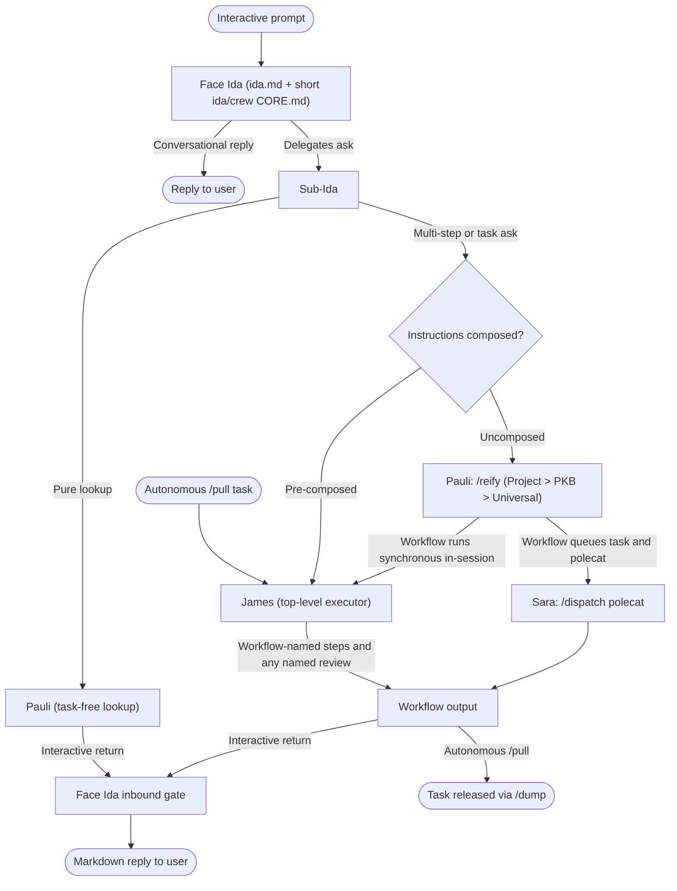

# In-session workflow assembly and execution

Interactive sessions need a direct route from a user's request to a workflow composed at run time from the three-tier template library (`Project > PKB > Universal`) and executed in session without unnecessary task creation or polecat dispatch. Under this design, **composed workflows determine everything** -- what gets reviewed, where work goes (in-session vs. queued task and polecat), and who inspects or executes what -- with no hardcoded routing, review, or reviewer decisions inside the universal plugin. The design recommends **Option 4b**: Face `ida` starts with minimal context and verifies final returns at her inbound boundary; `sub-ida` handles intake delegation (including sending pure lookups directly to `pauli`, just as she sends tasks to `james` or `sara` per the active workflow); `pauli` assembles uncomposed workflows via `/reify` (`in-session` or task dispatch); and `james` executes pre-composed instructions directly (including autonomous `/pull` launches and polecats) or runs composed in-session steps. This design targets the slimmed, role-labelled workflow library as PR #3771 leaves it (merged into `dev` via PR #3775) and carries no merge hold or implementation wait. Because this document is a `status: draft` design proposal, it retains the assembly-ownership comparison and affected-component inventory alongside the target contract; upon adoption, the option comparison moves to an Architectural Decision Record under `specs/decisions/` and migration items move to delivery tasks.

## User experience flow

## Capabilities and user stories

### US-1 Runtime workflow composition without hardcoded routing or review

As a user working interactively, I want multi-step requests that fit within my active session to be assembled at run time from my three-tier workflow templates without creating unnecessary tasks or applying hardcoded universal rules, so that composed workflows alone decide execution, placement, and review while I wait.

- **AC-1.1** Given an uncomposed request requiring multi-step work, when `/reify` (`in-session` mode) resolves matching `type: "template"` definitions across `Project > PKB > Universal`, then it emits a composed plan carrying only the stages, placement, review steps, and roles specified by the selected templates, with no hardcoded review, routing, or reviewer decisions added by universal plugin code.
- **AC-1.2** Given multi-step work that completes synchronously in session while the user waits (covering both read-only work and simple writes), when executed under a matching composed workflow, then the session runs the workflow-named steps without creating a PKB task or running `/dump` unless the composed workflow explicitly specifies tracking.

### US-2 Minimal startup context and direct `sub-ida` delegation

As a user in a live conversation, I want the interactive face to start with minimal context and delegate asks cleanly without startup bloat or unnecessary subagent hops, so that turn latency and token overhead stay low.

- **AC-2.1** Given an interactive session starting on `ida`, when startup hooks and agent definitions load, then `ida` receives only her own agent definition, her own short `CORE.md` (at most 20 lines), and `crew`'s short `CORE.md` (at most 20 lines), while role-specific startup context lives inside individual agent definitions rather than global startup injection.
- **AC-2.2** Given a request delegated by Face `ida` to `sub-ida`, when the ask is a pure lookup, then `sub-ida` (never Face `ida`) routes it straight to `pauli` without creating a task, just as `sub-ida` sends tasks to `sara` or `james` in accordance with the active workflow.

### US-3 Workflow-governed polecat offloading and invocation-scoped entry

As a researcher running work across interactive chats, crew containers, and polecats, I want asynchronous, pull-request-complex, or heavy work offloaded to tasks and polecats to conserve interactive tokens while autonomous task launches skip interactive wrappers, so that each execution surface fits how it was invoked.

- **AC-3.1** Given an autonomous task launch via `/pull` (replacing retired `/supervise`) or a prompt carrying pre-composed `## Instructions` and `## Appendix: Sources`, when execution begins, then `james` runs directly at top level with no `ida` wrapper layer and executes the supplied workflow steps without re-running `/reify`; when a crew container is run interactively, the session may invoke `ida` first.
- **AC-3.2** Given work whose composed workflow routes asynchronous execution, complex pull-request work, or large research to background isolation rather than waiting synchronously in session, when assembled for dispatch, then `/q`, `/reify`, and `/dispatch` (`sara`) queue a task and launch a polecat container to save interactive tokens, with any review or delivery follow-up defined solely by the composed workflow.

## Shared interface contract

### End-to-end execution route

1. **Invocation & intake boundary**: Autonomous task runs (`/pull`) start `james` directly at top level without an `ida` wrapper layer; interactive runs may invoke Face `ida` first. When invoked, Face `ida` loads only her own agent definition, her own short `CORE.md`, and `crew`'s short `CORE.md` (with role-specific startup context kept inside agent definitions), answers direct conversational turns herself, and delegates detail asks to `sub-ida`. Using turn-0 hydration (`specs/agents/prompt-hydration.md`) and conversation context, `sub-ida` (never Face `ida`) can route pure lookups straight to `pauli` with no task creation, just as she routes tasks or multi-step work to `james` or `sara` per the active workflow.
2. **Pre-composed execution vs. runtime `/reify` assembly**: Any prompt or claimed task already carrying composed `## Instructions` and `## Appendix: Sources` runs those steps directly without querying the PKB or calling `/reify`. Otherwise, `pauli` resolves matching `type: "template"` entries across `Project > PKB > Universal` (querying PKB templates alongside native enumeration of `plugins/crew/skills/workflow-library/workflows/*.md`, with `specs/agents/hydrate-workflow-finder.md` serving as an optional accelerator once built) via `/reify` (`target: in-session` for interactive execution or `target: task` when dispatching). If PKB MCP is unreachable during uncomposed assembly, execution halts fast rather than inventing steps.
3. **Workflow-governed brief contract (`pauli` via `/reify`)**: The composed brief carries only what the selected templates specify for the request:
   - `Execution route`: `in-session` (for synchronous waitable work, covering both read-only tasks and simple writes) or `dispatch` (when the composed workflow routes async work, complex pull-request work, or large research to a queued task and polecat to conserve interactive tokens).
   - `Task policy`: `none` (for task-free synchronous in-session work unless a workflow asks for tracking) or the queued task ID placed via `/q`.
   - `Acceptance`: observable outcomes derived from the user ask.
   - `Execution stages`: steps, roles, and execution boundaries named by the composed templates.
   - `Review & follow-up`: solely whatever review, verification, or delivery follow-up the composed workflow specifies (`none` when the workflow names none).
   - `Appendix: Sources`: resolved template slugs and tiers.
4. **Execution, inbound check, and handover**: Executors run the composed steps (or hand queued reified tasks to `sara` for `/dispatch` to a polecat). Universal plugin agents, skills, and hooks hardcode no decisions about what gets reviewed, where work goes, or who looks at what; the composed workflow supplies every such choice. When interactively invoked through Face `ida`, returned outputs cross her inbound `hearsay_gate` (`verdict.py`) before she replies to the user. `/dump` runs only when closing a tracked task, never on task-free synchronous in-session work.

### Behaviour across surfaces

| Dimension | Interactive session | Crew container (including cloud sessions) | Polecat container |
| - | - | - | - |
| **Plugins & PKB** | `ida`, `crew`, optional `sara`, `tools`; live PKB MCP. Role startup context lives in agent definitions; `ida` starting receives only her definition, short `ida/CORE.md`, and short `crew/CORE.md`. | `ida`, `crew`, optional `sara`, `tools`; live PKB MCP, repository bot token, OTel telemetry. | Target: zero plugins and zero PKB MCP (`specs/polecat/polecat-system.md`). |
| **Entry & assembly** | Face `ida` delegates to `sub-ida`, who sends pure lookups straight to `pauli` or tasks/work to `james`/`sara`; `pauli` composes uncomposed work via `/reify` (`in-session` or `task`). | Depends on invocation: autonomous `/pull` starts `james` directly (`no ida wrapper`); interactive sessions may invoke `ida` first. Claimed tasks without `## Instructions` compose via `/reify` in-session. | Zero in-container assembly; `pauli` runs `/reify` before `/dispatch` (pre-composed prompt only). Transitional images execute supplied `## Instructions` directly. |
| **Execution & review** | Composed workflow decides all delegation, in-session vs. polecat routing, whether anything is reviewed, and who performs it. | Same: composed workflow decides delegation, routing, and any review. | Single worker executes pre-composed workflow steps in its isolated clone; any post-run review is governed by the workflow outside the polecat. |
| **Task & handover** | Synchronous waitable work (read-only or simple writes) creates no task and skips `/dump`; async work, complex PR work, and large research create a task and polecat to save tokens, with delivery set by the workflow. | Autonomous `/pull` runs claim and release their task via `/dump`; interactive crew sessions follow the interactive task threshold above. | Runs no `/q`, `/reify`, `/pull`, or `/dump`. As-built `polecat-system.md` forwards the bot token and verifies working-branch push on reap; zero-push worker output awaits host commit extraction. |

## Assembly ownership options and recommendation

| Option | Startup context | Polecat compatibility | Check reliability | User latency |
| - | - | - | - | - |
| **1. `ida` assembles** | Fails (bloats `ida` tools and startup beyond `CORE.md`s) | High | Medium | Fast Turn 1; degrades thread |
| **2. `sub-ida` assembles** | Minimal on Face `ida` | High | High (double `ida` check) | Worst (6--8 serial turns) |
| **3. `james` assembles** | Minimal on Face `ida` | Breaks without PKB/bypass | Weakest (executor picks own workflow) | Medium (manual template scan) |
| **4a. Split (`ida -> pauli -> ida -> james`)** | Minimal startup; bloats root transcript | High | High | Slow (2 root wakeups) |
| **4b. Split (`ida -> sub-ida` delegates; `pauli` composes; `james` executes) -- Recommended** | Minimal (`ida.md` + short `ida`/`crew` `CORE.md`) | High (pre-composed direct run) | High (`pauli` + Face `ida` inbound check) | Fast (1 root hop; direct `sub-ida -> pauli` lookups) |

- **Option 1 (`ida` assembles)**: Giving Face `ida` direct template resolution requires `pkb_*` and file-read tools on the root user-facing agent, pushes bulky plans into root conversation history, and forces `plugins/ida` to read `plugins/crew/skills/workflow-library/`, violating startup context bounds and cross-plugin isolation.
- **Option 2 (`sub-ida` assembles)**: Letting `sub-ida` resolve workflows herself preserves Face `ida`'s lean startup, but `plugins/ida` still cannot own `plugins/crew` templates or PKB curation (`pauli` must still be called), duplicating `pauli`'s composition role and adding extra serial hops.
- **Option 3 (`james` assembles directly)**: Having `james` scan files and query PKB breaks in PKB-less polecats unless guarded, duplicates `pauli`'s workflow custody (`plugins/crew/agents/pauli.md`), and merges workflow selection with execution.
- **Option 4a (Split: `ida -> pauli -> ida -> james`)**: Respects `pauli`'s custody, but bypasses `sub-ida` delegation and wakes Face `ida`'s root context twice on every multi-step request.
- **Option 4b -- Recommended (`Face ida -> sub-ida` delegates; `pauli` composes via `/reify`; `james`/`sara`/polecat execute per workflow)**: Face `ida` starts with only her own definition, short `ida/CORE.md`, and short `crew/CORE.md`, checking final interactive returns at `hearsay_gate`. `sub-ida` (not Face `ida`) routes pure lookups directly to `pauli` and dispatches tasks or multi-step work to `james` or `sara`. `pauli` resolves `Project > PKB > Universal` workflows at run time via `/reify` (`in-session` task-free for synchronous waitable read or simple-write work, or `task` + `/dispatch` to a polecat for async/PR/heavy work), and `james` runs either pre-composed prompts directly (supporting autonomous `/pull` entry with no `ida` wrapper) or composed in-session steps. All choices about what gets reviewed, where work goes, and who inspects or receives output live solely in the composed workflow.

## Affected templates, skills, and instructions

- **New universal templates or skills**: **None (`0`)**. Extending `/reify` avoids a duplicate assembly skill or wrapper template.
- **`reify` (`plugins/crew/skills/reify/SKILL.md`)**: Add `target: in-session` alongside `target: task`, skipping Step 0's pre-placed `/q` node requirement when `Task policy: none` (for synchronous waitable in-session read or simple-write work), letting the composed workflow choose between in-session execution and task + polecat dispatch, and removing any hardcoded prescriptions for review, placement, or follow-up delivery.
- **`wf-interactive` (`plugins/crew/skills/workflow-library/workflows/wf-interactive.md`)**: Remove the hardcoded "always place one outer task before substantial work" and fixed delegation-chain rules so synchronous waitable work (read-only or simple writes) can run task-free via `/reify` (`in-session`), while async, PR-complex, and large research work routes to tasks and polecats as composed workflows direct.
- **`wf-lookup` (`plugins/crew/skills/workflow-library/workflows/wf-lookup.md`), `q` (`plugins/crew/skills/q/SKILL.md`), `decompose` (`plugins/crew/skills/decompose/SKILL.md`), `workflow-library` (`plugins/crew/skills/workflow-library/SKILL.md`), and `pull` (`plugins/crew/skills/pull/SKILL.md`)**: `wf-lookup` preserves task-free custodian lookups (`sub-ida` -> `pauli`); `q` and `decompose` remove hardcoded routing or delivery defaults; `workflow-library` broadens `/reify` wording from `"onto tasks"` to `"onto tasks or in-session briefs"`; `pull` keeps `/supervise` retired and notes that task-free in-session runs execute without `/pull` or `/dump`.
- **`plugins/ida/agents/ida.md`, `plugins/crew/agents/james.md`, `plugins/crew/agents/pauli.md`**: Move role-specific startup context into agent definitions. Update `ida.md` to keep minimal startup context and delegate to `sub-ida` (authorizing `sub-ida`, not Face `ida`, to send pure lookups directly to `pauli` alongside task routing to `james`/`sara`). Update `james.md` to support direct top-level `/pull` execution without an `ida` wrapper and uncomposed delegation to `/reify`, removing any hardcoded routing branches, review defaults, or reviewer choices. Update `pauli.md` for `in-session` `/reify` composition without hardcoded lens rules.
- **Startup injection and companion specs (`plugins/crew/hooks/handlers.py`, `specs/agents/startup-core-routing.md`, `specs/agents/face-ida-triage-and-tracked-requests.md`, `specs/enforcement/enforcement.md`)**: Align startup injection and `startup-core-routing.md` so most startup context lives in agent definitions while `ida` starting receives only her own definition, short `plugins/ida/CORE.md`, and short `plugins/crew/CORE.md` (with `PKB_SESSION_POINTER` already retired on `dev`). Revise `face-ida-triage-and-tracked-requests.md` so `sub-ida` handles direct `pauli` lookup routing, synchronous simple writes run task-free, and hardcoded binary triage/review rules move out of universal agent specs into composed workflows. Remove any remaining hardcoded review or routing rules from `specs/enforcement/enforcement.md`. Outside this repository, update the container entrypoint script that still passes `/ida:supervise` on `agy` task launches.

## Invariants and security boundaries

- **Runtime workflow sovereignty, fail-fast, and cross-plugin isolation**: `pauli` selects templates at run time from descriptions and `Project > PKB > Universal` shadowing inside `plugins/crew` with no hardcoded template chains, routing defaults, or review triggers in universal plugin code, halting fast if PKB MCP is unreachable on an uncomposed multi-step ask. `plugins/ida` reads only its own plugin files and shared `lib/` modules.
- **Positive capability perimeters and boundary gates**: Face `ida` starts with only her own agent definition, short `plugins/ida/CORE.md`, and short `plugins/crew/CORE.md`, and is authorized solely for subagent dispatch/messaging, user channel/question tools, client-supported todo state, and `verdict.py` recording; `sub-ida` performs direct `pauli` lookups and crew task delegation; crew containers hold scoped PKB MCP, repository bot, and OTel credentials; target polecat containers receive only an isolated repository clone and pre-composed prompt (while as-built polecats carry only the scoped repository bot token for working-branch push); and returns to Face `ida` cross her inbound `hearsay_gate` (`premise-check`) with `session_id`-scoped `verdict.py` verification before reaching the user.
