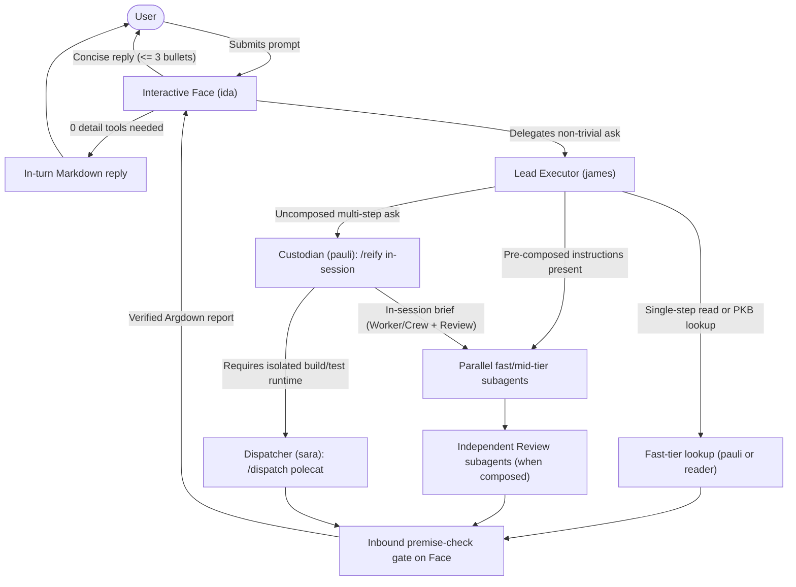

# In-session workflow assembly and execution

Synchronous interactive sessions need a direct route from a user's multi-step ask to a workflow composed from the three-tier template library (`Project > PKB > Universal`) and executed in session on lower-cost subagents without dispatching a polecat container. Today, three gaps block that route: `wf-interactive` invokes `/reify` only when work leaves for worker containers; `/reify` writes persistent task bodies onto pre-placed knowledge-base nodes rather than ephemeral in-session briefs; and `/pull` claims a standalone task and exits via `/dump`, conflicting with `wf-interactive`'s single-outer-task and coordinator-only `/dump` rules. Without an in-session assembly path, agents improvise ad-hoc subagent steps, burn turns browsing template files manually, or over-dispatch polecats while the user waits. Because this document is a `status: draft` design proposal for user decision, it includes assembly-ownership options and a component-change inventory alongside the target contract; upon adoption, the option comparison moves to an Architectural Decision Record under `specs/decisions/`.

## User experience flow

## Capabilities and user stories

### US-1 Synchronous multi-step execution from composed templates

As a user working interactively, I want multi-step requests that fit inside the current session to be assembled from my active three-tier workflow templates and run across low-cost subagents while I wait, so that I get workflow-governed results without polecat startup delay or ad-hoc agent improvisation.

- **AC-1.1** Given an interactive multi-step request whose tools and runtime fit within the session, when the lead executor receives the uncomposed brief, then the custodian resolves matching templates across `Project > PKB > Universal` tiers via `/reify` (`in-session` mode) and returns numbered execution stages, frozen acceptance criteria, warranted review lenses, and template sources before worker subagents execute.
- **AC-1.2** Given an in-session brief whose composed plan includes a `Review:` template, when worker subagents finish execution, then the lead executor dispatches independent reviewer subagents on the output before returning one consolidated prose Argdown report across the interactive face's inbound `premise-check` gate.

### US-2 Minimal interactive startup context and zero-ceremony lookups

As a user in a live conversation, I want the interactive face to start with minimal tool and prompt overhead and to answer conversational turns or single-step lookups without task or composition ceremony, so that turn latency stays low across long threads.

- **AC-2.1** Given a general interactive session starting on the face agent (`ida`), when `SessionStart` hooks execute and agent tools load, then zero `crew` `SessionStart` context is injected into the face agent's context and the face exposes only subagent delegation, user channel/question, todo, and verdict-recording tools.
- **AC-2.2** Given a single-step lookup (a knowledge-base query, overlap check, or bounded read-only file/web check), when delegated in session, then it executes via the lookup bypass on a fast-tier subagent without invoking `/q`, `/reify`, `/pull`, or `/dump` and creates zero task records.

### US-3 Portable execution across interactive, crew, and polecat surfaces

As a researcher running work across interactive chats, crew containers, and polecats, I want the lead executor to bypass workflow assembly whenever instructions are already composed or no knowledge base is reachable, so that one executor definition works across privileged sessions and isolated containers without failure.

- **AC-3.1** Given a task or prompt that already carries composed `## Instructions` and `## Appendix: Sources` (including every polecat prompt), when execution begins, then the executor runs the supplied steps directly without querying the knowledge base or invoking `/reify`.
- **AC-3.2** Given an interactive ask whose composed templates require long-running test/build suites, isolated branch execution, or capabilities absent in session while `sara` is installed, when `/reify` evaluates the resolved templates, then the custodian writes a persistent `Worker:` task body via `/q` and `/reify` and hands the task ID to `/dispatch` rather than blocking the interactive turn.

## Shared interface contract

### End-to-end in-session execution route

1. **Intake triage at the interactive face (`ida`)**: Using conversation state and turn-0 snippet hydration (`specs/agents/prompt-hydration.md`), the face handles zero-tool conversational replies directly and delegates detail asks in one unfenced prose Argdown brief (`**Original Ask**`, `Goal`, user constraints, and open outer-task ID if any; whether pure `wf-lookup` queries may shortcut directly to `pauli` is Open Question 1).
2. **Entry routing at the lead executor (`james`)**:
   - **Pre-composed bypass**: Prompts carrying `## Instructions` and `## Appendix: Sources` execute directly without workflow lookup.
   - **Single-step lookup bypass**: Single-step knowledge-base queries/writes route to `pauli` (`wf-lookup`); single-step file or web reads route to one `fast`-tier generic subagent.
   - **Multi-step assembly**: Uncomposed multi-step asks go to `pauli` on Turn 1 (in parallel with any independent read-only reconnaissance) for `/reify` (`target: in-session`).
3. **In-session `/reify` brief schema (`pauli` -> `james`)**: Using `hydrate` (`workflows` mode) and universal template enumeration under `Project > PKB > Universal` shadowing, `pauli` returns an Argdown brief containing:
   - `Execution mode`: `in-session` (or `dispatch`, after writing a persistent `Worker:` task via `/q` + `/reify` when polecat isolation is required).
   - `Outer task`: existing task ID, newly placed `/q` outer task ID (`assignee: ida`) when outer-task tracking applies (see Open Question 2), or `none`.
   - `Acceptance`: frozen testable checklist derived from the user ask.
   - `Execution stages`: outcome-level steps composed from `Worker:` and `Crew:` templates, omitting unrequested branch, pull-request, or release steps.
   - `Review lenses`: separate `Review:` templates (`wf-rbg`, `wf-fact-check`, `wf-qa`, `wf-dialectical-review`) warranted by stakes and artifact type (see Open Question 5), or `none`.
   - `Appendix: Sources`: resolved template slugs and tiers.
4. **Subagent fan-out, separated review, and inbound gate**: `james` dispatches parallel `fast`-tier subagents for bounded reads/edits (`mid-tier`/`flagship` for ambiguous judgment), runs any composed `Review:` stage on separate specialist subagents (`pauli`, `marsha`) after workers finish, verifies every child return via `premise-check`, and sends one consolidated Argdown report to `ida`. `ida`'s inbound `hearsay_gate` holds the boundary until `ida` records `verdict.py` confirming workflow provenance and criterion coverage, then replies in `<= 3` bullets (`wf-interactive` `/dump` runs only when closing an outer topic task).

### Behaviour across surfaces

| Dimension | Interactive session | Crew container (including cloud sessions) | Polecat container |
| - | - | - | - |
| **Plugins & PKB** | `ida`, `crew`, `sara` (optional), `tools`; live PKB MCP; zero `crew` `SessionStart` text in `ida`. | `ida`, `crew`, `sara`, `tools`; live PKB MCP, repository bot token, OTel telemetry. | Target: zero plugins and zero PKB MCP (`specs/polecat/polecat-system.md`). |
| **Entry & assembly** | `ida` triages -> `james` -> `pauli` runs `/reify` (`in-session` or `dispatch`). | Uncomposed prompt: `ida` -> `james` -> `pauli` `/reify`. Claimed task (`/pull`): `/reify` runs on task body only if `## Instructions` absent (see Open Question 3). | Zero in-container assembly; `pauli` ran `/reify` (`Worker:` templates only) before `/dispatch`. Transitional images hit `james`'s pre-composed bypass. |
| **Execution & review** | `james` fans out `fast` generic subagents, then runs composed `Review:` subagents in session. | Same `james` fan-out and separated `Review:` subagent pass in session. | Single worker executes `Worker:` instructions in its isolated clone; review runs in a separate post-reap process. |
| **Task & handover** | Zero child tasks; at most one outer task (`assignee: ida`); `ida` closes via `/dump` at topic end. | Standalone `/pull` tasks close via `/dump` (`pkb_release_task`) on completion; interactive crew sessions follow `wf-interactive`. | Runs no `/q`, `/reify`, `/pull`, or `/dump`; polecat service reaps container, verifies branch push, and writes task output to PKB. |

## Assembly ownership options and recommendation

| Option | Startup context | Polecat compatibility | Check reliability | User latency |
| - | - | - | - | - |
| **1. `ida` assembles** | Fails (needs `pkb_*`/read tools + bloats main context) | High | Medium | Fast Turn 1; degrades thread |
| **2. `sub-ida` assembles** | Minimal on `ida` | High | High (double `ida` gate) | Worst (6--8 serial turns) |
| **3. `james` assembles** | Minimal on `ida` | Breaks without PKB/bypass | Weakest (self-selected bar) | Medium (manual file search) |
| **4a. Split (`ida -> pauli -> ida -> james`)** | Minimal startup; bloats transcript | High | High | Slow (2 root wakeups + gates) |
| **4b. Split (`ida -> james -> pauli`)** | Minimal startup & transcript | High (via bypass) | High (`pauli` + `ida` gate) | Fast (1 root hop + parallel) |

- **Option 1 (`ida` assembles)**: Giving the interactive face direct template-resolution duties requires `pkb_*` MCP and file-read tools on `ida`, injects workflow instructions at startup, dumps raw template text into the root conversation transcript, and makes `plugins/ida` read `plugins/crew/skills/workflow-library/`, violating both the startup-context ceiling and cross-plugin file isolation.
- **Option 2 (`sub-ida` assembles)**: Spawning an organiser `sub-ida` twin preserves Face `ida`'s lean context and adds a second `premise-check` boundary gate, but `plugins/ida` still cannot own `plugins/crew` templates or PKB curation (`pauli` must still be called), duplicating `james`'s coordinator role and forcing `ida -> sub-ida -> pauli -> sub-ida -> james -> sub-ida -> ida` serial hops while the user waits.
- **Option 3 (`james` assembles directly)**: Having `james` read universal files and query the PKB itself keeps `ida` lean, but breaks inside PKB-less polecats unless guarded, encroaches on `pauli`'s exclusive workflow-selection authority (`plugins/crew/agents/pauli.md`), wastes turns browsing files without `hydrate`, and lets the executor pick its own review bar without independent custodian composition.
- **Option 4a (Split: `ida` calls `pauli`, then briefs `james`)**: Respects `pauli`'s ownership, but forces Face `ida`'s root model to wake twice, run `verdict.py` twice, and copy full composed instructions into main-thread history on every multi-step turn.
- **Option 4b -- Recommended (`ida` triages & checks -> `james` routes -> `pauli` composes via `/reify` `in-session`)**: Face `ida` stays strictly tool-limited with zero `crew` startup context and checks `james`'s final return across `hearsay_gate`; `james` keeps a pre-composed bypass (preserving polecat compatibility) and 1-hop lookup bypass; `pauli` owns three-tier resolution inside `plugins/crew` via `/reify` (`target: in-session`) in parallel with initial read-only recon, pairing `Worker:`/`Crew:` stages with independent `Review:` lenses; and `james` quotes `pauli`'s `verdict-<id>` and `Appendix: Sources` so Face `ida` verifies workflow provenance on the record in a single root round-trip.

## Affected templates, skills, and instructions

Aligned with the post-PR #3771 25-template role-labelled library (`Worker:`, `Crew:`, `Review:`, `Planning:` -- dependent on PR #3771 merging):

- **New universal templates or skills**: **None (`0`)**. Extending `/reify` avoids a duplicate `/assemble` skill or wrapper template. (In the project PKB tier, retire or update the stale supervised-delegation template referencing the removed `agy` skill.)
- **`reify` (`plugins/crew/skills/reify/SKILL.md`) -- changes**: Add `target: in-session` alongside `target: task` so `pauli` composes `Worker:`/`Crew:` execution stages, frozen acceptance criteria, and warranted `Review:` lenses into an ephemeral Argdown brief (or escalates to persistent `Worker:` task reification for `/dispatch`).
- **`wf-interactive` (`plugins/crew/skills/workflow-library/workflows/wf-interactive.md`) -- changes**: Require multi-step in-session work to compose stages via `pauli` (`/reify` `in-session`) rather than invoking `/reify` only for container dispatch, and align outer-task placement (`pauli` places via `/q` when needed; `ida` triggers `/dump` at topic closure).
- **`wf-lookup` (`plugins/crew/skills/workflow-library/workflows/wf-lookup.md`), `q` (`plugins/crew/skills/q/SKILL.md`), and `decompose` (`plugins/crew/skills/decompose/SKILL.md`) -- stay unchanged**: `wf-lookup` keeps zero-ceremony custodian lookups; `q` and `decompose` keep graph placement and meso-altitude objective expansion.
- **`workflow-library` (`plugins/crew/skills/workflow-library/SKILL.md`) and `pull` (`plugins/crew/skills/pull/SKILL.md`) -- stay (1-line boundary alignments)**: Broaden `workflow-library`'s `/reify` pointer from `"onto tasks"` to `"onto tasks or in-session briefs"`; note in `pull` that interactive delegates under `wf-interactive` execute `in-session` briefs without running `/pull` or `/dump`.
- **`supervise` (retired) and `plugins/crew/agents/james.md` -- `supervise` stays retired; `james.md` changes**: Keep `/supervise` retired. Update `james.md` (`Supervision & intake`) with the three-branch entry rule (pre-composed bypass, lookup bypass, `pauli` `/reify` `in-session` assembly + separated `Review:` subagent pass). Outside this repository, update the container entrypoint script that still passes `/ida:supervise` on `agy` task launches.
- **`plugins/ida/agents/ida.md`, `plugins/crew/agents/pauli.md`, `plugins/crew/hooks/handlers.py`, and `specs/agents/face-ida-triage-and-tracked-requests.md` -- change**: Add explicit minimal `tools:` frontmatter and 3-way triage to `ida.md`; note `in-session` `/reify` on `pauli.md`; suppress `crew/CORE.md` `SessionStart` injection on top-level `ida` sessions; and supersede `sub-ida` binary triage and reconcile the outer-task creator discrepancy in `face-ida-triage-and-tracked-requests.md`.

## Invariants and security boundaries

- **Runtime composition and cross-plugin isolation**: No instruction or spec hardcodes fixed `wf-*` chains for user asks; `pauli` selects templates at run time from descriptions and `Project > PKB > Universal` shadowing inside `plugins/crew`. `plugins/ida` never reads `plugins/crew` or `plugins/sara` files, and `SessionStart` routing relies solely on `lib/hooks/` context.
- **Least-privilege and boundary gates**: Face `ida` holds no direct `pkb_*` or repository mutation tools; polecat containers receive no PKB credentials or framework plugins and execute `Worker:` instructions with zero privileged push-to-protected-branch, PR-merge, publish, or external-send authority; inbound subagent returns cross `hearsay_gate` (`premise-check`) with `session_id`-scoped `verdict.py` verification before reaching the user.

## Open questions

1. **Direct lookup shortcut vs. single delegate**: Should `ida` keep `james` as its sole subagent delegate for every non-conversational turn (`ida -> james -> pauli`), or may `ida` dispatch `pauli` directly on pure `wf-lookup` PKB queries to save one subagent hop?
2. **Outer-task threshold on multi-step read-only work**: Should multi-step in-session synthesis and audits that mutate zero repository or PKB state run task-free (leaving OTel traces and transcript evidence only), reserving the single `/q` outer task strictly for mutating interactive topics, or should every multi-step `in-session` `/reify` run place an outer task?
3. **Crew container top-level wrapper**: When a crew container is launched autonomously on a queued task ID rather than a free-form prompt, should the entrypoint still place one `ida` layer above `james` so `hearsay_gate` checks `james`'s final report before `/dump`, or run `james` (`/pull`) at top level?
4. **Mechanism for suppressing `crew` context in general sessions**: Should `crew`'s `SessionStart` handler inspect the active root agent and omit `crew/CORE.md` when starting as `ida` (keeping `crew` OTel tracing active), or should `crew/CORE.md` move into `crew` agent bodies (`james`, `pauli`, `marsha`) and drop out of `SessionStart`?
5. **Default review bar for small defeasible interactive edits**: After PR #3771 removes review steps from `Worker:` templates, should `pauli` omit `Review:` lenses by default on small, easily reversible in-session edits unless the ask touches governance/axioms/hooks or audience-facing deliverables, or attach `wf-rbg` / `verify` to every mutating interactive run?
6. **Sequencing with PR #3771 and PKB shadowing cleanup**: Should implementation wait for PR #3771 (`Worker:` / `Crew:` / `Review:` / `Planning:` prefixes) to merge first and bundle cleanup of un-scoped PKB templates that currently shadow slimmed universal templates?
